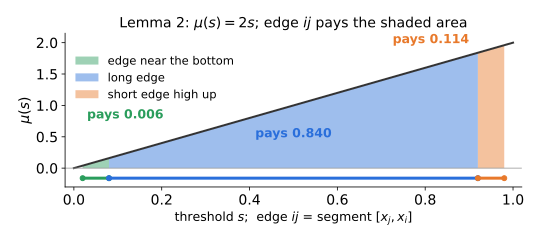
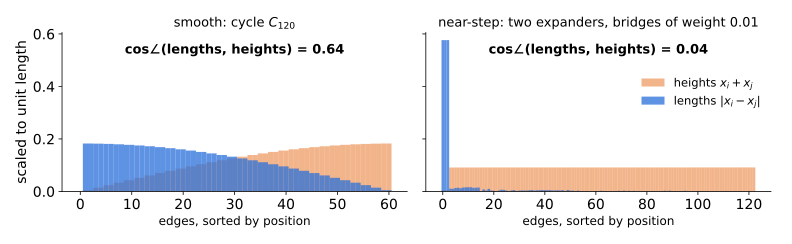
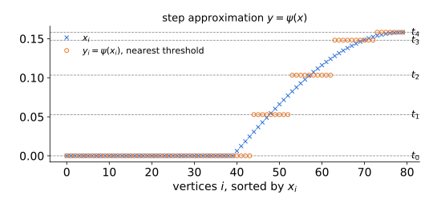
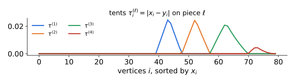
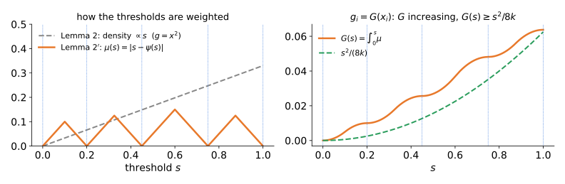
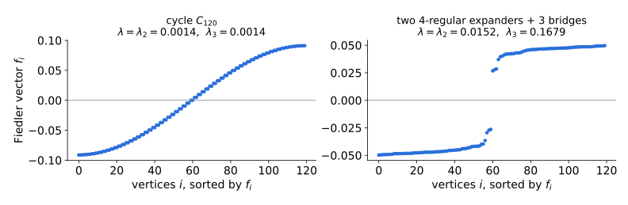
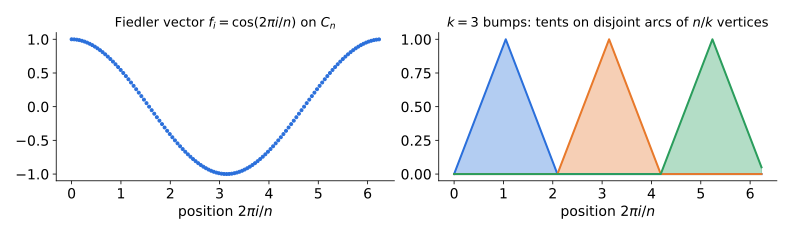

## Recap: Lecture 6

$G=(V,E,w)$, $\ d_i=\sum_j w_{ij}$ 
$L_{rw}=I-D^{-1}A$ with eigenvalues $0=\lambda_1\le\lambda_2\le\dots\le\lambda_n\le 2$, $\ \lambda:=\lambda_2$.

$$\Phi(S)=\frac{w(S,\bar S)}{\min\{\mathrm{vol}(S),\mathrm{vol}(\bar S)\}},\qquad \Phi(G)=\min_S\Phi(S),$$

::: {.thm}
**Cheeger.** $\ \tfrac12\lambda \le \Phi(G) \le \sqrt{2\lambda}$, and the best **sweep set** $S^\star$ of the Fiedler vector $f$ has $\Phi(S^\star)\le\sqrt{2\lambda}$.
:::

::: {.warn}
**Proof:** Lemma 3 (median shift) $\to$ Lemma 2 (square, $\ell_2^2\to\ell_1$) $\to$ Lemma 1 (sweep).
:::

::: {.idea}
**Improvement**: Replace Lemma 2 by a better, __adaptive__ $\ell_2^2\to\ell_1$ map.
:::

::: notes
~3 min. Only the pieces we reuse today. Today's proof keeps Lemmas 1 and 3 and replaces Lemma 2 by a better ℓ2² → ℓ1 map, tailored to the eigenvector.
:::

## Today

- Both sides of Cheeger are tight, but on *different* graphs (hypercube vs. cycle).
- In practice, the sweep cut is far better than the $\sqrt{\lambda}$ guarantee.

::: {.idea}
**Today.** The $\sqrt{\cdot}$ loss only happens when the Fiedler vector is *smooth*, and smooth eigenvectors force $\lambda_k$ to be small. With a gap $\lambda_k\gg\lambda$, the **same** algorithm does much better:
$$\Phi(S^\star) \;\le\; O(k)\,\frac{\lambda}{\sqrt{\lambda_k}}.$$
:::

**Plan:** statement & intuition · full proof  · tightness, demo, consequences

::: notes
Frame the lecture as: "Cheeger is tight, so how can it be improved?" Answer: it is tight only for a specific kind of graph; we add a second spectral parameter that detects that kind of graph.
:::

## The worst case: the cycle

For $C_n$: $\ \lambda = 1-\cos(2\pi/n) \approx 2\pi^2/n^2$, $\quad \Phi(C_n) = 2/n$.

- Upper bound **tight**: $\Phi(C_n) = \Theta(\sqrt{\lambda})$. Lower bound **off by $\Theta(n)$**: $\lambda/2 = \Theta(1/n^2)$. (On the hypercube it is the other way round.)
- So Cheeger only guarantees $\Phi(S^\star)/\Phi(G)\le\sqrt{2\lambda}/(\lambda/2)=\sqrt{8/\lambda}=\Theta(n)$ here, even though the sweep finds an optimal cut on $C_n$.

No improvement of Cheeger is possible **as a function of $\lambda$ alone.**

::: {.idea}
**Question.** Join two expanders on $n/2$ vertices by edges of total weight $1/n$. Then $\lambda=\Theta(1/n^2)$, as for the cycle, but also $\Phi(G)=\Theta(1/n^2)$: the *lower* bound is tight and the sweep is near-optimal. What distinguishes the two graphs?

**Answer (KLLOT): the rest of the spectrum.** For the cycle, $\lambda_3=\lambda_2$ and $\lambda_k = \Theta(k^2/n^2)$ grows slowly.
:::

::: notes
The ratio √(8/λ) compares against the lower bound λ/2, the only bound on Φ(G) we can compute; it was already on the Lecture 6 algorithm slide. On the cycle it is large because λ/2 is loose, not because the sweep is bad. For the two-expander example: Φ(A) = (1/n)/vol(A) ≈ 1/(d n²) and λ ≈ 2Φ(A), while λ3 stays Θ(1) (numerically, for two 4-regular expanders with n = 100: λ ≈ 1.0e-4, Φ(A) = 5.0e-5, λ3 ≈ 0.15; the cycle C_100 has λ ≈ 2.0e-3 but Φ = 2.0e-2). Real bad examples for spectral partitioning do exist (Guattery–Miller 1998), so the analysis must use some structural parameter of the graph. The paper's choice is λ_k.
:::

## Main theorem

::: {.thm}
**Theorem (KLLOT '13).** For every graph $G$ and every $k\ge 2$,
$$\Phi(G) \;\le\; \Phi(S^\star) \;\le\; 12\sqrt2\; k\,\frac{\lambda}{\sqrt{\lambda_k}}.$$
:::

- **Same algorithm.** Nothing changes except the analysis. The sweep never looks at $\lambda_k$, so the bound holds **for the best $k$ at once**: $\ \Phi(S^\star)\le \min_k O(k)\,\lambda/\sqrt{\lambda_k}$.
- **Approximation:** $\displaystyle \frac{\Phi(S^\star)}{\Phi(G)} \le \frac{\Phi(S^\star)}{\lambda/2} = O\!\left(\frac{k}{\sqrt{\lambda_k}}\right)$ vs $\sqrt{8/\lambda}$ from Cheeger.
- If $\lambda_3 = \Omega(1)$, spectral partitioning is a **constant-factor approximation** for conductance, in nearly-linear time.
- This partly explains the eigengap heuristic: few "outstanding" clusters ⇒ $\lambda_k$ large for small $k$.

::: notes
The constant 12√2 comes from the first proof; the paper remarks it can be sharpened to 10√2. Don't dwell on constants.
:::

## Sanity checks

1. **$k=2$:** $\ k\lambda/\sqrt{\lambda_2} = 2\sqrt{\lambda}$, which is Cheeger up to constants.
2. **When does it beat Cheeger?** $\ k\lambda/\sqrt{\lambda_k} \ll \sqrt{\lambda} \iff \lambda_k \gg k^2\lambda$.
   The spectrum has to grow **faster than quadratically** in $k$.
3. **The cycle sits exactly on the boundary:** $\lambda_k = \Theta(k^2/n^2) = \Theta(k^2\lambda)$, so
$$k\,\frac{\lambda}{\sqrt{\lambda_k}} = \Theta\!\left(k\cdot\frac{1}{n^2}\cdot\frac{n}{k}\right)=\Theta\!\left(\frac1n\right) = \Theta(\Phi(C_n)) \quad\text{for every } k.$$
   The theorem is **tight for every $k$**, so the factor $k$ cannot be removed.

::: {.fragment}
::: {.idea}
Contrapositive reading: if Cheeger is tight ($\Phi \approx \sqrt{\lambda}$), then $\lambda_k \lesssim k^2 \lambda$ for **all** $k$. Graphs on which Cheeger is tight have "cycle-like" spectra.
:::
:::

## Context: why should $\lambda_k$ matter?

**Higher-order Cheeger** (previewed in Lecture 6; Lee–Oveis Gharan–Trevisan '12, Louis–Raghavendra–Tetali–Vempala '12):
$$\rho_k(G) := \min_{S_1,\dots,S_k \text{ disjoint}}\ \max_\ell \Phi(S_\ell), \qquad \frac{\lambda_k}{2}\le \rho_k(G) \le O(k^2)\sqrt{\lambda_k}.$$

- $\lambda_k$ is small $\iff$ there are $k$ **disjoint** sparse sets.
- $\lambda$ small, $\lambda_3$ large $\Rightarrow$ the graph looks like **two expanders joined by a sparse cut**.
- Today we only need the **easy direction** (Lemma B): $k$ disjointly supported vectors with small $R_2$ force $\lambda_k$ to be small.

::: notes
Not assumed known; just state it for context. The only piece we use is the "disjoint supports ⇒ λ_k small" lemma, which we prove on the next slide.
:::

# Proof Ideas 

::: {.thm}
**Theorem (KLLOT '13).** For every graph $G$ and every $k\ge 2$,
$$\Phi(G) \;\le\; \Phi(S^\star) \;\le\; 12\sqrt2\; k\,\frac{\lambda}{\sqrt{\lambda_k}}.$$
:::

**Notation**: Let: 
$$R_2(x)=\dfrac{\sum_Ew_{ij}(x_i-x_j)^2}{\sum_id_ix_i^2} \textrm{ and } R_1(x)=\dfrac{\sum_Ew_{ij}|x_i-x_j|}{\sum_id_i|x_i|} \text{ (\textbf{uncentered})}$$

Write $\;N(x)=\sum_{ij\in E}w_{ij}(x_i-x_j)^2\;$ and $\;D(x)=\sum_i d_ix_i^2$.

Let $f$ be the Fiedler vector: $f\perp_d\mathbf 1$ and $R_2(f)=\lambda$.

## A new look at Lemma 2 in Cheeger's original proof

The original proof had 3 steps.

1) **Median-Shift** (Lemma 3, Lecture 6): median-shift $f$, keep the better half, rescale: $x\ge0$ with $\pi(\mathrm{supp}\,x)\le\tfrac12$, $R_2(x)\le\lambda$, $D(x)=1$. Its sweep sets are sweep sets of $\pm f$, so $\Phi(S^\star)\le\Phi_{\rm sw}(x) := \min_{t\ge0}\Phi(\{x_i>t\})$.

2) $\mathbf{\ell_2^2 \to \ell_1}$ (Lemma 2, Lecture 6): for $x\ge0$ with $\pi(\mathrm{supp}\,x)\le\frac12$, let $g_i = x_i^2$. Then $R_1(g) \le \sqrt{2R_2(x)}$.

3) **Sweep Rounding on Cut Cone** (Lemma 1, Lecture 6): for $g\ge0$ with $\pi(\mathrm{supp}\,g)\le\frac12$, some sweep set of $g$ has $\Phi\le R_1(g)$.

For improving Cheeger's inequality, we focus on strengthening the $\ell_2^2 \to \ell_1$ step by choosing a more general transformation $g_i = G(x_i)$ rather than just $x_i^2$. Moreover, our choice of final choice of $g$ will depend on the specific structure of $x$.

::: {.idea}
Take $g_i = G(x_i)$ with $G$ increasing, $G(0)=0$, and density $\mu=G'$. Then $g$ has the **same sweep sets** as $x$, and by the sweep-cut identities with $S_s=\{i:x_i>s\}$:
$$R_1(g) = \dfrac{\sum_Ew_{ij}|g_i-g_j|}{\sum_id_i|g_i|} =  \frac{\int_0^\infty \mu(s)\,w(S_s,\bar S_s)\,ds}{\int_0^\infty \mu(s)\,\mathrm{vol}(S_s)\,ds}.$$
Choosing $g$ means choosing **how to weight the thresholds**.
:::

::: notes
Improve the equation in the idea when improving lecture 6.
:::

## Lemma 2, revisited: what each edge pays

Let $g_i = G(x_i)$ with density $\mu = G'$, and $\bar\mu_{ij}$ := the average of $\mu$ over $[x_j,x_i]$. 
$$|g_i-g_j| = \int_{x_j}^{x_i}\mu(s)\,ds = \underbrace{|x_i-x_j|}_{\text{length}}\cdot\,\bar\mu_{ij}, \qquad \sum_i d_i g_i = \sum_i d_i\!\int_0^{x_i}\!\mu(s)\,ds.$$
Each **edge** is charged the density **where it sits**; each **vertex** is credited the density **below it**.

{.nostretch width="70%"}

**Lemma 2** takes $\mu(s)=2s$, so $\bar\mu_{ij} = x_i+x_j$: the edge's **height**. Cauchy–Schwarz:
$$
\sum_{ij\in E} w_{ij}\,|g_i-g_j|\, 
\le \sum_{ij\in E} w_{ij}\,|x_i-x_j|\,\bar\mu_{ij}\\
 \le \sqrt{N(x)}\,\sqrt{\textstyle\sum_{E} w_{ij}\,\bar\mu_{ij}^2} \le \sqrt{N(x)}\,\sqrt{2D(x)}\
$$
Dividing by $D(x)$, we have $R_1(x^2)\le\sqrt{2R_2(x)}$.

::: {.warn}
**The loss.** Cauchy–Schwarz is tight only if $\bar\mu_{ij}\propto|x_i-x_j|$ on every edge: a **short edge sitting high up** pays far more than its length.
:::

::: notes
~4 min. The identity |g_i − g_j| = length × average density is the whole point; "height" is just the name for the average density when μ(s) = 2s, because the average of 2s over [x_j, x_i] is x_i + x_j. The figure shows it: each edge is the segment [x_j, x_i] under the axis and pays the shaded area. The two short edges have the same length, but the one high up pays 0.114, almost 20 times the one near the bottom (0.006).
:::

## When is Lemma 2 tight, when is it loose

::: {.defn}
**Def.** $y\in\mathbb R^V$ is an **$h$-step vector** if it takes at most $h$ distinct values $t_1<\dots<t_h$ (the **steps**).
:::

In the Cauchy–Schwarz step of Lemma 2, lengths $|x_i-x_j|$ are paired with heights $\bar\mu_{ij}=x_i+x_j$.

{.nostretch width="100%"}

::: {.tip}
**Tight** (up to constants) when lengths $|x_i-x_j|$ are roughly proportional to heights on most edges: **smooth** vectors, like the cosine on the cycle.
:::

::: {.tip}
**Loose** when $x$ is close to an $h$-step vector: an edge **inside a step** has length $\approx0$ but height $\approx 2t_\ell$, a **short edge sitting high up**.
:::

::: notes
~3 min. Cauchy–Schwarz is an equality only when the two vectors (lengths and heights, weighted by w) are parallel. For a smooth vector like cos on the cycle they are comparable across the bulk of the edges, and Cheeger is tight there. For an exact h-step vector, edges inside a step have length 0 and pay nothing, but their heights still enter Σ w μ̄², which is what the bound 2D(x) controls; that slack is the √ loss. The figure plots both lists (each multiplied by √w and scaled to unit length) for the vector x from Lemma 3; Cauchy–Schwarz is tight exactly when the two bar profiles coincide. Their cosine is the exact efficiency of Lemma 2: R_1(x²) = cos∠ · √(2R_2(x)) · √(1 − R_2(x)/2). Cycle: cos∠ = 2/π ≈ 0.64 (lengths ∝ |sin|, heights ∝ cos). Two expanders with bridge weight ε: cos∠ ≈ 0.43√ε → 0, since the length is all on the three bridges and the height is spread over the edges inside the cluster.
:::

## Proof Idea and Roadmap

**Goal:** $R_1(g) \le 12\sqrt2\,k\,R_2(x)/\sqrt{\lambda_k}$ for a suitable $g=G(x)$, with $x\ge0$ and $R_2(x)\le\lambda$.

{.nostretch width="100%"}

::: {.tip}
**Tight Case** (smooth vector $x$): Show that $\lambda_k$ is small by constructing $k$ independent test vectors $z^{(1)},\dots,z^{(k)}$ with small Rayleigh quotients $R_2(z^{(\ell)})$.
:::

::: {.tip}
**Loose Case** (vector $x$ close to an $O(k)$-step vector): improve Lemma 2 by focusing on edges **between steps**, which contribute significantly to the Rayleigh quotient, while edges **inside steps** contribute very little.
:::

| Step | Statement | Source |
|:--|:--|:--|
| **Lemma B** | Disjoint supports: $\lambda_k \le 2\max_\ell R_2(z^{(\ell)})$ | intro (Courant–Fischer) |
| **Lemma 3.1** | $\exists$ $(2k{+}1)$-step $y$ with $D(x-y) \le 4R_2(x)/\lambda_k$ | uses B |
| **Lemma 2′** | for a suitable $g$: $\ R_1(g)\le 4kR_2(x) + 4\sqrt2\,k\sqrt{D(x-y)\,R_2(x)}$ | replaces Lemma 2 |

Recall $R_2=N/D$; throughout, $D(x)=1$.

::: notes
Lemma 3.1 is a structural statement about x: a spectral gap makes x nearly a step vector. Lemma 2′ (the paper's Prop 3.2) is the new rounding step: for a near-step vector, the ℓ2² → ℓ1 map loses only linearly. Paper numbering is kept for 3.1 so students can follow along in the paper.
:::

# Full Proofs

## Lemma B: Breaking $x$ into $k$ disjoint parts to bound $\lambda_k$

::: {.thm}
**Lemma B (KLLOT Lemma 2.3).** If $z^{(1)},\dots,z^{(k)}\neq0$ have pairwise disjoint supports, then $\ \lambda_k\le 2\max_\ell R_2(z^{(\ell)})$.
:::

::: {.pf}
**Courant–Fischer:** 
$$\lambda_k = \min_{\dim U=k}\; \max_{z\in U\setminus0}R_2(z)$$

Disjoint supports make the $z^{(\ell)}$ independent: take $U=\mathrm{span}\{z^{(\ell)}\}$ and 
$$z=\sum_\ell c_\ell z^{(\ell)} \textrm{ with } \vec{c} \neq 0.$$

- **Denominator** (disjoint supports): $\ \sum_i d_iz_i^2=\sum_\ell c_\ell^2\sum_i d_i\big(z^{(\ell)}_i\big)^2$.
- **Numerator:** each edge meets at most two supports.  
If $i\in\mathrm{supp}\,z^{(\ell)}$ and $j\in\mathrm{supp}\,z^{(m)}$,
$$\begin{aligned}(z_i-z_j)^2&=\big(c_\ell z^{(\ell)}_i-c_mz^{(m)}_j\big)^2\\
&\le 2c_\ell^2\big(z^{(\ell)}_i-z^{(\ell)}_j\big)^2+2c_m^2\big(z^{(m)}_i-z^{(m)}_j\big)^2,\end{aligned}
$$
so $\ \sum_{ij\in E}w_{ij}(z_i-z_j)^2\le2\sum_\ell c_\ell^2\sum_{ij\in E}w_{ij}\big(z^{(\ell)}_i-z^{(\ell)}_j\big)^2$.

A ratio of sums is at most the largest ratio: $\ R_2(z)\le2\max_\ell R_2(z^{(\ell)})$. $\square$
:::

::: notes
~4 min. Courant–Fischer for L_rw: L_rw is self-adjoint in L²(π), so the minimax characterization applies with the uncentered Rayleigh quotient R_2 (constants are allowed in U). The displayed inequality is (a+b)² ≤ 2a² + 2b², using z^(ℓ)_j = z^(m)_i = 0; edges inside one support give equality with factor 1, and edges with only one endpoint in a support are covered too. Used twice: for the bumps on the cycle (Intuition II) and for the tents in Lemma 3.1. Remark: with indicators z^(ℓ) = 1_{S_ℓ} of disjoint sets, R_2(1_S) = w(S,S̄)/vol(S) ≤ Φ(S), so λ_k ≤ 2ρ_k(G), the easy side of higher-order Cheeger from the previous slide.
:::

## Lemma 3.1: smooth vs step-like dichotomy

Lemma 3.1 encapsulates the dichotomy between smooth and step-like vectors. Either $x$ is close to a $(2k{+}1)$-step vector, or $\lambda_k$ is small.

**Def.** Thresholds $0=t_0\le t_1\le\dots\le t_m$; $\ \psi(s)$ := the threshold **nearest** to $s$; $\ y_i := \psi(x_i)$. ($(m{+}1)$-step approximation.)

::: {.lem}
**Lemma 3.1.** There is a $(2k{+}1)$-step approximation $y$ of $x$ with
$$D(x-y) \;\le\; \frac{4\,R_2(x)}{\lambda_k}.$$
:::

{.nostretch width="58%"}

If $\lambda_k \gg R_2(x)$, then $x$ is essentially a step vector with at most $2k{+}1$ levels.

## Proof of Lemma 3.1: greedy thresholds

Budget $C := \dfrac{2R_2(x)}{k\lambda_k}$, $\ M := \max_i x_i$, $\ t_0 := 0$. For $\ell = 1,\dots,2k$:

- let $t_\ell \ge t_{\ell-1}$ be the **smallest** value with **piece mass**
$$m_\ell := \sum_{i:\ t_{\ell-1}\le x_i\le t_\ell} d_i\,\big|x_i-\psi_{t_{\ell-1},t_\ell}(x_i)\big|^2 = C;$$
- if no such $t_\ell \le M$ exists, set $t_\ell := M$.

($m_\ell$ is continuous and nondecreasing in $t_\ell$, starting at $0$.)

::: {.lem}
**Success** ($t_{2k}=M$): $\ D(x-y) = \sum_\ell m_\ell \le 2k\,C = 4R_2(x)/\lambda_k$. $\checkmark$
:::

::: {.warn}
**Failure** ($t_{2k}<M$): all $2k$ pieces have mass **exactly** $C$. We show this contradicts Lemma B.
:::

## Failure is impossible

**Tents:** $\tau^{(\ell)}_i := |x_i-y_i|$ if $x_i\in[t_{\ell-1},t_\ell]$, else $0$. These are disjointly supported, with $D(\tau^{(\ell)}) = C$.

{.nostretch width="48%"}

::: {.lem}
**Claim.** For every edge: $\ \sum_\ell \big(\tau^{(\ell)}_i-\tau^{(\ell)}_j\big)^2 \le (x_i-x_j)^2$.
:::

- *Same piece:* each $\tau^{(\ell)}$ is 1-Lipschitz as a function of $x$.
- *Different pieces* $\ell<m$: $x_i\le t_\ell\le x_j$, so $\big(\tau^{(\ell)}_i\big)^2+\big(\tau^{(m)}_j\big)^2 \le (t_\ell-x_i)^2+(x_j-t_\ell)^2 \le (x_j-x_i)^2$.

Summing over edges:
$$\sum_{\ell=1}^{2k}R_2(\tau^{(\ell)}) = \frac{1}{C}\sum_\ell N(\tau^{(\ell)}) \le \frac{N(x)}{C} = \frac{R_2(x)}{C} = \frac{k\lambda_k}{2}.$$
By averaging, **at least $k$** of the $2k$ tents have $R_2(\tau^{(\ell)}) < \lambda_k/2$. Lemma B then gives $\lambda_k \le 2\max_\ell R_2(\tau^{(\ell)}) < \lambda_k$. Contradiction. $\square$

::: notes
Why 2k pieces rather than k: the averaging step throws away half of them. Good place to pause for questions.
:::

## Lemma 2′: rounding a near-step vector

::: {.thm}
**Lemma 2′ (KLLOT Prop 3.2).** For any $(2k{+}1)$-step approximation $y$ of $x$ (with $D(x)=1$), the vector $g$ below satisfies
$$\Phi_{\rm sw}(x) \;\le\; R_1(g) \;\le\; 4k\,R_2(x) \;+\; 4\sqrt2\,k\,\sqrt{D(x-y)\,R_2(x)}.$$
:::

- If $x=y$ exactly: $\Phi_{\rm sw}(x)\le 4kR_2(x)$. The loss is **linear**, with no square root.
- **The new map** (in place of $g=x^2$):
$$g_i := \int_0^{x_i} \mu(s)\,ds, \qquad \mu(s) := |s-\psi(s)|,$$
  the distance from $s$ to the nearest threshold. $g$ is increasing in $x$, so it has the same sweep sets and support.

{.nostretch width="88%"}

## Claim 3.3: the denominator

::: {.lem}
**Claim 3.3.** $\ g_i \ge \dfrac{x_i^2}{8k}\ $ for all $i$. Hence $\ \sum_i d_i\,g_i \ge \dfrac{D(x)}{8k} = \dfrac1{8k}$.
:::

::: {.pf}
Let $x_i\in(t_\ell,t_{\ell+1}]$ with $\ell\le 2k-1$.

- Each **full** step contributes $\int_{t_m}^{t_{m+1}}\mu = \frac14(t_{m+1}-t_m)^2$.
- The **partial** step contributes $\int_{t_\ell}^{x_i}\mu \ge \frac14 (x_i-t_\ell)^2$.
- Cauchy–Schwarz over at most $2k$ segments:
$$\begin{aligned} x_i^2 &= \Big(\textstyle\sum_{m<\ell}(t_{m+1}-t_m) + (x_i-t_\ell)\Big)^2\\ &\le 2k\Big(\textstyle\sum_{m<\ell}(t_{m+1}-t_m)^2+(x_i-t_\ell)^2\Big) \;\le\; 8k\,g_i. \;\square\end{aligned}$$
:::

This is **where the factor $k$ is paid**: a sawtooth density puts less weight on large values than the density $2s$.

## Claim 3.4: the numerator

::: {.lem}
**Claim 3.4.** For every edge $ij$:
$$|g_i-g_j| \;\le\; \tfrac12\,|x_i-x_j|\,\big(a_i + a_j + |x_i-x_j|\big).$$
Here $a_i := |x_i-y_i|$ is the distance from $x_i$ to its step.
:::

::: {.pf}
For $s$ between $x_i$ and $x_j$: $y_i,y_j$ are thresholds, so
$$\begin{aligned}\mu(s) &\le \min\{|s-y_i|,\,|s-y_j|\}\\ &\le \tfrac12\big(|s-x_i|+a_i+|s-x_j|+a_j\big),\end{aligned}$$
and $|s-x_i|+|s-x_j| = |x_i-x_j|$. Integrate over $s$ between $x_i$ and $x_j$. $\square$
:::

::: {.idea}
Compare with Lemma 2, $|x_i^2-x_j^2| = |x_i-x_j|\cdot(x_i+x_j)$: the edge's **height** has been replaced by its **distance to the steps** plus its own length.
:::

## Proof of Lemma 2′

Numerator, by Claim 3.4 and then Cauchy–Schwarz:
$$\begin{aligned}
\sum_{ij\in E} w_{ij}\,|g_i-g_j| &\le \tfrac12N(x) + \tfrac12\sum_{ij\in E} w_{ij}\,|x_i-x_j|\,(a_i+a_j)\\
&\le \tfrac12R_2(x) + \tfrac12\sqrt{N(x)}\,\sqrt{\textstyle\sum_{ij\in E} w_{ij}\,(a_i+a_j)^2}\\
&\le \tfrac12R_2(x) + \tfrac12\sqrt{R_2(x)}\,\sqrt{2D(x-y)},
\end{aligned}$$
using $(a+b)^2\le 2a^2+2b^2$ and $\sum_{ij\in E} w_{ij}(a_i^2+a_j^2) = \sum_i d_ia_i^2 = D(x-y)$.

Denominator $\sum_i d_ig_i\ge 1/(8k)$ (Claim 3.3). So
$$\begin{aligned}R_1(g) &\le 8k\Big(\tfrac12R_2(x) + \tfrac{1}{\sqrt2}\sqrt{R_2(x)\,D(x-y)}\Big)\\ &= 4kR_2(x) + 4\sqrt2\,k\,\sqrt{D(x-y)\,R_2(x)}. \;\square\end{aligned}$$

## Putting it together

Lemma 3 gives $x$; Lemma 3.1 gives $y$ with $D(x-y) \le 4R_2(x)/\lambda_k$. Then by Lemmas 1 and 2′:
$$\begin{aligned}\Phi(S^\star)\le\Phi_{\rm sw}(x)\le R_1(g) &\le 4kR_2(x) + 4\sqrt2\,k\cdot 2\frac{R_2(x)}{\sqrt{\lambda_k}}\\ &= 4kR_2(x) + 8\sqrt2\,k\,\frac{R_2(x)}{\sqrt{\lambda_k}}.\end{aligned}$$
Since $\lambda_k\le 2$, $\ 4kR_2(x)\le 4\sqrt2\,k\,R_2(x)/\sqrt{\lambda_k}$, so
$$\boxed{\ \Phi(S^\star) \le 12\sqrt2\,k\,\frac{R_2(x)}{\sqrt{\lambda_k}} \le 12\sqrt2\,k\,\frac{\lambda}{\sqrt{\lambda_k}}\ } \quad\square$$

::: {.idea}
**Same template as Lecture 6:** Lemma 3 → (new) Lemma 2′ → Lemma 1. The only change is the $\ell_2^2\to\ell_1$ map, designed to fit the structure of $x$, plus one averaging argument (Lemma 3.1) that says when that structure exists.
:::

# Tightness, demo, consequences

## Tightness: the cycle, numerically

$C_n$ has eigenvalues $1-\cos(2\pi j/n)$, so $\lambda_k = 1-\cos\!\big(2\pi\lfloor k/2\rfloor/n\big) = \Theta(k^2/n^2)$.

| $n$ | $n\cdot\Phi(C_n)$ | $k=2$ | $k=3$ | $k=5$ | $k=9$ | $k=17$ |
|:--:|:--:|:--:|:--:|:--:|:--:|:--:|
| 100 | 2 | 8.88 | 13.33 | 11.11 | 10.02 | 9.54 |
| 400 | 2 | 8.89 | 13.33 | 11.11 | 10.00 | 9.45 |
| 1600 | 2 | 8.89 | 13.33 | 11.11 | 10.00 | 9.44 |

Columns $k$: $\ n\cdot k\lambda/\sqrt{\lambda_k}$. Both columns are $\Theta(1)$, so $\Phi(C_n) = \Theta(k\lambda/\sqrt{\lambda_k})$ for every $k$.

- The **bound** cannot be improved beyond constants, for any $k$.
- But on the cycle the sweep finds an *optimal* cut. Tightness of the bound in $\lambda,\lambda_k$ is **not** the same as tightness of the approximation ratio (discussion Q3).

## Demo

<iframe class="demo-frame" src="demos/improved-cheeger-demo.html"></iframe>

Standalone: <a href="demos/improved-cheeger-demo.html" target="_blank">demos/improved-cheeger-demo.html</a>. Try: two expanders, ε → 0 (Cheeger's guarantee blows up, KLLOT's stays flat); three expanders with k = 3 vs. k = 4; cycle (both guarantees grow ∝ n).

::: notes
Things to show live: (1) dumbbell: move ε from 1 down to 0.001; Cheeger's guaranteed ratio grows like 1/√λ, KLLOT's stays constant because λ3 stays ~0.15. (2) three clusters: λ3 is small too, so k=3 doesn't help but k=4 does (look at the KLLOT row as k changes). (3) cycle: both guarantees grow linearly in n, the actual ratio too, consistent with tightness. The Lemma 3.1 panel shows the greedy thresholds and the step approximation y.
:::

## Consequences

- **Constant-factor sparsest cut when $\lambda_k=\Omega(1)$, $k=O(1)$, in nearly-linear time.**
  Compare: subspace enumeration (Arora–Barak–Steurer) and Lasserre (Guruswami–Sinop) get $O(1/\lambda_k)$, but with running times $n^{O(k)}$ and $2^{O(k)}\mathrm{poly}(n)$.
- **"Deterministic planted" instances (Cor 4.16).** $V = A\cup B$ with $\Phi(A)=\Phi(B)=\Phi_{\rm out}$, induced subgraphs of conductance $\ge\Phi_{\rm in}$, min internal degree $d_1$, max crossing degree $d_2$. Then every 3-partition has a set of large conductance, so $\lambda_3$ is large, and the sweep returns
$$\Phi(S^\star) = O\!\Big(\frac{\Phi_{\rm out}}{\Phi_{\rm in}}\cdot\frac{d_1+d_2}{d_1}\Big).$$
  For the 2-block SBM with parameters $p > q$, this is $O(q/p)$.
- **Stability (Cor 4.17).** Every $c$-approximate sparse cut is $\Theta(c\lambda/\lambda_3^{3/2})$-close to the optimum. A gap $\lambda_3\gg\lambda$ means the near-optimal cut is essentially unique.

## Extensions in the paper

- **$k$-way partitioning** (with LOT '12): for $l>k$, $\ \rho_k(G) \le O(l\,k^6)\,\dfrac{\lambda_k}{\sqrt{\lambda_l}}$, plus sharper bounds for $\rho_{(1-\delta)k}$ and for minor-free graphs.
- **Balanced separator:** recursive spectral partitioning finds $S$ with $\mathrm{vol}(S)\in[\frac15,\frac45]\mathrm{vol}(V)$ and $\Phi(S)=O(k\varepsilon/\lambda_k)$, where $\varepsilon$ is the conductance of the best bisection (vs. $O(\sqrt\varepsilon)$ classically).
- **Max cut:** Trevisan's spectral algorithm improved using the **top** of the spectrum ($\lambda_{n-k}$ close to 2 plays the role of $\lambda_k$).
- **Manifolds:** $\Phi(M)\le C_d\,k\,\lambda_2(M)/\sqrt{\lambda_k(M)}$ for closed $d$-dimensional Riemannian manifolds.

::: notes
These are all applications of the same two ingredients: the step-approximation lemma (or Thm 3.5) and a designed ℓ2² → ℓ1 map.
:::

## Takeaways

1. Cheeger's $\sqrt{\cdot}$ loss comes from **smooth** eigenvectors. Smooth eigenvectors can be chopped into many low-energy pieces, which forces **$\lambda_k$ to be small**.
2. With a gap, the Fiedler vector is close to a **step vector**, and rounding a step vector loses only linearly:
$$\Phi(S^\star) = O(k)\,\frac{\lambda}{\sqrt{\lambda_k}}, \quad\text{tight for every $k$ (cycle).}$$
3. **Technique:** keep Lemmas 1 and 3 of Lecture 6; replace the squaring map of Lemma 2 by one **designed** to fit the structure of $x$.
4. **Practice:** a theoretical basis for the eigengap heuristic. The plain sweep adapts to the best $k$ automatically.

## Discussion questions

1. Verify $R_2(f) = \bar\phi(A)$ for the centered 2-step vector. Why does it lie in $[\Phi(A),2\Phi(A)]$?
2. In Lemma 3.1, what goes wrong with only $k$ greedy pieces instead of $2k$?
3. The cycle shows the **bound** is tight. Does it show the **approximation ratio** $O(k/\sqrt{\lambda_k})$ is tight? What kind of example would?
4. In Claim 3.3 we lose a factor $k$. Could a different density $\mu$ avoid it while keeping Claim 3.4? What trade-off are we making?
5. Demo: on three expanders in a ring, why does $k=3$ give no improvement while $k=4$ does?

## References

- **T. C. Kwok, L. C. Lau, Y. T. Lee, S. Oveis Gharan, L. Trevisan.** Improved Cheeger's inequality: analysis of spectral partitioning algorithms through higher order spectral gap. *STOC 2013*; arXiv:1301.5584.
- N. Alon, V. Milman. $\lambda_1$, isoperimetric inequalities for graphs, and superconcentrators. *JCT-B* 1985. · N. Alon. Eigenvalues and expanders. *Combinatorica* 1986.
- S. Hoory, N. Linial, A. Wigderson. Expander graphs and their applications. *Bull. AMS* 2006.
- J. R. Lee, S. Oveis Gharan, L. Trevisan. Multi-way spectral partitioning and higher-order Cheeger inequalities. *STOC 2012*.
- A. Louis, P. Raghavendra, P. Tetali, S. Vempala. Many sparse cuts via higher eigenvalues. *STOC 2012*.
- S. Arora, B. Barak, D. Steurer. Subexponential algorithms for unique games and related problems. *FOCS 2010*.
- V. Guruswami, A. K. Sinop. Lasserre hierarchy, higher eigenvalues, and approximation schemes for graph partitioning and quadratic integer programming with PSD objectives. *FOCS 2011*.
- S. Guattery, G. L. Miller. On the quality of spectral separators. *SIAM J. Matrix Anal. Appl.* 1998.
- U. von Luxburg. A tutorial on spectral clustering. *Statistics and Computing* 2007.

<!--- DISCARDED SLIDES

## Intuition I: a gap makes the Fiedler vector a step function

{width="100%"}

If $f$ is **exactly** a 2-step vector, $f = \frac{1}{\mathrm{vol}(A)}\mathbf 1_A - \frac{1}{\mathrm{vol}(\bar A)}\mathbf 1_{\bar A}$ (so $f\perp_d\mathbf 1$):
$$R_2(f) = \frac{w(A,\bar A)\,\mathrm{vol}(V)}{\mathrm{vol}(A)\,\mathrm{vol}(\bar A)} = \bar\phi(A) \in [\Phi(A),\, 2\Phi(A)].$$
For step vectors there is **no square-root loss**: $R_2(f)\approx\Phi$.

::: notes
Quick computation: (a−b)^2 = (1/vol A + 1/vol Ā)^2 and the denominator is 1/vol A + 1/vol Ā. This is the symmetrized conductance φ̄ from Lecture 6. Ask students to check it (it is discussion question 1).
:::

## Example: why steps make Lemma 2 wasteful

Let $x$ be nearly a 2-step vector: one cluster near $0$, one near $1$, jitter $\varepsilon$ inside each.

| Edge inside the top cluster | $\mu(s)=2s$ (Lemma 2) | sawtooth $\mu$ (Lemma 2′, later) |
|:--|:--:|:--:|
| length | $\varepsilon$ | $\varepsilon$ |
| sits at | $s\approx1$ | $s\approx1$, next to the step at $1$ |
| average density $\bar\mu_{ij}$ | $\approx 2$ | $O(\varepsilon)$ |
| pays $\lvert g_i-g_j\rvert$ | $\approx 2\varepsilon$ | $O(\varepsilon^2)$ |

There are **many** such edges. Under $\mu=2s$ they dominate the numerator although they cross no real cut: that is the $\sqrt{\cdot}$ loss. Edges that jump between steps pay about the same under both.

::: {.idea}
**Fix:** a density that **vanishes at the steps**, $\mu(s)=|s-\psi(s)|$. Then $\bar\mu_{ij}\le\frac12(\text{distance to the steps} + \text{length})$ (Claim 3.4). **Price:** the denominator $\int_0^\infty\mu(s)\,\mathrm{vol}(S_s)\,ds$ shrinks too, but only by a factor $8k$ (Claim 3.3).
:::

::: notes
~3 min. Work through the table on the board. Point out that the internal edges of the bottom cluster pay ≈ 0 under both densities (μ(s)=2s is also ≈ 0 near s = 0); the problem with Lemma 2 is only the clusters that sit high up. The sawtooth treats every step like the bottom one.
:::

## Intuition II: Cheeger tight ⇒ smooth ⇒ small $\lambda_k$

{width="100%"}

**Bump.** Split $C_n$ into $k$ arcs of $n/k$ consecutive vertices. Bump $b^{(\ell)}$ is a **tent** on arc $\ell$: $1$ at its middle vertex, decreasing linearly to $0$ at its ends, and $0$ off the arc.

- It changes by $2k/n$ across each of its $n/k$ edges: $\ N(b^{(\ell)}) = \tfrac nk\big(\tfrac{2k}n\big)^2 = \tfrac{4k}{n}$, $\ D(b^{(\ell)})\approx 2\cdot\tfrac nk\cdot\tfrac13$, so $R_2(b^{(\ell)}) \approx \tfrac{6k^2}{n^2} = O(k^2\lambda)$.
- Disjoint supports ⇒ (Lemma B) $\ \lambda_k \le 2\max_\ell R_2(b^{(\ell)}) = O(k^2 \lambda)$.

::: {.idea}
**Dichotomy.** Either $f$ is close to a step vector with few steps (⇒ sweep is good), or bumps like these are cheap (⇒ $\lambda_k$ small). In the proof the bumps are built from the **values** of $x$ instead of positions: the tents $\tau^{(\ell)}$ of Lemma 3.1.
:::

::: notes
~2 min. Bumps are cheap on the cycle because nothing forces a function to jump: the same smoothness that makes cos a poor input for the sweep (no sharp step to cut at) makes localized bumps cheap. Sanity check against the truth: λ_k ≈ π²k²/(2n²) for C_n, and the bump bound gives 12k²/n².
:::

## The second proof (§3.2), in one slide

Reads the dichotomy the other way: **Cheeger nearly tight ⇒ $x$ is smooth ⇒ $\lambda_k$ is small.**

::: {.thm}
**Thm 3.5.** Let $\delta := \Phi_{\rm sw}(x)^2/R_2(x)$. Either $\ \Phi_{\rm sw}(x)\le O(k)R_2(x)$, or there are $k$ disjointly supported $z^{(1)},\dots,z^{(k)}$ (supported inside $\mathrm{supp}\,x$) with $\ R_2(z^{(\ell)})\le O(k^2)\,R_2(x)/\delta$.
:::

- Partition the values of $x$ into geometric intervals $[\alpha^{m+1},\alpha^{m}]$, each split into $12k$ equal subintervals.
- **Energy lower bound** (Lemma 2.6): a long interval holding little mass costs a lot of energy. So if $\delta$ is large, most intervals have their mass spread **evenly** ("balanced").
- Pick every third heavy subinterval, giving $2k$ well-separated regions. Localize $x$ on each, then average.

Gives the stronger "either–or" form needed for $k$-way partitioning (next slides).

-->