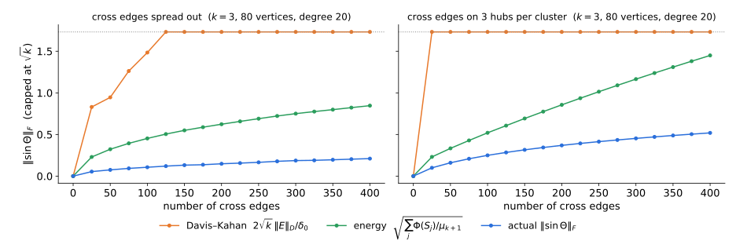
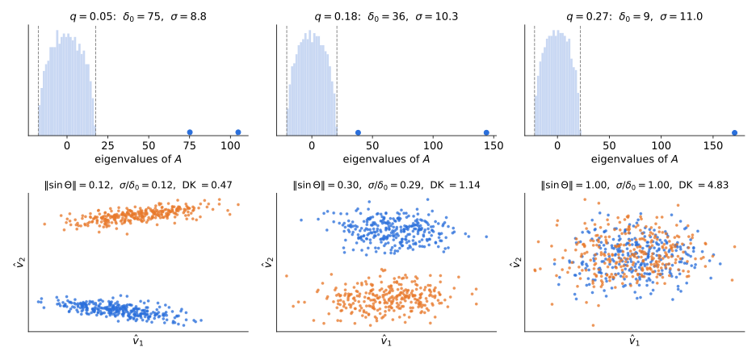

## Recap: Lectures 6–7

Random walk $P=D^{-1}A$, $\ L_{rw}=I-P$, eigenvalues $0=\mu_1\le\mu_2\le\dots\le\mu_n\le2$. $P$ is self-adjoint in $\ell^2(D)$: $\ \langle f,g\rangle_D=\sum_ud_uf(u)g(u)$ (Lecture 2; Review I, §2.5).

- **Cheeger:** $\ \tfrac12\mu_2\le\Phi(G)\le\sqrt{2\mu_2}$.
- **Higher-order Cheeger:** $\ \tfrac12\mu_k\le\rho_k(G)\le O(k^2)\sqrt{\mu_k}$.
- **KLLOT:** a gap $\mu_k\gg\mu_2$ makes the Fiedler vector nearly a step function, so the sweep cut does better.

::: {.idea}
All three are **worst-case** statements about what rounding an eigenvector can *certify* on any graph. In practice however, we are mostly interested in graphs that have an underlying cluster structure (e.g., unlike paths) that we hope to recover. Today we ask a **recovery** question, rather than an approximation one.

**If the graph is a small perturbation of $k$ planted clusters, does the spectral embedding recover them?**
:::

::: notes
~2 min. Lectures 6–7 compare the cut we find with the best cut. Today the clusters are given (planted) and we ask whether we find them: a recovery question, not an approximation question.
:::

## Spectral clustering

::: {.defn}
**Algorithm** (random-walk version, after Shi–Malik 2000).

1. Compute the top-$k$ eigenvectors of $P=D^{-1}A$, orthonormal in $\ell^2(D)$:

   ::: {.center}
   $\hat F=[\hat f_1,\dots,\hat f_k]\in\mathbb R^{n\times k},\qquad \hat F^\top D\hat F=I_k$.
   :::

2. **Embed.** Each eigenvector is a function on vertices. Map vertex $u$ to
   $$\hat\varphi(u)=\big(\hat f_1(u),\dots,\hat f_k(u)\big)\in\mathbb R^k .$$
3. **Cluster** with $k$-means in $\ell^2(D)$, i.e., with vertex weights $d_u$:
   $$\min_{z,\,c}\ \sum_u d_u\,\big\|\hat\varphi(u)-c_{z(u)}\big\|^2 .$$
:::

- Replacing $\hat F$ by $\hat FO$, for an orthogonal $O$, maps every point $\hat\varphi(u)$ to $O^\top\hat\varphi(u)$. This preserves all distances, so $k$-means is unaffected.
- **Variants in $\ell^2$.** NJW (2001): top-$k$ eigenvectors $\hat v_i=D^{1/2}\hat f_i$ of $N=D^{-1/2}AD^{-1/2}$, then $k$-means on the unit vectors $\hat x(u)/\|\hat x(u)\|$, where $\hat x(u)=\sqrt{d_u}\,\hat\varphi(u)$. Unnormalized: eigenvectors of $A$ (natural when degrees are equal, e.g., the SBM).

**Plan:** the ideal case · Davis–Kahan (full proof) · rounding · deterministic perturbations · stochastic perturbations · demo.

::: notes
The rotation invariance is the reason we only need to control the subspace, not individual eigenvectors. Remind them of this when we get to Lemma 2.1(3).

In practice one computes the eigenvectors v̂_i of the symmetric matrix N and sets f̂_i = D^{-1/2}v̂_i; these are the solutions of Shi–Malik's generalized problem Lf = λDf. Why the weights: Σ_u d_u ‖φ̂(u) − c_{z(u)}‖² = Σ_i ‖f̂_i − g_i‖²_D, where g_i is the step function equal to (c_j)_i on cluster j. So weighted k-means finds the partition whose step functions best fit the eigenfunctions in ℓ²(D): the rounding of the normalized-cut relaxation (Dhillon–Guan–Kulis). Unweighted k-means on φ̂ (von Luxburg's "Shi–Malik" algorithm) drops the weights. NJW removes the √d_u scale of x̂(u) by its noisy length instead of the known degree, which is roughly clustering directions. Attribution: Shi–Malik's paper is two-way (threshold the second generalized eigenvector) and recursive; the k-means version is later convention.
:::

# The ideal case

## $k$ disconnected clusters

Let $G_0$ be the disjoint union of connected graphs $G_1,\dots,G_k$ on $S_1,\dots,S_k$, with random walk $P_0=D^{-1}A_0$. Then $P_0$ is **block diagonal**.

- Each block is the walk on $G_j$: top eigenvalue $1$ with the constant eigenvector, second eigenvalue $1-\mu_2(G_j)$.
- So eigenvalue $1$ has multiplicity $k$, with eigenvectors orthonormal in $\ell^2(D)$:
$$f_j=\frac{\mathbf 1_{S_j}}{\sqrt{\mathrm{vol}(S_j)}}\quad(\text{cluster indicators}),\qquad F=[f_1,\dots,f_k].$$
- **Ideal embedding:** for $u\in S_j$ only $f_j(u)\neq0$, so with $e_j\in\mathbb R^k$ the $j$-th standard basis vector,
$$\varphi(u)=\big(f_1(u),\dots,f_k(u)\big)=c_j:=\frac{e_j}{\sqrt{\mathrm{vol}(S_j)}} .$$
  **Only $k$ distinct points, one per cluster, mutually orthogonal.** Weighted $k$-means has cost $0$ at the true partition.
- Every $\ell^2(D)$-orthonormal basis of the eigenspace is $FO$, with $O$ orthogonal: same picture, rotated ($O^\top c_j$).

::: {.thm}
**Gap.** $\ \delta_0:=\lambda_k(P_0)-\lambda_{k+1}(P_0)=\min_j\mu_2(G_j)\ \ge\ \min_j\tfrac12\Phi(G_j)^2$, by Cheeger.
:::

::: notes
~4 min. In ℓ²(D) the ideal eigenvectors are plain cluster indicators: no √d_u anywhere. (In ℓ², the eigenvectors of N_0 are D^{1/2}f_j, and the points x(u) = √d_u c_j lie on k rays; that is the factor NJW normalizes away.) The gap is controlled by the internal conductance of the clusters, the quantity Lecture 6 taught us to bound.
:::

## Real graphs are perturbations

Observed walk $\ P = P_0+E$, with $E$ self-adjoint in $\ell^2(D)$. Weyl (Review I, Cor. 2.9 and §2.5): eigen**values** move by at most $\|E\|$. What about eigen**vectors**?

Toy model: $A=\operatorname{diag}(1+\varepsilon,\,1,\,0)$. The top two eigenvalues are $\varepsilon$ apart (like the $k$-fold eigenvalue $1$ of $P_0$); the third is $1$ below (like the gap $\delta_0$). Two perturbations, both of size $\approx\varepsilon$:

| | perturbation $E$ | top eigenvector | top-2 eigenspace $\operatorname{span}\{e_1,e_2\}$ |
|:--|:--|:--|:--|
| (a) | $\frac\varepsilon2\begin{pmatrix}-1&1&0\\1&1&0\\0&0&0\end{pmatrix}$, mixes $e_1,e_2$ | $e_1\to\frac{e_1+e_2}{\sqrt2}$: **turns $45^\circ$** | **unchanged** |
| (b) | $\varepsilon\,(e_2e_3^\top+e_3e_2^\top)$, mixes $e_2,e_3$ | unchanged | **turns by $\approx\varepsilon$** ($\sin\Theta=0.0985$ at $\varepsilon=0.1$) |

::: {.idea}
**Two lessons.**

1. **Compare subspaces, not vectors.** In (a), $\|E\|=\varepsilon/\sqrt2\to0$ yet the top eigenvector turns $45^\circ$ for every $\varepsilon$: no bound "angle $\le C\|E\|$" can hold for a single eigenvector. The top-2 eigenspace does not move.
2. **Measure $\|E\|$ against the gap to the rest of the spectrum.** In (b) the top-2 eigenspace moves, but only by $\approx\|E\|/(\lambda_2-\lambda_3)=\varepsilon/1$.
:::

::: notes
~3 min. (a) is the 2×2 example of the Davis–Kahan note, §1, embedded in ℝ³ so that the subspace lesson is not vacuous (in ℝ² the span of both eigenvectors is the whole space). In (a) the ratio ‖E‖/(λ1 − λ2) = 1/√2 is constant, which is why the vector can turn by a constant angle. Clustering: in P_0 the top eigenvalue has multiplicity k (the ε = 0 limit), so individual eigenvectors of P are not even well defined; only the top-k eigenspace is, and it is separated from the rest by δ0. Davis–Kahan is the statement that (b) is the worst that can happen: sin Θ ≤ ‖E‖/gap. Numbers checked numerically: (b) at ε = 0.1 gives sin Θ = 0.0985 for the top-2 eigenspace and a top eigenvector that stays exactly e1.
:::

## The toy model, exactly

$A=\operatorname{diag}(1+\varepsilon,1,0)$: eigenvalues $1+\varepsilon,\ 1,\ 0$ with eigenvectors $e_1,e_2,e_3$. Perturbed eigenpairs of $\hat A=A+E$:

| | $\|E\|$ | $\lambda_1(\hat A)$ | $\lambda_2(\hat A)$ | $\lambda_3(\hat A)$ |
|:--|:--:|:--|:--|:--|
| (a) | $\varepsilon/\sqrt2$ | $1+\varepsilon$, $\ \frac{e_1+e_2}{\sqrt2}$ | $1$, $\ \frac{e_1-e_2}{\sqrt2}$ | $0$, $\ e_3$ |
| (b) | $\varepsilon$ | $1+\varepsilon$, $\ e_1$ | $\frac{1+\sqrt{1+4\varepsilon^2}}2\approx1+\varepsilon^2$, $\ \cos\theta\,e_2+\sin\theta\,e_3$ | $\frac{1-\sqrt{1+4\varepsilon^2}}2\approx-\varepsilon^2$, $\ -\sin\theta\,e_2+\cos\theta\,e_3$ |

In (b), $\tan2\theta=2\varepsilon$: the $2\times2$ block $\left(\begin{smallmatrix}1&\varepsilon\\\varepsilon&0\end{smallmatrix}\right)$ on $\operatorname{span}\{e_2,e_3\}$.

At $\varepsilon=0.1$:

| | eigenvalues of $\hat A$ | top eigenvector moves by | top-2 eigenspace moves by ($\sin\Theta$) |
|:--|:--|:--:|:--:|
| (a) | $1.1,\ 1,\ 0$ (**unchanged**) | $\sin=0.707$ ($45^\circ$) | $0$ |
| (b) | $1.1,\ 1.0099,\ -0.0099$ | $0$ | $0.0985$ |

- **Weyl is not the issue.** In (a) the eigenvalues do not move at all, yet the top eigenvector turns $45^\circ$. In (b) they move by $\varepsilon^2\le\|E\|$.
- In (b), the kept eigenvalues $1+\varepsilon$, $1+\varepsilon^2$ stay $\approx1$ above the discarded one: the gap survives the perturbation, and the subspace moves by $\approx\varepsilon/1$.

::: notes
~2 min. Optional backup slide for the previous one. Forward pointer for after the proof: in (b), Theorem 3.1 with [a, b] = [1, 1+ε] and the discarded eigenvalue −0.0099 gives δ = 1.0099 and ‖EV‖ = ε, so the bound is 0.1/1.0099 = 0.0990 against the true 0.0985. In (a), E maps span{e1, e2} into itself, so V̂⊥ᵀEV = 0 and the Sylvester equation gives sin Θ = 0 exactly for the top-2 eigenspace. All numbers computed numerically.
:::

# The Davis–Kahan $\sin\Theta$ theorem

## Distances between subspaces

$V,\hat V\in\mathbb R^{n\times k}$ with orthonormal columns. Singular values of $\hat V^\top V$: $\cos\theta_1\ge\dots\ge\cos\theta_k$, the **principal angles** $\theta_i\in[0,\pi/2]$. Set $\sin\Theta=\operatorname{diag}(\sin\theta_i)$.

::: {.lem}
**Lemma 2.1.** Complete $\hat V$ to an orthogonal $[\hat V\ \hat V_\perp]$.

1. The singular values of $\hat V_\perp^\top V$ are the $\sin\theta_i$ (padded with zeros).
2. $\|VV^\top-\hat V\hat V^\top\|=\|\sin\Theta\|$ and $\ \|VV^\top-\hat V\hat V^\top\|_F=\sqrt2\,\|\sin\Theta\|_F$.
3. There is an orthogonal $O$ with $\ \|\hat VO-V\|_F\le\sqrt2\,\|\sin\Theta\|_F$.
:::

::: {.pf}
(1) $I_k=V^\top V=(\hat V^\top V)^\top(\hat V^\top V)+(\hat V_\perp^\top V)^\top(\hat V_\perp^\top V)$, so the squared singular values of $\hat V_\perp^\top V$ are $1-\cos^2\theta_i$.

(2) Exercise.

(3) Write $\hat V^\top V=U(\cos\Theta)W^\top$ (SVD) and take $O=UW^\top$. Then
$$\|\hat VO-V\|_F^2=2k-2\operatorname{tr}(O^\top\hat V^\top V)=2\textstyle\sum_i(1-\cos\theta_i)\le2\sum_i\sin^2\theta_i.\ \blacksquare$$
:::

::: notes\
~5 min. (2) is only used to justify calling sin Θ a distance between subspaces; it can be skipped in class (the note has an alternative proof via a 2×2 block computation). (3) is the statement spectral clustering uses: the computed embedding equals the ideal one up to a rotation, plus a small Frobenius error. O is the solution of the orthogonal Procrustes problem.
2)
Let $\Pi=VV^\top$, $\hat\Pi=\hat V\hat V^\top$. **Frobenius:** $\|\Pi-\hat\Pi\|_F^2=\operatorname{tr}\Pi+\operatorname{tr}\hat\Pi-2\operatorname{tr}(\Pi\hat\Pi)=2k-2\|\hat V^\top V\|_F^2=2\sum_i\sin^2\theta_i$. **Operator:** write $x=x_1+x_2$ with $x_1=\hat\Pi x$, $x_2=(I-\hat\Pi)x$. Then $(\Pi-\hat\Pi)x=\Pi x_2-(I-\Pi)x_1$, a sum of two orthogonal vectors, and by (1) (applied both ways) $\|\Pi(I-\hat\Pi)\|=\|(I-\Pi)\hat\Pi\|=\sin\theta_1$. So $\|(\Pi-\hat\Pi)x\|^2\le\sin^2\theta_1\,(\|x_2\|^2+\|x_1\|^2)$, with equality for the best $x=x_2$.
:::

## The theorem

::: {.thm}
**Theorem 3.1 (Davis–Kahan 1970).** $A$ and $\hat A=A+E$ symmetric.

- $AV=V\Lambda_1$, with $V$ orthonormal $n\times k$ and the eigenvalues of $\Lambda_1$ in $[a,b]$.
- $\hat A\hat V_\perp=\hat V_\perp\hat\Lambda_2$, with $\hat V_\perp$ orthonormal $n\times(n-k)$ and the eigenvalues of $\hat\Lambda_2$ **outside** $(a-\delta,\,b+\delta)$.

Let $\hat V$ span the orthogonal complement of $\hat V_\perp$. Then
$$\|\sin\Theta(V,\hat V)\|\le\frac{\|EV\|}{\delta}\le\frac{\|E\|}{\delta},\qquad \|\sin\Theta(V,\hat V)\|_F\le\frac{\|EV\|_F}{\delta}.$$
:::

- The **unperturbed** eigenvalues we keep sit in $[a,b]$. The **perturbed** eigenvalues we discard stay $\delta$ away.
- Only $EV$ matters: how much $E$ moves the subspace we care about.

::: notes
~2 min. The asymmetry (gap between unperturbed kept and perturbed discarded eigenvalues) is what makes the proof two lines. We remove it with Weyl in the corollary.
:::

## The key lemma: Sylvester equations

::: {.lem}
**Lemma 3.2.** $\Lambda\in\mathbb R^{k\times k}$ and $M\in\mathbb R^{m\times m}$ symmetric, $\mathrm{spec}(\Lambda)\subseteq[a,b]$, $\mathrm{spec}(M)\cap(a-\delta,b+\delta)=\emptyset$. Then for all $X\in\mathbb R^{m\times k}$, in operator **and** Frobenius norm,
$$\|MX-X\Lambda\|\ \ge\ \delta\,\|X\|.$$
:::

::: {.pf}
**Center.** Let $c=\frac{a+b}2$ and $r=\frac{b-a}2$. Then $\|\Lambda-cI\|\le r$, and every eigenvalue of $M-cI$ has absolute value $\ge r+\delta$, so $\|(M-cI)^{-1}\|\le\frac1{r+\delta}$.

**Solve.** With $Y=MX-X\Lambda=(M-cI)X-X(\Lambda-cI)$,
$$X=(M-cI)^{-1}\big(Y+X(\Lambda-cI)\big)\ \Rightarrow\ \|X\|\le\frac{\|Y\|+r\|X\|}{r+\delta}\ \Rightarrow\ \delta\|X\|\le\|Y\|.\ \blacksquare$$
:::

- Uses only $\|PQ\|\le\|P\|_{\rm op}\|Q\|$, valid for both norms.
- Frobenius, diagonal case: $(MX-X\Lambda)_{ij}=(m_i-\lambda_j)X_{ij}$ and $|m_i-\lambda_j|\ge\delta$. Centering is what makes the **operator** norm work.

::: notes
~5 min. Ask: why not just say "M − λ is invertible for each λ in [a,b]"? That gives the Frobenius bound column by column after diagonalizing Λ, but in operator norm the columns interact. The centering trick handles both at once. The hypothesis matters: if we only know that the two spectra are δ-separated (interlaced, not one inside an interval and the other outside), the Frobenius bound still holds but in operator norm the best constant becomes π/2 (Bhatia–Davis–McIntosh); see Bhatia Ch. VII.
:::

## Proof of Davis–Kahan

Let $X=\hat V_\perp^\top V\in\mathbb R^{(n-k)\times k}$. By Lemma 2.1(1), $\|X\|=\|\sin\Theta\|$ and $\|X\|_F=\|\sin\Theta\|_F$.

Start from $AV=V\Lambda_1$:
$$\hat AV-V\Lambda_1=(A+E)V-V\Lambda_1=EV.$$
Multiply on the left by $\hat V_\perp^\top$, and use $\hat V_\perp^\top\hat A=\hat\Lambda_2\hat V_\perp^\top$ (symmetry of $\hat A$):
$$\boxed{\ \hat\Lambda_2X-X\Lambda_1=\hat V_\perp^\top EV\ }\qquad\text{(Sylvester equation)}$$
Lemma 3.2 with $M=\hat\Lambda_2$, $\Lambda=\Lambda_1$:
$$\delta\,\|\sin\Theta\|=\delta\|X\|\le\|\hat V_\perp^\top EV\|\le\|EV\|.\qquad\blacksquare$$

::: {.idea}
The eigengap enters **only** through Lemma 3.2: the map $X\mapsto\hat\Lambda_2X-X\Lambda_1$ is invertible with inverse of norm $\le1/\delta$.
:::

::: notes
~4 min. Point out where symmetry is used: V̂⊥ᵀ Â = Λ̂₂ V̂⊥ᵀ needs the left eigenvectors to equal the right ones. For non-normal matrices the inverse of the Sylvester operator can be huge even with a big gap (non-reversible chains; see the non-reversible note).
:::

## Gap on the ideal matrix only

In applications $A$ is the ideal (population) matrix. We control **its** gap, not that of $\hat A$.

::: {.thm}
**Corollary 3.3.** $V$, $\hat V$ span the top-$k$ eigenspaces of $A$ and $\hat A=A+E$, and $\delta_0=\lambda_k(A)-\lambda_{k+1}(A)>0$. Then
$$\|\sin\Theta\|\le\frac{2\|E\|}{\delta_0},\qquad\|\sin\Theta\|_F\le\frac{2\sqrt k\,\|E\|}{\delta_0}.$$
:::

::: {.pf}
If $\|E\|\le\delta_0/2$: take $[a,b]=[\lambda_k(A),\lambda_1(A)]$. By Weyl, every discarded eigenvalue satisfies $\lambda_j(\hat A)\le\lambda_{k+1}(A)+\|E\|=a-(\delta_0-\|E\|)$, so $\delta=\delta_0-\|E\|\ge\delta_0/2$ works. If $\|E\|>\delta_0/2$, the bound exceeds $1$ and is trivial. Frobenius: $\|\sin\Theta\|_F\le\sqrt k\|\sin\Theta\|$. $\blacksquare$
:::

- Yu–Wang–Samworth (2015): $\ \|\sin\Theta\|_F\le 2\min(\sqrt k\|E\|,\|E\|_F)/\delta_0$, for any block of the spectrum.
- With Lemma 2.1(3): $\ \|\hat VO-V\|_F\le 2\sqrt{2k}\,\|E\|/\delta_0$.

::: notes
~3 min. The factor 2 is the price of not knowing the perturbed spectrum.
:::

## Davis–Kahan is sharp

$A=\operatorname{diag}(\delta,0)$, $\ E=\varepsilon\begin{pmatrix}0&1\\1&0\end{pmatrix}$. The top eigenvector of $\hat A$ is at angle $\theta$ from $e_1$, with $\tan2\theta=2\varepsilon/\delta$:
$$\sin\theta=\frac{\varepsilon}{\delta}-O\big((\varepsilon/\delta)^3\big).$$

| $\varepsilon/\delta$ | $\sin\theta$ | DK bound $\|E\|/\delta_{\rm pert}$ |
|:--:|:--:|:--:|
| 0.01 | 0.0100 | 0.0100 |
| 0.1 | 0.0985 | 0.0990 |
| 0.3 | 0.267 | 0.277 |

$\delta_{\rm pert}=\delta-\lambda_2(\hat A)$: the gap in Theorem 3.1. Computed in `scripts/verify_bounds.py`.

**Variants** (same Sylvester proof): $\tan\Theta$ and $\sin2\Theta$ theorems (Davis–Kahan); singular subspaces of rectangular matrices (Wedin), via the dilation $\left(\begin{smallmatrix}0&M\\M^\top&0\end{smallmatrix}\right)$.

::: notes
~2 min. The perturbation is entirely "off-diagonal" (it maps the kept subspace into the discarded one), which is the worst case.
:::

## Davis–Kahan in $\ell^2(D)$

The proof used only **self-adjointness** and **orthonormality**, so it holds in any inner product. For ours:

::: {.idea}
$U:f\mapsto D^{1/2}f$ is an isometry $\ell^2(D)\to\ell^2$, and $\ UPU^{-1}=D^{1/2}PD^{-1/2}=N$ is symmetric. Translate:
:::

| $\ell^2$ (symmetric $N$) | $\ell^2(D)$ (walk $P$) |
|:--|:--|
| $V^\top V=I$ | $F^\top DF=I$ |
| angles: singular values of $\hat V^\top V$ | singular values of $\hat F^\top DF$ |
| $\|E\|$ | $\|E\|_D=\max_f\dfrac{|\langle f,Ef\rangle_D|}{\|f\|_D^2}$ ($E$ self-adjoint) |
| $\|\hat VO-V\|_F^2$ | $\|\hat FO-F\|_{D,F}^2=\sum_ud_u\,\|O^\top\hat\varphi(u)-\varphi(u)\|^2$ |

::: {.thm}
**Corollary 3.3 in $\ell^2(D)$.** $F,\hat F$: top-$k$ eigenvectors of $P_0$ and $P=P_0+E$, orthonormal in $\ell^2(D)$; $\delta_0=\lambda_k(P_0)-\lambda_{k+1}(P_0)$. Then
$$\|\sin\Theta\|\le\frac{2\|E\|_D}{\delta_0},\qquad \exists\,O:\ \ \|\hat FO-F\|_{D,F}\le\frac{2\sqrt{2k}\,\|E\|_D}{\delta_0}.$$
:::

::: notes
~3 min. Two ways to see it: (1) apply the ℓ² statements to N = UPU^{-1}, V = UF, V̂ = UF̂ (U is an isometry, so all angles and norms match); (2) rerun the proof with ᵀ replaced by the ℓ²(D) adjoint: X = F̂_⊥ᵀ D F, and the Sylvester equation is unchanged. From now on, the planted-cluster part lives entirely in ℓ²(D); the SBM part stays in ℓ² with A.
:::

# From subspaces to labels

## Rounding: few points can be far

::: {.lem}
**Lemma (counting bad vertices).** The ideal embedding is $\varphi(u)=c_j$ on $S_j$; let $\Delta_j=\min_{l\neq j}\|c_j-c_l\|$. Write $\hat\varphi_O(u)=O^\top\hat\varphi(u)$ for the embedding given by $\hat FO$. Call $u\in S_j$ **bad** if $\|\hat\varphi_O(u)-c_j\|\ge\Delta_j/2$. Then

- every good $u$ is strictly closer to its own center than to any other center, and
- $\displaystyle\sum_j\frac{\Delta_j^2}{4}\,\mathrm{vol}(\text{bad}\cap S_j)\ \le\ \sum_ud_u\|\hat\varphi_O(u)-\varphi(u)\|^2=\|\hat FO-F\|_{D,F}^2$.
:::

::: {.pf}
Triangle inequality, and Markov's inequality on the $d_u$-weighted squared errors. $\blacksquare$
:::

- **Planted clusters:** $c_j=e_j/\sqrt{\mathrm{vol}(S_j)}$, so $\Delta_j^2=\frac1{\mathrm{vol}(S_j)}+\min_{l\ne j}\frac1{\mathrm{vol}(S_l)}\ge\frac1{\mathrm{vol}(S_j)}$ and
$$\sum_j\frac{\mathrm{vol}(\text{bad}\cap S_j)}{\mathrm{vol}(S_j)}\ \le\ 4\,\|\hat FO-F\|_{D,F}^2\ \le\ 8\,\|\sin\Theta\|_F^2 .$$
- **$\ell^2$ version** (weights $1$, used for the SBM): ideal points $x(u)$ taking $k$ values with separation $\Delta$, and $\hat x_O(u)=O^\top\hat x(u)$, give $\#\text{bad}\le4\|\hat VO-V\|_F^2/\Delta^2$.
- $k$-means does not know the true centers. A $(1+\epsilon)$-approximate $k$-means solution loses only a constant factor (Lei–Rinaldo 2015, Lemma 5.3).
- Markov only counts bad vertices. Controlling **every** vertex needs $\ell_{2\to\infty}$ perturbation bounds (Cape–Tang–Priebe 2019; Abbe–Fan–Wang–Zhong 2020).

::: notes
~4 min. The natural count in ℓ²(D) is misclustered volume, i.e., π-mass: each vertex counts with its degree. Chain to remember: misclustered volume fraction ≲ ‖F̂O − F‖²_{D,F} ≤ 2‖sinΘ‖_F² ≤ 8k‖E‖_D²/δ0². Everything that follows is about bounding δ0 from below and ‖E‖ from above.
:::

# Deterministic perturbations: cut edges

## Turning cut edges into self-loops

$G$ with planted partition $S_1,\dots,S_k$. Split $A=A_{\rm in}+A_{\rm out}$; $\ d_{\rm out}(u)$ = weight of $u$'s edges leaving its cluster.

::: {.defn}
**Ideal graph $G_0$:** replace every cut edge $\{u,v\}$ of weight $w$ by a self-loop of weight $w$ at $u$ and at $v$:
$$A_0=A_{\rm in}+D_{\rm out}.$$
:::

- **Same degrees**, so the same $D$ and the same stationary distribution $\pi$. The walk on $G_0$ *stays put* where the walk on $G$ would cross.
- $G_0$ is disconnected, so the ideal case applies with $\delta_0=\min_j\mu_2(G_j+\text{loops})$.
- The perturbation is a **Laplacian of the cut**:
$$E=P-P_0=D^{-1}(A_{\rm out}-D_{\rm out})=-D^{-1}L_{\rm out},\qquad \langle f,Ef\rangle_D=-f^\top L_{\rm out}f .$$

::: {.thm}
$0\le f^\top L_{\rm out}f\le2f^\top D_{\rm out}f$, hence $\ \|E\|_D\le2\varepsilon_{\rm out}$, where $\ \varepsilon_{\rm out}:=\max_u\dfrac{d_{\rm out}(u)}{d(u)}$.
:::

::: notes
~4 min. Without the loops, removing the cut edges also changes the degrees, and E picks up an extra diagonal term that is messier to bound. With loops the comparison is between two walks with the same π, which is the natural comparison after Lectures 2–4. Proof: (f(u) − f(v))² ≤ 2f(u)² + 2f(v)², so the ℓ²(D) Rayleigh quotient of L_out is at most max_u d_out(u)/d(u) times 2.
:::

## Deterministic guarantee

::: {.thm}
**Theorem.** Let $\hat F$ be the top-$k$ eigenvectors of $P$ and $F=[f_1,\dots,f_k]$ the cluster indicators (both orthonormal in $\ell^2(D)$). Then
$$\|\sin\Theta(F,\hat F)\|\ \le\ \frac{4\,\varepsilon_{\rm out}}{\delta_0}\ \le\ \frac{8\,\varepsilon_{\rm out}}{\min_j\Phi(G_j)^2},$$
where $\Phi(G_j)$ is the conductance of $G[S_j]$ with volumes measured in $G$ (the loops count),
and $\ \sum_j\mathrm{vol}(\text{bad}\cap S_j)/\mathrm{vol}(S_j)\le8\|\sin\Theta\|_F^2\le128\,k\,\varepsilon_{\rm out}^2/\delta_0^2$.
:::

Read it as: **(fraction of each vertex's edges leaving its cluster) ≪ (internal expansion)².**

::: {.warn}
**The weak point: $\varepsilon_{\rm out}$ is a maximum over vertices.** Put all cross edges on a few **hubs**. One vertex with half its edges crossing gives $\varepsilon_{\rm out}=\tfrac12$, and the bound is vacuous, although $\Phi(S_j)$ is tiny and the embedding is fine.

The same per-vertex degree ratio appeared in KLLOT Cor. 4.16 (Lecture 7): $\frac{d_1+d_2}{d_1}$.
:::

::: notes
~3 min. Operator norms are controlled by the worst vertex: test the Rayleigh quotient of E on the indicator of a single vertex u and you get d_out(u)/d(u). This is not an artifact of the proof: ‖E‖ really is large when there are hubs. The question is whether the subspace really moves, and the next slide shows that it does not.
:::

## An energy bound that ignores hubs

::: {.thm}
**Proposition** (cf. Peng–Sun–Zanetti 2015). $\hat F$ = bottom-$k$ eigenvectors of $L_{rw}=I-P$ for the **observed** $G$, orthonormal in $\ell^2(D)$. Then
$$\|\sin\Theta(F,\hat F)\|_F^2\ \le\ \frac{\sum_j\Phi(S_j)}{\mu_{k+1}(G)}.$$
:::

::: {.pf}
$\langle f_j,L_{rw}f_j\rangle_D=\dfrac{w(S_j,\bar S_j)}{\mathrm{vol}(S_j)}=\Phi(S_j)$ (Rayleigh quotient of an indicator). Expand $f_j=\sum_i a_i\hat f_i$ in the $\ell^2(D)$-orthonormal eigenbasis of $L_{rw}$:
$$\Phi(S_j)=\sum_i\mu_ia_i^2\ \ge\ \mu_{k+1}\sum_{i>k}a_i^2=\mu_{k+1}\,\|\hat F_\perp^\top Df_j\|^2.$$
Sum over $j$ and use Lemma 2.1(1). $\blacksquare$
:::

- Uses the **average** leakage $\Phi(S_j)$ and the gap $\mu_{k+1}$ of the **observed** graph. By higher-order Cheeger, $\mu_{k+1}\ge\rho_{k+1}(G)^2/O(k^4)$.
- This is the Lecture 6 exercise "Cheeger with an approximate eigenvector", run backwards: a test vector with small Rayleigh quotient must lie mostly in the bottom eigenspace.

::: notes
~4 min. PSZ's structure theorem starts from exactly this inequality, with Υ = λ_{k+1}/ρ(k) as the gap parameter, and then proves the converse (eigenvectors are close to indicators of good clusters) and a k-means analysis.
:::

## Two bounds, two kinds of perturbation

{width="100%"}

| | Davis–Kahan | Energy bound |
|:--|:--|:--|
| perturbation size | $\|E\|_D\le2\varepsilon_{\rm out}$ (worst vertex) | $\sum_j\Phi(S_j)$ (average) |
| gap | ideal graph: $\delta_0$ | observed graph: $\mu_{k+1}(G)$ |
| rate | **linear**: $\varepsilon/\delta_0$ | **square root**: $\sqrt{\Phi/\mu_{k+1}}$ |
| good for | **many, random** cross edges (next) | **few, adversarial** cross edges |

::: notes
~3 min. Both bounds hold in both panels; constants make DK vacuous early on the left, and immediately on the right. The rate difference: the Rayleigh quotient is quadratic in the error of the vector, so bounding the vector by the energy loses a square root. In the SBM (next), Φ(S_j) is a constant (a constant fraction of each vertex's edges cross!), so the energy bound cannot give vanishing error, while Davis–Kahan plus concentration can.
:::

# Stochastic perturbations: the stochastic block model

## The SBM and its population matrix

$n$ vertices in $k$ blocks of size $n/k$. Edges independent: probability $p$ inside a block, $q<p$ across.

With $Z\in\{0,1\}^{n\times k}$ the block membership matrix,
$$\mathbb EA=Z\big((p-q)I_k+qJ_k\big)Z^\top-pI.$$

- Eigenvalues: $\ \tfrac nk(p-q)+nq-p$, then $\tfrac nk(p-q)-p$ with multiplicity $k-1$, then $-p$.
- Top-$k$ eigenspace: $V=Z/\sqrt{n/k}$. Degrees are equal in expectation, so we stay in $\ell^2$ with $A$: embed $u\mapsto\hat x(u)=(\hat v_1(u),\dots,\hat v_k(u))$ from the top-$k$ eigenvectors of $A$. Ideal points: $x(u)=\sqrt{k/n}\,e_j$ for $u$ in block $j$, so $\Delta^2=2k/n$.
- Gap: $\ \delta_0=\dfrac{n(p-q)}{k}$.

::: {.idea}
Here a constant fraction of each vertex's edges cross, so the cut is **not** sparse. The cross edges are **random**, and that is what will save us: $E=A-\mathbb EA$ has norm $\approx\sqrt d$, not $d$.
:::

::: notes
~3 min. Check the eigenvalues with the k × k matrix (p − q)I + qJ scaled by n/k. The −pI comes from forbidding self-loops; it shifts all eigenvalues and does not change eigenvectors or the gap.
:::

## How big is $E=A-\mathbb EA$?

Let $d=\max_u\sum_v p_{uv}$ (max expected degree).

- **Lower bound:** $\ \|E\|\ge\|Ee_u\|\approx\sqrt{\sum_v p_{uv}(1-p_{uv})}\approx\sqrt d$.
- **Truth** (dense enough): semicircle law, $\ \|E\|\approx2\sigma$, $\ \sigma^2=\max_u\sum_v p_{uv}(1-p_{uv})$.

::: {.thm}
**Matrix Bernstein** (Tropp 2012). $X_1,\dots,X_m$ independent, symmetric $n\times n$, $\ \mathbb EX_i=0$, $\ \|X_i\|\le L$, and $\ \sigma^2=\big\|\sum_i\mathbb EX_i^2\big\|$. Then
$$\Pr\Big[\Big\|\sum_iX_i\Big\|\ge t\Big]\le2n\exp\Big(\frac{-t^2/2}{\sigma^2+Lt/3}\Big).$$
:::

**Apply:** $X_{uv}=(A_{uv}-p_{uv})(e_ue_v^\top+e_ve_u^\top)$ for $u<v$. Then $L=1$ and $\sum\mathbb EX_{uv}^2=\operatorname{diag}\big(\sum_vp_{uv}(1-p_{uv})\big)\preceq d\,I$. With probability $\ge1-2/n$,
$$\|E\|\ \le\ 2\sqrt{d\ln n}+\tfrac43\ln n\ \le\ 4\sqrt{d\ln n}\quad(d\ge\ln n).$$

::: notes
~4 min. Choose t = a + b with a = 2√(σ² ln n), b = (4/3) ln n. Then t² ≥ a² + bt = 4 ln n (σ² + t/3), so the exponent is ≤ −2 ln n and the probability ≤ 2n · n⁻² = 2/n. Only a √(ln n) factor is lost against the √d lower bound.
:::

## Matrix Bernstein: proof sketch

Same four steps as the scalar proof, with $\operatorname{tr}$ and $\exp$ of matrices. Let $Y=\sum_iX_i$.

1. **Laplace transform:** $\ \Pr[\lambda_{\max}(Y)\ge t]\le e^{-\theta t}\,\mathbb E\operatorname{tr}e^{\theta Y}$, since $e^{\theta\lambda_{\max}(Y)}\le\operatorname{tr}e^{\theta Y}$.
2. **Subadditivity of matrix cgfs** (from **Lieb's concavity theorem**):
$\ \mathbb E\operatorname{tr}\exp\big(\sum_i\theta X_i\big)\le\operatorname{tr}\exp\big(\sum_i\log\mathbb Ee^{\theta X_i}\big).$
3. **One summand:** $\|X\|\le L$ and $\mathbb EX=0$ give $\ \mathbb Ee^{\theta X}\preceq\exp\big(g(\theta)\,\mathbb EX^2\big)$, with $g(\theta)=\frac{\theta^2/2}{1-L\theta/3}$, for $0<\theta<3/L$.
4. **Combine:** $\ \operatorname{tr}\exp\big(g(\theta)\sum_i\mathbb EX_i^2\big)\le n\,e^{g(\theta)\sigma^2}$. Optimize over $\theta$.

::: {.warn}
**Why Lieb?** The obvious route (Golden–Thompson, Ahlswede–Winter 2002) peels off one summand at a time and replaces $\big\|\sum_i\mathbb EX_i^2\big\|\le d$ by $\sum_i\|\mathbb EX_i^2\|\approx nd/2$. For the SBM that gives $\|E\|\lesssim\sqrt{nd\log n}$: worse than the trivial bound $\|E\|\le$ max degree.
:::

The factor $n$ in front comes from the trace (step 4): it is the dimension, and it is where the $\log n$ comes from.

::: notes
~4 min. Step 3 uses the scalar inequality e^{θx} ≤ 1 + θx + g(θ)x² for |x| ≤ L, transferred to matrices (both sides are functions of the same matrix X), then I + M ⪯ e^M and monotonicity of log. Don't prove Lieb; just say where it's used.
:::

## Putting it together: SBM recovery

::: {.thm}
**Theorem** (Davis–Kahan + matrix Bernstein + counting). If $d\ge\ln n$, then with probability $\ge1-2/n$, spectral clustering on $A$ misclassifies (by nearest true center) at most
$$\frac{32k\,\|E\|^2}{\Delta^2\delta_0^2}=\frac{16\,n\,\|E\|^2}{\delta_0^2}\ \le\ \frac{256\,k^2\,p\ln n}{(p-q)^2}\quad\text{vertices.}$$
:::

Chain: $\ \#\text{bad}\le\frac{4}{\Delta^2}\|\hat VO-V\|_F^2\le\frac{8}{\Delta^2}\|\sin\Theta\|_F^2\le\frac{32k\|E\|^2}{\Delta^2\delta_0^2}$, with $\Delta^2=\frac{2k}n$, $\delta_0=\frac{n(p-q)}k$, $\|E\|^2\le16\,np\ln n$.

- **Dense** ($p,q$ fixed): a fraction $O(\log n/n)$ is misclassified.
- **Logarithmic degrees**, $p=\frac{a\ln n}n$, $q=\frac{b\ln n}n$: a fraction $\le256k^2a/(a-b)^2$, small once $(a-b)^2\gg k^2a$.
- **Removing the log:** $\|E\|=O(\sqrt d)$ when $d\gtrsim\log n$ (Feige–Ofek 2005; Lei–Rinaldo 2015 for the SBM).

::: notes
~4 min. The proof is three black boxes snapped together. Lei–Rinaldo do it rigorously, with k-means instead of nearest true centers. Rohe–Chatterjee–Yu (2011) do the normalized Laplacian version, with k allowed to grow.
:::

## How sharp is this?

{width="88%"}

$n=600$, $k=2$, $p=0.3$. Dashed: $\pm2\sigma$. Blue dots: outlier eigenvalues. Colors: true blocks.

- **Spiked random matrix heuristic** (BBP; Benaych-Georges–Nadakuditi 2011): an outlier separates iff $\delta_0>\sigma$, and then $\|\sin\Theta\|\approx\sigma/\delta_0$. Davis–Kahan gives $2\|E\|/\delta_0\approx4\sigma/\delta_0$: **the right rate, off by a constant**.
- What fails at **constant degree** ($p=a/n$): hubs again. Max degree $\sim\log n/\log\log n$ forces $\|E\|\gg\sqrt d$ (Krivelevich–Sudakov 2003). Fixes: trim or regularize high-degree vertices (Feige–Ofek; Le–Levina–Vershynin 2017), or the non-backtracking matrix (Krzakala et al. 2013; Bordenave–Lelarge–Massoulié 2015).
- Sharp thresholds ($k=2$): partial recovery iff $(a-b)^2>2(a+b)$ for $p=\frac an$ (Mossel–Neeman–Sly; Massoulié); exact recovery iff $(\sqrt a-\sqrt b)^2>2$ for $p=\frac{a\ln n}n$ (Abbe–Bandeira–Hall; Mossel–Neeman–Sly).

::: notes
~4 min. In the figure, the numbers in the scatter titles are the actual sin Θ, the heuristic σ/δ0, and the Davis–Kahan bound 2‖E‖/δ0: (0.12, 0.12, 0.47), (0.30, 0.29, 1.14), (1.00, 1.00, 4.83). At q = 0.27 we have δ0 = 9 < σ = 11: no outlier, and the embedding is noise. Hubs: the same phenomenon as in the deterministic part. A single high-degree vertex makes ‖E‖ large without moving the subspace much.
:::

## Demo

<iframe class="demo-frame" style="height:640px" src="demos/spectral-clustering-demo.html"></iframe>

Standalone: <a href="demos/spectral-clustering-demo.html" target="_blank">demos/spectral-clustering-demo.html</a> (append <code>#planted</code> to open the second tab). Try: SBM, move q toward p and watch the outliers merge into the bulk; planted clusters, switch "spread out" to "on 3 hubs".

::: notes
Things to show live. (1) SBM, n = 300, k = 2, p = 0.3: move q from 0 to 0.3. The blue curve tracks the grey spiked-Wigner heuristic σ/δ0 closely; Davis–Kahan (orange) has the right shape but a factor ≈ 4. The shaded region is δ0 < σ, where the outliers have merged into the bulk. (2) Matrix Bernstein row of the table: always true, a factor ≈ 3 loose at these sizes. (3) Planted, k = 3: spread vs. hubs with the same number of cross edges. Φ(S_j), and so the energy bound, is unchanged; ε_out jumps and Davis–Kahan becomes vacuous, while the actual sin Θ barely moves.
:::

## Takeaways

1. **Ideal case:** $k$ disconnected clusters give a $k$-fold top eigenvalue of $P$ whose eigenvectors are cluster indicators in $\ell^2(D)$, and gap $\delta_0=\min_j\mu_2(G_j)\ge\frac12\min_j\Phi(G_j)^2$.
2. **Davis–Kahan:** $\ \|\sin\Theta\|\le\|EV\|/\delta$. The whole proof is the Sylvester equation $\hat\Lambda_2X-X\Lambda_1=\hat V_\perp^\top EV$ plus the centering lemma.
3. **Recipe:** gap of the ideal matrix + operator norm of the noise + Procrustes + Markov ⇒ few misclustered vertices.
4. **Deterministic noise:** cut edges → self-loops gives $\|E\|_D\le2\varepsilon_{\rm out}$. Worst-vertex sensitive; the energy bound $\sum_j\Phi(S_j)/\mu_{k+1}$ is not.
5. **Random noise:** matrix Bernstein gives $\|E\|\lesssim\sqrt{d\log n}$. This handles cuts that are **not sparse at all**, at the right rate up to constants.

## Discussion questions

1. Where exactly does the proof of Davis–Kahan use that $\hat A$ is symmetric? What breaks for the transition matrix of a non-reversible chain?
2. In the SBM, $\Phi(S_j)\approx\frac{(k-1)q}{p+(k-1)q}$. What does the energy bound give? Why does Davis–Kahan do better here, while the energy bound does better with hubs?
3. In the theorem for planted clusters, we compare $P$ with $P_0$. Why are self-loops better than simply deleting the cut edges?
4. The heuristic $\sigma/\delta_0$ suggests Davis–Kahan is off by a factor $4$ in the SBM. Which factor $2$ comes from Weyl, and which comes from $\|E\|\approx2\sigma$?
5. The counting lemma bounds the **number** of bad vertices. What would you need to prove that **no** vertex is bad (exact recovery)?

## References

- **C. Davis, W. M. Kahan.** The rotation of eigenvectors by a perturbation. III. *SIAM J. Numer. Anal.* 1970. · R. Bhatia. *Matrix Analysis*, Ch. VII. Springer GTM 169, 1997. · G. W. Stewart, J.-G. Sun. *Matrix Perturbation Theory*. Academic Press, 1990.
- Y. Yu, T. Wang, R. J. Samworth. A useful variant of the Davis–Kahan theorem for statisticians. *Biometrika* 2015.
- A. Y. Ng, M. I. Jordan, Y. Weiss. On spectral clustering: analysis and an algorithm. *NIPS* 2001. · J. Shi, J. Malik. Normalized cuts and image segmentation. *IEEE TPAMI* 2000. · U. von Luxburg. A tutorial on spectral clustering. *Statistics and Computing* 2007.
- R. Peng, H. Sun, L. Zanetti. Partitioning well-clustered graphs: spectral clustering works! *COLT* 2015; *SIAM J. Comput.* 2017.
- **J. A. Tropp.** User-friendly tail bounds for sums of random matrices. *Found. Comput. Math.* 2012. · R. Ahlswede, A. Winter. Strong converse for identification via quantum channels. *IEEE Trans. Inf. Theory* 2002.
- K. Rohe, S. Chatterjee, B. Yu. Spectral clustering and the high-dimensional stochastic blockmodel. *Ann. Statist.* 2011. · **J. Lei, A. Rinaldo.** Consistency of spectral clustering in stochastic block models. *Ann. Statist.* 2015.
- U. Feige, E. Ofek. Spectral techniques applied to sparse random graphs. *Random Structures Algorithms* 2005. · M. Krivelevich, B. Sudakov. The largest eigenvalue of sparse random graphs. *Combin. Probab. Comput.* 2003. · C. M. Le, E. Levina, R. Vershynin. Concentration and regularization of random graphs. *Random Structures Algorithms* 2017.
- F. Benaych-Georges, R. R. Nadakuditi. The eigenvalues and eigenvectors of finite, low rank perturbations of large random matrices. *Adv. Math.* 2011.
- F. Krzakala et al. Spectral redemption in clustering sparse networks. *PNAS* 2013. · C. Bordenave, M. Lelarge, L. Massoulié. Non-backtracking spectrum of random graphs. *FOCS* 2015.
- E. Abbe. Community detection and stochastic block models: recent developments. *JMLR* 2018 (survey; thresholds of Mossel–Neeman–Sly, Massoulié, Abbe–Bandeira–Hall).
- J. Cape, M. Tang, C. E. Priebe. The two-to-infinity norm and singular subspace geometry. *Ann. Statist.* 2019. · E. Abbe, J. Fan, K. Wang, Y. Zhong. Entrywise eigenvector analysis of random matrices with low expected rank. *Ann. Statist.* 2020.

Reading: [the Davis–Kahan note](../../notes/davis-kahan.qmd), von Luxburg §7 (perturbation theory point of view), Yu–Wang–Samworth.

