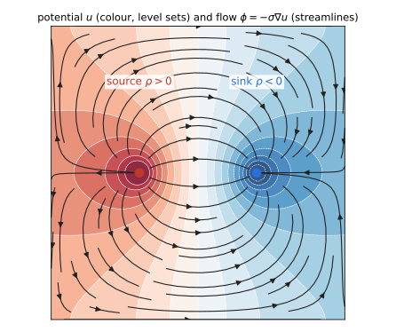
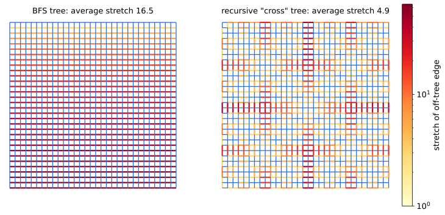
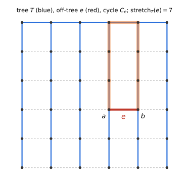
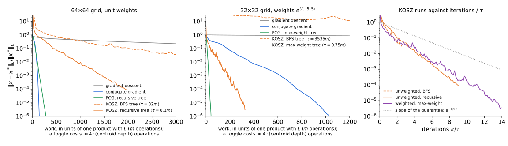
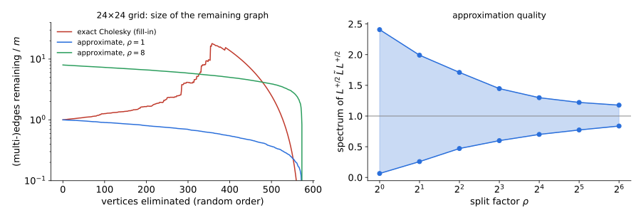

## Where we are

- Lecture 6 ended with a bad sign: computing a Fiedler vector takes
    - $\approx1/\lambda_2$ matrix–vector products by power iteration,
    - $\approx1/\sqrt{\lambda_2}$ by Lanczos.
- On the cycle that is $n^2$ vs. $n$. **The graphs with the sparsest cuts are exactly the slowest to cut.**
- Today the basic computational primitive: given $b\perp\mathbf 1$, solve
$$Lx=b .$$

::: {.thm}
**Theorem (Spielman–Teng 2004).** An $\varepsilon$-approximate solution of $Lx=b$ can be computed in time $O(m\log^{c}n\log(1/\varepsilon))$, **independently of $\lambda_2$**.
:::

::: notes
~2 min. The point of the first slide: the number of iterations of anything that only multiplies by L is controlled by the spectrum (we prove a lower bound later). Nearly-linear solvers escape this by using combinatorial structure (trees, sparsifiers, elimination). Today: one full, self-contained proof (KOSZ), and a map of the rest.
:::

## Plan

- Why we care: electrical flows, effective resistance, hitting times
- Classical methods: gradient descent, Krylov, preconditioning, trees
- **Randomized coordinate descent**
- **Full proof of KOSZ** (Kelner–Orecchia–Sidford–Zhu 2013), read as coordinate descent as in Lee–Sidford 2013
- Other routes: Spielman–Teng, approximate Gaussian elimination (Kyng–Sachdeva 2016)

# Laplacian systems

## The problem and how we measure error

$G=(V,E,w)$ connected, $n$ vertices, $m$ edges; **resistances** $r_e=1/w_e$. Orient each edge $e=(u,v)$ and set $b_e=\mathbf 1_u-\mathbf 1_v$ (the sign is immaterial; Lecture 2's $\nabla$ is $-B$).
$$B=\begin{pmatrix}\vdots\\ b_e^\top\\ \vdots\end{pmatrix}\in\mathbb R^{m\times n},\qquad L=B^\top WB=\sum_e w_e\,b_eb_e^\top,\qquad W=\operatorname{diag}(w),\ R=W^{-1}.$$

- $\ker L=\operatorname{span}(\mathbf 1)$, so $Lx=b$ is solvable iff $b\perp\mathbf 1$, and $x^*=L^+b$ is the solution orthogonal to $\mathbf 1$.
- **Error in the $L$-norm:** $\ \|x\|_L^2=x^\top Lx=\sum_ew_e(x_u-x_v)^2$. Adding a constant vector to $x$ does not change it.

::: {.defn}
$x$ is an **$\varepsilon$-approximate solution** if $\ \|x-x^*\|_L\le\varepsilon\,\|x^*\|_L$.
:::

- **Reductions.** Symmetric diagonally dominant (SDD) systems reduce to Laplacian systems on a graph of twice the size (Gremban 1996). Everything today applies to SDD matrices.

::: notes
~3 min. A solution in the L-norm can be converted to ℓ2 error at the cost of an additive ½ log κ in log(1/ε), which is why nobody cares about the choice inside nearly-linear-time statements.
:::

## Solving $Lx=b$ is a minimization problem

$$\min_{x\in\mathbb R^n}\ f(x)=\tfrac12x^\top Lx-b^\top x=\tfrac12\sum_ew_e\,(b_e^\top x)^2-b^\top x .$$

- **First-order optimality.** $f$ is convex ($L\succeq0$) and $\nabla f(x)=Lx-b$. So $x$ is a minimizer iff $Lx=b$.
    - If $b\not\perp\mathbf 1$, then $f$ is unbounded below along $\mathbf 1$: no solution.
- **Why the $L$-norm.** $f$ is quadratic and $\nabla f(x^*)=0$, so the Taylor expansion at $x^*$ is exact:
$$f(x)-f(x^*)=\tfrac12(x-x^*)^\top L(x-x^*)=\tfrac12\|x-x^*\|_L^2 .$$
The $L$-norm is the norm in which $f$ measures progress.

**The Fenchel–Rockafellar dual, through $B$.** Write $f(x)=g(Bx)+h(x)$ with $g(y)=\tfrac12y^\top Wy$ and $h(x)=-b^\top x$.

- Conjugates: $g^*(\phi)=\tfrac12\phi^\top R\phi=\tfrac12\sum_er_e\phi_e^2$, and $h^*(z)=0$ if $z=-b$, $+\infty$ otherwise.
- The dual is
$$\min_x f(x)\ =\ \max_{\phi}\ -g^*(\phi)-h^*(-B^\top\phi)\ =\ -\tfrac12\min_{B^\top\phi=b}\ \sum_er_e\phi_e^2 .$$
- **The dual is the flow problem:** route the demand $b$ with minimum energy. Strong duality holds (quadratic objective, feasible constraints).

| | variable | constraint | objective |
|---|---|---|---|
| **primal** | potentials $x\in\mathbb R^V$ | none | $\tfrac12\|x\|_L^2-b^\top x$ |
| **dual** | flows $\phi\in\mathbb R^E$ | $B^\top\phi=b$ | $\tfrac12\,\mathcal E(\phi)$ |

::: notes
~4 min. Setup for everything else today: the solver can be seen as unconstrained optimization over potentials (gradient descent, Krylov, preconditioning) or as constrained optimization over flows. KOSZ will work on the flow side (cycle toggling) while maintaining potentials. Check of the dual: at optimality both values equal −½ bᵀL⁺b; the next slide proves this directly (Thomson's principle) with an explicit duality gap. Conjugate of h: sup_x (z + b)ᵀx is 0 if z = −b and ∞ otherwise.
:::

## The continuous analogue: the Poisson equation

| | graph | domain $\Omega\subset\mathbb R^d$ |
|---|---|---|
| **equation** | $Lx=b$ | $-\operatorname{div}(\sigma\nabla u)=\rho$ (**Poisson**; $\rho=0$: **Laplace**) |
| **operators** | $B$, $B^\top$ | $\nabla$, $-\operatorname{div}$ |
| **Laplacian** | $L=B^\top WB$ | $-\operatorname{div}(\sigma\nabla\,\cdot)$, conductivity $\sigma\leftrightarrow W$ |
| **kernel, solvability** | $\ker L=\operatorname{span}(\mathbf 1)$, $b\perp\mathbf 1$ | constants, $\int\rho=0$ (**Neumann problem**, no boundary values) |
| **primal** | $\min_x\ \tfrac12x^\top Lx-b^\top x$ | $\min_u\ \tfrac12\int\sigma|\nabla u|^2-\int\rho u$ (**Dirichlet principle**) |
| **dual** | $\min_{B^\top\phi=b}\ \sum_er_e\phi_e^2$ | $\min_{\operatorname{div}\phi=\rho}\ \int|\phi|^2/\sigma$ (**Thomson principle**) |

- With **prescribed boundary values** the problem is the **Dirichlet problem**. On a graph, the boundary vertices are fixed and $Lx=0$ is solved on the rest.
- The **Cauchy problem** is different: an initial-value problem for evolution equations such as the heat equation $\partial_tu=\Delta u$ (graph: $\dot x=-Lx$, Lecture 3).

::: notes
~2 min. Optional. Poisson, not Cauchy: the Laplacian solve is the elliptic (steady-state) problem, while heat flow is its time-dependent counterpart. The graph case with no boundary is the pure Neumann problem, which is why the solution is only defined up to a constant.
:::

## The continuous picture

:::: {.columns}
::: {.column width="58%"}
{width="100%"}
:::
::: {.column width="42%"}
Poisson on the unit square with insulated sides (**Neumann**), one source and one sink, $\sigma\equiv1$.

- **Colour, level sets:** the potential $u$, solving $-\Delta u=\rho$. It is high at the source and low at the sink.
- **Streamlines:** the flow $\phi=-\sigma\nabla u$, which is orthogonal to the level sets. It leaves the source, enters the sink, and satisfies $\operatorname{div}\phi=\rho$.
- **Dirichlet principle:** $u$ minimizes $\tfrac12\int|\nabla u|^2-\int\rho u$.
- **Thomson principle:** among all fields with $\operatorname{div}\phi=\rho$, this $\phi$ has least energy $\int|\phi|^2$.
:::
::::

::: notes
~1 min. Same picture as the electrical network on the next slide, with the graph replaced by a domain. The flow runs from high to low potential, as in Ohm's law $f_e=w_e(x_u-x_v)$. Source and sink are point masses, so $u$ has logarithmic singularities (in 2D); on a graph there is no such issue. Made by scripts/make_figures.py, Fig. 5 (method of images for the Neumann square).
:::

## Electrical flows

A **flow** $f\in\mathbb R^E$ **routes the demand** $\chi$ (with $\mathbf 1^\top\chi=0$) if $B^\top f=\chi$: net outflow $\chi_u$ at every $u$. **Energy:** $\ \mathcal E(f)=\sum_er_ef_e^2$.

::: {.thm}
**Thomson's principle.** $\displaystyle\min_{B^\top f=\chi}\mathcal E(f)=\chi^\top L^+\chi$, attained by the **electrical flow** $f^*=WBx^*$, $\ x^*=L^+\chi$ (**Ohm's law**: $f_e=w_e(x_u-x_v)$).
:::

::: {.pf}
**Weak duality.** For any $f$ routing $\chi$ and any potentials $x$, let $\ \mathcal D(x)=2\chi^\top x-x^\top Lx$. Using $\chi^\top x=f^\top Bx=\sum_ef_e\,b_e^\top x$,
$$\boxed{\ \mathcal E(f)-\mathcal D(x)=\sum_e\frac{\big(r_ef_e-b_e^\top x\big)^2}{r_e}\ \ge0\ }$$
Equality iff $r_ef_e=b_e^\top x$ on every edge (Ohm). The flow $WBx^*$ routes $B^\top WBx^*=Lx^*=\chi$ and has equality. $\blacksquare$
:::

- **Dual error = solver error:** $\mathcal D(x)=-2f(x)$ for the objective $f$ of the previous slide (with $b=\chi$), so $\ \mathcal D(x^*)-\mathcal D(x)=\|x-x^*\|_L^2$. We will use the boxed **duality gap** twice.

::: notes
~4 min. Physics: Kirchhoff's current law is B^T f = χ; Kirchhoff's voltage law says the potential drops r_e f_e sum to zero around every cycle (equivalently, they are b_e^T x for some x). Thomson: of all flows obeying KCL, the one also obeying KVL minimizes energy. The gap identity says: the gap is exactly how badly Ohm's law fails, edge by edge, measured in the right norm. Check: D(x*) − D(x) = x*ᵀLx* − 2x*ᵀLx + xᵀLx. Numerically checked in scripts/verify_bounds.py §1 and §6.
:::

## Effective resistance

$$R_{\rm eff}(s,t)=(\mathbf 1_s-\mathbf 1_t)^\top L^+(\mathbf 1_s-\mathbf 1_t)=\text{energy of the unit }s\text{–}t\text{ electrical flow}=x^*_s-x^*_t,\quad x^*=L^+(\mathbf 1_s-\mathbf 1_t).$$

- **A metric**, and in fact an $\ell_2^2$ metric: $\ R_{\rm eff}(s,t)=\big\|L^{+/2}(\mathbf 1_s-\mathbf 1_t)\big\|^2$ (compare the cut-cone and ARV in Lecture 6).
- **Rayleigh monotonicity:** increasing any $w_e$ can only decrease every $R_{\rm eff}$ (Thomson: the same flows, cheaper energy).
- Series: $R_{\rm eff}=\sum r_e$ on a path. Parallel: $1/R_{\rm eff}=\sum w_e$ on parallel edges.

::: {.thm}
**Foster's theorem.** $\displaystyle\sum_{e\in E}w_e\,R_{\rm eff}(e)=n-1.$
:::

::: {.pf}
$\sum_ew_e\,b_e^\top L^+b_e=\operatorname{tr}\big(L^+\sum_ew_eb_eb_e^\top\big)=\operatorname{tr}(L^+L)=\operatorname{rank}L=n-1$. $\blacksquare$
:::

$w_eR_{\rm eff}(e)\in(0,1]$ is the **leverage score** of $e$: the fraction of the unit $u$–$v$ flow that uses the edge $e$ itself. Next lecture: sampling edges with probability $\propto w_eR_{\rm eff}(e)$ gives spectral sparsifiers.

::: notes
~4 min. Leverage: the electrical u–v flow through e itself is w_e (x_u − x_v) = w_e R_eff(e). So w_e R_eff(e) = 1 iff e is a bridge. Foster checked numerically on a weighted random 3-regular graph (scripts §1).
:::

## Random walks: hitting and commute times

Random walk $P=D^{-1}A$; $\ h(u,t)$ = expected time to hit $t$ from $u$; $\ \mathrm{vol}(G)=\sum_ud_u=2\sum_ew_e$.

::: {.lem}
**Hitting times are one Laplacian solve.** $h(\cdot,t)$ is the solution, normalized by $h(t,t)=0$, of
$$Lh=d-\mathrm{vol}(G)\,\mathbf 1_t .$$
:::

::: {.pf}
First-step analysis: $h(u)=1+\sum_vP_{uv}h(v)$ for $u\neq t$, i.e. $(Lh)(u)=d_u$. Since $\mathbf 1^\top Lh=0$, $(Lh)(t)=-\sum_{u\ne t}d_u=d_t-\mathrm{vol}(G)$. $\blacksquare$
:::

::: {.thm}
**Commute time identity** (Chandra–Raghavan–Ruzzo–Smolensky–Tiwari 1989). $\ h(s,t)+h(t,s)=\mathrm{vol}(G)\,R_{\rm eff}(s,t).$
:::

::: {.pf}
$h(s,t)+h(t,s)=(\mathbf 1_s-\mathbf 1_t)^\top L^+\big[(d-\mathrm{vol}\,\mathbf 1_t)-(d-\mathrm{vol}\,\mathbf 1_s)\big]=\mathrm{vol}\cdot(\mathbf 1_s-\mathbf 1_t)^\top L^+(\mathbf 1_s-\mathbf 1_t)$. $\blacksquare$
:::

- Path: $R_{\rm eff}(1,n)=n-1$, so the commute time is $2(n-1)^2$: diffusive, as in Lecture 3.

::: notes
~4 min. The two solves differ by vol·(1_s − 1_t), so the d terms cancel. Checked: weighted random 3-regular graph on 40 vertices, h(s,t)+h(t,s) = vol·R_eff = 236.554 (scripts §1). Consequence (CRRST): cover time ≤ 2m·n for unweighted graphs via a spanning tree, and ≥ m·max R_eff.
:::

## Why a fast solver matters

One Laplacian solve is a primitive inside many algorithms:

- **Semi-supervised learning / harmonic extension** (Zhu–Ghahramani–Lafferty 2003): labels on $S$, extend by $Lx=0$ on $V\setminus S$: a an SDD system (a Laplacian plus a nonnegative diagonal) on the unlabeled vertices.
- **Effective resistances of all edges, approximately**, with $O(\log n/\varepsilon^2)$ solves (Spielman–Srivastava 2008, via Johnson–Lindenstrauss) → **spectral sparsification** (Lecture 10).
- **Eigenvectors:** inverse power iteration $x\leftarrow L^+x$ finds a vector with Rayleigh quotient $\le(1+\varepsilon)\lambda_2$ in $O(\log(n)/\varepsilon)$ solves, at a cost that no longer depends on $\lambda_2$.
- **Flows:** electrical flows inside interior-point methods and multiplicative weights: max flow (Christiano–Kelner–Mądry–Spielman–Teng 2011; Mądry 2013), generalized and min-cost flow (Daitch–Spielman 2008).
- **Sampling:** random spanning trees (Kelner–Mądry 2009; Mądry–Straszak–Tarnawski 2015).

::: {.idea}
**The Laplacian paradigm** (Teng 2010): reduce a graph problem to a sequence of Laplacian solves, then use a nearly-linear-time solver.
:::

::: notes
~2 min. Keep this quick; it's a list. The inverse power iteration point closes the loop with Lecture 6: with a λ-independent solver, the cost of a Fiedler vector is no longer tied to the cut it reveals.
:::

# Classical methods

## Gradient descent is diffusion

Minimize $f(x)=\tfrac12x^\top Lx-b^\top x$ (gradient $Lx-b$):
$$x_{k+1}=x_k-\eta\,(Lx_k-b)\qquad\Longrightarrow\qquad x_{k+1}-x^*=(I-\eta L)(x_k-x^*).$$

- With $\eta=1/\lambda_n$: $\ \|x_k-x^*\|_L\le(1-1/\kappa)^k\,\|x_0-x^*\|_L$, where $\kappa=\lambda_n/\lambda_2$. So $\kappa\ln(1/\varepsilon)$ iterations, each one product with $L$: $O(m)$.
- On a $d$-regular graph with $\eta=1/(2d)$: $I-\eta L=\tfrac12(I+P)$, the **lazy random walk**. GD on $Lx=b$ *is* heat diffusion of the error, and the iteration count is the relaxation time of Lectures 3–4.

| graph | $\kappa=\lambda_n/\lambda_2$ | GD iterations to $10^{-6}$ | $\kappa\ln10^6$ |
|:--|--:|--:|--:|
| path, $n=200$ | 16 211 | 222 291 | 223 959 |
| grid $32\times32$ | 829 | 11 020 | 11 449 |
| random 3-regular, $n=1024$ | 34.5 | 393 | 476 |
| complete, any $n$ | 1 | 1 | — |

$b=\mathbf 1_s-\mathbf 1_t$ with $s,t$ far apart. Computed in `scripts/verify_bounds.py`, §3.

::: notes
~3 min. The path: κ ≈ 4n²/π². The k×k grid: κ ≈ 8k²/π² ≈ 0.81 n. For expanders κ = O(1) and GD is already fast. The bound κ ln(1/ε) is essentially attained: the error component along the Fiedler vector decays at exactly 1 − λ2/λn.
:::

## Acceleration: Krylov methods

Start from $x_0=0$. After $k$ products with $L$, any method that combines them outputs $x_k\in\mathcal K_k=\operatorname{span}\{b,Lb,\dots,L^{k-1}b\}$. Then $x_k-x^*=q(L)(x_0-x^*)$ for a polynomial $q$ of degree $\le k$ with $q(0)=1$, so
$$\|x_k-x^*\|_L\ \le\ \max_{\lambda\in[\lambda_2,\lambda_n]}|q(\lambda)|\cdot\|x_0-x^*\|_L .$$

::: {.thm}
**Chebyshev.** The best such $q$ is a rescaled Chebyshev polynomial, with
$$\max_{[\lambda_2,\lambda_n]}|q|\ \le\ 2\Big(\frac{\sqrt\kappa-1}{\sqrt\kappa+1}\Big)^k\le2e^{-2k/\sqrt\kappa}.$$
**Conjugate gradient** minimizes $\|x_k-x^*\|_L$ over $\mathcal K_k$, so it does at least this well, without knowing $\lambda_2,\lambda_n$.
:::

| graph | $\kappa$ | GD | CG | $\tfrac{\sqrt\kappa}{2}\ln(2\cdot10^6)$ |
|:--|--:|--:|--:|--:|
| path, $n=200$ | 16 211 | 222 291 | **100** | 924 |
| grid $32\times32$ | 829 | 11 020 | **73** | 209 |
| random 3-regular, $n=1024$ | 34.5 | 393 | **41** | 43 |

::: notes
~4 min. This is the same polynomial argument as Lanczos in Lecture 6. CG beats the Chebyshev bound on the path because b is antisymmetric and the Krylov space contains only 100 distinct eigen-directions: CG terminates exactly at k = 100 (next slide). Still √κ is the right answer in the worst case.
:::

## The limit of Krylov methods: locality

$L$ is local: if $b$ is supported on $S$, then $L^jb$ is supported on the $j$-neighborhood of $S$. So **$x_k$ vanishes outside the $(k-1)$-neighborhood of $\operatorname{supp}(b)$.**

- Path, $b=\mathbf 1_1-\mathbf 1_n$: $x^*$ is linear along the path, nonzero at every vertex ($n$ even). Every Krylov method needs $k\ge n/2$, and $\sqrt\kappa\approx2n/\pi$.
- Measured ($n=200$): CG error $0.071$ after 99 iterations, $<10^{-12}$ after 100.

::: {.warn}
**Lower bound.** For a worst-case $b$ and constant $\varepsilon$, any method that uses $L$ only through matrix–vector products (started at $0$) needs $\Omega(\text{diameter})$ products. For the path and the grid this is $\Omega(\sqrt\kappa)$, so total work $\Omega(n^2)$ and $\Omega(n^{1.5})$.
:::

::: {.idea}
To beat $\sqrt\kappa$ we need **non-local** operations: information has to travel far in one step. A **spanning tree** does exactly this: solving a tree system moves information across the whole graph in $O(n)$ time.
:::

::: notes
~3 min. The lower bound is information-theoretic, not about CG specifically. The way out on the next slides: preconditioners that can be inverted cheaply but are global. The tree solve is Gaussian elimination from the leaves: O(n), no fill.
:::

## Preconditioning

::: {.thm}
**Preconditioned CG.** If $\ L_H\preceq L_G\preceq\kappa\,L_H\ $ (same kernel $\mathbf 1$), PCG finds an $\varepsilon$-approximate solution of $L_Gx=b$ in $O(\sqrt\kappa\log(1/\varepsilon))$ iterations. Each iteration: one product with $L_G$ and **one solve with $L_H$**.
:::

- Why: CG on $L_H^{+/2}L_GL_H^{+/2}$ (eigenvalues in $[1,\kappa]$), rewritten so that only $L_H^+$ is needed.
- **Trade-off:** $H$ must be close to $G$ (small $\kappa$) and easy to solve. $H=G$ has $\kappa=1$ and is useless; Jacobi (scaling by $D$) is easy and only fixes uneven degrees.
- **Recursion:** $L_H$ only needs to be solved *approximately*, so it can be solved by PCG with a preconditioner of its own. This is the structure of Spielman–Teng.

::: notes
~2 min. Remind them of ⪯ from Lecture 5 (comparison of Dirichlet forms). The statement for inexact inner solves needs Chebyshev or a robust variant of CG, which is a technical point we skip.
:::

## Tree preconditioners and stretch

Spanning tree $T$. For $e=(u,v)$, let $P_T(e)$ be the tree path from $u$ to $v$ and $R_T(u,v)=\sum_{t\in P_T(e)}r_t$.

::: {.defn}
**Stretch:** $\ \mathrm{st}_T(e)=\dfrac{R_T(u,v)}{r_e}=w_e\sum_{t\in P_T(e)}r_t\ $ (unweighted: the length of the tree path). $\ \mathrm{st}_T(G)=\sum_{e\in E}\mathrm{st}_T(e)$.
:::

::: {.lem}
**Lemma (Boman–Hendrickson 2003).** $\ L_T\preceq L_G\preceq\mathrm{st}_T(G)\,L_T.$
:::

::: {.pf}
$L_T\preceq L_G$: $T$ is a subgraph. For the other side, Cauchy–Schwarz along the path, exactly as for canonical paths with weighted lengths in Lecture 5:
$$w_e(x_u-x_v)^2=w_e\Big(\sum_{t\in P_T(e)}\sqrt{r_t}\cdot\frac{\Delta_tx}{\sqrt{r_t}}\Big)^2\le w_eR_T(u,v)\sum_{t\in P_T(e)}\frac{(\Delta_tx)^2}{r_t}\le\mathrm{st}_T(e)\;x^\top L_Tx .$$
Sum over $e$. $\blacksquare$
:::

- **Vaidya (1991)** proposed (augmented) maximum-weight spanning trees as preconditioners. With a low-stretch tree, $\mathrm{st}_T(G)=\tilde O(m)$: $\tilde O(\sqrt m)$ iterations of $O(m)$, i.e. $\tilde O(m^{1.5})$. (Spielman–Woo 2009: $O(\mathrm{st}_T(G)^{1/3}\log(1/\varepsilon))$ iterations suffice.)

::: notes
~4 min. Here Δ_t x is the potential difference across the tree edge t, oriented along the path from u to v, so that the sum telescopes to x_u − x_v. The bound is a trace bound (it sums over all edges) and so it is loose: on the 32×32 grid the largest eigenvalue of L_T^+L_G is 575 for the recursive tree, against st_T(G) = 9 676. Spielman–Woo use exactly this: the trace of L_T^+ L_G is st_T(G), so there are few large eigenvalues, and CG handles a few outliers cheaply.
:::

## Low-stretch spanning trees

::: {.thm}
**Theorem** (Alon–Karp–Peleg–West 1995; Elkin–Emek–Spielman–Teng 2005; **Abraham–Neiman 2012**). Every graph has a spanning tree with $\ \mathrm{st}_T(G)=O(m\log n\log\log n)$, computable in $O(m\log n\log\log n)$ time. On the grid, $\Omega(m\log n)$ is necessary (AKPW).
:::

{width="92%"}

| grid $k\times k$ | 16 | 32 | 64 | 128 |
|:--|--:|--:|--:|--:|
| average stretch, BFS tree | 8.5 | 16.5 | 32.5 | 64.5 |
| average stretch, recursive tree | 3.6 | 4.9 | 6.3 | 7.9 |

BFS: $\approx\sqrt n/2$. Recursive (middle row + middle column, recurse on the quadrants): grows by $\approx1.4$ each time $n$ is multiplied by 4, i.e. $O(\log n)$.

::: notes
~3 min. The recursive tree is a toy version of the star/petal decompositions: at a block of side s, O(s) edges cross the block's cross and each has stretch O(s), so each of the log n levels contributes O(n). BFS from a corner gives a comb whose horizontal edges at depth i have stretch 2i + 1. Shortest-path trees are bad in general: low stretch on average is not the same as low distortion of distances.
:::

## Trees as preconditioners: the evidence

| | $\mathrm{st}_T(G)/m$ | $\lambda_{\max}(L_T^+L_G)$ | PCG iterations to $10^{-6}$ |
|:--|--:|--:|--:|
| grid $32\times32$, BFS tree | 16.5 | 1 632 | 169 |
| grid $32\times32$, recursive tree | 4.9 | 575 | 97 |
| grid $32\times32$, plain CG | — | ($\kappa=829$) | **73** |
| grid $64\times64$, recursive tree / plain CG | 6.3 | — | 189 / **146** |
| grid $32\times32$, weights $e^{U(-5,5)}$, max-weight tree / plain CG | 0.78 | — | **28** / 1 034 |

- On **unit-weight** grids, a tree alone is a worse preconditioner than nothing. On **weighted** graphs, where $\kappa$ comes from the weights ($\kappa\approx6.4\cdot10^4$ in the last row), it is spectacular.
- Spielman–Teng: add $\tilde O(m/k)$ well-chosen edges to the tree (**ultra-sparsifier**), so that $\kappa\le k$ while the system shrinks. End of the lecture.

::: {.idea}
**KOSZ uses the tree differently:** not to precondition, but as a **coordinate system** for the space of flows.
:::

::: notes
~2 min. Numbers from scripts/verify_bounds.py §4 and make_figures.py (Fig. 3). The weighted grid: conductances exp(U(−5,5)), i.e. spread over a factor e^10 ≈ 22 000. The maximum-weight spanning tree has small stretch because most off-tree edges are light.
:::

# Randomized coordinate descent

## Coordinate descent on a quadratic

$F(z)=\tfrac12z^\top Mz-p^\top z$, $\ M\succ0$ on $\mathbb R^N$; $\ \mu=\lambda_{\min}(M)$; $\ z^*=M^{-1}p$.

::: {.defn}
**Randomized coordinate descent (RCD).** Pick $i$ with probability $\ \pi_i=M_{ii}/\operatorname{tr}M$, and minimize $F$ exactly along $e_i$:
$$z\ \leftarrow\ z-\frac{\nabla_iF(z)}{M_{ii}}\,e_i .$$
:::

::: {.thm}
**Theorem** (Leventhal–Lewis 2010; Nesterov 2012). $\ \ \mathbb E\big[F(z_{k+1})-F^*\,\big|\,z_k\big]\ \le\ \Big(1-\dfrac{\mu}{\operatorname{tr}M}\Big)\big(F(z_k)-F^*\big).$
:::

::: {.pf}
**One step.** $F$ restricted to the line $z+se_i$ is $F(z)+s\nabla_iF+\tfrac{s^2}2M_{ii}$, minimized at $s=-\nabla_iF/M_{ii}$, with decrease $\dfrac{(\nabla_iF)^2}{2M_{ii}}$.

**Average.** $\ \mathbb E[\text{decrease}]=\sum_i\dfrac{M_{ii}}{\operatorname{tr}M}\cdot\dfrac{(\nabla_iF)^2}{2M_{ii}}=\dfrac{\|\nabla F\|^2}{2\operatorname{tr}M}.$

**Strong convexity.** $\ \|\nabla F\|^2=\|M(z-z^*)\|^2\ge\mu\,(z-z^*)^\top M(z-z^*)=2\mu\,(F(z)-F^*)$. $\blacksquare$
:::

::: notes
~5 min. The whole proof is three lines; take your time with it, everything else today is bookkeeping around it. The sampling probabilities are chosen so that the M_ii cancel. Checked exactly (expectation computed by enumerating coordinates) on 300 random 8×8 instances: the ratio actual/bound never exceeds 1 (scripts §5).
:::

## Reading the theorem

- **Compare with GD:** rate $1-\mu/\lambda_{\max}$ per step, each step costs a full product with $M$. RCD: rate $1-\mu/\operatorname{tr}M$, each step costs one column. Since $\operatorname{tr}M\le N\lambda_{\max}$, $N$ RCD steps are essentially never worse than one GD step ($(1-\beta/N)^N\approx e^{-\beta}$ vs. $1-\beta$), and are much better when the diagonal is uneven.
- **Coordinates are a choice.** Exact coordinate minimization does not depend on how coordinates are *scaled*, but the theorem does: with $z=Sy$ for diagonal $S$, both $\mu$ and $\operatorname{tr}M$ change. **Choosing the scaling = choosing the sampling distribution.**
- **Special cases:** randomized Kaczmarz (Strohmer–Vershynin 2009) is RCD on the dual of the least-norm problem $\min\|x\|^2$ s.t. $Ax=b$.
- **General smooth convex $F$** (Nesterov 2012): coordinate smoothness $L_i$, sample $\propto L_i$, step $-\nabla_iF/L_i$: same rate $1-\mu/\sum_iL_i$.
- **Acceleration** (Nesterov 2012; **Lee–Sidford 2013**): $O\big(\sqrt{N\sum_iL_i/\mu}\,\log(1/\varepsilon)\big)$ iterations, each as cheap as a plain one (Lee–Sidford). With sampling $\propto\sqrt{L_i}$: $O\big(\sum_i\sqrt{L_i/\mu}\,\log(1/\varepsilon)\big)$ (Allen-Zhu–Qu–Richtárik–Yuan 2016).

::: notes
~3 min. The point to emphasize: when we apply RCD to flows, the only real decision is the choice of coordinates (the tree) and their scaling (by √r_e). Everything else follows from the theorem.
:::

# KOSZ: cycle toggling is coordinate descent

## The cycle space

Fix a spanning tree $T$. Every off-tree edge $e=(a,b)$ closes a **fundamental cycle** $C_e$: $e$ from $a$ to $b$, then the tree path from $b$ back to $a$.

:::: {.cols2}
::: {}
{width="92%"}
:::
::: {}
$c_e\in\{0,\pm1\}^E$: the unit circulation around $C_e$, so $B^\top c_e=0$ and $c_e(e)=1$.

::: {.lem}
**Lemma.** Let $f_0$ be the unique flow on $T$ routing $\chi$. The flows routing $\chi$ are exactly
$$f=f_0+Cy=f_0+\sum_{e\notin T}y_e\,c_e,\qquad y\in\mathbb R^{E\setminus T},$$
and $y_e=f_e$ for every off-tree $e$.
:::

::: {.pf}
$f-f_0$ is a circulation. Subtract $\sum_{e\notin T}f_ec_e$: what is left is a circulation supported on the tree, hence $0$. $\blacksquare$
:::
:::
::::

::: notes
~3 min. C has full column rank m − n + 1: its rows indexed by off-tree edges form the identity. This is the "coordinate system" the tree gives us.
:::

## Energy in cycle coordinates

$$F(y)=\tfrac12\,\mathcal E(f_0+Cy),\qquad \nabla^2F=C^\top RC .$$

- **Gradient = Kirchhoff's voltage law violation.**
$$\frac{\partial F}{\partial y_e}=c_e^\top Rf=\sum_{t\in C_e}c_e(t)\,r_tf_t=:\Delta_e(f),$$
the total potential drop around $C_e$. $\ \Delta_e(f)=0$ for all $e\notin T$ iff $f$ is electrical.
- **Diagonal = cycle resistance:** $\ (C^\top RC)_{ee}=\sum_{t\in C_e}r_t=r_e+R_T(a,b)=:R_e$.
- **Exact coordinate step = cycle toggle:**
$$f\ \leftarrow\ f-\frac{\Delta_e(f)}{R_e}\,c_e\qquad\text{(after which }\Delta_e(f)=0\text{)}.$$

::: {.idea}
**Physical picture.** Pick a cycle; push just enough flow around it that the potential drops around it sum to zero. KCL holds throughout; we repair KVL one cycle at a time.
:::

::: notes
~3 min. This algorithm is the "cycle toggling" of KOSZ; it predates them as a heuristic (it's a Gauss–Seidel / Kaczmarz method on the cycle space), but without the choice of tree, scaling and sampling it has no nearly-linear guarantee.
:::

## The right scaling: $z_e=\sqrt{r_e}\,y_e$

In the variables $z_e=\sqrt{r_e}\,y_e$ the Hessian is $\ M=R_{\rm off}^{-1/2}\,C^\top RC\,R_{\rm off}^{-1/2}$, with $R_{\rm off}=\operatorname{diag}(r_e)_{e\notin T}$.

::: {.lem}
**Lemma.** (1) $\ M_{ee}=\dfrac{R_e}{r_e}=1+\mathrm{st}_T(e)$. $\quad$ (2) $\ \lambda_{\min}(M)\ge1$. $\quad$ (3) $\ \operatorname{tr}M=\tau(T):=\displaystyle\sum_{e\notin T}\big(1+\mathrm{st}_T(e)\big)\le m+\mathrm{st}_T(G)$.
:::

::: {.pf}
(2) $(Cy)_e=y_e$ on off-tree edges, so $\ z^\top Mz=\sum_{t\in E}r_t(Cy)_t^2\ \ge\ \sum_{e\notin T}r_ey_e^2=\|z\|^2$. $\blacksquare$
:::

::: {.thm}
**Corollary (RCD on flows).** Sample $e\notin T$ with probability $\ \dfrac{R_e/r_e}{\tau(T)}$ and toggle $C_e$. Then
$$\mathbb E\big[\mathcal E(f_{k})-\mathcal E^*\big]\ \le\ \Big(1-\frac1{\tau(T)}\Big)^{k}\big(\mathcal E(f_0)-\mathcal E^*\big).$$
:::

- Without rescaling (coordinates $y$, sampling $\propto R_e$) the theorem gives $\mu\ge\min_er_e$ and $\operatorname{tr}=\sum_eR_e$: a rate that depends on the spread of the weights.

::: notes
~4 min. Here st_T(e) = R_T(a,b)/r_e: for unit weights y = z and nothing changes. (3): the tree edges each have stretch 1 and are not coordinates, so τ(T) = st_T(G) + m − 2(n − 1) exactly; we only need the upper bound. The rescaling is "measure the flow on e in units of √r_e", i.e. use the energy norm restricted to the off-tree edges; λ_min ≥ 1 says the full energy dominates the off-tree energy.
:::

## The algorithm

::: {.defn}
**SimpleSolver** (KOSZ 2013). Input $G$, demand $\chi$, accuracy $\varepsilon$.

1. Compute a low-stretch spanning tree $T$; the tree flow $f_0$; $R_e$ and $p_e=\dfrac{R_e/r_e}{\tau(T)}$ for $e\notin T$.
2. Repeat $K=\big\lceil\tau(T)\ln\big(\tau(T)\,\mathrm{st}_T(G)/\varepsilon\big)\big\rceil$ times: sample $e\sim p$, compute $\Delta_e(f)$, set $f\leftarrow f-\dfrac{\Delta_e(f)}{R_e}c_e$.
3. Return the **tree-induced potentials** $x_T(f)$: $x_T(u)-x_T(v)=r_tf_t$ on every tree edge $t=(u,v)$.
:::

Two things remain to prove:

- **Start:** $f_0$ is not too far from optimal.
- **Stop:** a flow with small energy gap gives potentials with small $L$-norm error.

And one thing remains to build:

- **Each toggle in $O(\log n)$ time**, although the cycle $C_e$ has $|P_T(e)|+1$ edges (for unit weights, $\mathrm{st}_T(e)+1$).

::: notes
~2 min. Steps 1 and 3 are O(m log n log log n) (Abraham–Neiman) and O(n). The output is a vector of potentials, which is what "solve Lx = χ" asks for; the flow is a by-product.
:::

## Start: the tree flow

::: {.lem}
**Lemma.** $\ \mathcal E(f_0)\le\mathrm{st}_T(G)\cdot\mathcal E^*$.
:::

::: {.pf}
$f_0$ is the only flow on $T$ routing $\chi$, so it is the electrical flow of the tree, and by Thomson $\mathcal E(f_0)=\chi^\top L_T^+\chi$. By Boman–Hendrickson, $L_G\preceq\mathrm{st}_T(G)\,L_T$, and both have kernel $\mathbf 1$, so $L_T^+\preceq\mathrm{st}_T(G)\,L_G^+$:
$$\mathcal E(f_0)=\chi^\top L_T^+\chi\ \le\ \mathrm{st}_T(G)\;\chi^\top L_G^+\chi=\mathrm{st}_T(G)\,\mathcal E^*.\ \blacksquare$$
:::

- The same lemma that made $T$ a preconditioner now bounds the starting error. It enters only through a logarithm.
- Measured ($10\times10$ grid, random weights, BFS tree): $\mathcal E(f_0)/\mathcal E^*=8.2$, against $\mathrm{st}_T(G)=1\,777$.

::: notes
~2 min. Inversion reverses ⪯ for PSD matrices with the same kernel: A ⪯ B ⇒ B⁺ ⪯ A⁺ on the common range. Numbers: scripts §6.
:::

## Stop: from flows to potentials

::: {.lem}
**Lemma.** Let $x_T=x_T(f)$ be the tree-induced potentials of a flow $f$ routing $\chi$. Then
$$\|x_T-x^*\|_L^2\ \le\ \mathcal E(f)-\mathcal D(x_T)\ =\ \sum_{e\notin T}\frac{\Delta_e(f)^2}{r_e}\ =\ \|\nabla_zF\|^2\ \le\ \tau(T)\,\big(\mathcal E(f)-\mathcal E^*\big).$$
:::

::: {.pf}
**First inequality:** $\ \|x_T-x^*\|_L^2=\mathcal D(x^*)-\mathcal D(x_T)=\mathcal E^*-\mathcal D(x_T)\le\mathcal E(f)-\mathcal D(x_T)$.

**Equality:** the boxed duality gap. On tree edges $r_tf_t=b_t^\top x_T$, so those terms vanish. On $e=(a,b)\notin T$, $\ r_ef_e-b_e^\top x_T=r_ef_e+\big(x_T(b)-x_T(a)\big)=\Delta_e(f)$, the drop around $C_e$.

**Gradient:** $\ \partial F/\partial z_e=\Delta_e/\sqrt{r_e}$.

**Last inequality:** for a quadratic, $\ \|\nabla F\|^2=\|M(z-z^*)\|^2\le2\lambda_{\max}(M)(F-F^*)$, with $\lambda_{\max}(M)\le\operatorname{tr}M=\tau(T)$ and $F=\tfrac12\mathcal E$. $\blacksquare$
:::

::: {.idea}
The duality gap of the tree potentials **is** the squared gradient in the rescaled coordinates. Primal progress (energy) and dual quality (potentials) are tied by smoothness.
:::

::: notes
~4 min. Checked: on a weighted 10×10 grid after 300 toggles, E(f) − D(x_T) = Σ Δ_e²/r_e = 10.7939 to 12 digits, and ‖x_T − x*‖²_L = 9.37 (scripts §6). The τ in the last inequality is a trace bound for λ_max; it only costs a log τ in the iteration count.
:::

## The main theorem

::: {.thm}
**Theorem (KOSZ 2013).** After $K\ge\tau(T)\ln\dfrac{\tau(T)\,\mathrm{st}_T(G)}{\varepsilon}$ toggles, $\ \mathbb E\,\|x_T(f_K)-x^*\|_L^2\le\varepsilon\,\|x^*\|_L^2$. (For an $\varepsilon$-approximate solution in the sense of the definition, replace $\varepsilon$ by $\varepsilon^2$: same order of $K$.)
:::

::: {.pf}
Chain the three lemmas, with $\mathcal E^*=\chi^\top L^+\chi=\|x^*\|_L^2$:
$$\mathbb E\|x_T-x^*\|_L^2\ \overset{\rm stop}\le\ \tau\,\mathbb E[\mathcal E(f_K)-\mathcal E^*]\ \overset{\rm RCD}\le\ \tau\,e^{-K/\tau}\big(\mathcal E(f_0)-\mathcal E^*\big)\ \overset{\rm start}\le\ \tau\,e^{-K/\tau}\,\mathrm{st}_T(G)\,\mathcal E^*\le\varepsilon\,\mathcal E^*.\ \blacksquare$$
:::

**Running time.** With Abraham–Neiman, $\tau(T)\le m+\mathrm{st}_T(G)=O(m\log n\log\log n)$, and $\log(\tau\,\mathrm{st}_T(G)/\varepsilon)=O(\log(n/\varepsilon))$. With $O(\log n)$ per toggle:
$$O\big(m\log^2n\,\log\log n\,\log(n/\varepsilon)\big).$$

- No recursion, no sparsifiers, no Chebyshev: a tree, a sampling distribution and a data structure.
- **Acceleration** (Lee–Sidford 2013): accelerated RCD with $\mu\ge1$ needs $O\big(\sqrt{N\operatorname{tr}M}\log(\cdot)\big)=O\big(\sqrt{m\,\tau(T)}\log(\cdot)\big)$ toggles: $\tilde O(m\log^{3/2}n)$.

::: notes
~4 min. Expectation → high probability: Markov plus O(log 1/δ) independent repetitions, keeping the run with the smallest computable gap E(f) − D(x_T) (an upper bound on the error). On the accelerated version: the iteration count drops from τ = Õ(m log n) to √(mτ) = Õ(m √log n); the hard part of Lee–Sidford is implementing the accelerated step (which touches two or three sequences) with the same O(log n) data structure, which they do by maintaining the iterates in a changing basis. Their bound is O(m log^{3/2} n √(log log n) log(n/ε))-type; check their paper for the exact log(1/ε) term.
:::

# The data structure

## What a toggle needs

Toggle $e=(a,b)$: compute $\Delta_e=r_ef_e+x_T(b)-x_T(a)$, then push $\alpha=-\Delta_e/R_e$ around $C_e$:

- $f_e\leftarrow f_e+\alpha$: $O(1)$, off-tree flows are stored explicitly.
- push $\alpha$ through $T$ from $b$ to $a$: this changes $f_t$ on **every edge of the tree path**. Naively $O(|P_T(e)|)$.

::: {.lem}
**Lemma (potentials from charges).** Let $q=\sum_{e=(a,b)\notin T}f_e(\mathbf 1_b-\mathbf 1_a)$, the net demand that off-tree flows inject into $T$. Then, up to an additive constant,
$$x_T=x_0-\tfrac12\Psi,\qquad\Psi(u):=\sum_vq_v\,R_T(u,v),$$
where $x_0=L_T^+\chi$ are the potentials of $f_0$.
:::

::: {.pf}
The tree flow routes $\chi+q$, so $x_T=L_T^+(\chi+q)=x_0+L_T^+q$. For any connected graph, and in particular for $T$: $\ R_T(u,v)=(\mathbf 1_u-\mathbf 1_v)^\top L_T^+(\mathbf 1_u-\mathbf 1_v)=L^+_{T,uu}+L^+_{T,vv}-2L^+_{T,uv}$. Multiply by $q_v$ and sum over $v$, using $\sum_vq_v=0$:
$$\Psi(u)=\sum_vq_vL^+_{T,vv}-2\,(L_T^+q)(u)=\text{const}-2(L_T^+q)(u).\ \blacksquare$$
:::

So a toggle is: **two queries** $\Psi(a),\Psi(b)$ and **two point updates** $q_b\mathrel{+}=\alpha$, $q_a\mathrel{-}=\alpha$.

::: notes
~4 min. This is where effective resistance comes back: L⁺ of the tree is determined by the tree's resistance metric, R_T. The reduction turns "path update + path query" into "point update + sum of weighted distances", which is a classical data-structure problem on a static tree. (Equivalently, the four-point identity: the signed overlap of the tree paths x→y and a→b is ½[R(x,b) + R(y,a) − R(x,a) − R(y,b)].)
:::

## Centroid decomposition

::: {.lem}
**Lemma.** Every tree on $N$ vertices has a **centroid**: a vertex whose removal leaves components of size $\le N/2$.
:::

::: {.pf}
Start anywhere; while some component of $T-c$ has $>N/2$ vertices, move $c$ to its neighbor in it. The component on the other side has $<N/2$ vertices, so we never step back. $\blacksquare$
:::

Remove the centroid $c$ of $T$; recurse on each component. This gives the **centroid tree**: $c$ is the parent of the centroids of the components of $K_c-c$, where $K_c$ is the component in which $c$ was chosen.

- **Depth $\le\log_2n+1$**, and every vertex is the centroid of exactly one $K_c$.
- **Key property:** if $c$ is the lowest common ancestor of $u,v$ in the centroid tree, then $u,v\in K_c$ but $c$ separates them (or is one of them), so
$$c\in P_T(u,v)\qquad\text{and}\qquad R_T(u,v)=R_T(u,c)+R_T(c,v).$$
- Precompute $R_T(u,c)$ for every $u$ and every centroid ancestor $c$ of $u$: $O(n\log n)$ time and space (one BFS per component).

::: notes
~3 min. The components K_c are subtrees, so the tree path from u to v stays inside K_c, and it must pass through c because u and v lie in different components of K_c − c. Measured depth: 7 for n = 64, 12 for n = 4096 (log₂ n = 6, 12).
:::

## Sum of weighted distances in $O(\log n)$

For each centroid $c$ with parent $\hat c$ in the centroid tree ($D^\uparrow$ only for $c\ne$ root), store
$$S_c=\sum_{v\in K_c}q_v,\qquad D_c=\sum_{v\in K_c}q_v\,R_T(v,c),\qquad D^\uparrow_c=\sum_{v\in K_c}q_v\,R_T(v,\hat c).$$

::: {.defn}
**Update** $q_v\mathrel{+}=\alpha$: for each centroid ancestor $c$ of $v$: $\ S_c\mathrel{+}=\alpha$, $\ D_c\mathrel{+}=\alpha R_T(v,c)$, $\ D^\uparrow_c\mathrel{+}=\alpha R_T(v,\hat c)$.

**Query** $\Psi(u)$: with $u=c_0,c_1,\dots,c_\ell$ the centroid ancestors of $u$ (bottom-up),
$$\Psi(u)=\sum_{i=0}^{\ell}\Big[\big(D_{c_i}-D^\uparrow_{c_{i-1}}\big)+R_T(u,c_i)\big(S_{c_i}-S_{c_{i-1}}\big)\Big]\qquad(\text{terms with }c_{-1}\text{ are }0).$$
:::

::: {.pf}
The vertices $v\in K_{c_i}\setminus K_{c_{i-1}}$ are exactly those whose centroid-tree LCA with $u$ is $c_i$. For them $R_T(u,v)=R_T(u,c_i)+R_T(c_i,v)$. Summing $q_v$ times this over the set gives the $i$-th term, because $\hat c_{i-1}=c_i$. $\blacksquare$
:::

- Both operations touch $\le\log_2n+1$ centroids: **$O(\log n)$ per toggle**. Measured on the $64\times64$ grid: about 40 array touches per toggle.
- Preprocessing $O(n\log n)$. The same structure gives each $R_T(a,b)$, hence $R_e$ and $p_e$, in $O(\log n)$.

::: notes
~4 min. KOSZ's own data structure is also a recursive vertex-separator decomposition of the tree with O(log n) cost; this "charges + resistance distances" presentation is a reformulation that makes the correctness proof two lines. Tested against the naive O(n) formula and against L_T⁺ directly (scripts §6). Sampling: alias method, O(1) per sample after O(m) preprocessing.
:::

## Does it work?

{width="100%"}

- **Unit-weight $64\times64$ grid** ($n=4\,096$, $m=8\,064$): recursive tree $\tau=6.3m$, BFS tree $\tau=32m$. To reach $10^{-3}$: KOSZ $1\,700m$ work, CG $112$ products ($146$ for $10^{-6}$). **Here CG wins easily**: $\kappa\approx3\,300$ is mild, and constants matter.
- **Weighted $32\times32$ grid**, $\kappa\approx6.4\cdot10^4$: max-weight tree $\tau=0.75m$; after a short start KOSZ is ahead of CG (to $10^{-3}$: $420m$ work vs. $620$ products), and PCG with the same tree needs 28 iterations. A weight-oblivious tree (BFS: $\tau=3\,535m$) is useless.
- **Rate:** the observed decay is faster than the guarantee's slope $e^{-k/2\tau}$ (right).

::: notes
~3 min. Work is measured in "edge visits": a matvec costs m, a toggle costs its data-structure touches. The honest message: KOSZ is a theorem about worst-case asymptotics and a beautiful proof; production solvers are PCG with combinatorial preconditioners or approximate Cholesky (next). In the right panel the L-norm error, not the energy, is plotted; the guarantee for the energy is e^{−k/τ}, for the L-norm its square root.
:::

# Other routes to nearly-linear time

## Spielman–Teng and recursive preconditioning

::: {.defn}
**Ultra-sparsifier.** $H$ = spanning tree + $\tilde O(m/k)$ extra edges, with $\ L_H\preceq L_G\preceq k\,L_H$.
:::

**One level of the recursion:**

1. PCG (or Chebyshev) on $G$ with preconditioner $H$: $O(\sqrt k)$ iterations.
2. To solve with $L_H$: **eliminate** vertices of degree 1 and 2. A degree-1 vertex is a leaf; a degree-2 vertex is an edge in series ($r\leftarrow r_1+r_2$). No fill-in. What remains has $\tilde O(m/k)$ vertices and edges.
3. Solve the remaining system **recursively**, approximately.

- Work: $T(m)\approx\sqrt k\,\big(m+T(\tilde O(m/k))\big)$, nearly linear for a suitable $k=\mathrm{polylog}(n)$.
- Ingredients: low-stretch trees and **spectral sparsifiers** (Lecture 10).

| | running time ($\times\log(1/\varepsilon)$) |
|:--|:--|
| Spielman–Teng 2004 | $m\log^{c}n$ |
| Koutis–Miller–Peng 2010, 2011 | $m\log^2n$, then $m\log n\,(\log\log n)^2$ |
| Kelner–Orecchia–Sidford–Zhu 2013 | $m\log^2n\,\log\log n$ (no recursion) |
| Lee–Sidford 2013 | $m\log^{3/2}n\,\sqrt{\log\log n}$ |
| Cohen–Kyng–Miller–Pachocki–Peng–Rao–Xu 2014 | $m\sqrt{\log n}\,(\log\log n)^{O(1)}$ |
| Kyng–Sachdeva 2016 | $m\log^3n$ (sampling only) |

::: notes
~4 min. The degree-1 and degree-2 eliminations are exact Gaussian elimination steps that create no new edges: this is "partial Cholesky". The table is a guide, not a precise statement: polyloglog factors and the exact dependence on ε vary between papers (KOSZ has log(n/ε) in our analysis). KMP: Koutis–Miller–Peng, "Approaching optimality..." (FOCS 2010) and "A nearly m log n time solver..." (FOCS 2011).
:::

## Gaussian elimination is a graph operation

Eliminating vertex $v$ (one step of Cholesky) writes $L=d_v\,c_vc_v^\top+L'$, with $c_v=\mathbf 1_v-\sum_u\frac{w_{vu}}{d_v}\mathbf 1_u$, and the **Schur complement**
$$L'=L-\mathrm{star}(v)+\mathrm{clique}(v),\qquad \mathrm{clique}(v)=\sum_{\{u,u'\}\subseteq N(v)}\frac{w_{vu}w_{vu'}}{d_v}\,b_{uu'}b_{uu'}^\top .$$

- **The Schur complement of a Laplacian is a Laplacian**, on $V-v$. It is the electrical network seen from $V-v$ (star–mesh transform).
- Eliminating all vertices gives $L=\mathcal L\mathcal L^\top$ exactly. The cost is the **fill-in**: a vertex of degree $d$ creates up to $\binom d2$ edges.
- Trees (degree 1) and series edges (degree 2) create no fill. Grids do: nested dissection gives $O(n^{1.5})$ time for planar graphs (George 1973; Lipton–Rose–Tarjan 1979); expanders are hopeless.

::: notes
~3 min. Check of the clique weights: d_v c_v c_v^T has off-diagonal entries w_vu w_vu'/d_v, which must be added back to keep the star's contribution correct. Star–mesh: eliminating the center of a 3-star is the Y–Δ transform from physics.
:::

## Approximate Gaussian elimination (Kyng–Sachdeva 2016)

::: {.defn}
**Clique sampling.** When eliminating $v$, for each (multi-)edge $(v,u)$ sample one neighbor $u'$ with probability $w_{vu'}/d_v$ and add the edge $(u,u')$ with weight $\dfrac{w_{vu}w_{vu'}}{w_{vu}+w_{vu'}}$ (nothing if $u'=u$).
:::

- **Unbiased:** the expected weight on $\{u,u'\}$ is $\frac{w_{vu'}}{d_v}\cdot\frac{w_{vu}w_{vu'}}{w_{vu}+w_{vu'}}+\frac{w_{vu}}{d_v}\cdot\frac{w_{vu}w_{vu'}}{w_{vu}+w_{vu'}}=\frac{w_{vu}w_{vu'}}{d_v}$.
- **Sparse:** eliminating $v$ removes $\deg(v)$ edges and adds at most $\deg(v)$. **The number of edges never grows.**
- **Concentrated:** split every edge into $\rho=O(\log^2n)$ copies and eliminate in a **uniformly random order**. Every sample is then a small piece relative to $L$, and the errors form a **matrix martingale** (matrix Freedman). W.h.p. the result $\tilde L=\tilde{\mathcal L}\tilde{\mathcal L}^\top$ satisfies $\ \tfrac12L\preceq\tilde L\preceq\tfrac32L$.
- Factorization in $O(m\log^3n)$ time, then PCG: $O(m\log^3n\log(1/\varepsilon))$. No trees, no sparsifiers, no expanders.

{width="88%"}

$24\times24$ grid, random order. Exact elimination peaks at $18m$ edges. With $\rho=16$, $\ \mathrm{spec}(L^{+/2}\tilde LL^{+/2})\subseteq[0.70,1.30]$; with $\rho=64$, $[0.84,1.18]$ (average over 4 runs).

::: notes
~5 min. The split copies are what make every sample have leverage score ≤ 1/ρ, exactly the condition for matrix concentration in Lecture 8 (matrix Bernstein) and Lecture 10 (sparsification). The random order keeps expected degrees small: a random remaining vertex has expected degree 2·(edges)/(vertices). Modern practice: Gao–Kyng–Spielman (2023) "ApproxChol" in Laplacians.jl, a robust variant of this algorithm used as a PCG preconditioner. Numbers from make_figures.py, Fig. 4; unbiasedness checked in scripts §8.
:::

## Demo

<iframe class="demo-frame" style="height:660px" src="demos/laplacian-solvers-demo.html"></iframe>

Standalone: <a href="demos/laplacian-solvers-demo.html" target="_blank">demos/laplacian-solvers-demo.html</a> (append <code>#toggle</code> to open the second tab). Try: unit grid vs. weighted grid; BFS vs. recursive vs. max-weight tree; step through single toggles on a small grid.

::: notes
Things to show live. (1) Convergence tab, unit-weight grid: CG wins; switch to log-normal weights with large spread: CG slows down by √κ, KOSZ and PCG with the max-weight tree do not. (2) Switch the tree to BFS on the weighted grid: τ explodes and KOSZ stalls. (3) Toggle tab: a few single steps on an 8×8 grid. Watch the cycle, Δ_e, and the energy gap; the potentials (colors) become smooth.
:::

## Takeaways

1. **Electrical flows** are the primal, **potentials** the dual; the gap is $\sum_e(r_ef_e-b_e^\top x)^2/r_e$. Effective resistance, hitting and commute times are Laplacian solves.
2. **Matrix–vector methods** need $\Omega(\text{diameter})$ products for a worst-case $b$, which is $\Omega(\sqrt\kappa)$ on paths and grids: GD is diffusion, Krylov is local.
3. **Trees** are global: $L_T\preceq L_G\preceq\mathrm{st}_T(G)L_T$, and low-stretch trees have $\mathrm{st}_T(G)=\tilde O(m)$.
4. **RCD on a quadratic:** sample $\propto M_{ii}$, rate $1-\lambda_{\min}/\operatorname{tr}M$. Three lines.
5. **KOSZ = RCD in the cycle basis of a low-stretch tree, scaled by $\sqrt{r_e}$:** $\lambda_{\min}\ge1$, $\operatorname{tr}=\tau(T)=\tilde O(m)$. Plus a start lemma (stretch), a stop lemma (duality gap = gradient) and an $O(\log n)$ data structure (centroids + resistance distances).
6. **Elimination:** the Schur complement of a Laplacian is a Laplacian; sample the cliques to keep it sparse (Kyng–Sachdeva).

## Discussion questions

1. Run RCD on the **dual** $\max_x\mathcal D(x)$, one vertex potential at a time. What is the rate? Why is the primal (cycle space) better?
2. Where does the proof use that $T$ is a **tree**? What changes if $T$ is replaced by a subgraph $H$ with a few cycles (an ultra-sparsifier)?
3. The stop lemma used $\lambda_{\max}(M)\le\operatorname{tr}M$. What is $\lambda_{\max}(M)$ on the unit grid with the recursive tree, and does it matter?
4. KOSZ measures cost in toggles, CG in matrix–vector products. On the unit-weight grid, CG wins by a factor $>10$. Which part of the KOSZ bound is loose here, and which part is real?
5. Why does Kyng–Sachdeva need a **random** elimination order? Construct an order that makes clique sampling fail on a star.

## References

- **D. A. Spielman, S.-H. Teng.** Nearly-linear time algorithms for graph partitioning, graph sparsification, and solving linear systems. *STOC* 2004. · Nearly linear time algorithms for preconditioning and solving symmetric, diagonally dominant linear systems. *SIAM J. Matrix Anal. Appl.* 2014.
- **J. A. Kelner, L. Orecchia, A. Sidford, Z. A. Zhu.** A simple, combinatorial algorithm for solving SDD systems in nearly-linear time. *STOC* 2013 (arXiv:1301.6628).
- **Y. T. Lee, A. Sidford.** Efficient accelerated coordinate descent methods and faster algorithms for solving linear systems. *FOCS* 2013 (arXiv:1305.1922).
- Z. Allen-Zhu, Z. Qu, P. Richtárik, Y. Yuan. Even faster accelerated coordinate descent using non-uniform sampling. *ICML* 2016. · Y. Nesterov. Efficiency of coordinate descent methods on huge-scale optimization problems. *SIAM J. Optim.* 2012. · D. Leventhal, A. S. Lewis. Randomized methods for linear constraints: convergence rates and conditioning. *Math. Oper. Res.* 2010. · T. Strohmer, R. Vershynin. A randomized Kaczmarz algorithm with exponential convergence. *J. Fourier Anal. Appl.* 2009.
- P. M. Vaidya. Solving linear equations with symmetric diagonally dominant matrices by constructing good preconditioners. Manuscript, 1991. · E. G. Boman, B. Hendrickson. Support theory for preconditioning. *SIAM J. Matrix Anal. Appl.* 2003. · D. A. Spielman, J. Woo. A note on preconditioning by low-stretch spanning trees. arXiv:0903.2816, 2009.
- N. Alon, R. M. Karp, D. Peleg, D. West. A graph-theoretic game and its application to the k-server problem. *SIAM J. Comput.* 1995. · M. Elkin, Y. Emek, D. A. Spielman, S.-H. Teng. Lower-stretch spanning trees. *STOC* 2005. · I. Abraham, O. Neiman. Using petal-decompositions to build a low stretch spanning tree. *STOC* 2012.
- I. Koutis, G. L. Miller, R. Peng. Approaching optimality for solving SDD systems. *FOCS* 2010; A nearly-$m\log n$ time solver for SDD linear systems. *FOCS* 2011. · M. B. Cohen et al. Solving SDD linear systems in nearly $m\log^{1/2}n$ time. *STOC* 2014.
- **R. Kyng, S. Sachdeva.** Approximate Gaussian elimination for Laplacians: fast, sparse, and simple. *FOCS* 2016 (arXiv:1605.02353). · Y. Gao, R. Kyng, D. A. Spielman. Robust and practical solution of Laplacian equations by approximate elimination. arXiv:2303.00709, 2023.
- A. K. Chandra, P. Raghavan, W. L. Ruzzo, R. Smolensky, P. Tiwari. The electrical resistance of a graph captures its commute and cover times. *STOC* 1989. · P. G. Doyle, J. L. Snell. *Random Walks and Electric Networks*. MAA, 1984.
- D. A. Spielman, N. Srivastava. Graph sparsification by effective resistances. *STOC* 2008. · S.-H. Teng. The Laplacian paradigm: emerging algorithms for massive graphs. *TAMC* 2010. · N. K. Vishnoi. *Lx = b: Laplacian Solvers and Their Algorithmic Applications*. *FnT TCS* 2013.

Reading: Vishnoi, *Lx = b*, Parts I–II; KOSZ §§3–5; Spielman's *Spectral and Algebraic Graph Theory*, chapters on solvers and elimination.

