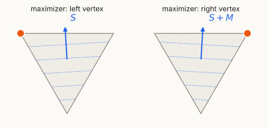
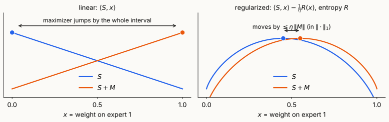
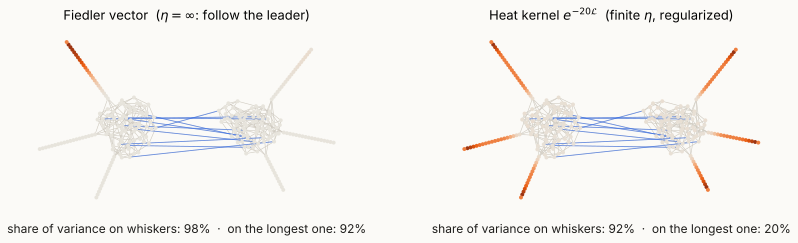

## Where we are

- **Lecture 9:** Laplacian systems in nearly-linear time. Today's first part finished KOSZ (Lecture 9 deck).
- **Lectures 6–8:** an eigenvector certifies a bound, and a sweep rounds it. One eigenvector, one round.
- **Next three lectures** need something different: control of $\lambda_{\max}$ of a **sum of matrices chosen one at a time**, possibly in response to what we did.

::: {.idea}
**Today's question.** How do we bound $\lambda_{\max}\big(\sum_tM_t\big)$ when the $M_t$ arrive online? And why does the answer tell us how to find **balanced** sparse cuts, which Fiedler's vector cannot?
:::

::: notes
~2 min. Two applications to keep in mind throughout: spectral sparsification (Lecture 12), where Σ_t M_t is a sum of sampled rank-one matrices that should be close to the identity, and SDP certificates for balanced separator (Lecture 11), where Σ_t M_t is a sum of penalty Laplacians.
:::

## Plan

- **§1 The game.** Online linear optimization over density matrices; follow the leader fails.
- **§2 FTRL with von Neumann entropy.** Gibbs, the MMWU, **strong convexity $\Rightarrow$ smoothness**, the regret bound.
- **§3 Losses and the heat kernel.** Eigenvector $=$ follow the leader, heat kernel $=$ regularized.
- **§4 Balanced separator.** Fiedler finds whiskers; recursive eigenvectors; an SDP with a spread constraint.

::: notes
~1 min. Timing for the new material: §1 ~15 min, §2 ~19 min, §3 ~3 min, §4 ~16 min, takeaways ~2 min.
:::

# §1 · The game {background-color="#1c1b19"}

## Why a learning algorithm?

Two problems of the form "bound $\lambda_{\max}$ of a sum":

- **Sparsification (L12).** Sample edges $e_1,\dots,e_q$ and show $\sum_tY_t\approx I$, with $Y_t$ rank one.
- **SDP certificates (L11).** Add penalty graphs $H_1,H_2,\dots$ until $\lambda_2\big(G+\sum_tH_t\big)$ is large.

. . .

**The obstacle:** $\lambda_{\max}(A)=\max_{\|u\|=1}u^\top Au$ is a max over **all** directions, and the $M_t$ may depend on the past.

. . .

::: {.idea}
**Online learning** replaces the max over all directions by **one** "probability distribution over directions" $X_t$, updated each round. If every round is good against $X_t$, the sum is good against **every** direction.
:::

::: notes
~3 min. The scalar analogue students know: multiplicative weights over n experts turns "the best expert did well" into "our average did well". Here the "experts" are all unit vectors, a continuum, and the distribution over them is a density matrix.
:::

## Density matrices

::: {.defn}
**Spectraplex.** $\ \Delta_n=\{X\in\mathbb S^n:\ X\succeq0,\ \operatorname{tr}X=1\}$, with $\langle A,X\rangle=\operatorname{tr}(AX)$.
:::

- $X=\sum_k p_k\,u_ku_k^\top$ with $p\in$ simplex and $u_k$ orthonormal: a **distribution over directions**. Extreme points: $uu^\top$, $\|u\|=1$.
- **Courant–Fischer (LA Review I):** $\ \lambda_{\max}(A)=\max_{X\in\Delta_n}\langle A,X\rangle$, attained at the top eigenvector.
- **Diagonal case:** $X=\operatorname{diag}(p)$, $\ \langle\operatorname{diag}(g),X\rangle=\langle g,p\rangle$: the simplex and the **experts** problem.

::: notes
~2 min. The max over Δ_n of a linear function is attained at an extreme point, hence at some uu^T, which recovers the Rayleigh quotient. We use "density matrix" from quantum mechanics: X describes a mixed state.
:::

## The game

::: {.defn}
**Online linear optimization over $\Delta_n$.** For $t=1,\dots,T$:

1. the player chooses $X_t\in\Delta_n$;
2. the adversary reveals a symmetric $M_t$ (which may depend on $X_1,\dots,X_t$);
3. the player **gains** $\langle M_t,X_t\rangle$.

**Regret:** with $S_t=\sum_{s\le t}M_s$,
$$\mathrm{Regret}_T=\max_{X\in\Delta_n}\langle S_T,X\rangle-\sum_{t}\langle M_t,X_t\rangle=\lambda_{\max}(S_T)-\sum_t\langle M_t,X_t\rangle .$$
:::

. . .

::: {.idea}
A regret bound **is** an eigenvalue bound: $\ \lambda_{\max}\big(\sum_tM_t\big)\le\sum_t\langle M_t,X_t\rangle+\mathrm{Regret}_T$. The right side only involves the **scalars** $\langle M_t,X_t\rangle$.
:::

::: notes
~3 min. Emphasize the reading of the regret bound: in applications we get to *choose* M_t so that ⟨M_t, X_t⟩ is small (an "oracle" that responds to X_t), and the regret bound converts this into a bound on λ_max of the sum. That is the whole trick of Lectures 11 and 12.
:::

## Follow the leader fails

**Follow the leader (FTL):** $\ X_t=\arg\max_{X\in\Delta_n}\langle S_{t-1},X\rangle$, i.e. the **top eigenvector** of the running sum.

Two experts (diagonal $M_t$), gains
$$(\tfrac12,0),\ (0,1),\ (1,0),\ (0,1),\ (1,0),\ \dots$$

- After round $t$ the leader is the expert that is about to get $0$: FTL gains $\approx0$.
- Each expert gains $\approx T/2$: $\ \mathrm{Regret}_T\approx T/2$.

::: {.warn}
**Linear maximizers are unstable.** A linear function on a compact convex set is maximized at an extreme point. When the objective is nearly perpendicular to a face, a tiny perturbation moves the maximizer **across the whole face** (right). On $\Delta_n$: the top eigenvector of $S_{t-1}$ jumps when eigenvalues are nearly tied, and the adversary keeps them tied.
:::

{.nostretch fig-align="center" width="100%" fig-alt="Two copies of a triangle with dashed level lines of a linear function. The objective arrow points almost straight up in both; a tiny rotation moves the maximizer from the left top vertex to the right top vertex."}

::: notes
~4 min. Check: S_1 = (1/2, 0) → FTL plays expert 1, gets 0 in round 2; S_2 = (1/2, 1) → plays expert 2, gets 0 in round 3; S_3 = (3/2, 1) → expert 1, gets 0; and so on. The running sum stays within 1/2 of a tie, exactly the situation in the picture: the objective is nearly perpendicular to the edge between the two experts. Keep this example: it comes back in §4, where FTL is the recursive eigenvector algorithm. Figure: scripts/stability_figures.py.
:::

## Regularization stabilizes the maximizer

{.nostretch fig-align="center" width="92%" fig-alt="Left: two nearly flat lines with opposite slopes; their maximizers are at opposite ends of the interval. Right: the same lines plus a concave entropy term; the two maxima are close together near the middle."}

- Adding a **strongly concave** term $-\frac1\eta R$ makes the objective fall off **quadratically** from its peak.
- A perturbation $M$ gains at most $\|M\|_*\,r$ by moving the peak a distance $r$, and loses $\approx\frac\alpha2r^2$. So the peak moves by **$O(\|M\|_*/\alpha)$**.

::: {.idea}
For entropy ($\alpha=\frac1\eta$ w.r.t. $\|\cdot\|_1$): $\ \|X(S+M)-X(S)\|_1\le\eta\,\|M\|$. Small $\eta$: stable but slow to follow the data. That trade-off is the regret bound.
:::

::: notes
~3 min. Intuition only; the precise statement is the lemma in §2 ("strong convexity implies smoothness of the maximum"). The Lipschitz bound follows by adding the quadratic-decay inequalities at the two maximizers: α‖Y−X‖² ≤ ⟨M, Y−X⟩ ≤ ‖M‖_*‖Y−X‖. In the picture: δ = ∓0.1, so ‖M‖ = 0.1 and the maximizer moves from σ(−0.2) ≈ 0.45 to σ(0.2) ≈ 0.55, i.e. ‖ΔX‖₁ = 0.2 = η‖M‖.
:::

## Follow the regularized leader

::: {.defn}
**FTRL.** Fix a convex **regularizer** $R:\Delta_n\to\mathbb R$ and a step size $\eta>0$. Play
$$X_t=\arg\max_{X\in\Delta_n}\ \Big\{\langle S_{t-1},X\rangle-\tfrac1\eta R(X)\Big\}.$$
:::

- $R$ penalizes **concentrated** plays: it keeps $X_t$ spread out, so small changes in $S_{t-1}$ cause small changes in $X_t$.
- $\eta\to\infty$: back to FTL. $\eta\to0$: ignore the data.
- The analysis will show two costs: the **range** of $R$ (paid once, $\propto1/\eta$) and the **stability** of the play (paid every round, $\propto\eta$).

::: notes
~2 min. Regularization is the same idea as in statistics: trade a little bias (we don't play the best response) for a lot of stability.
:::

# §2 · FTRL with von Neumann entropy {background-color="#1c1b19"}

## Matrix functions and von Neumann entropy

For $X=\sum_kx_ku_ku_k^\top$ and $f:\mathbb R\to\mathbb R$: $\ f(X)=\sum_kf(x_k)\,u_ku_k^\top$ (LA Review II).

::: {.defn}
**Von Neumann (negative) entropy** and **quantum relative entropy** on $\Delta_n$:
$$R(X)=\operatorname{tr}X\log X=\sum_kx_k\log x_k,\qquad D(Y\Vert X)=\operatorname{tr}Y(\log Y-\log X).$$
:::

- $-\log n\le R(X)\le0$: minimum at $X=I/n$, maximum ($0$) at every $uu^\top$. **Range $=\log n$.**
- $R$ depends only on the eigenvalues: it is the negative Shannon entropy of the spectrum.
- **Klein's inequality:** $D(Y\Vert X)\ge0$, with equality iff $Y=X$. Diagonal case: the KL divergence of Lecture 3.

::: notes
~3 min. Convention 0 log 0 = 0. Klein's inequality will also follow from the strong convexity theorem in a few slides (D(Y‖X) ≥ ½‖Y−X‖₁²), proved in the notes. Note that D(Y‖X) is not just KL of the spectra: the eigenbases of X and Y need not agree.
:::

## The Gibbs variational principle

::: {.lem}
**Lemma (Gibbs).** For every symmetric $A$,
$$\max_{X\in\Delta_n}\big\{\langle A,X\rangle-\operatorname{tr}X\log X\big\}=\log\operatorname{tr}e^{A},\qquad\text{attained only at}\quad\rho_A=\frac{e^{A}}{\operatorname{tr}e^{A}} .$$
:::

::: {.pf}
*Proof.* Let $Z=\operatorname{tr}e^A$, so $\log\rho_A=A-(\log Z)I$. For $X\in\Delta_n$, $\ \langle A,X\rangle=\operatorname{tr}X\log\rho_A+\log Z$, hence
$$\langle A,X\rangle-\operatorname{tr}X\log X=\log Z-\operatorname{tr}X(\log X-\log\rho_A)=\log Z-D(X\Vert\rho_A)\le\log Z,$$
with equality iff $X=\rho_A$ (Klein). $\square$
:::

- Statistical mechanics: free energy $=$ energy $-$ entropy, maximized by the **Gibbs state**.
- Diagonal case: $\max_{p}\{\langle a,p\rangle+H(p)\}=\log\sum_ie^{a_i}$, the **log-sum-exp**.

::: notes
~3 min. This is the only place we use Klein. It gives the closed form of the FTRL play on the next slide.
:::

## The matrix multiplicative weights update

FTRL with $R(X)=\operatorname{tr}X\log X$, by Gibbs with $A=\eta S_{t-1}$:

::: {.thm}
**MMWU.** $\displaystyle\ X_t=\frac{\exp(\eta S_{t-1})}{\operatorname{tr}\exp(\eta S_{t-1})},\qquad S_{t-1}=\sum_{s<t}M_s .$

**Value function.** $\displaystyle\ \Psi(S):=\max_{X\in\Delta_n}\Big\{\langle S,X\rangle-\tfrac1\eta\operatorname{tr}X\log X\Big\}=\frac1\eta\log\operatorname{tr}e^{\eta S},\qquad X_t=X(S_{t-1}).$
:::

- **Diagonal case:** $p_t(i)\propto\exp\big(\eta\sum_{s<t}g_s(i)\big)$, the **Hedge** / multiplicative weights algorithm.
- **Two facts about $\Psi$:** $\ \Psi(0)=\dfrac{\log n}\eta\ $ and $\ \Psi(S)\ge\lambda_{\max}(S)\ $ (take $X=uu^\top$, entropy $0$).
- **Cost:** one matrix exponential per round, or (L11) a few products $e^{\eta S}v$ via Laplacian solvers.

::: notes
~3 min. Ψ is the "soft max" of the eigenvalues: λ_max(S) ≤ Ψ(S) ≤ λ_max(S) + log n / η. The whole regret analysis is: Ψ starts at log n/η, ends above λ_max(S_T), and grows by about ⟨M_t, X_t⟩ each round.
:::

## Strong convexity implies smoothness of the maximum

::: {.lem}
**Lemma.** Let $R$ be **$\alpha$-strongly convex** on a convex set $K$ w.r.t. a norm $\|\cdot\|$:
$$R(Y)\ge R(X)+\langle\nabla R(X),Y-X\rangle+\tfrac\alpha2\|Y-X\|^2 .$$
Let $\Psi(S)=\max_{X\in K}\{\langle S,X\rangle-R(X)\}$ with maximizer $X(S)$. Then, with $\|\cdot\|_*$ the dual norm,
$$\Psi(S+M)\ \le\ \Psi(S)+\langle X(S),M\rangle+\frac1{2\alpha}\|M\|_*^2 .$$
:::

::: {.pf}
*Proof.* Let $X=X(S)$ and $g(Y)=\langle S,Y\rangle-R(Y)$. **Quadratic decay:** strong convexity plus first-order optimality, $\langle S-\nabla R(X),Y-X\rangle\le0$, give for every $Y\in K$
$$g(Y)\le g(X)+\langle S-\nabla R(X),Y-X\rangle-\tfrac\alpha2\|Y-X\|^2\le\Psi(S)-\tfrac\alpha2\|Y-X\|^2 .$$
**Conclude** with $Y=X(S+M)$:
$$\Psi(S+M)=g(Y)+\langle M,Y \rangle 
\le \Psi(S)+\langle M,Y\rangle -\tfrac\alpha2\|Y-X\|^2 \\
\le \Psi(S)+\langle M,X\rangle+ \langle M,Y - X\rangle -\tfrac\alpha2\|Y-X\|^2 \\
\le \Psi(S)+\langle M,X\rangle+\max_{r\ge0}\Big\{\|M\|_*\,r-\tfrac\alpha2r^2\Big\}.\ \square$$
:::

::: notes
~5 min. The picture: g is strongly concave, so it falls off quadratically from its peak X(S). Tilting by M can move the peak, but the gain from moving a distance r is at most ‖M‖_* r, while the loss is (α/2) r². The best trade-off is ‖M‖_*²/(2α). This is the conjugate-duality fact "R strongly convex ⇔ R* smooth", proved without Bregman divergences. For the entropy, X(S) is full rank, so ∇R(X) = log X + I exists, and first-order optimality holds with equality on traceless directions.
:::

## Strong convexity of von Neumann entropy

::: {.thm}
**Theorem.** $R(X)=\operatorname{tr}X\log X$ is **$1$-strongly convex on $\Delta_n$ w.r.t. the trace norm** $\|H\|_1=\sum_k|\lambda_k(H)|$: for $X\in\Delta_n$ of full rank and $Y\in\Delta_n$,
$$R(Y)\ \ge\ R(X)+\langle\log X+I,\,Y-X\rangle+\tfrac12\|Y-X\|_1^2 .$$
:::

- The gap $R(Y)-R(X)-\langle\log X+I,Y-X\rangle$ is exactly $D(Y\Vert X)$, so this is **quantum Pinsker**: $\ D(Y\Vert X)\ge\tfrac12\|Y-X\|_1^2$. Diagonal case: Pinsker from Lecture 3.
- The dual of $\|\cdot\|_1$ is the **operator norm** $\|M\|=\max_k|\lambda_k(M)|$.
- **Proof in the notes** (one page): the second derivative along $H$ is $\sum_{ij}|H_{ij}|^2\,\frac{\log x_i-\log x_j}{x_i-x_j}$ in the eigenbasis of $X$, then logarithmic mean $\le$ arithmetic mean and Cauchy–Schwarz against $\operatorname{sgn}(H)$.

::: notes
~3 min. Do not prove in class. Mention that the trace norm is the right norm because Δ_n is its unit-norm slice of the PSD cone, exactly as ℓ₁ is for the simplex; and that strong convexity in ℓ₁ for Shannon entropy is classical Pinsker. Notes: notes/lecture10-notes.qmd §3.
:::

## The regret bound

::: {.thm}
**Theorem (MMWU regret).** For any symmetric $M_1,\dots,M_T$ (chosen adaptively), the MMWU plays satisfy
$$\lambda_{\max}\Big(\sum_{t=1}^TM_t\Big)\ \le\ \sum_{t=1}^T\langle M_t,X_t\rangle+\frac\eta2\sum_{t=1}^T\|M_t\|^2+\frac{\log n}{\eta}.$$
:::

::: {.pf}
*Proof.* Apply the lemma with $R=\frac1\eta\operatorname{tr}X\log X$, which is $\frac1\eta$-strongly convex w.r.t. $\|\cdot\|_1$: for each $t$,
$$\Psi(S_t)\le\Psi(S_{t-1})+\langle X_t,M_t\rangle+\tfrac\eta2\|M_t\|^2 .$$
Sum over $t$ and use the two facts: $\ \lambda_{\max}(S_T)\le\Psi(S_T)\ $ and $\ \Psi(S_0)=\Psi(0)=\frac{\log n}\eta$. $\square$
:::

**Tuning.** If $\|M_t\|\le\rho$, take $\eta=\sqrt{2\log n/(T\rho^2)}$: $\ \mathrm{Regret}_T\le\rho\sqrt{2T\log n}$. Average regret $\to0$; diagonal case: Hedge's $\sqrt{T\log n}$.

::: notes
~4 min. Point at the two terms: log n/η is the range of the regularizer (FTL has η = ∞, so this term vanishes) and (η/2)Σ‖M_t‖² is the stability cost (for FTL it is unbounded, which is the two-experts example). In "averaged" form: (1/T) λ_max(S_T) ≤ average gain + ε after T = O(ρ² log n/ε²) rounds.
:::

## A sharper bound: local norms

::: {.thm}
**Theorem (local-norm MMWU; stated).** If $\eta M_t\preceq I$ for all $t$, then
$$\lambda_{\max}\Big(\sum_tM_t\Big)\ \le\ \sum_t\langle M_t,X_t\rangle+\eta\sum_t\langle M_t^2,X_t\rangle+\frac{\log n}{\eta}.$$
:::

- $\langle M^2,X\rangle\le\|M\|^2$ always: never worse (up to the constant), often much better.
- **PSD losses.** If $0\preceq M_t\preceq\rho I$, then $M_t^2\preceq\rho M_t$ and
$$\lambda_{\max}\Big(\sum_tM_t\Big)\le(1+\eta\rho)\sum_t\langle M_t,X_t\rangle+\frac{\log n}\eta .$$
- With $\langle M_t,X_t\rangle\le1$ per round: average $\le1+O(\varepsilon)$ after $T=O(\rho\log n/\varepsilon^2)$ rounds, vs. $O(\rho^2\log n/\varepsilon^2)$ from the global bound.

::: {.idea}
The **width** $\rho$ enters linearly, not quadratically. In sparsification $\rho\approx n$: this is $n\log n$ vs. $n^2\log n$ samples. Proof: Lecture 12.
:::

::: notes
~3 min. The global bound measures the change in the play X_t in the worst direction; the local bound measures it in the directions where X_t actually puts mass. For PSD losses with small trace against X_t (the situation in sampling), these are very different. Proof options for L12: Golden–Thompson, or a local version of the strong convexity ⇒ smoothness lemma.
:::

# §3 · Losses and the heat kernel {background-color="#1c1b19"}

## Losses: MMWU is a heat kernel

Apply the theorem to $-M_t$: play $X_t\propto\exp(-\eta S_{t-1})$, and
$$\lambda_{\min}\Big(\sum_tM_t\Big)\ \ge\ \sum_t\langle M_t,X_t\rangle-\frac\eta2\sum_t\|M_t\|^2-\frac{\log n}\eta .$$

. . .

If the losses are **Laplacians**, say $S_{t-1}=s\,\mathcal L$ with $\mathcal L=D^{-1/2}LD^{-1/2}$:
$$X_t\ \propto\ e^{-\eta s\mathcal L}=D^{1/2}H_{\eta s}D^{-1/2}\qquad(\text{Lecture 2: }H_\tau=e^{-\tau L_{rw}}).$$

- $X_t$ is the **heat kernel** at time $\tau=\eta s$. Its diagonal is the **return probability** $H_\tau(i,i)$: large where the walk gets stuck.
- $\eta\to\infty$: $X_t\to$ projector onto the bottom eigenvector. On $\mathbf 1^\perp$ (in the $D$ inner product): the **Fiedler vector**.

::: {.idea}
**Eigenvector $=$ follow the leader. Heat kernel $=$ follow the regularized leader.**
:::

::: notes
~4 min. To work orthogonally to the trivial eigenvector, restrict to the subspace orthogonal to D^{1/2}1: then the diagonal of X is proportional to H_τ(i,i) − π_i. The heat-kernel walk was in Lecture 1's demo; here it acquires a meaning: it is the regularized version of the eigenvector, with regularization strength 1/τ.
:::

# §4 · Balanced separator {background-color="#1c1b19"}

## The problem

::: {.defn}
$S$ is **$b$-balanced** if $\ b\,\mathrm{vol}(V)\le\mathrm{vol}(S)\le(1-b)\,\mathrm{vol}(V)$.

**Balanced separator** (parameters $b\in(0,\frac12]$, $\gamma>0$): **either** output an $\Omega(b)$-balanced $S$ with $\Phi(S)=O(\sqrt\gamma)$, **or** certify that every $b$-balanced $S$ has $\Phi(S)>\gamma$.
:::

- The $\sqrt\gamma$ is the Cheeger loss (Lecture 6): this is the best we can hope for from spectral methods.
- **Why balance:** divide and conquer, nested dissection (Lecture 9), hierarchical clustering. An unbalanced sparse cut makes no progress.
- Fiedler + sweep gives $\Phi(S)\le\sqrt{2\lambda}$, but **no control over the balance**.

::: notes
~3 min. The decision version with a certificate is the natural primal-dual form: the certificate will be a dual SDP solution (Lecture 11).
:::

## Fiedler finds whiskers

{.nostretch fig-align="center" width="100%" fig-alt="Two copies of the same graph: two dense clusters joined by blue edges with six long paths sticking out. On the left only one path is coloured orange; on the right all six paths are coloured."}

- A balanced cut with $\Phi=0.0235$ exists. The Fiedler sweep returns the longest whisker: $\Phi=0.0233$, **5% of the volume**.
- A whisker of length $\ell$ has $\Phi\approx\frac1{2\ell}$ but $\lambda=\Theta(1/\ell^2)$ (test function, Lecture 5): the eigenvalue sees the whisker as $\Phi^2$ and the bridge as $\Phi$.

::: notes
~4 min. Numbers from scripts/make_figures.py: n = 262, λ₂ = 0.0025, λ₃ = 0.0031, λ₄ = 0.0038 (one eigenvalue per whisker, roughly). The Fiedler embedding puts 92% of its variance on the longest whisker. The heat kernel at τ = 20 (right) spreads 92% of its variance over all six whiskers, 11–20% each: a penalty on "heavy" vertices would hit all of them at once.
:::

## Recursive eigenvector partitioning

::: {.defn}
**Recursive spectral partitioning.** $U\leftarrow\emptyset$. Repeat: compute the Fiedler vector of $G[V\setminus U]$ and its sweep cut $C$; if $C$ is balanced, output it; otherwise $U\leftarrow U\cup C$. Stop when $\mathrm{vol}(U)\ge b\,\mathrm{vol}(V)$ and output $U$.
:::

On the example ($b=\frac14$): rounds 1–3 remove the whiskers of lengths $22,20,18$ ($\Phi=0.023,0.026,0.029$); round 4 finds a balanced cut.

. . .

- The **guarantee** is Cheeger-type: each removed piece is sparse in what remains.
- The **cost**: with $k$ whiskers, up to $k$ rounds, each a full eigenvector computation. Worst case $\Theta(n)$ rounds: time $\tilde\Omega(mn)$.

::: {.idea}
Each round plays the **best response** to everything removed so far, and the adversary (the graph) answers with the next whisker. **Recursive eigenvectors are follow the leader.**
:::

::: notes
~4 min. "Is FTL" is an analogy made precise by the SDP on the next slide: removing a set is a crude way of enforcing a constraint that the eigenvector violates. FTL makes progress one violation at a time; FTRL hedges against all of them at once.
:::

## A relaxation with a spread constraint

Embed $v_i\in\mathbb R^n$ and minimize the Dirichlet energy:
\begin{align*}
\mathrm{SDP}(b) & :\quad\min\ \frac1{\mathrm{vol}(V)}\sum_{\{i,j\}\in E}w_{ij}\|v_i-v_j\|^2\\
\text{s.t.} & \quad\sum_i\pi_iv_i=0,\\
& \sum_i\pi_i\|v_i\|^2=1,\\
& \underbrace{\|v_i\|^2\le\tfrac1b\ \ \forall i}_{\text{spread}} .
\end{align*}

- **An SDP** in the Gram matrix $X_{ij}=\langle v_i,v_j\rangle$: minimize $\frac{\langle L,X\rangle}{\mathrm{vol}(V)}$ s.t. $X\pi=0$, $\langle\Pi,X\rangle=1$, $X_{ii}\le\frac1b$, $X\succeq0$.

- **Cuts are feasible.** For $S$ with $p=\pi(S)\in[b,\frac12]$: $v=\frac{\mathbf 1_S-p}{\sqrt{p(1-p)}}$ has $\max_i\|v_i\|^2=\frac{1-p}p\le\frac1b$ and objective $\bar\phi(S)$ (Lecture 6). So $\ \mathrm{SDP}(b)\le\min_{S\ b\text{-bal.}}\bar\phi(S)\le2\min_{S\ b\text{-bal.}}\Phi(S)$.
- **Drop the spread constraint:** the minimum is $\lambda$ (Lecture 6, $\ell_2^2$ characterization). A whisker embedding puts all its variance on 5% of the volume, so some $\|v_i\|^2\gg1/b$.

::: notes
~4 min. Check the cut embedding: Σπ_i v_i = 0 and Σπ_i v_i² = 1 by construction; v_i² = (1−p)/p on S and p/(1−p) ≤ 1 off S; (1−p)/p ≤ 1/b iff p ≥ b/(1+b), so p ≥ b suffices. Objective: w(S, S̄)/(vol(V) p(1−p)) = w(S, S̄) vol(V)/(vol(S) vol(S̄)) = φ̄(S). The dual (Lecture 11) has one multiplier per spread constraint: a certificate that λ₂ of G plus a penalty graph on heavy vertices is large.
:::

## Two ways to enforce the spread constraint

| | recursive eigenvector | MMWU (Orecchia–Sachdeva–Vishnoi 2012) |
|:--|:--|:--|
| each round plays | eigenvector ($\eta=\infty$) | heat kernel (finite $\eta$) |
| a violation is handled by | removing the heavy set | **penalizing** it (adding a loss) |
| rounds | up to $\Theta(n)$ | $\mathrm{polylog}(n)$, by the regret bound |
| cost per round | one eigenvector | a few $e^{-\tau\mathcal L'}v$: $\tilde O(m)$ via solvers |
| total time | $\tilde O(mn)$ worst case | $\tilde O(m)$ |

- Same guarantee: $\Omega(b)$-balanced with $\Phi=O(\sqrt\gamma)$, or a certificate.
- Context: ARV's $O(\sqrt{\log n})$ uses the SDP with triangle inequalities (Lecture 6 §5); the cut-matching game is its combinatorial relative.

::: {.idea}
**Next lecture:** the primal-dual loop. Each round the heat-kernel embedding is either **spread** (round it with a sweep) or **concentrated** on a set (penalize it); the regret bound ends the loop.
:::

::: notes
~3 min. The exact number of rounds and the form of the penalty graphs (stars) are for Lecture 11. Keep the table high-level here.
:::

## Takeaways

1. Many spectral bounds are bounds on $\lambda_{\max}$ of a **sum**. Online learning over $\Delta_n$ reduces them to **per-round scalars** $\langle M_t,X_t\rangle$.
2. **FTL** plays the top eigenvector and can have regret $T/2$. **FTRL with von Neumann entropy** is the MMWU, $X_t\propto e^{\eta S_{t-1}}$ (Gibbs).
3. **Strong convexity $\Rightarrow$ smoothness of the max:** $\ \lambda_{\max}(\sum M_t)\le\sum\langle M_t,X_t\rangle+\frac\eta2\sum\|M_t\|^2+\frac{\log n}\eta$. Entropy is $1$-strongly convex in $\|\cdot\|_1$ (quantum Pinsker).
4. **Local norms** replace $\|M_t\|^2$ by $\langle M_t^2,X_t\rangle$: width linear, not squared.
5. With Laplacian losses the plays are **heat kernels**; the eigenvector is the $\eta=\infty$ limit.
6. **Balanced separator:** Fiedler finds whiskers; recursive eigenvectors (FTL) may need $\Theta(n)$ rounds; the spread-constrained SDP and MMWU (FTRL) handle all whiskers at once.

## Discussion questions

1. For diagonal $M_t$, what do the Gibbs lemma, the strong convexity theorem and the regret bound become?
2. Replace the entropy by $R(X)=\frac12\|X\|_F^2$. What is the play? The range of $R$? Which norm appears in the regret bound, and when is it worse than $\|M_t\|$?
3. Why is the **return probability** $H_\tau(i,i)$ large at the end of a whisker? How large is it, as a function of $\ell$ and $\tau$?
4. In the example, which vertices violate the spread constraint for the Fiedler embedding when $b=\frac14$? For the heat-kernel embedding at $\tau=20$?
5. Construct a family of graphs on which recursive spectral partitioning needs $\Omega(n)$ rounds.

## References

- **S. Arora, E. Hazan, S. Kale.** The multiplicative weights update method: a meta-algorithm and applications. *Theory of Computing* 2012.
- **S. Arora, S. Kale.** A combinatorial, primal-dual approach to semidefinite programs. *STOC* 2007; *J. ACM* 2016.
- K. Tsuda, G. Rätsch, M. K. Warmuth. Matrix exponentiated gradient updates for on-line learning and Bregman projection. *JMLR* 2005. · M. K. Warmuth, D. Kuzmin. Randomized online PCA algorithms with regret bounds that are logarithmic in the dimension. *JMLR* 2008.
- S. Shalev-Shwartz. Online learning and online convex optimization. *FnT ML* 2012. · E. Hazan. *Introduction to Online Convex Optimization*, 2nd ed., 2022.
- Y.-L. Yu. The strong convexity of von Neumann's entropy. Note, 2013. · M. A. Nielsen, I. L. Chuang. *Quantum Computation and Quantum Information*, Ch. 11.
- L. Orecchia, L. J. Schulman, U. V. Vazirani, N. K. Vishnoi. On partitioning graphs via single commodity flows. *STOC* 2008.
- L. Orecchia, N. K. Vishnoi. Towards an SDP-based approach to spectral methods: a nearly-linear-time algorithm for graph partitioning and decomposition. *SODA* 2011.
- **L. Orecchia, S. Sachdeva, N. K. Vishnoi.** Approximating the exponential, the Lanczos method and an $\tilde O(m)$-time spectral algorithm for balanced separator. *STOC* 2012 (arXiv:1111.1491).
- S. Arora, S. Rao, U. Vazirani. Expander flows, geometric embeddings and graph partitioning. *STOC* 2004; *J. ACM* 2009. · R. Andersen, Y. Peres. Finding sparse cuts locally using evolving sets. *STOC* 2009.
- M. W. Mahoney, L. Orecchia. Implementing regularization implicitly via approximate eigenvector computation. *ICML* 2011.

Reading: Lecture 10 notes; Arora–Hazan–Kale §§2, 5; Hazan, Ch. 5.

# Appendix: definitions for the board {background-color="#1c1b19"}

## Definitions {.smaller}

| Object | Definition |
|:--|:--|
| spectraplex | $\Delta_n=\{X\succeq0,\ \operatorname{tr}X=1\}$, $\ \langle A,X\rangle=\operatorname{tr}(AX)$ |
| regret | $\lambda_{\max}(S_T)-\sum_t\langle M_t,X_t\rangle$, $\ S_t=\sum_{s\le t}M_s$ |
| FTL / FTRL | $\arg\max_X\langle S_{t-1},X\rangle$ / $\arg\max_X\{\langle S_{t-1},X\rangle-\frac1\eta R(X)\}$ |
| entropy, relative entropy | $R(X)=\operatorname{tr}X\log X\in[-\log n,0]$, $\ D(Y\Vert X)=\operatorname{tr}Y(\log Y-\log X)$ |
| MMWU | $X_t=e^{\eta S_{t-1}}/\operatorname{tr}e^{\eta S_{t-1}}$; value $\Psi(S)=\frac1\eta\log\operatorname{tr}e^{\eta S}$ |
| norms | $\|H\|_1=\sum_k|\lambda_k(H)|$ (trace), $\ \|M\|=\max_k|\lambda_k(M)|$ (operator), dual to each other |
| strong convexity | $R(Y)\ge R(X)+\langle\nabla R(X),Y-X\rangle+\frac\alpha2\|Y-X\|^2$ |
| regret bound | $\lambda_{\max}(\sum M_t)\le\sum\langle M_t,X_t\rangle+\frac\eta2\sum\|M_t\|^2+\frac{\log n}\eta$ |
| local norms ($\eta M_t\preceq I$) | $\lambda_{\max}(\sum M_t)\le\sum\langle M_t,X_t\rangle+\eta\sum\langle M_t^2,X_t\rangle+\frac{\log n}\eta$ |
| heat kernel | $e^{-\tau\mathcal L}=D^{1/2}H_\tau D^{-1/2}$, $\ H_\tau=e^{-\tau L_{rw}}$ |
| $b$-balanced | $b\,\mathrm{vol}(V)\le\mathrm{vol}(S)\le(1-b)\,\mathrm{vol}(V)$ |
| $\mathrm{SDP}(b)$ | $\min\frac{\langle L,X\rangle}{\mathrm{vol}(V)}$ s.t. $X\pi=0$, $\langle\Pi,X\rangle=1$, $X_{ii}\le\frac1b$, $X\succeq0$ |
