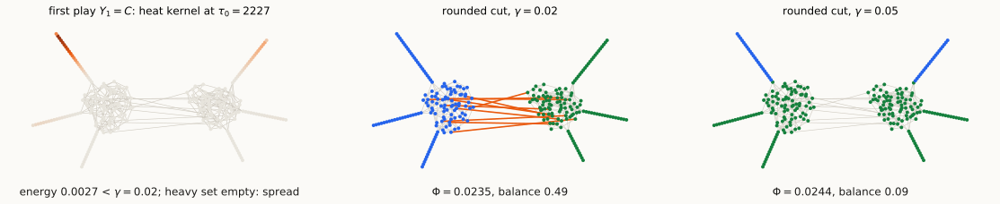

## Where we are

- **Today:** solve the **feasibility version** of $\mathrm{SDP}(b)$ approximately by playing the MMWU against an **oracle**, and read off either a balanced sparse cut or a **certificate** that none exists.

::: {.defn}
**Is $\mathrm{SDP}(b)\le\gamma$?** With $\Pi=\operatorname{diag}(\pi)$ and the Gram matrix $X$ of the $v_i$, set $Y=\Pi^{1/2}X\Pi^{1/2}$.

\begin{alignat*}{2}
&\textbf{Vector form} &\qquad\qquad&\textbf{Density-matrix form}\\[4pt]
\text{find}\ &v_1,\dots,v_n\in\mathbb R^n &\qquad\qquad\text{find}\ &Y\succeq0\\
\text{s.t.}\ &\frac1{\mathrm{vol}(V)}\sum_{\{i,j\}\in E}w_{ij}\|v_i-v_j\|^2\le\gamma, &\text{s.t.}\ &\langle\mathcal L,Y\rangle\le\gamma,\\
&\sum_i\pi_iv_i=0, &&Y\sqrt\pi=0,\\
&\sum_i\pi_i\|v_i\|^2=1, &&\operatorname{tr}Y=1,\\
&\|v_i\|^2\le\tfrac1b\ \ \forall i, &&\frac{Y_{ii}}{\pi_i}\le\tfrac1b\ \ \forall i.
\end{alignat*}

The plays are density matrices on $W=\sqrt\pi^{\perp}$, the space where $\mathcal L\succeq\lambda_2 I$.
:::

::: notes
~2 min. Check the translation: tr Y = Σπ_i‖v_i‖² = 1; Y√π = 0 iff Σπ_i v_i = 0; ⟨L, X⟩/vol(V) = ⟨D^{-1/2} L D^{-1/2}, Y⟩ = ⟨𝓛, Y⟩ because Π = D/vol(V). From here on "the embedding" means the v_i read off from Y.
:::

## A first candidate: the heat kernel at $\tau_0$

Try $\ Y=\dfrac{e^{-\tau_0\mathcal L}}{\operatorname{tr}e^{-\tau_0\mathcal L}}$ on $W$, $\ \tau_0=\dfrac{8\ln n}\gamma$, and check the constraints:

- $Y\sqrt\pi=0$, $Y\succeq0$: by construction. **Variance** $\operatorname{tr}Y=\sum_i\pi_i\|v_i\|^2=1$: just a **normalization**, since an embedding's scale is arbitrary.
- **Energy** $\langle\mathcal L,Y\rangle\le\gamma$: large $\tau_0$ keeps only the directions of energy $\approx\lambda_2$.
- **Spread** $\|v_i\|^2\le\frac1b$: **every vector is short**, so no small set can hold much of the variance. This is the constraint that fails.
- **Heavy and light sets.** $\ H=\{i:\|v_i\|^2\ge\frac{16}b\}$, $\ L=V\setminus H$. The algorithm asks less than spread: is **most of the variance on $L$**?

<iframe class="demo-frame" style="height:410px" src="demos/heat-candidate-demo.html"></iframe>

Standalone: <a href="demos/heat-candidate-demo.html" target="_blank">demos/heat-candidate-demo.html</a>. Data: <code>scripts/heat_candidate_demo.py</code>.

::: notes
~4 min. Go through the graphs in order (b = 1/4, γ = 0.02, so 1/b = 4; heavy threshold c/b with c = 16 as in the algorithm).

- Two expanders: Y ≈ the Fiedler vector, ‖v_i‖² ≈ 1 everywhere, energy λ₂ = 0.011: feasible. Round.
- Lecture 10 graph: energy 0.003 is fine, but max ‖v_i‖² = 27 > 1/b: infeasible. The heat kernel mixes all the near-λ₂ whisker modes. With c = 16 nothing is heavy (27 < 64), so the oracle rounds (round 1 of the example later). Switch to c = 4: the tip of one long whisker becomes heavy (2.2% of the volume, 51% of the variance), and the oracle penalizes instead.
- 8-regular expander + one whisker: Y is essentially the whisker's own mode, max ‖v_i‖² = 119. Heavy even at c = 16: 0.7% of the volume, 75% of the variance. Penalize.
- Expander: energy ≈ λ₂ = 0.15 > γ, and every Y on W has ⟨𝓛,Y⟩ ≥ λ₂, so SDP(b) > γ: certify. (Slide γ above 0.15 to see the energy constraint hold.)
- Grid: feasible, max ‖v_i‖² ≈ 1.9. Round.

Takeaway: centering, normalization, and energy come for free from the heat kernel; spread is the only constraint we have to work for, and we never enforce it exactly. The oracle only compares the heavy share to ½. The constant c = 16 is chosen for the proofs and is pessimistic: on these graphs only a very concentrated play gets penalized.
:::

## Plan

- **§1 The loop.** 
  - Start at a heat kernel with $t = \tau_0 = \frac{8\ln n}{\gamma}$;
  - Given current heat-kernel embeddings, three cases:
    1. high energy **certifies** $\mathrm{SDP}(b) \geq \gamma$,
    2. if the heavy set $H_t$ has high variance, it is **penalized**,
    3. if the light set $L_t$ has high variance, it is **rounded**.

- **§2 Why it ends.** Centered local-norm regret bound for MMWU yields $T = O(\log n)$ rounds, independent of $\gamma$.
- **§3 Computing the plays.** $e^{- \tau_0 L + M}v$ in $\tilde O(m)$ for diagonal M.

::: notes
~1 min. Throughout: b ∈ (0, ½] is a constant, γ ∈ (0, 1]. Constants (16/b, 2γ, τ₀ = 8 ln n/γ, η = 1/(4γ), T = ⌈32 ln n⌉) are chosen to make the proofs one line each, not to be optimal.
:::

# §1 · The loop {background-color="#1c1b19"}

## The algorithm

Notation: $P$ projects onto $W$; $\ \Delta_H=P\operatorname{diag}(\mathbf 1_H)P$ is the **penalty** on a vertex set $H$; $\ \langle\Delta_H,Y\rangle$ is the **variance contributed by $H$** (next slide).

::: {.defn}
**BalSep$(G,b,\gamma)$.** $\ \tau_0=\frac{8\ln n}\gamma$, $\ \eta=\frac1{4\gamma}$, $\ T=\lceil32\ln n\rceil$, $\ S_0=0$. For $t=1,\dots,T$:

1.  **FTRL with center $C\propto e^{-\tau_0\mathcal L}$**. 
**Play** $\ Y_t=\dfrac{e^{-\tau_0\mathcal L-\eta S_{t-1}}}{\operatorname{tr}e^{-\tau_0\mathcal L-\eta S_{t-1}}}$ on $W$.
2. Read off $\|v_i\|^2=(Y_t)_{ii}/\pi_i$ to define:
    - the **heavy set** $H_t=\{i:\|v_i\|^2\ge\frac{16}b\}$,
    - and the light set $L_t=V\setminus H_t$.
3. **Oracle:**
   (a) if $\ \langle\mathcal L,Y_t\rangle\ge\gamma$: **stop**, certify;
   (b) else if the heavy share $\ \langle\Delta_{H_t},Y_t\rangle\ge\frac12$: $\ M_t=2\gamma\,\Delta_{H_t}$;
   (c) else (light share $\langle\Delta_{L_t},Y_t\rangle>\frac12$): **round** $Y_t$, output the cut, **stop**.
4. $S_t=S_{t-1}+M_t$.

If the loop finishes, **certify**: every $b$-balanced $S$ has $\Phi(S)\ge\gamma/8$.
:::

- **No rounds are spent on the loss $\mathcal L$:** the center starts the plays at the heat kernel at time $\tau_0=O(\log n/\gamma)$. The only losses are penalties.

::: notes
~3 min. This is the plain MMWU of Lecture 10 after a "round 0" with loss (τ₀/η)𝓛 = 32 ln n·𝓛, i.e. what the uncentered loop would reach after Θ(log n/γ) rounds of case (a); the center gets it for free. Y_1 = C itself. Case labels follow the order in which we discuss them.
:::

## Reading a play: energy and where the variance sits

A play $Y$ is an embedding with **total variance** $\operatorname{tr}Y=\sum_i\pi_i\|v_i\|^2=1$. For any partition $V=H\cup L$:
$$1=\underbrace{\langle\Delta_H,Y\rangle}_{\text{variance on }H}+\underbrace{\langle\Delta_L,Y\rangle}_{\text{variance on }L},\qquad\langle\Delta_H,Y\rangle=\sum_{i\in H}\pi_i\|v_i\|^2 .$$

- **Spread constraint** $\|v_i\|^2\le\frac1b$, in these terms: every set $H$ holds at most $\frac{\pi(H)}b$ of the variance.
- Recall the **heavy** set $H_t=\{i:\|v_i\|^2\ge\frac{16}b\}$ and the **light** set $L_t=V\setminus H_t$ of the play $Y_t$.

::: {.lem}
**Heavy sets are small (Markov).** $\ \frac{16}b\,\pi(H_t)\le\langle\Delta_{H_t},Y_t\rangle\le1$, so $\ \pi(H_t)\le\frac b{16}$.
:::

| | energy $\langle\mathcal L,Y_t\rangle$ | variance split | action |
|:--|:--|:--|:--|
| (a) | $\ge\gamma$ | — | **certify** |
| (b) | $<\gamma$ | heavy share $\ge\frac12$: half the variance on volume $\le\frac b{16}$ | **penalize** $H_t$ |
| (c) | $<\gamma$ | light share $>\frac12$: variance spread over volume $1 - O(b)$ | **round** |

::: notes
~3 min. Energy is per unit variance: since tr Y = 1, ⟨𝓛, Y⟩ is the Rayleigh quotient of the embedding. Heavy vertices violate the spread constraint by a factor 16. The penalty 2γΔ_{H_t} is a tax on the variance held by H_t. The comparator table on the next slide uses the same language: a balanced cut satisfies the spread constraint, so a small set holds little of its variance.
:::

## How the algorithm sees a sparse balanced cut

Both certificates say: *if a $b$-balanced $S$ with small $\bar\phi(S)$ existed, the loop would have behaved differently.* To prove it, plug the cut embedding $U_S=xx^\top$ into the analysis as a **comparator**. Three numbers are needed:

| term in the analysis | value at $U_S$ | meaning |
|:--|:--|:--|
| energy $\ \langle\mathcal L,U\rangle$ | $=\bar\phi(S)$ | the comparator is as good as the cut |
| penalty $\ \langle2\gamma\Delta_H,U\rangle$, $\ \pi(H)\le\frac b{16}$ | $\le\frac\gamma8$ | a small set holds at most $\frac{\pi(H)}b\le\frac1{16}$ of a balanced cut's variance |
| range $\ D(U\Vert C)$, $\ C=e^{-\tau_0\mathcal L}/Z$ | $=\tau_0\,\bar\phi(S)+\ln Z\ \le\ \tau_0\,\bar\phi(S)+\ln n$ | the center finds a sparse cut **likely** |

::: {.idea}
So $D(U_S\Vert C)=O(\log n)$ exactly when $\bar\phi(S)=O(\gamma)$: with the heat-kernel center, a sparse cut costs as little as the uniform center's worst case.
:::

::: notes
~4 min. One-line proofs. Replace S by S̄ if needed so p = π(S) ∈ [b, ½]; x = Π^{1/2} y with y = (1_S − p)/√(p(1−p)) (Lecture 10), so x ∈ W, ‖x‖ = 1, y_i² ≤ 1/b. Energy: Lecture 10. Penalty: x^T Δ_H x = Σ_{i∈H} π_i y_i² ≤ π(H)/b ≤ 1/16, times 2γ. Range: U_S is pure, so tr U_S log U_S = 0 and D(U_S‖C) = −⟨log C, U_S⟩ = τ₀ x^T𝓛x + ln Z; Z = tr_W e^{−τ₀𝓛} ≤ n − 1. Recall from Lecture 10 that with a center the range term of the regret bound is D(U‖C)/η for any comparator U. φ̄ ∈ [Φ, 2Φ], so bounds on φ̄ transfer to Φ up to a factor 2.
:::

## Case (a): high energy certifies

::: {.thm}
**Claim.** If $\langle\mathcal L,Y_t\rangle\ge\gamma$ for some $t\le T$, then every $b$-balanced $S$ has $\bar\phi(S)\ge\frac{3\gamma}4$.
:::

::: {.pf}
*Proof.* **Softmin** (Gibbs): $\ \operatorname{softmin}(A):=-\ln\operatorname{tr}_We^{-A}=\min_Y\big\{\langle A,Y\rangle+\operatorname{tr}Y\log Y\big\}$, attained at $Y\propto e^{-A}$.
The play is $Y_t\propto e^{-A_t}$ with $A_t=\tau_0\mathcal L+\eta S_{t-1}$, and $U_S$ is pure (entropy $0$), so
$$\tau_0\langle\mathcal L,Y_t\rangle-\ln n\ \le\ \operatorname{softmin}(A_t)\ \le\ \langle A_t,U_S\rangle=\tau_0\,\bar\phi(S)+\underbrace{\eta\langle S_{t-1},U_S\rangle}_{\le\eta(t-1)\frac{2\gamma}{16}\le\ln n},$$
using $S_{t-1}\succeq0$ and $\operatorname{tr}Y\log Y\ge-\ln n$ on the left. So $\langle\mathcal L,Y_t\rangle\le\bar\phi(S)+\frac{2\ln n}{\tau_0}=\bar\phi(S)+\frac\gamma4$. $\square$
:::

- The center enters only through the exponent $\tau_0\mathcal L$: no $\ln Z$ or $D(\cdot\Vert C)$ needed.
- Read it as: **the play's energy is at most the best balanced cut's, plus $\gamma/4$**.

::: notes
~4 min. The penalty bound uses the comparator table (penalty row) and the heavy-set lemma ("Reading a play" slide): π(H_s) ≤ b/16, so ⟨Δ_{H_s}, U_S⟩ ≤ 1/16, and η(t−1)·2γ/16 = (t−1)/32 ≤ T/32 ≈ ln n. With τ₀ = 8 ln n/γ, 2 ln n/τ₀ = γ/4. In the uncentered loop, a high-energy round was a loss 𝓛 with width 2 and gain only γ, which is what cost log n/γ rounds.
:::

## Case (b): concentrated plays are penalized

**Low energy, heavy share $\ge\frac12$:** half the variance sits on $H_t$, a set of volume $\le\frac b{16}$. The loss $M_t=2\gamma\,\Delta_{H_t}$ **taxes the variance on $H_t$**:
$$\langle M_t,Y_t\rangle=2\gamma\cdot\underbrace{\langle\Delta_{H_t},Y_t\rangle}_{\text{heavy share}}\ \ge\ \gamma,\qquad 0\preceq M_t\preceq2\gamma I .$$

- The next play is the heat kernel of $G$ **plus edges to ground at $H_t$**: the walk leaks out at the heavy vertices, and their return probability drops.
- **All heavy vertices at once**, not one whisker per round: this is where FTRL beats FTL.

::: {.warn}
On the Lecture 10 example the first play is **already spread** (heavy set empty), so the loop stops in round 1 (see the whisker-graph slide). Penalties are needed when a piece of volume $\le\frac b{16}$ holds half the variance.
:::

::: notes
~3 min. Heavy vertices are where the spread constraint ‖v_i‖² ≤ 1/b is violated by a factor 16. Gain/width ratio of a penalty: γ/(2γ) = 1/2, independent of γ; that is why §2 gets O(log n) rounds. Discussion question 3 asks for a graph where case (c) fires.
:::

## Penalties are edges to ground

For $x=\Pi^{1/2}y\in W$ (so $\sum_i\pi_iy_i=0$):
$$x^\top\Delta_Hx=\sum_{i\in H}\pi_i\,(y_i-0)^2 .$$

- This is the **Dirichlet energy of edges** from each $i\in H$, of weight $\pi_i$, to an extra vertex held at the mean ("**ground**").
- So with $A'=\tau_0\mathcal L+\sum_tc_t\operatorname{diag}(\mathbf 1_{H_t})$, the matrix $D^{1/2}A'D^{1/2}=\tau_0L+\operatorname{diag}(\cdot)\ge0$ is the Laplacian of $G$ **plus edges to ground**: SDD. On $W$ the penalized matrix is $PA'P$. Lecture 9's solvers apply (§3).
- **It is the dual of the spread constraint.** $\mathrm{SDP}(b)$'s dual is $\max\ \alpha-\frac1b\sum_i\beta_i\pi_i$ s.t. $\mathcal L+\operatorname{diag}(\beta)\succeq\alpha I$ on $W$, $\beta\ge0$. A run that uses all $T$ rounds yields a dual solution with $\beta\propto\sum_t\mathbf 1_{H_t}$ (notes).

::: notes
~2 min. Dual solution when the loop runs out (notes §3): the regret bound with U = the bottom eigenvector of τ₀𝓛 + ηΣM_t gives τ₀𝓛 + ηΣ_t M_t ⪰ 3 ln n·I on W; divide by τ₀ to get 𝓛 + diag(β) ⪰ (3/8)γ with dual value ≥ γ/4 − γ/(256 ln n) (T = ⌈32 ln n⌉ may exceed 32 ln n). Compare Lecture 9: grounding a vertex is a Dirichlet boundary condition.
:::

## Case (c): spread plays are rounded

::: {.lem}
**Rounding (stated).** If $\langle\mathcal L,Y\rangle<\gamma$ and the light share is at least $\frac12$ (the light vertices, $\|v_i\|^2<\frac{16}b$, hold at least half the variance), then for a Gaussian $g$, with constant probability, a sweep cut of $y_i=\langle v_i,g\rangle$ is $\Omega(b)$-balanced with $\Phi=O(\sqrt\gamma)$ (constants depend on $b$).
:::

**Idea of proof** (notes):

1. **Projection** preserves energy and variance in expectation; Markov keeps both within constant factors.
2. **Truncate** $y$ at $\pm O(b^{-1/2})$: energy does not increase, and the light vertices keep $\Omega(1)$ of the variance.
3. So $\{i:y_i^2\ge c\}$ has volume $\Omega(b)$; a **Cheeger sweep** over those thresholds gives a level set that is both balanced and $O(\sqrt\gamma)$-sparse.

::: notes
~3 min. State, sketch, move on. The point is that "spread" is exactly what the sweep needs to be balanced. Ω(b) here means something like b/64; the slides do not optimize constants.
:::

## The loop on the whisker graph

{.nostretch fig-align="center" width="100%" fig-alt="Three copies of the whisker graph. Left: shading concentrated on two whiskers. Middle: a cut separating the left cluster and three whiskers from the rest. Right: a cut separating two whiskers from the rest."}

- Both runs stop in **round 1**: $Y_1$ has energy $\approx0.003<\gamma$ and $\max_i\|v_i\|^2\le27<\frac{16}b=64$ (spread).
- $\gamma=0.02$ ($\tau_0=2227$): $\Phi=0.0235$, balance $0.49$, essentially the planted cut. $\gamma=0.05$ ($\tau_0=891$): two whiskers, $\Phi=0.024$, balance $0.095$: $\Omega(b)$, not $b$.

::: notes
~2 min. Numbers from scripts/loop_figure.py (20 random projections, sweep restricted to balance ≥ b/4). γ = 0.1 gives the same two-whisker cut. The guarantee is only Ω(b)-balanced with Φ = O(√γ); both outputs satisfy it. The run never comes close to T = ⌈32 ln 262⌉ = 179 rounds.
:::

# §2 · Why it ends {background-color="#1c1b19"}

## Counting rounds

::: {.thm}
**Theorem.** If BalSep runs all $T=\lceil32\ln n\rceil$ rounds, every $b$-balanced $S$ has $\bar\phi(S)\ge\frac\gamma4$, hence $\Phi(S)\ge\frac\gamma8$.
:::

::: {.pf}
*Proof.* Lecture 10's local-norm bound with center $C$, for losses, against the comparator $U_S$:
$$\sum_t\langle M_t,Y_t\rangle\ \le\ \Big\langle\sum_tM_t,U_S\Big\rangle+\eta\sum_t\langle M_t^2,Y_t\rangle+\frac{D(U_S\Vert C)}\eta .$$
**Width** $\rho=2\gamma$, so $M_t^2\preceq2\gamma M_t$ and $\eta\rho=\frac12$. With $\langle M_t,Y_t\rangle\ge\gamma$ each round and the comparator table:
$$\frac{T\gamma}2\ \le\ T\cdot\frac{2\gamma}{16}+4\gamma\big(\tau_0\bar\phi(S)+\ln n\big)=\frac{T\gamma}8+32\ln n\,\bar\phi(S)+4\gamma\ln n .$$
With $T\ge32\ln n$: $\ 12\gamma\ln n\le32\ln n\,\bar\phi(S)+4\gamma\ln n$, so $\bar\phi(S)\ge\frac\gamma4$. $\square$
:::

- **Why the center matters.** The loss $\mathcal L$ has width $2$ but gain only $\gamma$: $\Theta(\log n/\gamma)$ rounds. Penalties have width $2\gamma$ and gain $\gamma$: $O(\log n)$ rounds. The center absorbs $\mathcal L$ and charges $D(U_S\Vert C)/\eta=32\ln n\,\bar\phi(S)+4\gamma\ln Z$: the gain of $O(\log n)$ rounds exactly when $\bar\phi(S)=O(\gamma)$.
- **Local norms matter:** with $\frac\eta2\|M_t\|^2$ the bound still works here ($\|M_t\|\le2\gamma$), but in L12 the width is $n$.

::: notes
~5 min. Condition of the local-norm theorem for losses: −ηM_t ⪯ I, trivially true. Arithmetic: 4γ·τ₀ = 4γ·8 ln n/γ = 32 ln n; T/2 − T/8 = 3T/8 ≥ 12 ln n. Without the center (C = I/n, as in a naive loop), high-energy rounds must be paid as losses 𝓛 and the count is Θ(log n/γ); the total time would then be Õ(m/γ) instead of Õ(m).
:::

## Two ways to enforce the spread constraint

| | recursive eigenvector | MMWU (after Orecchia–Sachdeva–Vishnoi 2012) |
|:--|:--|:--|
| each round plays | Fiedler vector ($\eta=\infty$, FTL) | heat kernel from $\tau_0=O(\log n/\gamma)$, penalized (FTRL with center) |
| a violation is handled by | **removing** the heavy set | **penalizing** it: edges to ground |
| rounds | up to $\Theta(n)$ | $\le\lceil32\ln n\rceil$, by the regret bound |
| cost per round | one eigenvector | $O(\log n)$ products $e^{-A}u$, $\tilde O(m)$ each (§3) |
| total time | $\tilde\Omega(mn)$ worst case | $\tilde O(m)$ |

- **Same guarantee:** an $\Omega(b)$-balanced cut with $\Phi=O(\sqrt\gamma)$, or a certificate that every $b$-balanced cut has $\Phi=\Omega(\gamma)$.
- **Context:** ARV's $O(\sqrt{\log n})$ adds triangle inequalities to the SDP (Lecture 6 §5); Arora–Kale solve it with the MMWU; the cut-matching game is the combinatorial relative.

::: notes
~3 min. Moved here from the Lecture 10 deck. The constants and the diagonal penalties are this lecture's; OSV use star penalties.
:::

# §3 · Computing the plays {background-color="#1c1b19"}

## Computing $e^{-A}v$ in nearly-linear time

**What the oracle needs:** $\|v_i\|^2$, $\ \langle\mathcal L,Y_t\rangle=\frac1{\mathrm{vol}(V)}\sum_{ij\in E}w_{ij}\|v_i-v_j\|^2$, and one random projection. All are **distances in the embedding**.

- $Y_t^{1/2}\propto e^{-A/2}$ with $A=\tau_0\mathcal L+\eta S_{t-1}$. **Johnson–Lindenstrauss:** $k=O(\log n)$ Gaussian $u_j$, and the rows of $\Pi^{-1/2}e^{-A/2}[u_1\cdots u_k]$ preserve all these distances up to constants.
- So each round needs $O(\log n)$ products $e^{-A/2}u$, with $A=PA'P$, $\ A'$ a grounded Laplacian after $D^{1/2}$ scaling ("$G$ plus edges to ground"), and $\|A\|\le2\tau_0+2\gamma\eta T=O(\log n/\gamma)$.

. . .

| method | approximates $e^{-x}$ by | cost per product |
|:--|:--|:--|
| Chebyshev / Lanczos | a polynomial of degree $\approx\sqrt{\|A\|\log\frac1\delta}$ | $\tilde O\big(m/\sqrt\gamma\big)$ |
| **rational (OSV)** | $p_k\big((I+A/k)^{-1}\big)$, $k=O(\log\frac1\delta)$ (Saff–Schönhage–Varga) | $k$ **Laplacian solves**: $\tilde O(m)$ |

::: {.idea}
The rational approximation converges geometrically on all of $[0,\infty)$, so the cost **does not depend on $\|A\|$**, hence not on $\gamma$: total $\tilde O(m)$. With polynomials the large starting time $\tau_0$ would cost $\tilde O(m/\sqrt\gamma)$. Lecture 9's solvers are what make the heat kernel cheap.
:::

::: notes
~4 min. Details in the notes: a solve with I + PA'P/k on W costs two SDD solves with I + A'/k (a bordered system: z = B⁻¹u + cB⁻¹√π with c chosen so z ⊥ √π); errors δ in the products only perturb the gains by O(δ). Lanczos on (I + A/k)^{-1} is how OSV implement the rational approximation in practice. Precision caveat: the products need relative accuracy, and tr e^{−A} can be as small as e^{−λ_min(A)}. Before any penalty λ_min(A) = τ₀λ₂; if λ₂ ≥ γ then case (a) fires in round 1 anyway (energy ≥ λ₂), so we may assume λ₂ < γ and λ_min(A) = O(log n), and δ = n^{−O(1)}, i.e. k = O(log n) solves, suffices.
:::

## Takeaways

1. $\mathrm{SDP}(b)$ is solved by a **game**: the plays are heat kernels of $G$ plus edges to ground, **centered** at $e^{-\tau_0\mathcal L}$; the only losses are **penalties** on heavy vertices.
2. Each round: high energy **certifies** (a), concentration is **penalized** (c), spread is **rounded** (b). Every certificate is the analysis tested against the **cut embedding $U_S$**.
3. **Center $+$ local norms** $\Rightarrow$ at most $\lceil32\ln n\rceil$ rounds, independent of $\gamma$: penalties have gain/width ratio $\frac12$, and $D(U_S\Vert C)=\tau_0\bar\phi(S)+\ln Z$ is small for sparse cuts. Certificate: every $b$-balanced cut has $\Phi\ge\gamma/8$.
4. Penalties are **edges to ground**, so every play is $e^{-A}$ with $A$ a projected grounded Laplacian: rational approximation $+$ Laplacian solvers give $\tilde O(m)$ per round.
5. **Regularization** is the difference between $\Theta(n)$ rounds of recursive eigenvectors and $O(\log n)$ rounds of MMWU; the **center** is the difference between $O(\log n/\gamma)$ and $O(\log n)$.

## Discussion questions

1. Why do the certificates need $\pi(H_t)\le\frac b{16}$? Redo the constants with heavy threshold $\frac cb$: what breaks for small $c$? What if $\tau_0$ is much smaller than $\log n/\gamma$?
2. Run the loop without a center ($C=I/n$): high-energy rounds must become losses $\mathcal L$. Redo the round count. Why does it become $\Theta(\log n/\gamma)$?
3. On the whisker example case (c) never fires. Build a graph on which it does. (Half the variance must sit on volume $\le\frac b{16}$.)
4. The certificate gives $\Phi\ge\gamma/8$; rounding gives $O(\sqrt\gamma)$. Where exactly is the Cheeger gap lost? What would an ARV-style oracle have to add?
5. Except in case (b), the oracle only uses $\|v_i\|^2$ and $\langle\mathcal L,Y\rangle$. Why is that enough, and why does it make JL possible?

## References

- **L. Orecchia, S. Sachdeva, N. K. Vishnoi.** Approximating the exponential, the Lanczos method and an $\tilde O(m)$-time spectral algorithm for balanced separator. *STOC* 2012 (arXiv:1111.1491).
- L. Orecchia, N. K. Vishnoi. Towards an SDP-based approach to spectral methods: a nearly-linear-time algorithm for graph partitioning and decomposition. *SODA* 2011.
- S. Arora, S. Kale. A combinatorial, primal-dual approach to semidefinite programs. *STOC* 2007; *J. ACM* 2016.
- S. Arora, S. Rao, U. Vazirani. Expander flows, geometric embeddings and graph partitioning. *STOC* 2004; *J. ACM* 2009.
- R. Khandekar, S. Rao, U. Vazirani. Graph partitioning using single commodity flows. *J. ACM* 2009.
- E. B. Saff, A. Schönhage, R. S. Varga. Geometric convergence to $e^{-z}$ by rational functions with real poles. *Numer. Math.* 1975.
- S. Sachdeva, N. K. Vishnoi. Faster algorithms via approximation theory. *FnT TCS* 2014.

Reading: Lecture 11 notes; OSV 2012; Sachdeva–Vishnoi, the chapters on approximating $e^{-x}$ (polynomial and rational).

# Appendix: definitions for the board {background-color="#1c1b19"}

## Definitions {.smaller}

| Object | Definition |
|:--|:--|
| center, play | $C=e^{-\tau_0\mathcal L}/Z$ on $W=\sqrt\pi^\perp$; $\ Y_t\propto e^{-\tau_0\mathcal L-\eta S_{t-1}}$; $\ \|v_i\|^2=(Y_t)_{ii}/\pi_i$ |
| heavy set | $H_t=\{i:\|v_i\|^2\ge16/b\}$, $\ \pi(H_t)\le b/16$ |
| variance on $H$ | $\langle\Delta_H,Y\rangle=\sum_{i\in H}\pi_i\|v_i\|^2$; $\ \operatorname{tr}Y=1$; heavy share $\langle\Delta_{H_t},Y_t\rangle$, light share $\langle\Delta_{L_t},Y_t\rangle$ |
| penalty | $\Delta_H=P\operatorname{diag}(\mathbf 1_H)P$: edges of weight $\pi_i$ from $i\in H$ to ground; the only loss is $2\gamma\Delta_{H_t}$ |
| parameters | $\tau_0=8\ln n/\gamma$, $\ \eta=1/(4\gamma)$, $\ T=\lceil32\ln n\rceil$, $\ 0\preceq M_t\preceq2\gamma I$ |
| cut comparator | $U_S=xx^\top$: $\ \langle\mathcal L,U_S\rangle=\bar\phi(S)$, $\ \langle\Delta_H,U_S\rangle\le\pi(H)/b$, $\ D(U_S\Vert C)=\tau_0\bar\phi(S)+\ln Z$ |
| certificates | (a) $\langle\mathcal L,Y_t\rangle\ge\gamma\Rightarrow\bar\phi(S)\ge\frac{3\gamma}4$; $\ $ $T$ rounds $\Rightarrow\bar\phi(S)\ge\frac\gamma4$, for every $b$-balanced $S$ |
| local-norm bound (losses, center) | $\sum\langle M_t,Y_t\rangle\le\langle\sum M_t,U\rangle+\eta\sum\langle M_t^2,Y_t\rangle+\frac{D(U\Vert C)}\eta$ |
