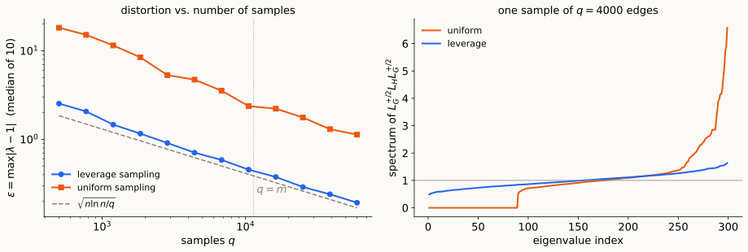
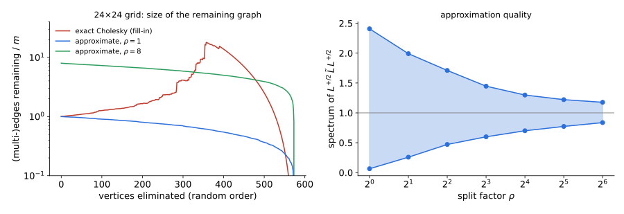

## Where we are

- **Lecture 9:** effective resistances, Foster's theorem, nearly-linear Laplacian solvers.
- **Lectures 10–11:** the MMWU turns a bound on $\lambda_{\max}$ of a **sum** into per-round scalars $\langle M_t,X_t\rangle$; we used it with penalties chosen by an oracle.
- **Today:** the sum is a **random sample**. The same regret bound, with local norms, proves that sampling edges by effective resistance gives a **spectral sparsifier**.

::: notes
~1 min. Two promises from earlier decks are kept today: the proof of the local-norm bound (Lecture 10) and the "other routes" to nearly-linear solvers (Lecture 9), which both use sparsification or sampling.
:::

## Plan

- **§1 Sparsifiers and leverage scores.** What we want; leverage scores of arbitrary vectors; isotropic position.
- **§2 Sampling by leverage.** The algorithm and why importance sampling.
- **§3 Proof by MMWU.** The local-norm bound, both tails, and the comparison with matrix Bernstein.
- **§4 Fast, and smaller.** Computing resistances in $\tilde O(m)$; linear-size sparsifiers.
- **§5 (optional) Other routes to nearly-linear solvers.**

::: notes
~1 min. Core material ~38 min; §5 ~7 min if there is time.
:::

# §1 · Sparsifiers and leverage scores {background-color="#1c1b19"}

## Spectral sparsifiers

::: {.defn}
A reweighted subgraph $H$ of $G$ is an **$\varepsilon$-spectral sparsifier** if
$$(1-\varepsilon)\,L_G\ \preceq\ L_H\ \preceq\ (1+\varepsilon)\,L_G .$$
:::

- **Preserves everything quadratic:** every cut ($x=\mathbf 1_S$), every effective resistance (invert: Lecture 9), every Rayleigh quotient, hence $\lambda_2$ and conductance bounds.
- **Preconditioning:** $L_H$ is a preconditioner with condition number $\frac{1+\varepsilon}{1-\varepsilon}$, and $H$ has few edges.
- **Cut sparsifiers** (Benczúr–Karger 1996) only ask this for $x\in\{0,1\}^n$: weaker.

::: {.idea}
**Example: expanders sparsify $K_n$.** A non-bipartite $d$-regular Ramanujan graph has $L$-spectrum in $d\pm2\sqrt{d-1}$ on $\mathbf 1^\perp$, and $L_{K_n}=nI$ there. So $\frac nd\,G$ is an $\varepsilon$-sparsifier with $\varepsilon=\frac{2\sqrt{d-1}}d<\frac2{\sqrt d}$: about $\frac{2n}{\varepsilon^2}$ edges instead of $\binom n2$.
:::

::: notes
~3 min. Effective resistances: L_H ⪯ (1+ε)L_G implies L_G^+ ⪯ (1+ε)L_H^+ on 1^⊥ (operator monotonicity of the inverse). The expander example is the benchmark: can every graph be sparsified to O(n/ε²) edges? Yes (§4), and O(n log n/ε²) by a very simple random algorithm (§2).
:::

## Leverage scores

::: {.defn}
For $v_1,\dots,v_m\in\mathbb R^n$ with $M=\sum_iv_iv_i^\top$ (rows of $A$, $M=A^\top A$), the **leverage score** of $v_i$ is $\ \ell_i=v_i^\top M^+v_i .$
:::

**Three readings:**

- **Size in isotropic position:** $u_i=M^{+/2}v_i$ satisfy $\sum_iu_iu_i^\top=\Pi_{\operatorname{im}M}$, and $\ell_i=\|u_i\|^2$.
- **Hat matrix:** $\ell_i=\big(A(A^\top A)^+A^\top\big)_{ii}$; in least squares, $\ell_i=\partial\hat y_i/\partial y_i$.
- **Dominance:** $\ \ell_i=\max_x\dfrac{(v_i^\top x)^2}{x^\top Mx}$: the largest share of the quadratic form that term $i$ can carry.

**Properties:** $0\le\ell_i\le1$; $\ \sum_i\ell_i=\operatorname{rank}M=:r$; $\ \ell_i=1$ iff removing $v_i$ drops the rank.

::: {.thm}
**Graphs.** $A=W^{1/2}B$, $M=L$, $v_e=\sqrt{w_e}\,b_e$: $\ \ell_e=w_e\,R_{\rm eff}(e)$. Foster's theorem is $\sum_e\ell_e=n-1$; $\ \ell_e=1$ iff $e$ is a bridge.
:::

::: notes
~4 min. Dominance: Cauchy–Schwarz in the M-norm, (v_i^T x)² = (u_i^T M^{1/2}x)² ≤ ‖u_i‖² x^T M x for v_i ∈ im M, with equality at x = M^+ v_i. ℓ_i ≤ 1 because v_i v_i^T ⪯ M. Σℓ_i = tr(M^+ M) = rank. Lecture 9's reading for graphs: ℓ_e is the fraction of the unit u–v electrical flow that uses the edge e itself. A bridge carries all of it.
:::

## A sparsifier is a sum close to the identity

In isotropic coordinates, a reweighting $\widetilde M=\sum_is_iv_iv_i^\top$ satisfies
$$(1-\varepsilon)M\preceq\widetilde M\preceq(1+\varepsilon)M\iff(1-\varepsilon)\Pi\preceq\sum_is_i\,u_iu_i^\top\preceq(1+\varepsilon)\Pi .$$

- The problem is now about **vectors in isotropic position**: $\sum_iu_iu_i^\top=\Pi$ (identity on an $r$-dimensional space), $\sum_i\|u_i\|^2=r$.
- **Goal:** keep few $u_i$, reweighted, with all eigenvalues of the sum in $1\pm\varepsilon$.
- Graph sparsification is $r=n-1$; row sampling for least squares (subspace embeddings) is the same statement.

::: notes
~2 min. Conjugate by M^{+/2}: M^{+/2} M̃ M^{+/2} = Σ s_i u_i u_i^T, and M̃ has range inside im M, so the two-sided inequality transfers. From here on work on im M, an r-dimensional space where Π is the identity.
:::

# §2 · Sampling by leverage {background-color="#1c1b19"}

## The algorithm

::: {.defn}
**Leverage sampling** (Spielman–Srivastava 2008). Draw $i_1,\dots,i_q$ i.i.d. with $p_i=\ell_i/r$. Output
$$\widetilde M=\sum_{t=1}^q\frac{v_{i_t}v_{i_t}^\top}{q\,p_{i_t}} .\qquad\text{Graphs: keep edge }e\text{ with weight }w_e\cdot\frac{\#\{t:i_t=e\}}{q\,p_e},\ \ p_e=\frac{w_eR_{\rm eff}(e)}{n-1}.$$
:::

In isotropic coordinates the samples are $Y_t=\dfrac{u_{i_t}u_{i_t}^\top}{q\,p_{i_t}}$:
$$\mathbb EY_t=\frac\Pi q,\qquad 0\preceq Y_t\preceq\rho\,\Pi\ \ \text{with}\ \ \rho=\|Y_t\|=\frac{\ell_i}{q\,\ell_i/r}=\frac rq,\qquad\operatorname{tr}\sum_tY_t=r\ \text{exactly}.$$

::: {.thm}
**Theorem.** For $\varepsilon\le1$ and $r\ge2$: with $q=36\,r\ln r/\varepsilon^2$ samples, with probability $\ge\frac13$, $\ (1-\varepsilon)M\preceq\widetilde M\preceq(1+\varepsilon)M$. Graphs: $O(n\log n/\varepsilon^2)$ edges.
:::

::: notes
~3 min. The constant 36 comes from Markov in §3; with matrix Bernstein one gets high probability with a similar count. The trace identity holds sample by sample: tr Y_t = ‖u_i‖²/(q p_i) = r/q. It is what makes the Markov step work.
:::

## Why leverage scores?

- **Importance sampling equalizes the samples:** $\|Y_t\|=\frac rq$ for **every** draw. Any other distribution has some $\frac{\ell_i}{qp_i}>\frac rq$: a larger **width** $\rho$, and $\rho$ is what the proof pays.
- **Uniform sampling** ($p_e=\frac1m$) has width $\frac{m\,\max_e\ell_e}q$. A bridge ($\ell_e=1$) is missed unless $q\gtrsim m$, and then $H$ is disconnected.
- **On $K_n$** all $\ell_e=\frac2n$, so leverage sampling **is** uniform: $O(n\log n/\varepsilon^2)$ edges, a $\log n$ factor above Ramanujan.

::: notes
~2 min. Width of a general distribution: max_i ℓ_i/(q p_i) ≥ Σ_i ℓ_i/q = r/q, with equality iff p ∝ ℓ (the maximum of a ratio is at least the ratio of the sums). Next slide: a graph where uniform sampling fails.
:::

## Leverage vs. uniform sampling

{.nostretch fig-align="center" width="100%" fig-alt="Left: log-log plot of distortion against number of samples. Leverage sampling follows the dashed line sqrt(n ln n / q); uniform sampling is about seven times worse at q = 500 and still above 1 at q = 60000. Right: sorted eigenvalues; leverage sampling stays between 0.5 and 1.6, uniform sampling has about 90 zero eigenvalues and a top eigenvalue of 6.6."}

- The sparse half holds **half the leverage** on **2% of the edges** ($\ell_e\approx0.66$ there, $0.013$ in $K_{150}$).
- $q=4000$: leverage keeps $2025$ distinct edges, spectrum in $[0.49,1.63]$; uniform disconnects the sparse half (spectrum from $0$ to $6.6$).

::: notes
~2 min. Numbers from scripts/make_figures.py. The leverage curve tracks √(n ln n/q) closely, which is the shape of the theorem. At this toy size, ε = 0.2 needs q ≈ 60000 > m: the theorem's n log n/ε² beats m only on larger, denser graphs. Uniform sampling's distortion exceeds 1: for small q because sampled sparse-half edges get weight m/q ≫ 1 (about 23 at q = 500); for large q because of count fluctuations on the few high-leverage edges.
:::

# §3 · Proof by MMWU {background-color="#1c1b19"}

## The local-norm bound, proved

::: {.thm}
**Theorem (Lecture 10).** If $\eta M_t\preceq I$ for all $t$, then the MMWU plays with center $C$ satisfy, for every $U\in\Delta_n$,
$$\Big\langle\sum_tM_t,U\Big\rangle\ \le\ \sum_t\langle M_t,X_t\rangle+\eta\sum_t\langle M_t^2,X_t\rangle+\frac{D(U\Vert C)}\eta .$$
:::

::: {.pf}
*Proof.* Let $\Phi_t=\operatorname{tr}\exp(\log C+\eta S_t)$, so $\Phi_0=1$ and $X_t=e^{\log C+\eta S_{t-1}}/\Phi_{t-1}$.

1. **Golden–Thompson** ($\operatorname{tr}e^{A+B}\le\operatorname{tr}e^Ae^B$): $\ \Phi_t\le\Phi_{t-1}\,\langle X_t,e^{\eta M_t}\rangle$.
2. $e^x\le1+x+x^2$ for $x\le1$, so $e^{\eta M_t}\preceq I+\eta M_t+\eta^2M_t^2$, and with $1+y\le e^y$:
$$\Phi_t\le\Phi_{t-1}\exp\big(\eta\langle M_t,X_t\rangle+\eta^2\langle M_t^2,X_t\rangle\big).$$
3. **Gibbs** (Lecture 10): $\ \ln\Phi_T\ge\eta\langle S_T,U\rangle-D(U\Vert C)$. Take logs, divide by $\eta$. $\square$
:::

::: notes
~5 min. Golden–Thompson is the one genuinely matrix fact; for commuting matrices it is an equality. Step 2 uses that I + ηM + η²M² − e^{ηM} is a function of M, nonnegative on the spectrum when ηλ ≤ 1, and that ⟨X, ·⟩ is monotone for X ⪰ 0. Losses: apply to −M_t; the condition becomes −ηM_t ⪯ I, which holds for any M_t ⪰ 0. Lecture 8's Ahlswede–Winter proof of matrix Chernoff is this computation in expectation.
:::

## The upper tail

Work on $\operatorname{im}M$ ($\dim r$) with the uniform center $C=\Pi/r$, gains $Y_t$, and $\eta=\varepsilon/\rho$ (so $\eta Y_t\preceq I$). Since $Y_t^2\preceq\rho Y_t$:
$$\lambda_{\max}\Big(\sum_tY_t\Big)\ \le\ (1+\eta\rho)\sum_t\langle Y_t,X_t\rangle+\frac{\ln r}\eta\qquad\text{for every sequence of samples.}$$

. . .

**Take expectations.** $X_t$ depends only on $Y_1,\dots,Y_{t-1}$, and $Y_t$ is a fresh sample:
$$\mathbb E\big[\langle Y_t,X_t\rangle\,\big|\,Y_{<t}\big]=\Big\langle\frac\Pi q,X_t\Big\rangle=\frac1q .$$
So
$$\mathbb E\,\lambda_{\max}\Big(\sum_tY_t\Big)\ \le\ 1+\varepsilon+\frac{\rho\ln r}\varepsilon=1+\varepsilon+\frac{r\ln r}{q\,\varepsilon}\ \le\ 1+2\varepsilon\quad\text{for }q\ge\frac{r\ln r}{\varepsilon^2}.$$

::: {.idea}
The regret bound is **deterministic**; randomness enters only through one conditional expectation per round. The width enters as $\rho\ln r$: linear, thanks to local norms.
:::

::: notes
~4 min. η = ε/ρ ≤ 1/ρ needs ε ≤ 1. The plays X_t are a proof device: nobody computes them. They are "the direction in which the sample so far looks largest, softened". This is the online-learning view of matrix concentration.
:::

## The lower tail, and success probability

**Lower tail:** the loss version (plays $X_t'\propto e^{-\eta S_{t-1}}$) gives
$$\lambda_{\min}\Big(\sum_tY_t\Big)\ \ge\ (1-\eta\rho)\sum_t\langle Y_t,X'_t\rangle-\frac{\ln r}\eta,\qquad\mathbb E\,\lambda_{\min}\ \ge\ 1-2\varepsilon .$$

. . .

**From expectation to probability.** $\operatorname{tr}\sum_tY_t=r$ exactly, so the average eigenvalue is $1$:
$$\lambda_{\max}-1\ \ge\ 0\ \ \text{and}\ \ 1-\lambda_{\min}\ \ge\ 0\quad\text{always}.$$
**Markov** on each: $\Pr[\lambda_{\max}-1\ge6\varepsilon]\le\frac13$ and $\Pr[1-\lambda_{\min}\ge6\varepsilon]\le\frac13$. Rescaling $\varepsilon$ gives the theorem ($q=36\,r\ln r/\varepsilon^2$, probability $\ge\frac13$).

- **High probability:** run the same potential argument on $\mathbb E\operatorname{tr}e^{\theta\sum Y_t}$ (Ahlswede–Winter, Lecture 8), or apply **matrix Bernstein** with $L=\rho$, $\sigma^2\le\rho$: probability $1-r^{-c}$ with $q=O(r\log r/\varepsilon^2)$.
- **Without local norms:** $\frac\eta2\sum_t\|Y_t\|^2=\frac{\eta r^2}{2q}$, and the same argument needs $q=\Omega(r^2\log r/\varepsilon^2)$.

::: notes
~4 min. Bernstein: X_t = Y_t − Π/q has ‖X_t‖ ≤ ρ and Σ E X_t² ⪯ Σ E Y_t² ⪯ ρ Σ E Y_t = ρΠ, so σ² ≤ ρ = r/q; the tail bound 2r exp(−(ε²/2)/(ρ + ρε/3)) is ≤ 2r^{−1} once q ≥ 6 r ln r/ε² (for ε ≤ 1). Without local norms: optimizing η in 1 + ηr²/(2q) + ln r/η gives 1 + r√(2 ln r/q).
:::

# §4 · Fast, and smaller {background-color="#1c1b19"}

## Computing all effective resistances in $\tilde O(m)$

Since $L^+=L^+LL^+=L^+B^\top WBL^+$,
$$R_{\rm eff}(u,v)=\big\|W^{1/2}BL^+(\mathbf 1_u-\mathbf 1_v)\big\|^2 :$$
a distance between columns of the $m\times n$ matrix $W^{1/2}BL^+$.

- **Johnson–Lindenstrauss:** a random $\pm\frac1{\sqrt k}$ matrix $Q$ with $k=O(\log n/\delta^2)$ rows preserves all $m$ of these distances up to $1\pm\delta$.
- $Z=Q\,W^{1/2}BL^+$ costs $k$ **Laplacian solves** (Lecture 9): $L z_j=(QW^{1/2}B)_j^\top$.
- Total $\tilde O(m\log n/\delta^2)$ for all resistances; then sampling is $O(q)$. **A sparsifier in nearly-linear time.**
- **Overestimates are fine:** with $\tilde\ell_e\ge\ell_e$ and $p_e\propto\tilde\ell_e$, the width is $\le\frac{\sum_e\tilde\ell_e}q$: sample proportionally more. (The trace is then exact only in expectation, so use the Bernstein route for the tail; cf. discussion question 4.)

::: notes
~4 min. Constant δ (say 1/2) is enough: it changes q by a constant factor. The circularity "solvers need sparsifiers (Spielman–Teng) and sparsifiers need solvers" is broken by KOSZ (Lecture 9) or by recursive constructions (Koutis–Miller–Peng; Kyng–Sachdeva, §5).
:::

## Linear-size sparsifiers

::: {.thm}
**Batson–Spielman–Srivastava (2009).** Every graph has an $\varepsilon$-sparsifier with $O(n/\varepsilon^2)$ edges, found **deterministically**: $\ d(n-1)$ edges give condition number $\frac{d+1+2\sqrt d}{d+1-2\sqrt d}$ ("twice-Ramanujan").
:::

- **Proof idea:** add one reweighted $u_i$ at a time, controlling both ends of the spectrum with **barrier potentials** $\operatorname{tr}(uI-A)^{-1}$ and $\operatorname{tr}(A-\ell I)^{-1}$.
- **As regret minimization** (Allen-Zhu–Liao–Orecchia 2015): FTRL over $\Delta_n$ with the **$\ell_{1/2}$ regularizer** $R(X)=-2\operatorname{tr}X^{1/2}$ plays $X_t=(c_tI-\eta S_{t-1})^{-2}$, a barrier. Its regret bound pays less for the width than entropy does, which removes the $\log n$; the plays guide the choice of each $u_{i_t}$ (deterministically, in BSS).
- **Optimal up to constants:** BSS also show that any weighted sparsifier of $K_n$ with average degree $d$ has condition number at least about $1+\frac2{\sqrt d}$, so $\Omega(n/\varepsilon^2)$ edges are necessary; Ramanujan graphs attain this up to a factor $\approx2$ in edges.

::: notes
~4 min. The plays of FTRL with R(X) = −2 tr X^{1/2}: the first-order condition S − (1/η)∇R(X) = cI with ∇R(X) = −X^{−1/2} gives X^{−1/2} = η(cI − S)·const, i.e. X ∝ (cI − ηS)^{−2} with c chosen so that tr X = 1. The log n of MMWU is the range of the entropy; the ℓ_{1/2} regularizer has range √n but much better stability against rank-one updates. Lower bound: Alon–Boppana covers only unweighted d-regular graphs; the bound for arbitrary weighted sparsifiers of K_n is in the BSS paper.
:::

# §5 · (Optional) Other routes to nearly-linear solvers {background-color="#1c1b19"}

## Spielman–Teng and recursive preconditioning

::: {.defn}
**Ultra-sparsifier.** $H$ = spanning tree + $\tilde O(m/k)$ extra edges, with $\ L_H\preceq L_G\preceq k\,L_H$.
:::

**One level of the recursion:**

1. PCG (or Chebyshev) on $G$ with preconditioner $H$: $O(\sqrt k)$ iterations.
2. To solve with $L_H$: **eliminate** vertices of degree 1 and 2. A degree-1 vertex is a leaf; a degree-2 vertex is an edge in series ($r\leftarrow r_1+r_2$). No fill-in. What remains has $\tilde O(m/k)$ vertices and edges.
3. Solve the remaining system **recursively**, approximately.

- Work: $T(m)\approx\sqrt k\,\big(m+T(\tilde O(m/k))\big)$, nearly linear for a suitable $k=\mathrm{polylog}(n)$.
- Ingredients: low-stretch trees and **spectral sparsifiers** (this lecture).

| | running time ($\times\log(1/\varepsilon)$) |
|:--|:--|
| Spielman–Teng 2004 | $m\log^{c}n$ |
| Koutis–Miller–Peng 2010, 2011 | $m\log^2n$, then $m\log n\,(\log\log n)^2$ |
| Kelner–Orecchia–Sidford–Zhu 2013 | $m\log^2n\,\log\log n$ (no recursion) |
| Lee–Sidford 2013 | $m\log^{3/2}n\,\sqrt{\log\log n}$ |
| Cohen–Kyng–Miller–Pachocki–Peng–Rao–Xu 2014 | $m\sqrt{\log n}\,(\log\log n)^{O(1)}$ |
| Kyng–Sachdeva 2016 | $m\log^3n$ (sampling only) |
| Jambulapati–Sidford 2021 | $m(\log\log n)^{O(1)}$ |

::: notes
~3 min. The degree-1 and degree-2 eliminations are exact Gaussian elimination steps that create no new edges: this is "partial Cholesky". The table is a guide, not a precise statement: polyloglog factors and the exact dependence on ε vary between papers (KOSZ has log(n/ε) in our analysis). KMP: Koutis–Miller–Peng, "Approaching optimality..." (FOCS 2010) and "A nearly m log n time solver..." (FOCS 2011). Jambulapati–Sidford: "Ultrasparse ultrasparsifiers and faster Laplacian system solvers" (SODA 2021), expected time.
:::

## Gaussian elimination is a graph operation

Eliminating vertex $v$ (one step of Cholesky) writes $L=d_v\,c_vc_v^\top+L'$, with $c_v=\mathbf 1_v-\sum_u\frac{w_{vu}}{d_v}\mathbf 1_u$, and the **Schur complement**
$$L'=L-\mathrm{star}(v)+\mathrm{clique}(v),\qquad \mathrm{clique}(v)=\sum_{\{u,u'\}\subseteq N(v)}\frac{w_{vu}w_{vu'}}{d_v}\,b_{uu'}b_{uu'}^\top .$$

- **The Schur complement of a Laplacian is a Laplacian**, on $V-v$. It is the electrical network seen from $V-v$ (star–mesh transform).
- Eliminating all vertices gives $L=\mathcal L\mathcal L^\top$ exactly. The cost is the **fill-in**: a vertex of degree $d$ creates up to $\binom d2$ edges.
- Trees (degree 1) and series edges (degree 2) create no fill. Grids do: nested dissection gives $O(n^{1.5})$ time for planar graphs (George 1973; Lipton–Rose–Tarjan 1979); expanders are hopeless.

::: notes
~2 min. Check of the clique weights: d_v c_v c_v^T has off-diagonal entries w_vu w_vu'/d_v, which must be added back to keep the star's contribution correct. Star–mesh: eliminating the center of a 3-star is the Y–Δ transform from physics.
:::

## Approximate Gaussian elimination (Kyng–Sachdeva 2016)

::: {.defn}
**Clique sampling.** When eliminating $v$, for each (multi-)edge $(v,u)$ sample one neighbor $u'$ with probability $w_{vu'}/d_v$ and add the edge $(u,u')$ with weight $\dfrac{w_{vu}w_{vu'}}{w_{vu}+w_{vu'}}$ (nothing if $u'=u$).
:::

- **Unbiased:** the expected weight on $\{u,u'\}$ is $\frac{w_{vu'}}{d_v}\cdot\frac{w_{vu}w_{vu'}}{w_{vu}+w_{vu'}}+\frac{w_{vu}}{d_v}\cdot\frac{w_{vu}w_{vu'}}{w_{vu}+w_{vu'}}=\frac{w_{vu}w_{vu'}}{d_v}$.
- **Sparse:** eliminating $v$ removes $\deg(v)$ edges and adds at most $\deg(v)$. **The number of edges never grows.**
- **Concentrated:** split every edge into $\rho=O(\log^2n)$ copies and eliminate in a **uniformly random order**. Every sample then has **leverage $\le\frac1\rho$**, and the errors form a **matrix martingale** (matrix Freedman). W.h.p. $\tilde L=\tilde{\mathcal L}\tilde{\mathcal L}^\top$ satisfies $\ \tfrac12L\preceq\tilde L\preceq\tfrac32L$.
- Factorization in $O(m\log^3n)$ time, then PCG: $O(m\log^3n\log(1/\varepsilon))$. No trees, no sparsifiers, no expanders.

{width="88%"}

$24\times24$ grid, random order. Exact elimination peaks at $18m$ edges. With $\rho=16$, $\ \mathrm{spec}(L^{+/2}\tilde LL^{+/2})\subseteq[0.70,1.30]$; with $\rho=64$, $[0.84,1.18]$ (average over 4 runs).

::: notes
~2 min. The split copies are what make every sample have leverage score ≤ 1/ρ: exactly the width condition of today's proof, now for a martingale instead of independent samples. The random order keeps expected degrees small: a random remaining vertex has expected degree 2·(edges)/(vertices). Modern practice: Gao–Kyng–Spielman (2023) "ApproxChol" in Laplacians.jl, a robust variant used as a PCG preconditioner. Figure and numbers from lectures/lecture09/scripts/make_figures.py, Fig. 4.
:::

## Takeaways

1. **Leverage scores** $\ell_i=v_i^\top M^+v_i$ measure how much one term can dominate a sum of rank-one matrices; they sum to the rank. For graphs, $\ell_e=w_eR_{\rm eff}(e)$.
2. **Sampling by leverage** makes every sample the same size ($\rho=r/q$) and gives a $(1\pm\varepsilon)$ approximation with $O(r\log r/\varepsilon^2)$ samples: spectral sparsifiers with $O(n\log n/\varepsilon^2)$ edges.
3. **Matrix concentration is a regret bound:** the MMWU inequality holds for every sample path; one conditional expectation per round and Markov finish the proof. **Local norms** make the width enter linearly.
4. All resistances in $\tilde O(m)$ via **JL $+$ Laplacian solvers**: sparsifiers in nearly-linear time.
5. **Linear size** $O(n/\varepsilon^2)$ is possible (BSS), and is FTRL with a different regularizer.
6. **Elimination:** the Schur complement of a Laplacian is a Laplacian; sample the cliques to keep it sparse (Kyng–Sachdeva).

## Discussion questions

1. Show that $\max_i\ell_i/(qp_i)\ge r/q$ for every distribution $p$, with equality only for $p\propto\ell$.
2. What is $\ell_e$ for an edge of the cycle $C_n$? Of the grid? Which edges of a dumbbell have the largest leverage, and why does that match intuition about cuts?
3. In the upper-tail proof, where exactly is it used that the samples are **independent**? Would the argument survive a sampling scheme where $Y_t$ depends on $Y_{<t}$ but still has $\mathbb E[Y_t\mid Y_{<t}]=\Pi/q$?
4. The Markov step used $\operatorname{tr}\sum_tY_t=r$. What breaks if the trace is only correct in expectation?
5. Why does Kyng–Sachdeva need a **random** elimination order? Construct an order that makes clique sampling fail on a star.

## References

- **D. A. Spielman, N. Srivastava.** Graph sparsification by effective resistances. *STOC* 2008; *SIAM J. Comput.* 2011.
- D. A. Spielman, S.-H. Teng. Spectral sparsification of graphs. *SIAM J. Comput.* 2011. · A. A. Benczúr, D. R. Karger. Approximating s–t minimum cuts in $\tilde O(n^2)$ time. *STOC* 1996.
- **J. Batson, D. A. Spielman, N. Srivastava.** Twice-Ramanujan sparsifiers. *STOC* 2009; *SIAM J. Comput.* 2012.
- Z. Allen-Zhu, Z. Liao, L. Orecchia. Spectral sparsification and regret minimization beyond matrix multiplicative updates. *STOC* 2015.
- R. Ahlswede, A. Winter. Strong converse for identification via quantum channels. *IEEE Trans. Inf. Theory* 2002. · J. A. Tropp. User-friendly tail bounds for sums of random matrices. *Found. Comput. Math.* 2012.
- P. Drineas, M. W. Mahoney, S. Muthukrishnan. Sampling algorithms for ℓ₂ regression and applications. *SODA* 2006.
- A. Lubotzky, R. Phillips, P. Sarnak. Ramanujan graphs. *Combinatorica* 1988.
- R. Kyng, S. Sachdeva. Approximate Gaussian elimination for Laplacians: fast, sparse, and simple. *FOCS* 2016. · D. A. Spielman, S.-H. Teng. Nearly-linear time algorithms for graph partitioning, graph sparsification, and solving linear systems. *STOC* 2004.

Reading: Spielman–Srivastava; Spielman, <i>Spectral and Algebraic Graph Theory</i>, chapters on sparsification; Allen-Zhu–Liao–Orecchia §§1–3.

# Appendix: definitions for the board {background-color="#1c1b19"}

## Definitions {.smaller}

| Object | Definition |
|:--|:--|
| $\varepsilon$-sparsifier | $(1-\varepsilon)L_G\preceq L_H\preceq(1+\varepsilon)L_G$ |
| leverage score | $\ell_i=v_i^\top M^+v_i$, $\ M=\sum_iv_iv_i^\top$; $\ \sum_i\ell_i=r=\operatorname{rank}M$; graphs: $\ell_e=w_eR_{\rm eff}(e)$ |
| isotropic position | $u_i=M^{+/2}v_i$, $\ \sum_iu_iu_i^\top=\Pi$, $\ \|u_i\|^2=\ell_i$ |
| leverage sampling | $p_i=\ell_i/r$, $\ Y_t=u_{i_t}u_{i_t}^\top/(qp_{i_t})$, $\ \mathbb EY_t=\Pi/q$, $\ \|Y_t\|=\rho=r/q$, $\ \operatorname{tr}\sum Y_t=r$ |
| local-norm bound | $\eta M_t\preceq I$: $\ \langle\sum M_t,U\rangle\le\sum\langle M_t,X_t\rangle+\eta\sum\langle M_t^2,X_t\rangle+\frac{D(U\Vert C)}\eta$ |
| upper tail | $\mathbb E\lambda_{\max}(\sum Y_t)\le1+\eta\rho+\frac{\ln r}\eta$ |
| resistances via JL | $R_{\rm eff}(u,v)=\|W^{1/2}BL^+(\mathbf 1_u-\mathbf 1_v)\|^2\approx\|Z(\mathbf 1_u-\mathbf 1_v)\|^2$, $\ Z=QW^{1/2}BL^+$ |
