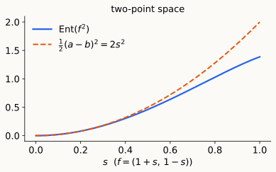

## Variance and entropy

For $f:\Omega\to\mathbb R$ and a probability measure $\pi$:

::: {.defn}
$$\operatorname{Var}_\pi(f)=\mathbb E_\pi[f^2]-(\mathbb E_\pi f)^2,\qquad\qquad\operatorname{Ent}_\pi(f)=\mathbb E_\pi[f\log f]-\mathbb E_\pi f\,\log\mathbb E_\pi f\quad(f\ge0).$$
:::

- **Same shape:** both are $\ \mathbb E_\pi\,\phi(f)-\phi(\mathbb E_\pi f)$, with $\phi(x)=x^2$ and $\phi(x)=x\log x$. Both are $\ge0$ by **Jensen**, and $=0$ iff $f$ is constant.
- **Scaling:** $\operatorname{Var}(cf)=c^2\operatorname{Var}f$, but $\operatorname{Ent}(cf)=c\operatorname{Ent}f$. That is why log-Sobolev is written with $\operatorname{Ent}(f^2)$: both sides are then quadratic in $f$.
- **Distances to equilibrium** (Lecture 3), for a density $h=d\mu/d\pi$ with $\mathbb E_\pi h=1$:
$$\chi^2(\mu\Vert\pi)=\operatorname{Var}_\pi(h),\qquad D(\mu\Vert\pi)=\operatorname{Ent}_\pi(h)=\mathbb E_\pi[h\log h].$$
- **Near equilibrium,** $h=1+\epsilon g$ with $\mathbb E_\pi g=0$: $\ \operatorname{Ent}_\pi(h)=\frac{\epsilon^2}2\operatorname{Var}_\pi(g)+O(\epsilon^3)$.

::: notes
~2 min. Write both definitions on the board and leave them there: every inequality today compares one of these two functionals with a Dirichlet form. The linearization is what gives ρ₀ ≤ 2λ (Lecture 4) and α ≤ λ/2 (today).
:::

## Where we are

From Lecture 4, for the continuous-time walk $h_t=H_th_0$, $\ H_t=e^{-tL_{rw}}$:

- **Entropy dissipation:** $\ \dfrac d{dt}\operatorname{Ent}_\pi(h_t)=-\mathcal E(h_t,\log h_t)$.
- **MLSI** $\ \rho_0\operatorname{Ent}_\pi(h)\le\mathcal E(h,\log h)$ gives $\ D(\mu_t\Vert\pi)\le e^{-\rho_0t}D(\mu_0\Vert\pi)$ and
$$t_{\rm mix}(\varepsilon)\le\frac1{\rho_0}\Big(\log\log\frac1{\pi_{\min}}+\log\frac1{2\varepsilon^2}\Big)\qquad\text{vs.}\qquad\frac1\lambda\Big(\frac12\log\frac1{\pi_{\min}}+\log\frac1{2\varepsilon}\Big).$$
- **The price:** $\ \rho_0\le2\lambda$ (linearize at $\pi$).

::: {.idea}
**Open since Lecture 4:** how do we bound $\rho_0$ **from below**? Today: by reducing a big chain to small ones.
:::

::: notes
~2 min. Keep this short; everything here was proved in Lecture 4. Lecture 5's table ended with an "entropy + LSI" entry for the hypercube that we never justified: today we do.
:::

## Plan

- **§1 Why tensorize.** The hypercube resists our tools; independence suggests the answer; Gross's log-Sobolev inequality.
- **§2 Tensorization.** Product chains; variance (Efron–Stein) and entropy tensorize.
- **§3 The hypercube, solved.** The two-point inequality, $\rho_0=4/d$, mixing at the cutoff.
- **§4 Payoffs and limits.** Concentration, hypercontractivity, where LSI is weak, the continuum.

::: notes
~1 min. Timing: §1 ~17 min, §2 ~20 min, §3 ~18 min, §4 ~15 min, closing ~5 min. If short on time, shorten §4 (hypercontractivity can be one sentence).
:::

# §1 · Why tensorize {background-color="#1c1b19"}

## The mismatch, in experiments

Lecture 5's table for the hypercube $\{0,1\}^d$ (flip a uniform coordinate at rate $1$):

| | lower: $t_{\rm rel}$ | upper: $\chi^2$ + gap | upper: entropy + LSI | truth |
|---|---|---|---|---|
| hypercube | $\Theta(d)$ | $\Theta(d^2)$ | **?** | $\sim\frac d4\log d$ (cutoff) |

{.nostretch fig-align="center" width="100%" fig-alt="Left: TV curves for d from 16 to 256 that steepen around t equal to (d/4) log d, with simulated dots on the curves. Right: log-log plot of mixing time against d; the truth tracks (d/4) log d, the chi-square bound grows like d squared, the gap lower bound like d."}

- **Cutoff:** the curves steepen around $t=\frac d4\log d$ as $d$ grows.
- **The gap is off by $\log d$ from below and the $\chi^2$ bound by $d/\log d$ from above.** At $d=256$: $t_{\rm rel}\log2\approx89$, truth $413$, $\chi^2$ bound $\approx11{,}400$.

::: notes
~3 min. Numbers from scripts/make_figures.py (mismatch_figure): simulated t_mix(1/4) = 14.8, 81.2, 412.0 for d = 16, 64, 256 against exact 14.8, 81.1, 412.7. The simulation tracks only the Hamming distance to the start, a sufficient statistic for TV by symmetry. The fixed crossing point of the curves near TV ≈ 0.4 at t = (d/4) log d is the cutoff profile. Next slide: why each tool misses.
:::

## The hypercube resists our tools

$\{0,1\}^d$, $n=2^d$, flip a uniform coordinate at rate $1$: $\ \lambda=\frac2d$, cutoff at $\frac d4\log d$ (Lecture 5).

| tool | what it gives | vs. truth |
|:--|:--|:--|
| characters (exact spectrum) | $\lambda=\frac2d$ | exact |
| canonical paths (bit-fixing, Lecture 5) | $\lambda\ge\frac2{d^2}$ | off by $d$ |
| Cheeger, $\Phi=\frac1d$ (Lecture 6) | $\lambda\ge\frac{\Phi^2}2=\frac1{2d^2}$ | off by $d$ |
| $\chi^2$ + gap (Lecture 4) | $t_{\rm mix}\le\frac d2\big(\frac{d\log2}2+\log\frac1{2\varepsilon}\big)=\Theta(d^2)$ | off by $\frac d{\log d}$ |
| entropy + MLSI | needs $\rho_0$ of a chain with $2^d$ states | **?** |

::: {.idea}
The geometric tools see **one big graph**. The truth comes from **structure**: $d$ independent bits, each updated at rate $\frac1d$.
:::

::: notes
~3 min. Canonical paths: bit-fixing, every edge carries 2^d ordered pairs, paths of length ≤ d, so κ ≤ d·2^d and λ₂(L) ≥ 2n/κ = 2/d; the graph is d-regular so λ = λ₂(L)/d ≥ 2/d². Cheeger: the half-cube {x₁ = 0} has Φ = 1/d; the Cheeger upper side λ ≤ 2Φ = 2/d is tight here, the lower side loses d. χ²: π_min = 2^{−d}, so ½ log(1/π_min) = (d log 2)/2 and the bound is (d/2)·(d log 2)/2 ≈ 0.17 d².
:::

## Independence suggests the answer

From a vertex, $\delta_xH_t$ is a **product measure**: each bit is flipped independently with probability $p_t=\frac12(1-e^{-2t/d})$.

- **Relative entropy adds** (chain rule):
$$D(\delta_xH_t\Vert\pi)=d\cdot\mathrm{KL}\big(\mathrm{Bern}(p_t)\Vert\mathrm{Bern}(\tfrac12)\big)\approx\frac d2\,e^{-4t/d},\qquad O(1)\ \text{at}\ t\approx\frac d4\log d .$$
- **$\chi^2$ multiplies:** $\ 1+\chi^2=\prod_i(1+\chi_i^2)=(1+e^{-4t/d})^d$. Its burn-in is $\log\frac1{\pi_{\min}}=d\log2$: the lost factor of $d$.

. . .

::: {.warn}
**But this used a product start.** A general initial distribution, or the test function $h$ in a functional inequality, is **not** a product. We need: *if each coordinate satisfies an inequality with constant $c$, the product satisfies it with constant $c/d$, for every $h$.* That is **tensorization**.
:::

::: notes
~3 min. KL(Bern(½ − δ) ‖ Bern(½)) ≈ 2δ² with δ = e^{−2t/d}/2. Entropy is additive and χ² is multiplicative; that is the whole difference between the two burn-ins. The heuristic already gives the right answer, constant included; §2–§3 make it a theorem.
:::

## Which inequality should we tensorize?

Two candidates for bounding $\rho_0$ (both tensorize once **entropy** does, §2):

$$\textbf{MLSI:}\ \ \rho_0\operatorname{Ent}_\pi(h)\le\mathcal E(h,\log h)\qquad\qquad\textbf{LSI (Gross 1975):}\ \ \alpha\operatorname{Ent}_\pi(f^2)\le\mathcal E(f,f)$$

**Why LSI:** its right side is the **quadratic form** $\mathcal E(f,f)$.

- **Base cases are calculus** on a quadratic form: the two-point space in one slide (§3).
- **Comparison** of Dirichlet forms (canonical paths, Lecture 5) uses Cauchy–Schwarz, so it transfers LSI from one chain to another; it does not apply to $\mathcal E(h,\log h)$.
- **Consequences:** hypercontractivity and Gaussian concentration (§4).
- **Nothing is lost for entropy decay**, by the next slide.

::: notes
~3 min. Honest framing: MLSI also tensorizes, by the same entropy subadditivity (Corollary in §2). The reason to prefer LSI is that everything we can actually compute or compare is quadratic. For diffusions the two coincide (§4).
:::

## LSI controls entropy decay

::: {.thm}
**Sandwich.** $\qquad 4\alpha\ \le\ \rho_0\ \le\ 2\lambda,\qquad \alpha\ \le\ \frac\lambda2 .$
:::

::: {.pf}
*$\rho_0\ge4\alpha$.* For $a,b>0$: $\ (a-b)(\log a-\log b)\ge4(\sqrt a-\sqrt b)^2$ (with $a=x^2>b=y^2$ this is $\log\frac xy\ge\frac{2(x-y)}{x+y}$; symmetric in $a,b$). Edge by edge in $\mathcal E$:
$$\mathcal E(h,\log h)\ \ge\ 4\,\mathcal E(\sqrt h,\sqrt h)\ \ge\ 4\alpha\operatorname{Ent}_\pi\big((\sqrt h)^2\big)=4\alpha\operatorname{Ent}_\pi(h).$$
*$\alpha\le\frac\lambda2$.* Linearize, $f=1+\epsilon g$, $\mathbb E_\pi g=0$: $\ \operatorname{Ent}_\pi(f^2)=2\epsilon^2\operatorname{Var}_\pi g+O(\epsilon^3)$, $\ \mathcal E(f,f)=\epsilon^2\mathcal E(g,g)$. $\square$
:::

- So $\ t_{\rm mix}(\varepsilon)\le\dfrac1{4\alpha}\Big(\log\log\dfrac1{\pi_{\min}}+\log\dfrac1{2\varepsilon^2}\Big)$.
- **Plan:** compute $\alpha$ for a **2-state** chain, tensorize to $2^d$ states, read off $\rho_0$.

::: notes
~3 min. ρ₀ ≤ 2λ was Lecture 4. The inequality log(x/y) ≥ 2(x−y)/(x+y) for x > y is "logarithmic mean ≤ arithmetic mean". 𝓔(h, log h) = (1/vol)Σ w_ij (h_i − h_j)(log h_i − log h_j) is a sum of nonnegative edge terms, which is why the comparison goes edge by edge.
:::

# §2 · Tensorization {background-color="#1c1b19"}

## Product chains

Reversible chains $(\Omega_i,\pi_i,L_i)$, $i=1,\dots,d$. On $\Omega=\prod_i\Omega_i$ with $\pi=\bigotimes_i\pi_i$: **pick a uniform coordinate, update it**:
$$L=\frac1d\sum_{i=1}^dL_i\ \ (\text{acting on coordinate }i),\qquad\mathcal E(f,f)=\frac1d\sum_{i=1}^d\mathbb E_\pi\big[\mathcal E_i(f)\big],$$
where $\mathcal E_i(f)$ is the Dirichlet form of $x_i\mapsto f(x)$, all other coordinates frozen. Likewise $\operatorname{Var}_i$, $\operatorname{Ent}_i$.

- **Spectrum:** eigenfunctions $\prod_i\varphi^{(i)}_{k_i}(x_i)$, eigenvalues $\frac1d\sum_i\lambda^{(i)}_{k_i}$, so $\ \lambda=\frac1d\min_i\lambda_i$.
- **Hypercube** $=$ product of $d$ two-point chains ($L_i=I-\sigma_i$, eigenvalues $0,2$): eigenvalues $\frac{2|S|}d$.

::: notes
~3 min. Spectra of products are easy because L is a sum of commuting operators. The question for today is whether the same is true for inequalities involving entropy, which is not a quadratic quantity.
:::

## Variance tensorizes (Efron–Stein)

::: {.thm}
**Efron–Stein.** For product $\pi$: $\qquad\operatorname{Var}_\pi f\ \le\ \sum_{i=1}^d\mathbb E_\pi\big[\operatorname{Var}_if\big].$
:::

::: {.pf}
*Proof.* Let $f_i=\mathbb E[f\mid x_1,\dots,x_i]$ ($f_0=\mathbb Ef$, $f_d=f$) and $\Delta_i=f_i-f_{i-1}$: orthogonal martingale differences, so $\operatorname{Var}f=\sum_i\mathbb E\Delta_i^2$. **Independence:** $f_{i-1}=\mathbb E[\mathbb E_if\mid x_1,\dots,x_i]$, so $\Delta_i=\mathbb E[f-\mathbb E_if\mid x_1,\dots,x_i]$, and by Jensen $\ \mathbb E\Delta_i^2\le\mathbb E(f-\mathbb E_if)^2=\mathbb E\operatorname{Var}_if$. $\square$
:::

**Poincaré tensorizes:** $\ \operatorname{Var}f\le\sum_i\mathbb E\operatorname{Var}_if\le\sum_i\frac{\mathbb E\,\mathcal E_i(f)}{\lambda_i}\le\frac d{\min_i\lambda_i}\,\mathcal E(f,f)$, i.e. $\lambda\ge\frac1d\min_i\lambda_i$, the same answer as the spectrum.

::: notes
~4 min. 𝔼_i f means: integrate out x_i only. The independence step is where the product structure enters: integrating out x_i commutes with conditioning on x_1..x_i when the coordinates are independent. This is the warm-up; the entropy proof has exactly the same skeleton.
:::

## The variational formula for entropy

::: {.lem}
**Lemma.** For $f\ge0$: $\qquad\operatorname{Ent}_\pi(f)=\sup\big\{\mathbb E_\pi[fg]\ :\ \mathbb E_\pi e^g\le1\big\}$, attained at $g=\log\frac f{\mathbb E_\pi f}$.
:::

::: {.pf}
*Proof.* Let $\mu=f\pi/\mathbb E_\pi f$. By the **Gibbs variational principle** (Lecture 10, diagonal case), $\ \mathbb E_\mu g\le D(\mu\Vert\pi)+\log\mathbb E_\pi e^g$. So if $\mathbb E_\pi e^g\le1$,
$$\mathbb E_\pi[fg]=\mathbb E_\pi f\cdot\mathbb E_\mu g\ \le\ \mathbb E_\pi f\cdot D(\mu\Vert\pi)=\operatorname{Ent}_\pi(f).\qquad\square$$
:::

- Entropy is a **supremum of linear functionals**: that is what will let us split it into pieces.
- Variance has the analogous formula $\operatorname{Var}f=\sup\{\mathbb E[fg]^2:\ \mathbb Eg=0,\ \mathbb Eg^2\le1\}$.

::: notes
~3 min. This is Donsker–Varadhan duality. In Lecture 10 it was max_X {⟨A,X⟩ − tr X log X} = log tr e^A; for diagonal matrices and a reference measure π it reads log 𝔼_π e^g = max_μ {𝔼_μ g − D(μ‖π)}.
:::

## Entropy tensorizes

::: {.thm}
**Tensorization of entropy.** For product $\pi$ and $f\ge0$: $\qquad\operatorname{Ent}_\pi f\ \le\ \sum_{i=1}^d\mathbb E_\pi\big[\operatorname{Ent}_if\big].$
:::

::: {.pf}
*Proof.* Same martingale: $f_i=\mathbb E[f\mid x_1,\dots,x_i]$, and $g_i=\log\frac{f_i}{f_{i-1}}$. Then $\sum_ig_i=\log\frac f{\mathbb Ef}$, so by the equality case of the Lemma
$$\operatorname{Ent}_\pi f=\mathbb E\Big[f\sum_ig_i\Big]=\sum_i\mathbb E[fg_i].$$
Freeze all coordinates but $x_i$. $g_i$ depends on $x_1,\dots,x_i$, and by **independence** $\ \mathbb E_i f_i=f_{i-1}$, so
$$\mathbb E_i\,e^{g_i}=\frac{\mathbb E_if_i}{f_{i-1}}=1\qquad\Longrightarrow\qquad\mathbb E_i[fg_i]\le\operatorname{Ent}_if\quad\text{(Lemma, in coordinate }i).$$
Average over the frozen coordinates and sum over $i$. $\square$
:::

::: notes
~6 min. This is the key slide. The structure is identical to Efron–Stein: decompose along the martingale, then bound each increment by a one-coordinate quantity, using independence exactly once (𝔼_i f_i = f_{i−1}: integrating x_i out of 𝔼[f | x_1..x_i] gives 𝔼[f | x_1..x_{i−1}] because x_i is independent of the others). Where Efron–Stein used orthogonality and Jensen, this uses the variational formula. Without independence, the inequality can fail; with weak dependence it holds up to a constant ("approximate tensorization").
:::

## Constants of products

::: {.thm}
**Corollary.** $\qquad\alpha(\text{product})=\frac1d\min_i\alpha_i,\qquad\rho_0(\text{product})\ \ge\ \frac1d\min_i\rho_0^{(i)} .$
:::

::: {.pf}
*Proof of $\ge$ for LSI.* $\ \operatorname{Ent}f^2\le\sum_i\mathbb E\operatorname{Ent}_if^2\le\sum_i\frac{\mathbb E\,\mathcal E_i(f)}{\alpha_i}\le\frac d{\min_i\alpha_i}\,\mathcal E(f,f)$. MLSI: the same with $h$ and $\mathcal E_i(h,\log h)$. *$\le$:* test functions of one coordinate. $\square$
:::

- The constant of a chain with $\prod_i|\Omega_i|$ states comes from chains with $|\Omega_i|$ states, and **no factor is lost**.
- Compare: canonical paths and Cheeger lost a factor $d$ on the hypercube.

::: {.idea}
**Beyond products.** Glauber dynamics and Gibbs samplers update one coordinate at a time, but $\pi$ is not a product (Ising, hard-core, ...). Modern mixing proofs show **approximate tensorization** $\operatorname{Ent}f\le C\sum_i\mathbb E\operatorname{Ent}_if$, via spectral or entropic independence (Anari–Liu–Oveis Gharan 2020; Chen–Liu–Vigoda 2021; Anari–Jain–Koehler–Pham–Vuong 2022).
:::

::: notes
~4 min. The ≤ direction: for f depending only on coordinate i, Ent f² = Ent_i f² and 𝓔(f,f) = (1/d)𝓔_i(f), so α ≤ α_i/d. For MLSI the matching upper bound also holds by the same test functions; we only need ≥. Approximate tensorization: the constant C replaces "1"; it is O(1) under spectral-independence-type conditions, which gives O(n log n) mixing of Glauber dynamics in those models. Keep the citations at that level.
:::

# §3 · The hypercube, solved {background-color="#1c1b19"}

## The two-point space (Gross)

Uniform $\pi$ on $\{0,1\}$, flips at rate $1$: $\ \mathcal E(f,f)=\frac12(a-b)^2$ for $f=(a,b)$, $\ \lambda=2$.

::: {.thm}
**Theorem.** $\ \operatorname{Ent}_\pi(f^2)\le\frac12(a-b)^2$, i.e. $\alpha=1=\frac\lambda2$.
:::

::: {.cols2}
::: {}
::: {.pf}
*Proof.* WLOG $a\ge b\ge0$ (replacing $f$ by $|f|$ only lowers the right side), and by homogeneity $a=1+s$, $b=1-s$, $s\in[0,1]$. Let $\varphi(s)=\operatorname{Ent}(f^2)$; we need $\varphi(s)\le2s^2$, and $\varphi(0)=0$. Differentiating,
$$\varphi'(s)=2(1+s)\log(1+s)-2(1-s)\log(1-s)-2s\log(1+s^2)$$
$$=4s-4\sum_{j\ \text{odd}\ \ge3}\frac{s^j}{j(j-1)}-2s\log(1+s^2)\ \le\ 4s .\ \ \square$$
:::
:::
::: {}
{width="100%" fig-alt="Entropy of f squared and 2 s squared on [0,1]; the entropy curve stays below and touches only at 0."}
:::
:::

- Sharp as $s\to0$: equality to second order is the linearization $\alpha\le\lambda/2$.
- **MLSI:** $4\alpha\le\rho_0\le2\lambda$ gives $\rho_0=4$ here.

::: notes
~5 min. Series: (1+s)log(1+s) = s + Σ_{j≥2} (−1)^j s^j/(j(j−1)) and (1−s)log(1−s) = −s + Σ_{j≥2} s^j/(j(j−1)); the even terms cancel in the difference and the odd ones come with a minus sign. The derivative formula and the inequality are checked numerically in scripts/make_figures.py, along with ρ₀ = 4 by direct minimization.
:::

## The hypercube: constants and mixing

Tensorize $d$ copies of the two-point space, each at rate $\frac1d$:
$$\alpha=\frac1d,\qquad\lambda=\frac2d,\qquad 4\alpha\le\rho_0\le2\lambda\ \Longrightarrow\ \rho_0=\frac4d\ \text{exactly}.$$

. . .

With $\log\frac1{\pi_{\min}}=d\log2$:
$$t_{\rm mix}(\varepsilon)\ \le\ \frac d4\Big(\log d+\log\log2+\log\frac1{2\varepsilon^2}\Big)=\frac d4\log d+O(d).$$

| | lower: $t_{\rm rel}$ | upper: $\chi^2$ + gap | upper: entropy + LSI | truth |
|---|---|---|---|---|
| hypercube | $\Theta(d)$ | $\Theta(d^2)$ | $\frac d4\log d+O(d)$ | $\sim\frac d4\log d$ |

::: {.idea}
**The Lecture 5 table, completed:** entropy + LSI finds the cutoff location, **constant included**.
:::

::: notes
~4 min. A brute-force minimization for d = 1, 2, 3 gives α = 1/d and ρ₀ = 4/d to four digits (scripts/make_figures.py). At d = 100: cutoff (d/4) log d = 115; exact t_mix(1/4) = 138; the MLSI + Pinsker bound gives 158; χ² + gap gives about 1770.
:::

## The hypercube, $d=100$

{.nostretch fig-align="center" width="100%" fig-alt="Left: log-log plot; entropy curve and its MLSI bound nearly coincide near 70 and fall after t = 100; chi-square starts near 10^30. Right: TV curves; the exact curve drops near t = 115, the MLSI bound shortly after, the chi-square bound only near t = 1770."}

- **Same rate, different start:** $\rho_0=2\lambda=\frac4d$ here, so the whole difference is $\log D(0)=\log(d\log 2)$ vs. $\log\chi^2(0)\approx d\log2$.
- $t_{\rm mix}(\frac14)$: exact $138$, MLSI bound $158$, $\chi^2$ bound $\approx1770$.

::: notes
~2 min. The MLSI bound on the entropy is almost exact for all t: the ratio of e^{−4t/d}·d log 2 to D(t) = d·KL(Bern(p_t)‖Bern(½)) rises from 1 at t = 0 to 2 log 2 ≈ 1.39 as t → ∞ (where D(t) ≈ (d/2)e^{−4t/d}). Pinsker then costs the difference between 138 and 158.
:::

# §4 · Payoffs and limits {background-color="#1c1b19"}

## Concentration from LSI (Herbst)

::: {.thm}
**Theorem.** If $\alpha\operatorname{Ent}_\pi(f^2)\le\mathcal E(f,f)$ and $\ \max_x\sum_yK(x,y)\big(F(x)-F(y)\big)^2\le v$, then
$$\Pr_\pi\big[F\ge\mathbb E_\pi F+r\big]\ \le\ e^{-2\alpha r^2/v}.$$
:::

::: {.pf}
*Proof sketch.* Let $Z(s)=\mathbb E e^{sF}$ and $f=e^{sF/2}$. Convexity, $(e^u-e^w)^2\le\frac{(u-w)^2}2(e^{2u}+e^{2w})$, and reversibility: $\ \mathcal E(f,f)\le\frac{s^2}8\,v\,Z(s)$. LSI gives $\ \operatorname{Ent}(e^{sF})=sZ'-Z\log Z\le\frac{s^2v}{8\alpha}Z$, i.e. $\big(\frac1s\log Z\big)'\le\frac v{8\alpha}$, so $\log Z(s)\le s\,\mathbb EF+\frac{s^2v}{8\alpha}$. Chernoff with $s=\frac{4\alpha r}v$. $\square$
:::

- **Hypercube:** $F$ 1-Lipschitz in Hamming distance has $v\le1$, so $\ \Pr[F\ge\mathbb EF+r]\le e^{-2r^2/d}$: exactly **McDiarmid's** bound.
- Every **LSI constant is a concentration constant**: the same mechanism gives Gaussian concentration in the continuum.

::: notes
~5 min. K(x,y) are the jump rates, so 𝓔(f,f) = ½ Σ π_x K(x,y)(f(x) − f(y))². Convexity step: (e^u − e^w)² = (u−w)²(∫₀¹e^{w+θ(u−w)}dθ)² ≤ (u−w)²·(e^{2u} − e^{2w})/(2(u−w)) (Jensen) ≤ (u−w)²(e^{2u}+e^{2w})/2 (log-mean ≤ arithmetic mean). The cruder mean-value bound max(e^{2u},e^{2w}) loses a factor 2 in the exponent. Then symmetrize with π_x K(x,y) = π_y K(y,x). Hypercube: K(x, x^i) = 1/d, so v ≤ d·(1/d) = 1.
:::

## Hypercontractivity

::: {.thm}
**Gross's theorem (stated).** $\alpha\operatorname{Ent}(f^2)\le\mathcal E(f,f)$ holds **iff** for all $p>1$, $t\ge0$:
$$\|H_tf\|_{q(t)}\le\|f\|_p,\qquad q(t)=1+(p-1)e^{4\alpha t}.$$
:::

- The semigroup does not only shrink variance: it **improves integrability**, from $L^p$ to $L^{q(t)}$ with $q(t)>p$.
- **Hypercube** ($\alpha=\frac1d$): with $\rho=e^{-2t/d}$ the noise operator $T_\rho$ satisfies $\|T_\rho f\|_q\le\|f\|_p$ for $\rho\le\sqrt{\frac{p-1}{q-1}}$: **Bonami–Beckner**, the engine of Boolean function analysis (KKL, noise stability, ...).
- Proof idea: differentiate $\log\|H_tf\|_{q(t)}$ in $t$. For diffusions the derivative is $\le0$ exactly when LSI holds; for chains one also needs $\mathcal E(f^{q-1},f)\ge\frac{4(q-1)}{q^2}\mathcal E(f^{q/2},f^{q/2})$ (Stroock–Varopoulos).

::: notes
~4 min. Stated, not proved. The derivative of ‖H_t f‖_{q(t)} contains an entropy term (from d/dq of the norm) and a Dirichlet term (from d/dt of H_t); LSI says the second beats the first, with the rate q' = 4α(q − 1). On the hypercube, H_t acts on the character χ_S by e^{−2|S|t/d} = ρ^{|S|}, which is T_ρ.
:::

## When LSI is weak, and where it is exact

- **Complete graph $K_n$:** $\ \lambda\asymp1$, but $\ \alpha\asymp\frac1{\log n}$ (Diaconis–Saloff-Coste), while $\ \rho_0\asymp1$ (Bobkov–Tetali). The sandwich $4\alpha\le\rho_0$ can be loose by $\log n$, and then LSI gives back nothing over the gap.
- **From the gap alone** (Diaconis–Saloff-Coste): $\ \alpha\ \ge\ \dfrac{(1-2\pi_*)\,\lambda}{\log(1/\pi_*-1)}$, $\pi_*=\min_x\pi_x$. Plugged in, this is never better than the gap bound: **LSI needs structure**.
- **Diffusions:** with a chain rule, $\ \mathcal E(h,\log h)=\int\nabla h\cdot\frac{\nabla h}h=4\int|\nabla\sqrt h|^2=4\mathcal E(\sqrt h,\sqrt h)$, so $\rho_0=4\alpha$ **exactly**.

::: notes
~4 min. Constants for K_n and the Diaconis–Saloff-Coste bound are quoted from memory (Lecture 4's notes flagged them too): check against Diaconis–Saloff-Coste 1996 (Ann. Appl. Probab.) and Bobkov–Tetali 2006 before writing exact constants on the board. The orders of magnitude are the point: on K_n the walk mixes in O(1) time from any start, entropy sees this (ρ₀ ≍ 1), LSI does not.
:::

## Toward the continuum

- **Gauss from coin flips (Gross 1975).** Apply the hypercube LSI to $f\big(\frac{\sum_i(2x_i-1)}{\sqrt d}\big)$ and let $d\to\infty$ (CLT): the **Gaussian log-Sobolev inequality**
$$\operatorname{Ent}_\gamma(f^2)\ \le\ 2\,\mathbb E_\gamma|\nabla f|^2,\qquad\text{dimension-free.}$$
- After rescaling time by $\frac d2$, the limiting process is **Ornstein–Uhlenbeck**, $\ Lf=-\Delta f+x\cdot\nabla f$ (generator $-L$): $\lambda=1$, $\alpha=\frac12$, so again $\alpha=\frac\lambda2$.
- **Next:** continuous-space Markov processes (L15), Langevin dynamics and Fokker–Planck (L16), and **Bakry–Émery** (L17): curvature $\Rightarrow$ LSI, which explains the Gaussian case.

::: notes
~3 min. Dimension-free: the constant does not depend on the dimension of the Gaussian, which is tensorization again (products of 1-D Gaussians). In Gross's original paper the Gaussian LSI is derived from the two-point inequality via the CLT, exactly as stated here.
:::

## Takeaways

1. The gap pays $\log\frac1{\pi_{\min}}$ to burn in; entropy pays $\log\log\frac1{\pi_{\min}}$, at rate $\rho_0\ge4\alpha$ (**Gross's LSI**).
2. **Entropy tensorizes** (variational formula $+$ martingale), just like variance (Efron–Stein): constants of products are $\frac1d$ times the worst factor.
3. The **two-point space** has $\alpha=1$; the hypercube has $\alpha=\frac1d$, $\rho_0=\frac4d$, and entropy finds the **cutoff** $\frac d4\log d$.
4. LSI $\Rightarrow$ **concentration** (Herbst) and **hypercontractivity** (Gross): Bonami–Beckner on the cube, Gaussian LSI in the limit.
5. LSI needs **structure** (products, curvature): on $K_n$ it is a $\log n$ weaker than the gap.

## Discussion questions

1. Where exactly does each tensorization proof use independence? Give a non-product $\pi$ on $\{0,1\}^2$ for which $\operatorname{Ent}f\le\sum_i\mathbb E\operatorname{Ent}_if$ fails.
2. Compute $\alpha$ for the **biased** two-point space $\pi=(p,1-p)$. How does it compare with $\lambda/2$ as $p\to0$?
3. The lazy random walk on the cycle $C_n$ is not a product. Which of today's tools still apply, and what do they give?
4. Use Herbst to show that the number of ones of a uniform random $x\in\{0,1\}^d$ concentrates. Where would a cruder bound on $(e^u-e^w)^2$ lose a factor $2$ against Hoeffding?
5. Why does $\chi^2$ multiply over coordinates while relative entropy adds? Which other divergences tensorize additively?

## References

- **L. Gross.** Logarithmic Sobolev inequalities. *Amer. J. Math.* 1975.
- **P. Diaconis, L. Saloff-Coste.** Logarithmic Sobolev inequalities for finite Markov chains. *Ann. Appl. Probab.* 1996.
- S. G. Bobkov, P. Tetali. Modified logarithmic Sobolev inequalities in discrete settings. *J. Theoret. Probab.* 2006.
- M. Ledoux. *The Concentration of Measure Phenomenon.* AMS, 2001 (Herbst argument, Ch. 5). · S. Boucheron, G. Lugosi, P. Massart. *Concentration Inequalities.* OUP, 2013 (Efron–Stein, entropy method, Chs. 3–6).
- D. Bakry, I. Gentil, M. Ledoux. *Analysis and Geometry of Markov Diffusion Operators.* Springer, 2014.
- R. O'Donnell. *Analysis of Boolean Functions.* CUP, 2014 (hypercontractivity, Ch. 9).
- N. Anari, K. Liu, S. Oveis Gharan. Spectral independence in high-dimensional expanders and applications to the hardcore model. *FOCS* 2020. · Z. Chen, K. Liu, E. Vigoda. Optimal mixing of Glauber dynamics: entropy factorization via high-dimensional expansion. *STOC* 2021. · N. Anari, V. Jain, F. Koehler, H. T. Pham, T.-D. Vuong. Entropic independence: optimal mixing of down-up random walks. *STOC* 2022.

Reading: Diaconis–Saloff-Coste §§1–3; Boucheron–Lugosi–Massart Ch. 4–5; Levin–Peres–Wilmer on the hypercube walk (coupling, strong stationary times, and the cutoff chapter).

# Appendix: definitions for the board {background-color="#1c1b19"}

## Definitions {.smaller}

| Object | Definition |
|:--|:--|
| Dirichlet form | $\mathcal E(f,g)=\langle f,L_{rw}g\rangle_\pi=\frac12\sum_{x,y}\pi_xK(x,y)(f_x-f_y)(g_x-g_y)$ |
| entropy | $\operatorname{Ent}_\pi(f)=\mathbb E_\pi[f\log f]-\mathbb E_\pi f\log\mathbb E_\pi f$; $\ D(\mu\Vert\pi)=\operatorname{Ent}_\pi(d\mu/d\pi)$ |
| Poincaré, LSI, MLSI | $\lambda\operatorname{Var}f\le\mathcal E(f,f)$; $\ \alpha\operatorname{Ent}(f^2)\le\mathcal E(f,f)$; $\ \rho_0\operatorname{Ent}(h)\le\mathcal E(h,\log h)$ |
| sandwich | $4\alpha\le\rho_0\le2\lambda$, $\ \alpha\le\lambda/2$ |
| product chain | $L=\frac1d\sum_iL_i$, $\ \mathcal E=\frac1d\sum_i\mathbb E\,\mathcal E_i$; $\ \lambda,\alpha=\frac1d\min_i(\cdot)$ |
| tensorization | $\operatorname{Var}f\le\sum_i\mathbb E\operatorname{Var}_if$; $\ \operatorname{Ent}f\le\sum_i\mathbb E\operatorname{Ent}_if$ |
| variational formula | $\operatorname{Ent}_\pi(f)=\sup\{\mathbb E_\pi[fg]:\mathbb E_\pi e^g\le1\}$ |
| hypercube | $\lambda=\frac2d$, $\ \alpha=\frac1d$, $\ \rho_0=\frac4d$; $\ t_{\rm mix}\le\frac d4\log d+O(d)$ |
| Herbst | $\Pr[F\ge\mathbb EF+r]\le e^{-2\alpha r^2/v}$, $\ v=\max_x\sum_yK(x,y)(F_x-F_y)^2$ |
| hypercontractivity | $\|H_tf\|_{q(t)}\le\|f\|_p$, $\ q(t)=1+(p-1)e^{4\alpha t}$ |
