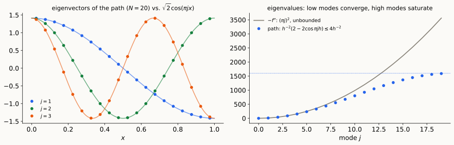
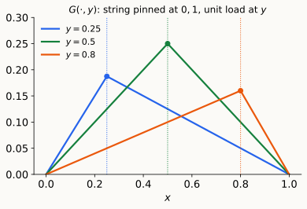
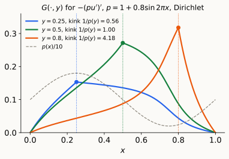
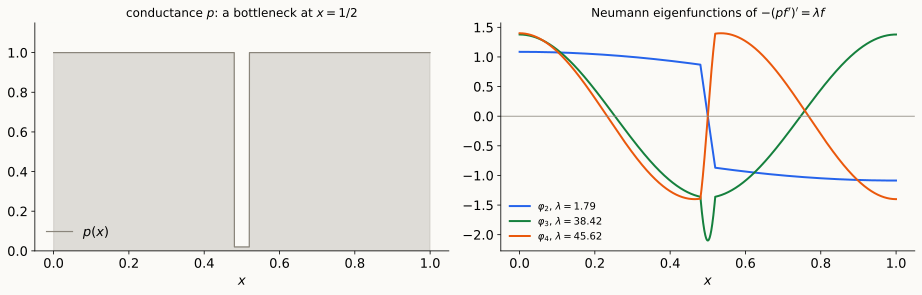
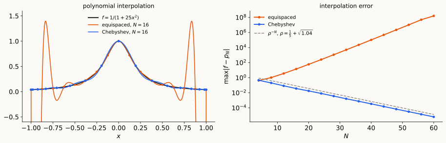
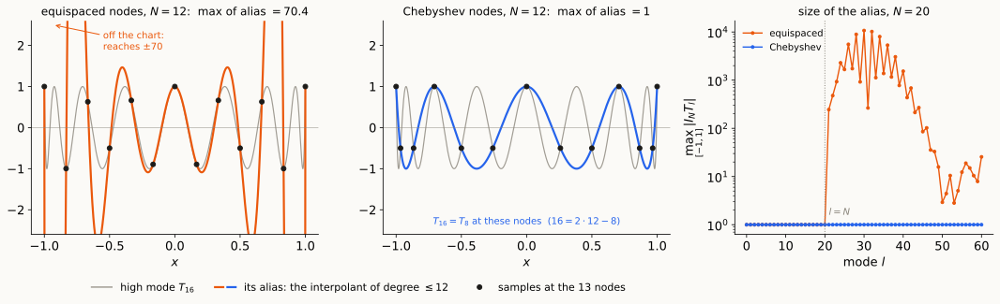

## Where we are

- **So far:** spectral theory of **finite** matrices: graph Laplacians, walks, cuts, solvers, sparsifiers, functional inequalities.
- **From now on:** the **continuum**. Markov processes on $\mathbb R^d$ (L15), Langevin and Fokker–Planck (L16), Bakry–Émery (L17), manifold learning (L18).
- **The bridge:** a graph Laplacian on finely sampled points is a discretization of a **differential operator**. Which spectral facts survive the limit, and which break?

::: {.idea}
**Today:** the simplest case, one dimension. The weighted path graph becomes a **Sturm–Liouville operator** $-(pf')'+qf=\lambda rf$, whose spectral theory is as complete as that of a symmetric matrix.
:::

::: notes
~2 min. Reading: LA Review II (Hilbert spaces, compact operators, §8 unbounded operators). Today uses §7 (spectral theorem for compact self-adjoint operators) and §8 (domains, boundary conditions, compact resolvents).
:::

## Plan

- **§1 The path graph and its limit.** Eigenvectors converge, eigenvalues saturate; what changes in infinite dimensions.
- **§2 Sturm–Liouville theory.** The operator and its quadratic form; the spectral theorem via the Green's function; min–max and comparison; oscillation.
- **§3 The dictionary.** Weighted paths $\leftrightarrow$ Sturm–Liouville; a bottleneck example; how accurate the graph is.
- **Part 2 · Spectral collocation.** §4 interpolation and Chebyshev points; §5 differentiation matrices and eigenvalues; §6 what's lost, and where Chebyshev reappears.

::: notes
~1 min. Part 1 (§1–§3) on 11/12; Part 2 (§4–§6, spectral collocation) in the next session, ~35 min.
:::

# §1 · The path graph and its limit {background-color="#1c1b19"}

## The path graph converges to $-\frac{d^2}{dx^2}$

$N$ cells of width $h=\frac1N$ on $[0,1]$, centers $x_i=(i-\frac12)h$, edge weights $h^{-2}$ (Lecture 2 notes):
$$(Lf)_i=\frac{2f_i-f_{i-1}-f_{i+1}}{h^2}\ \longrightarrow\ -f''(x_i).$$

The limit operator is the linear differential operator $T_N=-\frac{d^2}{dx^2}$ ($N$ for Neumann) on
the space of twice-differentiable functions on $[0,1]$ (precisely: $u''\in L^2$) satisfying the **Neumann boundary conditions** $u'(0)=u'(1)=0$. It has
a complete set of eigenfunctions $\cos(\pi jx)$ with eigenvalues $(\pi j)^2$, $j=0,1,2,\dots$.

- **Path Graph Eigenvectors:** $\cos(\pi jx_i)$, $j=0,\dots,N-1$, **exactly** the samples of the Neumann eigenfunctions $\cos(\pi jx)$.
- **Path Graph Eigenvalues:** $\ \mu_j=h^{-2}\big(2-2\cos(\pi jh)\big)\ $ vs. $\ (\pi j)^2$.

{.nostretch fig-align="center" width="100%" fig-alt="Left: dots for three path eigenvectors lying exactly on cosine curves. Right: eigenvalues of the path following (pi j)^2 for small j and flattening below 4 N^2 for large j."}

::: notes
~4 min. Ratios μ_j/(πj)² at N = 20: 0.998 (j = 1), 0.950 (j = 5), 0.811 (j = 10), 0.446 (j = 19). The graph Laplacian has Neumann boundary conditions built in (Lecture 2 notes: no boundary term in the discrete Green's identity), which is why the cosines appear.
:::

## Reminder: Fourier modes diagonalize the path {.smaller}

:::: {.columns}
::: {.column width="50%"}
**Path** (drop the factor $h^{-2}$)

**Bulk** (rows $2\le i\le N-1$): the stencil is translation invariant, so every frequency $\theta$ works:
$$\begin{aligned}&f_i=\cos\big(\theta(i-\tfrac12)\big)\\ \Rightarrow\ &2f_i-f_{i-1}-f_{i+1}=(2-2\cos\theta)\,f_i\end{aligned}$$

**Boundary** (rows $1$, $N$): bulk rows with ghost values $f_0=f_1$, $f_{N+1}=f_N$ (discrete Neumann).

- $f_0=f_1$: automatic, thanks to the half-shift $i-\frac12$.
- $f_{N+1}=f_N$ $\iff$ $\sin(\theta N)\sin(\theta/2)=0$ $\iff$ $\theta=\pi jh$.
:::

::: {.column width="50%"}
**Continuum** ($T_N=-\frac{d^2}{dx^2}$)

**Bulk** (the ODE on $(0,1)$): the equation is translation invariant, so every frequency $\omega$ works:
$$\begin{aligned}&u=A\cos\omega x+B\sin\omega x\\ \Rightarrow\ &{-u''}=\omega^2u\end{aligned}$$

**Boundary** (Neumann $u'(0)=u'(1)=0$):

- $u'(0)=B\omega=0$: $\ B=0$, the phase is fixed.
- $u'(1)=-A\omega\sin\omega=0$ $\iff$ $\omega=\pi j$.
:::
::::

**Bulk gives the eigenvalue** ($2-2\cos\theta$ vs. $\omega^2$, equal to leading order when $\theta=\omega h$); **the boundary picks the frequencies** ($\theta=\pi jh$ vs. $\omega=\pi j$). So $\ \varphi_j(x_i)=\cos(\pi jx_i)$, $\ \mu_j=h^{-2}(2-2\cos\pi jh)$, $\ j=0,\dots,N-1$: $N$ distinct eigenvalues, a complete basis (the DCT).

::: {.idea}
**Folding:** reflect the path across both ends to get the cycle $C_{2N}$ (Lecture 2 notes, §6.2). Even functions on $C_{2N}$ = functions on the path, and the even Fourier modes are the cosines. Continuum: cosine series on $[0,1]$ = Fourier series of the even extension to the circle of length $2$.
:::

::: notes
~3 min. Bulk identity: cos(a − θ) + cos(a + θ) = 2 cos θ cos a. Boundary: cos(θ(N+½)) − cos(θ(N−½)) = −2 sin(θN) sin(θ/2); θ ∈ [0, π) gives j = 0, …, N−1. The boundary rows are f_1 − f_2 and f_N − f_{N−1} (degree-1 end vertices). Folding: identify i with 2N+1−i; the cycle edges (N, N+1) and (2N, 1) become self-loops, which the Laplacian ignores, so L_cycle restricted to even functions is L_path. The modes cos(πm(i−½)/N) are exactly the reflection-even modes of C_{2N}. Same mechanism gives Dirichlet: odd extension, sine modes.
Continuum details: the right column treats λ = ω² > 0. No negative eigenvalues, since ⟨u, T_N u⟩ = ∫u'² (the boundary term u u' vanishes under Neumann). λ = 0 gives u = A + Bx, and u'(0) = 0 leaves the constants (j = 0). The ghost value f_0 = f_1 is the discrete u'(0) = 0: (f_1 − f_0)/h is the centered difference for u' at x = 0 (index i = ½). Changing only the boundary rows changes which modes survive but not the dispersion relation: Dirichlet keeps the sines, periodic conditions give the cycle's modes.
:::

## What changes in infinite dimensions

The limit operator $-\frac{d^2}{dx^2}$ on $L^2([0,1])$ (LA Review II, §8):

- **Unbounded:** $\|T_N\|=\infty$, while $\|L\|\le4h^{-2}$. It is defined only on a **domain**, a proper subspace of $L^2$.
- **The domain is part of the data:** $T_{\min}=-\frac{d^2}{dx^2}$ on $C_c^\infty((0,1))$ is symmetric but not self-adjoint. Its self-adjoint extensions impose **boundary conditions** on $H^2(0,1)=\{u:\ u''\in L^2\}$, with different spectra:
  - $T_N$, Neumann $u'(0)=u'(1)=0$: $\ (\pi j)^2$, $j\ge0$, $\ \cos(\pi jx)$;
  - $T_D$, Dirichlet $u(0)=u(1)=0$: $\ (\pi j)^2$, $j\ge1$, $\ \sin(\pi jx)$.
- **On the graph:** Neumann is automatic; Dirichlet is **grounding the endpoints** (edges to ground, Lecture 11).
- **Tame it by inverting:** $T_D^{-1}$ is the integral operator with kernel $\ G(x,y)=\min(x,y)-xy$: continuous, symmetric, hence **compact**. Its eigenbasis is $T_D$'s, and its range is exactly the domain of $T_D$.

::: notes
~4 min. The general principle from LA Review II: pass to a bounded function of the unbounded operator (resolvent, heat semigroup, spectral projector). Check of the Green's function: the Dirichlet path matrix (weights h^{−2}, interior nodes) has inverse exactly h·G(x_i, x_j) (scripts/make_figures.py, error 3·10⁻¹⁷). In continuous time, the heat semigroup e^{−tT_D} (or e^{−tT_N}) is compact for t > 0 for the same reason.
Domains: H²(0,1) = {u ∈ C¹[0,1] : u' absolutely continuous, u'' ∈ L²}; in one dimension such u are C¹, so u(0), u'(0), u(1), u'(1) make sense. D(T_N) and D(T_D) are H² plus the two boundary conditions. Why the bare C_c^∞ operator fails: the adjoint test f ↦ ⟨T_min f, g⟩ never sees the boundary values of g, so D(T_min*) = H² with no conditions (T_max), and T_max g = λg has a 2-dimensional solution space for every λ ∈ ℂ (e.g. g = 1, x for λ = 0). The closure of T_min has domain {u ∈ H²: u = u' = 0 at both ends} and no eigenvalues at all. D(T_max)/D(closure of T_min) is 4-dimensional (the four boundary values); a self-adjoint extension imposes 2 conditions making the boundary form [fg' − f'g]₀¹ vanish (Lagrange identity). Why H² and not C²: on C² with Neumann conditions the operator is symmetric and its closure is T_N (essentially self-adjoint), but T_N^{-1} of an L² function is generally not C². Range of T_D^{-1} = D(T_D): u = ∫G(·,s)f(s)ds vanishes at both ends with −u'' = f ∈ L², and conversely any u ∈ D(T_D) comes from f = −u''.
:::

## Constructing $T_D^{-1}$: the Dirichlet Green's function {.smaller}

**Task:** given $f$, solve $\ -u''=f,\ \ u(0)=u(1)=0$.

:::: {.columns}
::: {.column width="56%"}
**1. Integrate twice from $0$.**
$$u'(x)=u'(0)-\int_0^x f(s)\,ds,$$
$$u(x)=u(0)+u'(0)\,x-\int_0^x(x-s)\,f(s)\,ds,$$
using $\int_0^x\!\int_0^t f(s)\,ds\,dt=\int_0^x(x-s)f(s)\,ds$ (swap the order).

**2. The boundary values fix the two constants.** $u(0)=0$, and $u(1)=0$ forces $\ u'(0)=\int_0^1(1-s)f(s)\,ds$.

**3. Read off the kernel.** Splitting at $s=x$:
$$\begin{aligned}u(x)&=\int_0^1\underbrace{x(1-s)}_{\text{from }u'(0)}f(s)\,ds-\int_0^x(x-s)f(s)\,ds\\&=\int_0^1G(x,s)f(s)\,ds,\end{aligned}$$
$$G(x,s)=\begin{cases}s(1-x),&s\le x\\ x(1-s),&s\ge x\end{cases}\ =\ \min(x,s)-xs.$$

**4. Check.** $u=(1-x)\int_0^x sf+x\int_x^1(1-s)f$. Differentiate twice: the boundary terms cancel, and $-u''=f$.
:::

::: {.column width="44%"}
{fig-alt="Three tent functions on [0,1], each zero at both endpoints, linear on each side of its peak at y = 0.25, 0.5 and 0.8, with peak height y(1−y)."}

- **Column $G(\cdot,y)$:** solves $-u''=\delta_y$. Linear on each side of $y$, the slope drops by $1$ at $y$, and it vanishes at both ends.
- **Graph analogue:** $h\,G(x_i,x_j)=(L_{\rm Dir})^{-1}_{ij}$ exactly.
:::
::::

::: {.idea}
**What we gained.** $G$ is continuous and symmetric, so $T_D^{-1}f=\int G(\cdot,s)f(s)\,ds$ is **bounded, self-adjoint, compact**. Its eigenpairs are $\big(\frac{1}{(\pi j)^2},\sin\pi jx\big)$. Sanity check: $\operatorname{tr}T_D^{-1}=\int_0^1G(x,x)\,dx=\frac16=\sum_j\frac1{(\pi j)^2}$.
:::

::: notes
~6 min. Go slowly; for many students this is the first Green's function they see. Points to stress:
(a) Linearity: u depends linearly on f, so it must be an integral against some kernel; the computation only finds the kernel.
(b) Order swap in step 1: the region 0 ≤ s ≤ t ≤ x, integrate in t first, which gives the length x − s.
(c) The two boundary conditions use up exactly the two constants of integration. A second-order equation needs two conditions; that is why the domain is part of the data.
(d) Step 4 in detail: u' = −∫_0^x s f + ∫_x^1 (1−s) f (the terms ±x(1−x)f(x) from Leibniz cancel), then u'' = −x f(x) − (1−x) f(x) = −f(x).
(e) Physical picture: a string pinned at both ends with a unit point load at y. The tent's height y(1−y) is largest in the middle.
(f) Neumann has no inverse: constants are in the kernel (−u'' = 0, u' = 0 at both ends). Restrict to mean-zero f and u, and you get the analogue of L^+ (§3).
(g) Trace check: ∫G(x,x) = ∫(x − x²) = 1/6, and Σ 1/(π j)² = 1/6 is the Basel sum. Likewise ∫∫G² = 1/90 = Σ 1/(π j)⁴ (Hilbert–Schmidt norm). Both are checked numerically in scripts/make_figures.py.
:::

# §2 · Sturm–Liouville theory {background-color="#1c1b19"}

## The Sturm–Liouville problem

::: {.defn}
On $[a,b]$, with $p\in C^1$, $p>0$, and $r>0$, $q$ continuous: find $\lambda$ and $f\ne0$ with
$$-(pf')'+qf=\lambda\,rf,$$
plus **separated boundary conditions** $\ \alpha_af(a)+\beta_ap(a)f'(a)=0$, $\ \alpha_bf(b)+\beta_bp(b)f'(b)=0$ (**regular** problem).
:::

- **Hilbert space:** $L^2([a,b],r\,dx)$, $\ \langle f,g\rangle_r=\int fg\,r$. The operator is $\ Tf=\frac1r\big(-(pf')'+qf\big)$: the analogue of $L_{rw}=D^{-1}L$.
- **Domain** $D(T)$: the $f\in H^2(a,b)$ satisfying both boundary conditions, as for $T_N$, $T_D$ in §1.
- **Lagrange (Green's) identity:** $\ \displaystyle\int_a^b\big(g\,(pf')'-f\,(pg')'\big)=\Big[p\,(gf'-fg')\Big]_a^b$, which **vanishes** for $f,g\in D(T)$. So $T$ is **symmetric** in $\langle\cdot,\cdot\rangle_r$.
- **Quadratic form** (Neumann or Dirichlet): $\ \langle f,Tf\rangle_r=\displaystyle\int_a^b\big(p\,f'^2+q\,f^2\big)$, the **Dirichlet energy**. Rayleigh quotient $\ R(f)=\dfrac{\int pf'^2+qf^2}{\int rf^2}$, defined on the larger **form domain** $H^1$ (Neumann) or $H^1_0$ (Dirichlet).

::: notes
~4 min. Domain: the natural definition is {f : f and pf' absolutely continuous, Tf ∈ L²(r), boundary conditions}. Since p ∈ C¹ with p > 0 and r, q are continuous with r > 0 on the compact interval, this is the same set as H²(a,b) with the boundary conditions ((pf')' = p'f' + pf'', and L²(r) = L² as sets). Functions in H² are C¹, so f(a), p(a)f'(a) make sense. The same story as §1: T_min on C_c^∞((a,b)) is symmetric but not self-adjoint, its adjoint is T on H² with no conditions, and each choice of separated boundary conditions gives a self-adjoint T. The form domain H¹ (u and u' in L², no derivative condition) is where the Rayleigh quotient and min–max live: Dirichlet conditions are imposed there (H¹₀), Neumann conditions are not, and minimizers satisfy them automatically (natural boundary conditions).
Mixed (Robin) conditions add a boundary term ±(α/β) f² at each end (from p f' = −(α/β) f), and the Rayleigh quotient picks up those terms. Examples to name: −f'' (p = r = 1, q = 0); the quantum harmonic oscillator and Hermite functions (singular, on ℝ, Lecture 16); Legendre −((1−x²)f')' (singular endpoints, Chebyshev's cousin, next time); vibrating string with density r and tension p.
:::

## The spectral theorem for Sturm–Liouville

::: {.thm}
**Theorem.** For a regular Sturm–Liouville problem:

1. the eigenvalues are real, **simple**, and form a sequence $\lambda_1<\lambda_2<\dots\to\infty$, which is the **whole spectrum**: $\sigma(T)=\{\lambda_k\}$;
2. the eigenfunctions $\varphi_k$ form an **orthonormal basis** of $L^2([a,b],r\,dx)$;
3. **oscillation:** $\varphi_k$ has exactly $k-1$ zeros in $(a,b)$;
4. **Weyl asymptotics:** $\ \lambda_k\sim\Big(\dfrac{k\pi}{\int_a^b\sqrt{r/p}\,dx}\Big)^2$.
:::

- Same shape as the spectral theorem for symmetric matrices, plus two facts special to **one dimension**: simplicity and exact zero counts.
- Check (scripts, Neumann, where $\varphi_{k+1}$ has $k$ zeros): $p=1+0.8\sin2\pi x$, $r=1+\frac x2$ gives $\lambda_{k+1}\big/\big(\frac{k\pi}{\int\sqrt{r/p}}\big)^2=1.008,\ 1.002,\ 1.0003$ for $k=5,10,20$.

::: notes
~3 min. Plan for the next slides: (1)–(2) from the Green's function and LA Review II, Theorem 7.1; simplicity from the Wronskian; (3) from Sturm comparison; (4) heuristically by counting zeros (slide after Oscillation); rigorously by the Liouville transformation t = ∫√(r/p), which turns the problem into −u'' + Q u = λu on an interval of length ∫√(r/p) (state, don't prove).
Whole spectrum (purely discrete, from the compact resolvent): for λ ≠ 0, λ ∈ σ(T) iff 1/λ ∈ σ(T^{-1}) = {ν_k} ∪ {0}, and 0 ∈ σ(T^{-1}) corresponds to "λ = ∞". Concretely, (T − z)^{-1} = Σ_k ⟨φ_k, ·⟩_r φ_k / (λ_k − z) is bounded, with norm 1/dist(z, {λ_k}), for every z ∉ {λ_k}. This fails for singular problems: −f'' on [0, ∞) has spectrum [0, ∞) and no eigenvalues; −f'' − 2 sech²x f on ℝ has the eigenvalue −1 (eigenfunction sech x) plus [0, ∞); the harmonic oscillator (L16) and Legendre (next time) are singular but still discrete. Graph side: the unrescaled path (h = 1, N → ∞) has spectrum filling [0, 4], so discreteness comes from the compact interval, not from the operator being differential.
:::

## Constructing the Sturm–Liouville Green's function {.smaller}

**Task:** given $f$, solve $\ \mathcal Lu:=-(pu')'+qu=f$ with both boundary conditions. Assume $0$ is not an eigenvalue (a shift arranges this, next slide). **Idea:** as for the tent, find the response to a unit point load, $\mathcal L\,G(\cdot,y)=\delta_y$, then superpose: $u=\int G(\cdot,y)f(y)\,dy$.

:::: {.columns}
::: {.column width="56%"}
**0. One solution per endpoint.** Solve $\mathcal Lu=0$ from each end: $u_a$ with $(u_a,\,pu_a')(a)=(\beta_a,-\alpha_a)$ satisfies the condition at $a$; $u_b$ likewise at $b$. (Linear ODE: they exist.)

**1. Ansatz.** Away from $y$, $G$ solves $\mathcal LG=0$, with the condition at $a$ on the left and at $b$ on the right:
$$G(x,y)=\begin{cases}A(y)\,u_a(x),&x<y\\ B(y)\,u_b(x),&x>y.\end{cases}$$

**2. Match at $x=y$:** continuity, and a unit jump in the flux $pG'$ (integrate $-(pG')'=\delta_y$ across $y$):
$$A\,u_a(y)=B\,u_b(y),\qquad p(y)\big(B\,u_b'(y)-A\,u_a'(y)\big)=-1.$$

**3. Solve:** $\ A=\dfrac{u_b(y)}C,\ \ B=\dfrac{u_a(y)}C$, so
$$G(x,y)=\frac{u_a(x_<)\,u_b(x_>)}{C},\qquad C=p\,(u_a'u_b-u_au_b').$$
:::

::: {.column width="44%"}
{fig-alt="Three Green's function columns for p = 1 + 0.8 sin 2πx with Dirichlet conditions: each is zero at both ends, curved on each side of its peak, with a sharper kink where p is small (y = 0.8)."}

- $C$ is **constant** (Abel), and $C\ne0$ $\iff$ $u_a,u_b$ independent $\iff$ $0$ is not an eigenvalue.
- **Check,** $-u''$, Dirichlet: $u_a=x$, $u_b=1-x$, $C=1$, $\ G=\min(x,y)-xy$.
- **$q=0$, Dirichlet:** $u_a=s(x)=\int_a^x\frac{dt}p$, $u_b=R-s$, $C=R$: the **tent in the resistance coordinate**.
:::
::::

::: notes
~6 min. Same structure as the Dirichlet slide in §1, but now we cannot integrate twice explicitly, so we build G column by column.
Step 0: (u_a(a), p u_a'(a)) = (β_a, −α_a) gives α_a u_a(a) + β_a p(a) u_a'(a) = α_aβ_a − β_aα_a = 0. Any nonzero multiples of u_a, u_b give the same G (C scales the same way).
Step 1: the homogeneous equation has a 2-dimensional solution space; imposing the condition at a cuts it to the line through u_a, and similarly at b. So the only freedom is the two scalars A(y), B(y).
Step 2: the jump condition is the precise meaning of "the slope drops by 1/p(y) at y" (by 1 for the tent). Integrating −(pG')' = δ_y from y−ε to y+ε gives −[pG']_{y−}^{y+} = 1.
Step 3: continuity reads u_b u_a / C = u_a u_b / C; the jump reads p(u_a u_b' − u_b u_a')/C = −C/C = −1.
Step 4 (check, do not present unless asked): u = (u_b(x)∫_a^x u_a f + u_a(x)∫_x^b u_b f)/C. Differentiating once, the Leibniz terms ±u_a u_b f/C cancel, so pu' = (pu_b'∫_a^x u_a f + pu_a'∫_x^b u_b f)/C. Differentiating again, the Leibniz terms give p(u_b'u_a − u_a'u_b) f/C = −f, and (pu_b')' = q u_b, (pu_a')' = q u_a, so (pu')' = qu − f, i.e. 𝓛u = f. At x = a the first integral vanishes, so (u, pu')(a) is a multiple of (u_a, pu_a')(a) and satisfies the boundary condition; likewise at b.
Figure: p = 1 + 0.8 sin 2πx, q = 0, Dirichlet on [0, 1]; R = ∫1/p = 1/0.6 = 5/3. The kink at y has size 1/p(y): sharp at y = 0.8 where p is small. The grounded weighted path (conductances p(x_{i+1/2})/h) has K^{-1} equal to this G at the nodes to 4·10⁻¹⁴ (scripts/make_figures.py): the discrete resistance coordinate is exact.
Weight: Tu = f means 𝓛u = r f, so T^{-1} f = ∫G(x,y) f(y) r(y) dy (next slide, step 3).
:::

## Proof of (1)–(2): invert the operator

1. **Shift:** replace $q$ by $q+cr$ with $c$ large, so that $\lambda=0$ is not an eigenvalue. Eigenvalues shift by $c$; eigenfunctions are unchanged.
2. **Green's function** (previous slide): $\ G(x,y)=u_a(x_<)\,u_b(x_>)/C$ solves $\ -(pu')'+qu=f\iff u(x)=\int G(x,y)f(y)\,dy$.
3. **Compact and self-adjoint:** $T^{-1}f=\int G(x,y)f(y)\,r(y)\,dy$ has a **continuous symmetric** kernel on $[a,b]^2$, so it is a compact (Hilbert–Schmidt) self-adjoint operator on $L^2(r)$, with range exactly $D(T)$.
4. **LA Review II, Thm 7.1:** an orthonormal eigenbasis with eigenvalues $\nu_k\to0$. Each $\varphi_k=\nu_k^{-1}T^{-1}\varphi_k$ lies in $D(T)$, with $T\varphi_k=\lambda_k\varphi_k$, $\lambda_k=1/\nu_k\to\infty$. Injective, so the basis is complete.

::: notes
~5 min. C is constant: (p(u_a'u_b − u_a u_b'))' = u_b(pu_a')' − u_a(pu_b')' = q u_a u_b − q u_a u_b = 0 (Abel). For −f'' with Dirichlet: u_a = x, u_b = 1 − x, C = 1, G = min(x,y) − xy. Self-adjointness in L²(r): ⟨T^{-1}f, g⟩_r = ∬ G(x,y) f(y) g(x) r(x) r(y), symmetric in f and g. The construction needs u_a and u_b independent, which is exactly "0 is not an eigenvalue".
Range = D(T): u = ∫G f r = (u_b(x)∫_a^x u_a f r + u_a(x)∫_x^b u_b f r)/C; at x = a, u and pu' equal c·u_a and c·pu_a' with c = ∫_a^b u_b f r / C, so u satisfies the boundary condition at a, and likewise at b; and −(pu')' + qu = r f ∈ L², so u ∈ D(T); conversely u ∈ D(T) comes from f = Tu. This is what makes the eigenfunctions of T^{-1} eigenfunctions of T (step 4).
:::

## Simplicity, min–max and comparison

**Simplicity.** If $f,g$ are eigenfunctions for the same $\lambda$, both satisfy the boundary condition at $a$, so their Wronskian vanishes there; $p\,(fg'-f'g)$ is constant (Abel), so it vanishes everywhere: $f\propto g$. *(Fails in higher dimensions and on graphs: multiplicities.)*

. . .

**Min–max (Courant–Fischer, as in LA Review I):**
$$\lambda_k=\min_{\dim S=k}\ \max_{f\in S\setminus0}\ R(f),\qquad R(f)=\frac{\int pf'^2+qf^2}{\int rf^2}.$$

- **Comparison:** increasing $p$ or $q$ raises every $\lambda_k$; increasing $r$ lowers every positive $\lambda_k$ (e.g. all of them when $q\ge0$). *(Rayleigh monotonicity, Lecture 9.)*
- **Boundary conditions:** Dirichlet $\ge$ Neumann, eigenvalue by eigenvalue (a smaller space of test functions: $S\subset H^1_0$ vs. $S\subset H^1$). *(Grounding raises the spectrum.)*
- **Test functions** give upper bounds, as in Lecture 5.

::: notes
~4 min. For the Dirichlet problem the min–max is over subspaces of H¹₀ (functions vanishing at the ends); for Neumann over all of H¹; the energy form is the same. The comparison statements follow because R(f) is monotone in p and q, and in r wherever the numerator is ≥ 0, and the min–max is monotone in R. Stated here for Neumann/Dirichlet; Robin adds boundary terms to R.
:::

## Oscillation

::: {.thm}
**Sturm comparison.** Let $-(pu')'+qu=\lambda ru$ and $-(pv')'+qv=\mu rv$ with $\mu>\lambda$. Between any two consecutive zeros of $u$ there is a zero of $v$.
:::

::: {.pf}
*Proof.* Let $x_1<x_2$ be consecutive zeros of $u$, with $u>0$ on $(x_1,x_2)$, and suppose $v>0$ there. Then
$$\Big[p\,(u'v-uv')\Big]_{x_1}^{x_2}=(\mu-\lambda)\int_{x_1}^{x_2}r\,u\,v\ >\ 0,$$
but the left side is $p(x_2)u'(x_2)v(x_2)-p(x_1)u'(x_1)v(x_1)\le0$ since $u'(x_2)\le0\le u'(x_1)$. $\square$
:::

- **Zero counting:** follow $\varphi$ as $\lambda$ increases from $\lambda_1$; zeros enter only through the boundary and never merge (zeros are simple: $\varphi=\varphi'=0$ at a point forces $\varphi\equiv0$), so $\varphi_k$ has exactly $k-1$ zeros, and zeros of $\varphi_k,\varphi_{k+1}$ **interlace**.
- **On the path graph:** the $k$-th eigenvector of a weighted path has exactly $k-1$ sign changes (Gantmacher–Krein). The **Fiedler vector is monotone**, so the sweep cut is a threshold.
- **Higher dimensions:** only **Courant's bound**: $\varphi_k$ has at most $k$ nodal domains (graph versions: Davies–Gladwell–Leydold–Stadler).

::: notes
~5 min. The identity: (p(u'v − uv'))' = (pu')'v − u(pv')' = (q − λr)uv − (q − μr)uv = (μ − λ) r u v. The zero-counting argument is a continuity (Prüfer angle) argument; state it. The discrete statement is the oscillation theory of Jacobi (tridiagonal, negative off-diagonal) matrices; it is why spectral partitioning on a path, or along a nearly one-dimensional graph, is so clean.
:::

## Where Weyl comes from: counting zeros

For large $\lambda$, freeze the coefficients near a point $x_0$: $\ -p(x_0)\,u''\approx\lambda\,r(x_0)\,u$. *(Where did $q$ go? Discussion question 5.)*

- **Local wavelength:** solutions look like $\sin(\omega x+c)$ with $\ \omega(x)=\sqrt{\lambda\,r(x)/p(x)}$, so consecutive zeros are $\approx\pi/\omega(x)$ apart.
- **Count:** $\ \#\{\text{zeros in }(a,b)\}\approx\dfrac1\pi\displaystyle\int_a^b\omega\,dx=\dfrac{\sqrt\lambda}{\pi}\displaystyle\int_a^b\sqrt{r/p}\,dx.$
- **Oscillation:** $\varphi_k$ has exactly $k-1$ zeros, so $\ k\approx\dfrac{\sqrt{\lambda_k}}{\pi}\displaystyle\int_a^b\sqrt{r/p}$. That is Weyl's law.

::: {.idea}
**Travel time.** A string with tension $p$ and density $r$ carries waves at speed $c=\sqrt{p/r}$, so $\int\sqrt{r/p}=\int dx/c$ is the time to cross it. The high modes hear only this. $\lambda_2$ hears the global layout: the total resistance $R=\int dx/p$ and where the mass $M=\int r$ sits along it ($\lambda_2\ge\frac{4}{RM}$, nearly tight for a bottleneck, next section).
:::

::: notes
~3 min. Heuristic; two ways to make it rigorous. (a) Sturm–Picone comparison (different coefficients, same λ) on short intervals against constant-coefficient equations with r/p frozen at its max and min there. (b) The Liouville transformation t = ∫ₐˣ√(r/p), u = (pr)^{1/4} f turns the problem into −u'' + Q u = λu on [0, ℓ], ℓ = ∫√(r/p), with Q built from q/r and two derivatives of (pr)^{1/4} (needs p, r ∈ C²). For Dirichlet conditions, min–max then gives (kπ/ℓ)² + min Q ≤ λ_k ≤ (kπ/ℓ)² + max Q. On the weighted path, ℓ is Σᵢ √(mᵢ / c_{i+1/2}) = Σᵢ h√(r/p): the geometric mean of mass and resistance, cell by cell, whereas λ₂ sees Σ 1/c (resistance) and the masses separately. Valid only for 1 ≪ k ≪ N on the graph, since its spectrum stops at 4h⁻².
:::

# §3 · The dictionary {background-color="#1c1b19"}

## Weighted paths are Sturm–Liouville problems

Discretize: edge $(i,i+1)$ gets conductance $c_{i+\frac12}=\frac{p(x_{i+1/2})}h$, vertex $i$ gets mass $m_i=r(x_i)\,h$:
$$\sum_ic_{i+\frac12}(f_{i+1}-f_i)^2\approx\int pf'^2,\qquad\sum_im_if_i^2\approx\int rf^2 .$$

| weighted path graph | Sturm–Liouville |
|:--|:--|
| vertex measure $m_i$ (degrees, $\pi$) | density $r(x)$ |
| conductance $c_{i+\frac12}$ | coefficient $p(x)$ |
| edges to ground | potential $q$ / Dirichlet condition |
| no boundary term (Neumann built in) | boundary conditions = self-adjoint extension |
| $M^{-1}K$ ($=L_{rw}$ for $m=d$) | $\frac1r\big(-(p\,\cdot\,')'+q\big)$ |
| end-to-end $R_{\rm eff}=\sum_i\frac1{c_{i+1/2}}$ | $\int_a^b\frac{dx}p$ |
| $L^+$, effective resistances | Green's function $G$ |
| Fiedler vector monotone | $\varphi_2$ has one zero |
| heat kernel $e^{-tL_{rw}}$ | $e^{-tT}$ (compact for $t>0$) |

::: notes
~3 min. The figures on the next slide are computed exactly this way, with N = 2000 cells: the "finite-difference method" for Sturm–Liouville problems is a weighted path graph. The Green's function of the Neumann problem (with the constant mode removed) plays the role of L^+, and G(x,x) − 2G(x,y) + G(y,y) is the effective resistance between x and y.
:::

## A bottleneck

{.nostretch fig-align="center" width="100%" fig-alt="Left: a step function equal to 1 with a narrow dip to 0.02 at the center. Right: the second eigenfunction is nearly constant on each half and jumps across the bottleneck; the next two oscillate within the halves."}

- $\varphi_2$ is **nearly constant on each half** and jumps across the bottleneck: the continuum **sparse cut**.
- $\lambda_2=1.79$, close to two masses $\frac12$ joined by resistance $\int_{\rm gap}\frac{dx}p=2$: $\ \frac1R\big(\frac1{m_1}+\frac1{m_2}\big)=2$. Without the bottleneck, $\lambda_2=\pi^2\approx9.9$.
- $\lambda_3=38.4$, $\lambda_4=45.6$: the halves' own modes (symmetric and antisymmetric), on either side of $(\pi/0.48)^2\approx42.8$. A **spectral gap** $\lambda_3\gg\lambda_2$ separates the cut from the rest (Lecture 7).

::: notes
~3 min. Numbers from scripts/make_figures.py (N = 2000 cells). Zero counts of φ₂, …, φ₆: 1, 2, 3, 4, 5, as the oscillation theorem predicts. The two-mass estimate is off by about 12%: the halves are not exactly constant. General bound (Neumann, q = 0): in the resistance coordinate s = ∫dx/p the problem is a uniform string of length R = ∫dx/p carrying the mass r dx; for f ⟂ 1, ∫rf² ≤ M·(osc f)²/4 and (osc f)² ≤ R·∫pf'², so λ₂ ≥ 4/(RM), with equality for masses M/2 at the two ends of a massless spring. Here R = 2.96, M = 1: bound 1.35 ≤ 1.79; the halves' own resistance (0.96) is why it isn't tight. Uniform string: λ₂ = π²/(RM). Graph version (Lecture 11): (f(u) − f(v))² ≤ R_eff(u,v)·E(f) gives λ₂(M⁻¹L) ≥ 4/(m(V)·max R_eff). This is Cheeger's picture in one dimension: small p is a low-conductance cut.
:::

## How accurate is the graph?

For $-f''$ on $[0,1]$ with $N$ cells, $\ \theta=\pi jh$:
$$\frac{\mu_j}{(\pi j)^2}=\frac{2-2\cos\theta}{\theta^2}=1-\frac{\theta^2}{12}+O(\theta^4).$$

- **Second-order accurate** for fixed $j$: relative error $\approx\frac{(\pi jh)^2}{12}$.
- **But only for $j\ll N$:** at $N=20$ the ratio is $0.998$, $0.950$, $0.811$, $0.446$ for $j=1,5,10,19$. To get mode $j$ to accuracy $\delta$ we need $N\gtrsim j/\sqrt\delta$.

::: {.idea}
**Part 2: spectral collocation.** Sample at **Chebyshev points** and differentiate the interpolating polynomial: eigenvalues converge **exponentially fast** in $N$ for smooth coefficients, and a constant fraction of the $N$ modes come out accurate.
:::

::: notes
~3 min. This is the bridge to the second half of Lecture 14. The graph approximation is local (nearest neighbors), hence algebraic accuracy; the collocation matrix is dense (global interpolation), hence spectral accuracy. Same trade-off as finite differences vs. Fourier for the heat equation in Lecture 1's demo.
:::

# Part 2 · Spectral collocation {background-color="#1c1b19"}

## Part 2: where we are

- **Part 1:** a weighted path graph *is* a finite-difference discretization of a Sturm–Liouville operator. It keeps all the structure (symmetric, PSD, monotone Fiedler vector), but it is **local**, so its accuracy is **algebraic**: mode $j$ has relative error $\approx\frac{(\pi jh)^2}{12}$.
- **Lecture 1, §6:** Chebyshev collocation solved $u''=e^{4x}$ to machine precision with $\approx20$ points; finite differences with thousands of points were still at $10^{-6}$.
- **Today:** why. Replace the nearest-neighbour stencil by **differentiation of a global interpolating polynomial**.

::: notes
~2 min. Part 2 plan: §4 interpolation and Chebyshev points; §5 differentiation matrices, eigenvalues, Sturm–Liouville by collocation; §6 what is lost (structure) and where Chebyshev polynomials reappear in the course and in ML.
:::

# §4 · Interpolation and Chebyshev points {background-color="#1c1b19"}

## Collocation in one sentence

**Represent $u$ by its values at nodes $x_0,\dots,x_N$; differentiate the interpolating polynomial exactly.**

- With the Lagrange basis $\ell_j$ ($\ell_j(x_i)=\delta_{ij}$, degree $N$), $\ p_N(x)=\sum_ju_j\ell_j(x)$, and the **differentiation matrix** is
$$(D_N)_{ij}=\ell_j'(x_i),\qquad (D_Nu)_i=p_N'(x_i).$$
- $D_N$ is **exact on polynomials of degree $\le N$**, and **dense**: every node talks to every other node.
- An eigenvalue problem $-(pu')'+qu=\lambda ru$ becomes a **matrix** eigenvalue problem, as with the path graph, but with a global stencil.

::: {.warn}
**Which nodes?** The obvious choice, equispaced, is a disaster.
:::

::: notes
~2 min. Finite differences use a local polynomial (degree 2 through three neighbours) at each node; collocation uses one global polynomial through all nodes. The question of accuracy becomes a question about polynomial interpolation.
:::

## Equispaced nodes fail; Chebyshev nodes don't {.smaller}

{.nostretch fig-align="center" width="62%" fig-alt="Left: the equispaced interpolant oscillates wildly near the endpoints while the Chebyshev interpolant follows the function. Right: equispaced error grows exponentially to 10^8; Chebyshev error decays exponentially along the dashed line rho^{-N}."}

**Lebesgue constant** $\Lambda_N=\max_x\sum_j|\ell_j(x)|$ is the operator norm of the interpolation operator. Hence:
$$\|f-p_N\|_\infty\le(1+\Lambda_N)\,\min_{\deg q\le N}\|f-q\|_\infty.$$

| $N$ | 10 | 20 | 40 |
|:--|:--|:--|:--|
| equispaced, $\Lambda_N\sim\frac{2^{N+1}}{eN\log N}$ | $30$ | $1.1\times10^4$ | $4.7\times10^9$ |
| Chebyshev $x_j=\cos\frac{j\pi}N$, $\ \Lambda_N\le\frac2\pi\log(N+1)+1$ | $2.42$ | $2.87$ | $3.31$ |

: {tbl-colwidths="[52,16,16,16]"}

**Why Chebyshev:** $T_{N+1}/2^N$ is the monic polynomial of least sup-norm on $[-1,1]$ (equioscillation), so its zeros minimize $\|\prod_j(x-x_j)\|_\infty$ in the error $f-p_N=\frac{f^{(N+1)}(\xi)}{(N+1)!}\prod_j(x-x_j)$. Optimal nodes for $\Lambda_N$ gain only $O(1)$.

::: notes
~4 min. Minimax property: T_{N+1}(cos θ) = cos((N+1)θ) takes the values ±1 alternately at the N+2 points θ = kπ/(N+1). If a monic q of degree N+1 had ‖q‖∞ < 2^{−N}, then T_{N+1}/2^N − q would alternate in sign at these N+2 points, so it would have N+1 zeros; but it has degree ≤ N (the leading terms cancel), so it is 0, a contradiction. The deck uses the extreme points cos(jπ/N) rather than the zeros of T_{N+1}: their node polynomial is 2^{1−N}(x² − 1)U_{N−1}(x), and (1 − x²)U_{N−1}(cos θ) = sin θ sin(Nθ), so ‖ω‖∞ = 2^{1−N}, within a factor 2 of optimal. Link to Λ_N: ℓ_j(x) = ω(x)/((x − x_j) ω'(x_j)), so Λ_N is small when |ω| is uniformly small and |ω'(x_j)| is large at every node; an equioscillating ω does both, while for equispaced nodes ω is ~2^N larger near the ends than in the middle. Optimal Lebesgue nodes: any nodes have Λ_N ≥ (2/π) log N + 0.52 (Erdős, Brutman); Chebyshev gives (2/π) log N + 0.96 + o(1); the optimal nodes are characterized by equal local maxima of the Lebesgue function Σ|ℓ_j(x)| between consecutive nodes (Kilgore; de Boor–Pinkus 1978, the Bernstein–Erdős conjecture), with no closed form.
Numbers from scripts/collocation_figures.py (barycentric interpolation). Runge: equispaced error 60 at N = 20 and 10⁵ at N = 40; Chebyshev 1.8·10⁻², 3.4·10⁻⁴, 6.4·10⁻⁶ at N = 20, 40, 60. The Lebesgue bound says: Chebyshev interpolation is within a factor 1 + Λ_N ≈ 4 of the best polynomial approximation, for every f. Equispaced interpolation amplifies errors exponentially.
:::

## Series expansion vs. interpolation {.smaller}

Approximate $f$ by $N+1$ modes $\varphi_0,\dots,\varphi_N$ of an orthonormal basis of $L^2(w\,dx)$, e.g. the eigenfunctions of an operator. There are two natural choices:

- **Truncated series** $f_N=\sum_{k\le N}a_k\varphi_k$, with $a_k=\int f\,\varphi_k\,w\,dx$: the orthogonal projection. **Needs integrals of $f$.**
- **Interpolant** $p_N=\sum_{k\le N}c_k\varphi_k$, with $p_N(x_j)=f(x_j)$ at $N+1$ nodes. **Needs only samples.**

**1. Interpolation is projection with the integral replaced by a quadrature rule.**
$$a_k=\int f\,\varphi_k\,w\,dx\quad\leadsto\quad c_k=\sum_j w_j\,f(x_j)\,\varphi_k(x_j).$$
If the modes are **discretely orthonormal**, $\sum_jw_j\varphi_k(x_j)\varphi_l(x_j)=\delta_{kl}$ for $k,l\le N$, then this $p_N$ matches $f$ at every node.

**2. The quadrature error is aliasing.** On the grid, a high mode $\varphi_l$ ($l>N$) can coincide with a low mode $\varphi_k$, so the samples cannot tell them apart and the tail of $f$ is counted as low modes. Fourier at $M$ equispaced points: $e^{i(k+mM)x_j}=e^{ikx_j}$, so
$$c_k=a_k+\sum_{m\ne0}a_{k+mM}.$$

**3. So interpolation costs at most a factor 2.** When each high mode aliases onto a single low mode (Fourier, cosines, Chebyshev),
$$\|f-p_N\|_\infty\le\|f-f_N\|_\infty+\|p_N-f_N\|_\infty\le2\sum_{k>N}|a_k|\,\|\varphi_k\|_\infty .$$

**Every node set aliases.** What matters is the size of the aliased mode, measured by the Lebesgue constant $\Lambda_N$: Chebyshev aliasing only relabels modes ($\approx1$), while equispaced aliasing amplifies them ($\sim2^N$).

::: {.idea}
**You have seen this already.** Sampled Fourier is the DFT, i.e. the trapezoidal rule. On the path (Part 1), expanding sampled $f$ in the eigenvectors of $L$ is cosine interpolation in $x$ at the cell centers (DCT-II). Equispaced **polynomial** interpolation has no such quadrature structure, which is why its Lebesgue constant grows like $2^N$. **Next:** Chebyshev interpolation is exactly this picture, with cosines in a new variable.
:::

::: notes
~4 min. Why step 1 interpolates: let Φ = [φ_k(x_j)] (rows j, columns k) and W = diag(w_j). Discrete orthonormality says ΦᵀWΦ = I, so Φ is invertible. The coefficients are c = ΦᵀW f(x), and the samples of p_N are Φc = Φ ΦᵀW f(x) = f(x), because ΦΦᵀW = I as well (a left inverse of a square matrix is a right inverse). Step 2 in general: c_k = Σ_l a_l ⟨φ_l, φ_k⟩_grid, and ⟨φ_l, φ_k⟩_grid = δ_kl for l ≤ N, so only l > N contributes. Step 3: p_N − f_N = Σ_{l>N} a_l φ_{k(l)} when each φ_l equals a single φ_{k(l)} on the grid. Check on Runge with Chebyshev, N = 10: the aliasing formula holds exactly; truncation error 0.110, interpolation error 0.132, tail sum 0.110. Aliasing at equispaced vs. Chebyshev nodes (N = 20): interpolating T_l, with |T_l| ≤ 1, gives an interpolant of sup norm 245, 1.7·10³, 1.1·10⁴ at l = 21, 25, 30 on the equispaced grid, and exactly 1 at Chebyshev nodes, where I_N T_l is a single T_k. Caution for students: discrete orthonormality alone does not distinguish the two. Gram–Schmidt in any positive grid inner product gives discretely orthonormal polynomials at any nodes (Gram polynomials for equispaced, equal weights), and projecting onto them reproduces the interpolant. The difference is that Chebyshev's discrete basis is also continuously orthonormal and bounded (the same T_k), while the Gram polynomials stay bounded at the nodes but blow up between them: sup on [−1, 1] / max at the nodes ≈ 1, 1.8, 21, 7600 for degree 5, 10, 15, 20 at N = 20. General bound: ‖f − p_N‖ ≤ ‖f − f_N‖ + ‖I_N(f − f_N)‖ ≤ (1 + Λ_N)‖f − f_N‖. The practical point for collocation: D_N acts on samples, so it is the interpolant we differentiate, and the factor 2 says that loses essentially nothing compared with the true series.
:::

## Aliasing: relabeling vs. amplification

{.nostretch fig-align="center" width="100%" fig-alt="Left: at equispaced nodes the interpolant of T_16 matches the samples but swings far outside [-1,1] near the endpoints, reaching about 70. Middle: at Chebyshev nodes the interpolant is the smooth mode T_8, bounded by 1. Right: semilog plot of the maximum of the interpolant of T_l against l; both equal 1 for l up to N = 20; beyond that the Chebyshev curve stays at 1 while the equispaced curve jumps to between 10 and 10^4."}

- **Both grids alias:** $13$ samples cannot tell $T_{16}$ from a polynomial of degree $\le12$.
- **Chebyshev:** the alias is another mode, $T_8$, of the same size. The tail of $f$ is **relabeled**, never amplified.
- **Equispaced:** the alias matches the samples but **oscillates wildly** between the nodes near the ends, $70\times$ larger than $T_{16}$. At $N=20$ the factor reaches $10^4$, so a tail of size $10^{-6}$ can come back as an error of size $10^{-2}$.
- **Right panel:** for $l\le N$ both are exact (size $1$). For $l>N$ the equispaced alias is $10$ to $10^4$ times too large: this amplification factor is what $\Lambda_N$ bounds.

::: notes
~3 min. Point at the middle panel: T_16 and T_8 agree at every Chebyshev node because cos(16 jπ/12) = cos(2πj − 8jπ/12) = cos(8 jπ/12). In θ this is just Fourier aliasing on an equispaced grid, which is a relabeling of frequencies. Point at the left panel: the alias is the same kind of wild polynomial as the Runge interpolant, and for the same reason. The equispaced curve on the right is not monotone in l; what matters is that it is far above 1 for every l > N. Figure from scripts/collocation_figures.py (fig_aliasing).
:::

## Chebyshev is Fourier in disguise {.smaller}

::: {.defn}
**Chebyshev polynomials** are defined by the **cosine property**
$$T_k(\cos\theta)=\cos k\theta,\qquad\text{i.e. }\ T_k(x)=\cos(k\arccos x)\ \text{ on }[-1,1].$$
This is a polynomial of degree $k$ in $x$: the identity $\cos(k+1)\theta+\cos(k-1)\theta=2\cos\theta\,\cos k\theta$ gives
$$T_0=1,\qquad T_1=x,\qquad T_{k+1}=2x\,T_k-T_{k-1}\qquad(T_2=2x^2-1,\ \ T_3=4x^3-3x).$$
So $|T_k|\le1$ on $[-1,1]$, with alternating extrema $\pm1$ at $x=\cos\frac{j\pi}k$, and leading coefficient $2^{k-1}$.
:::

Substitute $x=\cos\theta$, $\theta\in[0,\pi]$, and set $F(\theta)=f(\cos\theta)$. Everything about Chebyshev becomes a statement about cosines in $\theta$:

| on $[-1,1]$, variable $x$ | on the circle, variable $\theta$ |
|:--|:--|
| any function $f$ | $F(\theta)=f(\cos\theta)$: **even and $2\pi$-periodic** |
| $T_k(x)$ | $\cos k\theta$ |
| Chebyshev series $f=\sum_k a_kT_k$ | cosine series $F=\sum_k a_k\cos k\theta$ |
| $a_k=\frac2\pi\int_{-1}^1 f\,T_k\,\frac{dx}{\sqrt{1-x^2}}$ | $a_k=\frac2\pi\int_0^\pi F(\theta)\cos k\theta\,d\theta$ $\ $ (halve $a_0$) |
| nodes $x_j=\cos\frac{j\pi}N$, clustered at $\pm1$ | $\theta_j=\frac{j\pi}N$, **equispaced** |
| interpolant $p_N$ at the $x_j$ | trigonometric interpolant: a DCT-I, $O(N\log N)$ by FFT |

: {tbl-colwidths="[50,50]"}

**Why this helps: $F$ is smooth and periodic for free.** $F'(\theta)=-\sin\theta\,f'(\cos\theta)$ vanishes at $\theta=0,\pi$, whatever $f'(\pm1)$ is, and so does every odd derivative. So the periodic extension of $F$ has **no kink**.

| expand $f$ in | periodic extension | coefficients of a smooth $f$ |
|:--|:--|:--|
| Fourier in $x$ on $[-1,1]$ | jumps if $f(-1)\ne f(1)$ (Gibbs) | $O(1/k)$ |
| cosines in $x$ (the path, Part 1) | kinks if $f'\ne0$ at the ends | $O(1/k^2)$ |
| cosines in $\theta$ (Chebyshev) | smooth | as fast as $f$ is smooth |

: {tbl-colwidths="[34,40,26]"}

::: notes
~4 min. The folding picture from Part 1 returns: the path is a cosine series in x, Chebyshev is a cosine series in θ. The change of variables moves the endpoints ±1 to the turning points θ = 0, π of an even function, where a smooth even function automatically has zero slope. In the x-cosine series, the even extension of f across x = 0 and x = 1 is continuous, but its slope jumps from −f'(0) to f'(0), so the coefficients are O(1/k²): a_k ≈ 2((−1)^k f'(1) − f'(0))/(πk)². In θ there is nothing to jump. Coefficient formula: substitute x = cos θ, dx = −sin θ dθ, and √(1 − x²) = sin θ; the weight 1/√(1 − x²) is exactly the Jacobian. DCT-I (endpoints included) is the transform for the extreme points cos(jπ/N); the path's cell centers gave DCT-II. Chebfun computes Chebyshev coefficients from samples by exactly this FFT.
:::

## Why the convergence is geometric {.smaller}

::: {.thm}
**Theorem** (Trefethen, *ATAP* Thms 8.1–8.2). Let $f$ be analytic, with $|f|\le M$, inside the **Bernstein ellipse** $E_\rho$ (foci $\pm1$, semi-axes $\frac{\rho\pm\rho^{-1}}2$, $\rho>1$). Then
$$|a_k|\le2M\rho^{-k},\qquad \|f-f_N\|_\infty\le\frac{2M\rho^{-N}}{\rho-1}\ \ (\text{truncation}),\qquad \|f-p_N\|_\infty\le\frac{4M\rho^{-N}}{\rho-1}\ \ (\text{interpolation}).$$
:::

**Proof in three moves.** Make $\theta$ complex.

1. **Joukowski.** Put $z=e^{i\theta}$, so $x=\frac{z+z^{-1}}2$ and $T_k(x)=\frac{z^k+z^{-k}}2$. The Chebyshev series of $f$ is the **Laurent series** of $g(z)=f\big(\tfrac{z+z^{-1}}2\big)$: $\ g(z)=a_0+\sum_{k\ge1}\frac{a_k}2\,(z^k+z^{-k})$.
2. **Circles become ellipses.** The Joukowski map sends the circles $|z|=\rho$ and $|z|=\rho^{-1}$ onto $E_\rho$. So
$$f\text{ analytic in }E_\rho\iff g\text{ analytic on the annulus }\rho^{-1}<|z|<\rho\iff F\text{ analytic on the strip }|\operatorname{Im}\theta|<\log\rho.$$
3. **Cauchy's estimate.** $\frac{a_k}2=\frac1{2\pi i}\oint_{|z|=\rho}g(z)\,z^{-k-1}dz$, so $|a_k|\le2M\rho^{-k}$. Since $|T_k|\le1$, the tail is at most $\sum_{k>N}2M\rho^{-k}=\frac{2M\rho^{-N}}{\rho-1}$. At the nodes $\cos\frac{j\pi}N$, $T_{2mN\pm k}=T_k$, so interpolation **aliases** the tail onto the low modes, $c_k=a_k+\sum_{m\ge1}(a_{2mN-k}+a_{2mN+k})$, which at most doubles this (step 3 of the series-vs-interpolation slide).

::: {.idea}
This is the classical Fourier fact, "analytic in a strip of half-width $\alpha$ $\Rightarrow$ coefficients $O(e^{-\alpha k})$", with $\rho=e^{\alpha}$. Chebyshev **is** Fourier, after the change of variables.
:::

::: notes
~5 min. Step 1: cos kθ = (e^{ikθ} + e^{−ikθ})/2 = (z^k + z^{−k})/2. Step 2: on |z| = ρ, write z = ρe^{iφ}; then x = ½(ρ + ρ^{−1}) cos φ + (i/2)(ρ − ρ^{−1}) sin φ, an ellipse with those semi-axes and foci ±1. In θ: z = e^{iθ} with |z| = ρ means Im θ = −log ρ, so the annulus is the strip, and cos(θ + iα) traces E_{e^α} (checked numerically in scripts/collocation_figures.py). The unit circle |z| = 1 maps onto [−1, 1], covered twice (z and z̄ = z^{−1} give the same x): that is why g is symmetric under z ↦ 1/z and has equal coefficients on z^k and z^{−k}. Step 3: take the contour slightly inside |z| = ρ and pass to the limit. Aliasing: at the nodes x_j = cos(jπ/N), T_{2mN ± k'} and T_{k'} take the same values, so the interpolant is f_N + Σ_{k>N} a_k T_{k'(k)}, and the extra error is again at most the tail Σ_{k>N} |a_k|.
:::

## Reading the theorem

![Left: equispaced points on the semicircle project to the Chebyshev nodes (dots on $[-1,1]$). Ellipses through the nearest singularity of three functions. Right: their Chebyshev coefficients, with $\rho^{-k}$ dashed.](figures/bernstein.svg){.nostretch fig-align="center" width="100%" fig-alt="Left: the interval [-1,1] with Chebyshev nodes obtained by projecting equispaced points on the upper semicircle, and three nested ellipses with foci at plus and minus 1 passing through poles at plus or minus i/5, plus or minus i/20, and 1.05. Right: semilog plot of Chebyshev coefficient magnitudes for the three functions, each decaying along a straight line of slope log rho: rho = 1.051 slowest, 1.220 middle, 1.370 fastest."}

- **$\rho$ is set by the nearest complex singularity** $z_0$: $\ \rho=|z_0+\sqrt{z_0^2-1}|$ (the root with modulus $>1$). Smoothness on the real line is not enough: Runge is $C^\infty$ on $[-1,1]$, but its poles at $\pm\frac i5$ give $\rho\approx1.22$.
- **Digits per node:** the error is $\approx\rho^{-N}$, so each extra node buys $\log_{10}\rho$ digits. For Runge that is $0.086$: one digit every $12$ nodes.
- **The ends are forgiving, the middle is not.** A singularity at distance $\delta$ beyond an endpoint gives $\rho\approx1+\sqrt{2\delta}$; at distance $\delta$ off the middle, $\rho\approx1+\delta$. At $\delta=0.05$: $\rho=1.37$ vs. $1.05$. This is the node clustering again.
- **Entire $f$** ($e^x$, $\sin x$): every $\rho$ works, so convergence is **faster than any geometric rate**.
- **Only finitely smooth** ($f^{(\nu)}$ of bounded variation): $O(N^{-\nu})$ (*ATAP* Thm 7.2). A kink ($\nu=1$) gives $O(1/N)$, which is what a jump in $p$ does in §5.

::: notes
~4 min. Fitted decay rates of |a_k| in scripts/collocation_figures.py: 1.2198, 1.0512, 1.3702, matching ρ to four digits. (Runge is even, so its odd coefficients vanish; only the even ones are plotted.) Endpoint vs. middle: for z_0 = 1 + δ, ρ = 1 + δ + √(2δ + δ²) ≈ 1 + √(2δ); for z_0 = iδ, ρ = δ + √(1 + δ²) ≈ 1 + δ. The ellipse is thin near ±1, so a singularity there has to be much closer to hurt. The same 1/√(1 − x²) density puts more nodes near the ends. Contrast with equispaced interpolation: it converges only if f is analytic in a much larger region, bounded by a level curve of a logarithmic potential through ±1 that crosses the imaginary axis at about ±0.526i. Runge's poles at ±0.2i lie inside it, hence divergence. Practical reading: plot |a_k| on a log scale. A straight line means analytic, and its slope is log ρ; a plateau at 10⁻¹⁶ means converged (Chebfun chops there).
:::

# §5 · Differentiation matrices and eigenvalues {background-color="#1c1b19"}

## The Chebyshev differentiation matrix

$$(D_N)_{ij}=\frac{c_i}{c_j}\,\frac{(-1)^{i+j}}{x_i-x_j}\ \ (i\ne j),\qquad (D_N)_{ii}=-\sum_{j\ne i}(D_N)_{ij},$$
with $c_0=c_N=2$ and $c_j=1$ otherwise.

- **Negative-sum trick:** $D_N\mathbf 1=0$ (constants have zero derivative), exactly as $L\mathbf 1=0$ for a graph Laplacian. It is also numerically the most accurate way to get the diagonal.
- **Second derivative:** $D_N^2$. **Boundary conditions:** Dirichlet: delete the first and last rows and columns. Neumann or Robin: replace the boundary rows by the condition.
- **Map** $[a,b]\to[-1,1]$: $x=\frac{a+b}2+\frac{b-a}2t$, so $\frac d{dx}=\frac2{b-a}\frac d{dt}$.

```python
def cheb(N):                                    # Trefethen, Spectral Methods in MATLAB, cheb.m
    x = np.cos(np.pi * np.arange(N + 1) / N)
    c = np.hstack([2, np.ones(N - 1), 2]) * (-1) ** np.arange(N + 1)
    D = np.outer(c, 1 / c) / (x[:, None] - x[None, :] + np.eye(N + 1))
    return D - np.diag(D.sum(1)), x
```

::: notes
~3 min. The off-diagonal formula is ℓ_j'(x_i) for Chebyshev nodes, from the barycentric weights w_j ∝ (−1)^j/c_j (derived on the next two slides). Same function as in Lecture 1's demo. Cost: dense (N+1)², but N is 20–100.
:::

## Deriving $D_N$ (1): any nodes {.smaller}

**Definition.** Interpolate the values $u_j$ by $p(x)=\sum_j u_j\,\ell_j(x)$, differentiate, sample at the nodes:
$$p'(x_i)=\sum_j \underbrace{\ell_j'(x_i)}_{(D_N)_{ij}}\,u_j .$$
So $D_N$ is **exact** on polynomials of degree $\le N$, and the task is to compute $\ell_j'(x_i)$.

**1. Write $\ell_j$ through the node polynomial** $\ \omega(x)=\prod_{k=0}^N(x-x_k)$:
$$\ell_j(x)=\frac{\omega_j(x)}{\omega_j(x_j)},\qquad \omega_j(x)=\frac{\omega(x)}{x-x_j}=\prod_{k\ne j}(x-x_k),\qquad \omega_j(x_j)=\omega'(x_j).$$

**2. Off-diagonal ($i\ne j$).** Quotient rule, then use $\omega(x_i)=0$:
$$\omega_j'(x)=\frac{\omega'(x)}{x-x_j}-\frac{\omega(x)}{(x-x_j)^2}\ \Longrightarrow\ \omega_j'(x_i)=\frac{\omega'(x_i)}{x_i-x_j}\ \Longrightarrow\ \boxed{(D_N)_{ij}=\frac{\omega'(x_i)}{\omega'(x_j)}\,\frac{1}{x_i-x_j}}.$$

**3. Diagonal.** Interpolation reproduces constants: $\sum_j\ell_j\equiv1$. Differentiate: $\sum_j\ell_j'\equiv0$, so
$$(D_N)_{ii}=-\sum_{j\ne i}(D_N)_{ij}\qquad\text{(the negative-sum trick is an identity, not a hack).}$$

::: {.idea}
Everything depends on the nodes only through the numbers $\omega'(x_j)$. Their reciprocals $w_j=1/\omega'(x_j)$ are the **barycentric weights**.
:::

::: notes
~4 min. Smallest example, N = 1, nodes x = (1, −1): ω = x² − 1, ω' = 2x, so ω'(x_0) = 2, ω'(x_1) = −2, and D_01 = (2/−2)·1/(1 − (−1)) = −1/2. The diagonal gives D_00 = 1/2. So D_1 = [[½, −½], [½, −½]]: both rows return the slope (u_0 − u_1)/2 of the line through the two points, as they must. In step 2, ω_j'(x_i) can also be seen directly: ω_j(x) = ω(x)/(x − x_j), and at a root x_i of ω only the term in which (x − x_i) is differentiated survives in the product rule.
:::

## Deriving $D_N$ (2): the Chebyshev weights {.smaller}

**Nodes** $x_j=\cos\theta_j$, $\theta_j=\frac{j\pi}N$: the endpoints $\pm1$ and the $N-1$ extrema of $T_N$, i.e. the roots of
$$\omega(x)\ \propto\ (x^2-1)\,U_{N-1}(x),\qquad\text{and in }\theta:\ \ (x^2-1)\,U_{N-1}(x)=-\sin\theta\,\sin N\theta .$$

**Compute $\omega'(x_j)$** with the chain rule $\frac{d}{dx}=-\frac1{\sin\theta}\frac{d}{d\theta}$:
$$\frac{d}{dx}\big(-\sin\theta\sin N\theta\big)=\frac{\cos\theta\,\sin N\theta+N\sin\theta\,\cos N\theta}{\sin\theta}.$$

- **Interior** $0<j<N$: $\sin N\theta_j=0$ and $\cos N\theta_j=(-1)^j$, so $\ \omega'(x_j)\propto N(-1)^j$.
- **Endpoints** ($\sin\theta=0$, use the polynomial form): $\frac{d}{dx}\big[(x^2-1)U_{N-1}\big]_{x=\pm1}=\pm2\,U_{N-1}(\pm1)$, with $U_{N-1}(1)=N$ and $U_{N-1}(-1)=(-1)^{N-1}N$. This gives $2N$ and $2N(-1)^N$: **twice** the interior pattern.

So $\ \omega'(x_j)\propto(-1)^j c_j$, with $c_0=c_N=2$ and $c_j=1$ otherwise. Substitute into step 2:
$$(D_N)_{ij}=\frac{(-1)^ic_i}{(-1)^jc_j}\,\frac1{x_i-x_j}=\frac{c_i}{c_j}\,\frac{(-1)^{i+j}}{x_i-x_j}\qquad(i\ne j).\ \ \checkmark$$

::: notes
~4 min. Where the node polynomial comes from: T_N'(cos θ) = N sin Nθ / sin θ = N U_{N−1}(cos θ), so the interior extrema of T_N are the roots of U_{N−1}, and the factor x² − 1 adds the endpoints. Monic normalization: ω = 2^{1−N}(x² − 1)U_{N−1}, so ω'(x_j) = 2^{1−N} N (−1)^j c_j exactly; the constant cancels in the ratio. The sign alternation is the equioscillation of T_N; the factor 2 at the ends is the same halving as the endpoint weights of the trapezoidal rule (DCT-I). Closed forms for the diagonal (not needed, the negative-sum trick gives them): D_00 = −D_NN = (2N² + 1)/6, and D_jj = −x_j / (2(1 − x_j²)) for 0 < j < N. All checked numerically against the derivative of the Lagrange basis.
:::

## Eigenvalues of $-u''$: a constant fraction is exact

![Relative error of $\lambda_k$ for $-u''=\lambda u$ on $[-1,1]$ with Dirichlet conditions, $\lambda_k=(k\pi/2)^2$, against $k/N$.](figures/cheb-eigs.svg){.nostretch fig-align="center" width="64%" fig-alt="Chebyshev errors are at machine precision for k/N below about 0.3 to 0.4 and rise steeply near k/N = 2/pi; finite-difference errors rise smoothly from 10^-3 and are the same curve for both N."}

- **Chebyshev:** $14/31$ eigenvalues to relative error $10^{-6}$ at $N=32$, $33/63$ at $N=64$; the fraction tends to $\frac2\pi\approx0.64$ (Weideman–Trefethen 1988). **Finite differences:** none, at either $N$.
- **Why $\frac2\pi$:** the grid is coarsest in the middle, spacing $\approx\frac\pi N$. Mode $k$ has wavelength $\frac4k$; two points per wavelength there needs $k\le\frac{2N}\pi$.
- **The rest are spurious:** the largest eigenvalue is $\approx0.047\,N^4$, not $(N\pi/2)^2$. Trust only the bottom $\approx60\%$.

::: notes
~4 min. Numbers from scripts/collocation_figures.py: fraction accurate to 10⁻⁶ is 0.45, 0.52, 0.57, 0.60 for N = 32, 64, 128, 256 (to 10⁻², 0.58–0.65). All eigenvalues of the Dirichlet D_N² are real and negative here (max imaginary part 0). The finite-difference errors depend only on k/N, so the two FD curves coincide. Compare: to get λ_k to accuracy δ, finite differences need N ≳ k/√δ; Chebyshev needs N ≳ (π/2)k plus a few points.
:::

## Sturm–Liouville by collocation

$$-(pu')'+qu=\lambda ru\quad\longrightarrow\quad\big(-D\,\mathrm{diag}(p)\,D+\mathrm{diag}(q)\big)u=\lambda\,\mathrm{diag}(r)\,u$$
(Dirichlet: keep interior rows and columns; generalized eigenproblem.)

![Relative error of $\lambda_1$ (solid) and $\lambda_5$ (dashed) on $[0,1]$, Dirichlet, $r=1+\frac x2$. Left: smooth $p$ (the Weyl example of Part 1). Right: $p$ with a jump at $x=\frac12$.](figures/sl-convergence.svg){.nostretch fig-align="center" width="100%" fig-alt="Left: Chebyshev errors fall to 10^-11 by N = 64 while finite-difference errors decrease like N^-2. Right: with a jump in p, Chebyshev errors decrease only like 1/N and are no better than finite differences."}

- **Smooth $p$:** $\lambda_1$ to $4\times10^{-4},\ 1.5\times10^{-7},\ 10^{-11}$ at $N=16,32,64$; finite differences reach $10^{-5}$ only at $N\approx230$.
- **Jump in $p$:** Chebyshev error $\approx\frac1N$ ($4.5\times10^{-2}$, $2.2\times10^{-2}$, $1.1\times10^{-2}$), **worse** than the graph. Smoothness is the price; the fix is a breakpoint at the jump (piecewise Chebyshev, spectral elements).

::: notes
~4 min. The graph (finite differences) handles the jump better because, when p is constant on each cell (jump at a node), its energy Σ c (f_{i+1} − f_i)² is the exact quadratic form of the piecewise-linear interpolant: a Galerkin method in disguise (with lumped mass). In the script the jump sits at a cell midpoint for odd N, so FD is only O(h) and erratic there (7·10⁻⁴ at N ≈ 34, 2·10⁻³ at N ≈ 227), but still beats Chebyshev. Chebyshev differentiates a global polynomial across the kink of u (p u' is continuous, so u' jumps), and the error is O(1/N). Chebfun splits the interval automatically at breakpoints.
:::

# §6 · What's lost, and where Chebyshev reappears {background-color="#1c1b19"}

## Structure vs. accuracy

| | weighted path (finite differences) | Chebyshev collocation |
|:--|:--|:--|
| matrix | sparse, tridiagonal | dense |
| symmetry | symmetric PSD (in $\langle\cdot,\cdot\rangle_m$) | **non-symmetric**; here mildly non-normal |
| accuracy | algebraic, $O(N^{-2})$ | geometric, $O(\rho^{-N})$ for smooth data |
| trustworthy modes | low modes only ($j\ll N$) | bottom $\approx\frac2\pi$ fraction |
| conditioning of $D^2$ | $O(N^2)$ | $O(N^4)$: $3.3\times10^5$ at $N=64$ |
| rough $p,q,r$ (e.g. a jump in $p$) | robust: $O(h^2)$ if the jump is at a node, $O(h)$ otherwise | loses spectral accuracy: $O(1/N)$ |
| oscillation, monotone Fiedler | yes (Jacobi matrices) | not guaranteed |

- **Getting symmetry back:** Legendre–Galerkin methods (weak form, quadrature weights) give a symmetric generalized eigenproblem with the same spectral accuracy.
- **Non-self-adjoint operators** (Orr–Sommerfeld, Lecture 1): there the non-normality is severe, eigenvalues mislead, and one studies **pseudospectra**.

::: notes
~4 min. Numbers from scripts/collocation_figures.py: for the Dirichlet −D_N², ‖AAᵀ − AᵀA‖/‖A‖² ≈ 0.16 and the eigenvector matrix has condition number 1.6, 1.9, 2.3 for N = 16, 32, 64 (mild); cond(A) = 1.3·10³, 2.1·10⁴, 3.3·10⁵, growing like N⁴. Finite differences: λ_max/λ_min ≈ (4/h²)/(π²/4) ≈ 0.4N² on [−1,1].
:::

## Chebyshev polynomials elsewhere

- **Krylov and Chebyshev acceleration** (Lecture 9): the optimal polynomial on $[\lambda_{\min},\lambda_{\max}]$ is a rescaled $T_k$, giving $\sqrt\kappa$ iterations.
- **Approximating $e^{-x}$** (Lecture 11): polynomial approximation on $[0,\beta]$ with degree $\approx\sqrt{\beta\log\frac1\delta}$, via Chebyshev.
- **Graph neural networks:** ChebNet filters $\sum_k\theta_kT_k(\tilde L)$, $\tilde L=\frac2{\lambda_{\max}}L-I$: $K$-hop localized, no eigendecomposition (Defferrard–Bresson–Vandergheynst 2016).
- **Spectral densities of large networks:** estimate $\operatorname{tr}T_k(\tilde L)$ by random probes and expand the density of states in Chebyshev polynomials: the kernel polynomial method (Weiße et al. 2006; Lin–Saad–Yang 2016; Dong–Benson–Bindel 2019).
- **Practice:** Chebfun (Driscoll–Hale–Trefethen) does all of today's computations, including breakpoints and eigenvalue problems.

::: notes
~3 min. The common thread: on an interval, Chebyshev polynomials are the near-optimal basis (minimax, Lebesgue constant, FFT-fast transforms). Whenever an algorithm needs "a polynomial in L" — iterative solvers, matrix functions, graph filters, spectral density estimation — it is in the Chebyshev basis.
:::

## Takeaways

1. A weighted path graph is a **discretized Sturm–Liouville operator**: conductances $\to p$, vertex masses $\to r$, grounding $\to q$ or Dirichlet conditions; Neumann is built in.
2. The limit is **unbounded**: the domain (boundary conditions) is part of the operator. Inverting gives a **compact** operator (the Green's function), and the finite-dimensional spectral theorem returns.
3. In one dimension the spectrum is **simple**, eigenvalues grow like $k^2$ (Weyl), and $\varphi_k$ has exactly $k-1$ zeros: the continuum version of the monotone Fiedler vector on a path.
4. Min–max, comparison and test functions work exactly as for graphs.
5. **Collocation** differentiates a global interpolating polynomial. At **Chebyshev points** ($=$ Fourier in $\theta$) interpolation is near-optimal and converges geometrically for analytic data; equispaced points fail (Runge).
6. In Chebyshev collocation the bottom $\approx\frac2\pi$ fraction of the eigenvalues converges spectrally (asymptotically, Weideman–Trefethen), and the lowest third or so reach machine precision with modest $N$, against algebraic accuracy for the graph; the price is **smoothness**, **density**, **non-symmetry** and $O(N^4)$ conditioning.
7. Chebyshev polynomials are the basis of choice for any "polynomial in $L$": Krylov solvers, matrix functions, ChebNet, spectral density estimation.

## Discussion questions

1. Compute the Green's function of $-f''$ on $[0,1]$ with $f(0)=0$, $f'(1)=0$. What are the eigenvalues? (Compare LA Review II, Exercise 4.)
2. On a weighted path, what is the analogue of the Wronskian, and why does it prove that path eigenvalues are simple?
3. For the Dirichlet problem with $q=0$, show that $G(x,x)-2G(x,y)+G(y,y)$ is the effective resistance between $x$ and $y$ in the network **grounded at both ends**. Why is it smaller than $\int_x^y\frac{dt}p$?
4. A "dumbbell": $p=1$ on two intervals joined by a gap of width $w$ with $p=\varepsilon$. How does $\lambda_2$ scale with $\varepsilon$ and $w$? Compare with Cheeger.
5. Why does Weyl's law depend only on $\int\sqrt{r/p}$ and not on $q$?
6. Show that $D_N$ is nilpotent ($D_N^{N+1}=0$). What does that say about its eigenvalues, and why do boundary conditions change the picture?
7. The Runge function has poles at $\pm\frac i5$. Predict the convergence rate for $1/(1+a^2x^2)$ as a function of $a$, and check it numerically.
8. Why do finite differences handle a jump in $p$ better than Chebyshev collocation? (Hint: what is $\sum_ic_{i+1/2}(f_{i+1}-f_i)^2$ for a piecewise-linear $f$ when $p$ is constant on each cell?)

## References

<div class="small">

- G. Teschl. *Ordinary Differential Equations and Dynamical Systems.* AMS, 2012, Ch. 5 (Sturm–Liouville problems; free online).
- A. Zettl. *Sturm–Liouville Theory.* AMS, 2005.
- R. Courant, D. Hilbert. *Methods of Mathematical Physics*, Vol. I, Chs. V–VI.
- E. A. Coddington, N. Levinson. *Theory of Ordinary Differential Equations*, Chs. 7–8.
- F. R. Gantmacher, M. G. Krein. *Oscillation Matrices and Kernels and Small Vibrations of Mechanical Systems.* AMS Chelsea, 2002.
- E. B. Davies, G. M. L. Gladwell, J. Leydold, P. F. Stadler. Discrete nodal domain theorems. *Linear Algebra Appl.* 2001.
- **L. N. Trefethen.** *Spectral Methods in MATLAB.* SIAM, 2000 (Chs. 6–9). · *Approximation Theory and Approximation Practice*, SIAM, 2013/2019 (Chs. 2–8, 15).
- J. A. C. Weideman, L. N. Trefethen. The eigenvalues of second-order spectral differentiation matrices. *SIAM J. Numer. Anal.* 1988.
- J. P. Boyd. *Chebyshev and Fourier Spectral Methods*, 2nd ed. Dover, 2001. · T. A. Driscoll, N. Hale, L. N. Trefethen (eds.). *Chebfun Guide.* Pafnuty, 2014.
- M. Defferrard, X. Bresson, P. Vandergheynst. Convolutional neural networks on graphs with fast localized spectral filtering. *NeurIPS* 2016.
- A. Weiße, G. Wellein, A. Alvermann, H. Fehske. The kernel polynomial method. *Rev. Mod. Phys.* 2006. · L. Lin, Y. Saad, C. Yang. Approximating spectral densities of large matrices. *SIAM Rev.* 2016. · K. Dong, A. R. Benson, D. Bindel. Network density of states. *KDD* 2019.

</div>

<p class="tiny muted">Reading: LA Review II §§6–8; Teschl Ch. 5; Trefethen, <i>Spectral Methods in MATLAB</i>, Chs. 6–9.</p>

# Appendix: definitions for the board {background-color="#1c1b19"}

## Definitions {.smaller}

| Object | Definition |
|:--|:--|
| domains of $-\frac{d^2}{dx^2}$ | $T_{\min}$: $C_c^\infty((0,1))$; $\ T_N$: $u\in H^2$, $u'(0)=u'(1)=0$; $\ T_D$: $u\in H^2$, $u(0)=u(1)=0$ $=\operatorname{ran}T_D^{-1}$ |
| Sturm–Liouville | $-(pf')'+qf=\lambda rf$ on $[a,b]$, $p,r>0$; separated boundary conditions |
| Hilbert space, operator | $L^2([a,b],r\,dx)$; $\ Tf=\frac1r\big(-(pf')'+qf\big)$ on $D(T)=\{f\in H^2:$ boundary conditions$\}$ |
| form domain | $H^1$ (Neumann), $H^1_0$ (Dirichlet): where $R(f)$ and min–max live |
| Lagrange identity | $\int\big(g(pf')'-f(pg')'\big)=\big[p(gf'-fg')\big]_a^b$ |
| Rayleigh quotient | $R(f)=\frac{\int pf'^2+qf^2}{\int rf^2}$ (Neumann/Dirichlet) |
| Green's function | $G(x,y)=u_a(x_<)u_b(x_>)/C$, $\ C=p(u_a'u_b-u_au_b')$ |
| spectral theorem | $\lambda_1<\lambda_2<\dots\to\infty$ simple; $\{\varphi_k\}$ ONB of $L^2(r)$ |
| oscillation | $\varphi_k$ has $k-1$ zeros; consecutive zeros interlace |
| Weyl | $\lambda_k\sim\big(k\pi/\int\sqrt{r/p}\big)^2$ |
| path graph | $c_{i+\frac12}=p(x_{i+1/2})/h$, $m_i=r(x_i)h$; $\ \mu_j=h^{-2}(2-2\cos\pi jh)$ for $p=r=1$ |
| Chebyshev points, polynomials | $x_j=\cos\frac{j\pi}N$; $\ T_k(\cos\theta)=\cos k\theta$ |
| Lebesgue constant | $\Lambda_N=\max_x\sum_j|\ell_j(x)|$; $\ \|f-p_N\|\le(1+\Lambda_N)\min_q\|f-q\|$ |
| Bernstein ellipse bound | $\|f-p_N\|_\infty\le4M\rho^{-N}/(\rho-1)$ |
| differentiation matrix | $(D_N)_{ij}=\ell_j'(x_i)=\frac{c_i}{c_j}\frac{(-1)^{i+j}}{x_i-x_j}$, $\ (D_N)_{ii}=-\sum_{j\ne i}(D_N)_{ij}$ |
| SL by collocation | $\big(-D\,\mathrm{diag}(p)\,D+\mathrm{diag}(q)\big)u=\lambda\,\mathrm{diag}(r)u$ |
