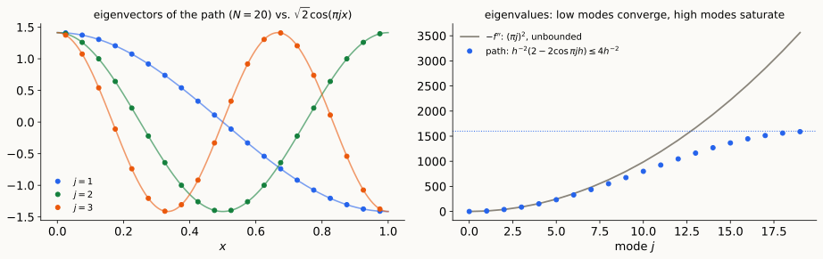
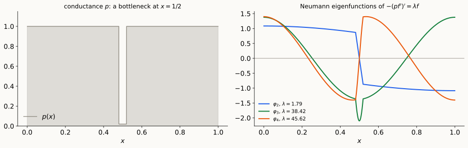

## Where we are

- **So far:** spectral theory of **finite** matrices: graph Laplacians, walks, cuts, solvers, sparsifiers, functional inequalities.
- **From now on:** the **continuum**. Markov processes on $\mathbb R^d$ (L15), Langevin and Fokker–Planck (L16), Bakry–Émery (L17), manifold learning (L18).
- **The bridge:** a graph Laplacian on finely sampled points is a discretization of a **differential operator**. Which spectral facts survive the limit, and which break?

::: {.idea}
**Today:** the simplest case, one dimension. The weighted path graph becomes a **Sturm–Liouville operator** $-(pf')'+qf=\lambda rf$, whose spectral theory is as complete as that of a symmetric matrix.
:::

::: notes
~2 min. Reading: LA Review II (Hilbert spaces, compact operators, §8 unbounded operators). Today uses §7 (spectral theorem for compact self-adjoint operators) and §8 (domains, boundary conditions, compact resolvents).
:::

## Plan

- **§1 The path graph and its limit.** Eigenvectors converge, eigenvalues saturate; what changes in infinite dimensions.
- **§2 Sturm–Liouville theory.** The operator and its quadratic form; the spectral theorem via the Green's function; min–max and comparison; oscillation.
- **§3 The dictionary.** Weighted paths $\leftrightarrow$ Sturm–Liouville; a bottleneck example; how accurate the graph is (preview of spectral collocation).

::: notes
~1 min. Spectral collocation (Chebyshev points, exponential accuracy) is the second half of Lecture 14, next time.
:::

# §1 · The path graph and its limit {background-color="#1c1b19"}

## The path graph converges to $-\frac{d^2}{dx^2}$

$N$ cells of width $h=\frac1N$ on $[0,1]$, centers $x_i=(i-\frac12)h$, edge weights $h^{-2}$ (Lecture 2 notes):
$$(Lf)_i=\frac{2f_i-f_{i-1}-f_{i+1}}{h^2}\ \longrightarrow\ -f''(x_i).$$

- **Eigenvectors:** $\cos(\pi jx_i)$, $j=0,\dots,N-1$, **exactly** the samples of the Neumann eigenfunctions $\cos(\pi jx)$.
- **Eigenvalues:** $\ \mu_j=h^{-2}\big(2-2\cos(\pi jh)\big)\ $ vs. $\ (\pi j)^2$.

{.nostretch fig-align="center" width="100%" fig-alt="Left: dots for three path eigenvectors lying exactly on cosine curves. Right: eigenvalues of the path following (pi j)^2 for small j and flattening below 4 N^2 for large j."}

::: notes
~4 min. Ratios μ_j/(πj)² at N = 20: 0.998 (j = 1), 0.950 (j = 5), 0.811 (j = 10), 0.446 (j = 19). The graph Laplacian has Neumann boundary conditions built in (Lecture 2 notes: no boundary term in the discrete Green's identity), which is why the cosines appear.
:::

## What changes in infinite dimensions

The limit operator $T=-\frac{d^2}{dx^2}$ on $L^2([0,1])$ (LA Review II, §8):

- **Unbounded:** $\|T\|=\infty$, while $\|L\|\le4h^{-2}$. It is defined only on a **domain** of twice-differentiable functions.
- **The domain is part of the data:** on $C_c^\infty((0,1))$, $T$ is symmetric but not self-adjoint. Its self-adjoint extensions are **boundary conditions**, with different spectra:
  - Neumann $f'(0)=f'(1)=0$: $\ (\pi j)^2$, $j\ge0$, $\ \cos(\pi jx)$;
  - Dirichlet $f(0)=f(1)=0$: $\ (\pi j)^2$, $j\ge1$, $\ \sin(\pi jx)$.
- **On the graph:** Neumann is automatic; Dirichlet is **grounding the endpoints** (edges to ground, Lecture 11).
- **Tame it by inverting:** for Dirichlet, $T^{-1}$ is the integral operator with kernel $\ G(x,y)=\min(x,y)-xy$: continuous, symmetric, hence **compact**. Its eigenbasis is $T$'s.

::: notes
~4 min. The general principle from LA Review II: pass to a bounded function of the unbounded operator (resolvent, heat semigroup, spectral projector). Check of the Green's function: the Dirichlet path matrix (weights h^{−2}, interior nodes) has inverse exactly h·G(x_i, x_j) (scripts/make_figures.py, error 3·10⁻¹⁷). In continuous time, the heat semigroup e^{−tT} is compact for t > 0 for the same reason.
:::

# §2 · Sturm–Liouville theory {background-color="#1c1b19"}

## The Sturm–Liouville problem

::: {.defn}
On $[a,b]$, with $p\in C^1$, $p>0$, $r>0$, $q$ continuous: find $\lambda$ and $f\ne0$ with
$$-(pf')'+qf=\lambda\,rf,$$
plus **separated boundary conditions** $\ \alpha_af(a)+\beta_ap(a)f'(a)=0$, $\ \alpha_bf(b)+\beta_bp(b)f'(b)=0$ (**regular** problem).
:::

- **Hilbert space:** $L^2([a,b],r\,dx)$, $\ \langle f,g\rangle_r=\int fg\,r$. The operator is $\ Tf=\frac1r\big(-(pf')'+qf\big)$: the analogue of $L_{rw}=D^{-1}L$.
- **Lagrange (Green's) identity:** $\ \displaystyle\int_a^b\big(g\,(pf')'-f\,(pg')'\big)=\Big[p\,(gf'-fg')\Big]_a^b$, which **vanishes** under separated boundary conditions. So $T$ is **symmetric** in $\langle\cdot,\cdot\rangle_r$.
- **Quadratic form** (Neumann or Dirichlet): $\ \langle f,Tf\rangle_r=\displaystyle\int_a^b\big(p\,f'^2+q\,f^2\big)$, the **Dirichlet energy**. Rayleigh quotient $\ R(f)=\dfrac{\int pf'^2+qf^2}{\int rf^2}$.

::: notes
~4 min. Mixed (Robin) conditions add a boundary term ±(α/β) f² at each end (from p f' = −(α/β) f), and the Rayleigh quotient picks up those terms. Examples to name: −f'' (p = r = 1, q = 0); the quantum harmonic oscillator and Hermite functions (singular, on ℝ, Lecture 16); Legendre −((1−x²)f')' (singular endpoints, Chebyshev's cousin, next time); vibrating string with density r and tension p.
:::

## The spectral theorem for Sturm–Liouville

::: {.thm}
**Theorem.** For a regular Sturm–Liouville problem:

1. the eigenvalues are real, **simple**, and form a sequence $\lambda_1<\lambda_2<\dots\to\infty$;
2. the eigenfunctions $\varphi_k$ form an **orthonormal basis** of $L^2([a,b],r\,dx)$;
3. **oscillation:** $\varphi_k$ has exactly $k-1$ zeros in $(a,b)$;
4. **Weyl asymptotics:** $\ \lambda_k\sim\Big(\dfrac{k\pi}{\int_a^b\sqrt{r/p}\,dx}\Big)^2$.
:::

- Same shape as the spectral theorem for symmetric matrices, plus two facts special to **one dimension**: simplicity and exact zero counts.
- Check (scripts, Neumann, where $\varphi_{k+1}$ has $k$ zeros): $p=1+0.8\sin2\pi x$, $r=1+\frac x2$ gives $\lambda_{k+1}\big/\big(\frac{k\pi}{\int\sqrt{r/p}}\big)^2=1.008,\ 1.002,\ 1.0003$ for $k=5,10,20$.

::: notes
~3 min. Plan for the next slides: (1)–(2) from the Green's function and LA Review II, Theorem 7.1; simplicity from the Wronskian; (3) from Sturm comparison; (4) by the Liouville transformation t = ∫√(r/p), which turns the problem into −u'' + Q u = λu on an interval of length ∫√(r/p) (state, don't prove).
:::

## Proof of (1)–(2): invert the operator

1. **Shift:** replace $q$ by $q+cr$ with $c$ large, so that $\lambda=0$ is not an eigenvalue. Eigenvalues shift by $c$; eigenfunctions are unchanged.
2. **Green's function:** let $u_a$ solve the equation with $\lambda=0$ and the boundary condition at $a$, and $u_b$ at $b$. Then
$$G(x,y)=\frac{u_a(x_<)\,u_b(x_>)}{C},\qquad C=p\,(u_a'u_b-u_au_b')\ \ (\text{constant}),$$
with $x_<=\min(x,y)$, $x_>=\max(x,y)$, solves $\ -(pu')'+qu=f\iff u(x)=\int G(x,y)f(y)\,dy$.
3. **Compact and self-adjoint:** $T^{-1}f=\int G(x,y)f(y)\,r(y)\,dy$ has a **continuous symmetric** kernel on $[a,b]^2$, so it is a compact (Hilbert–Schmidt) self-adjoint operator on $L^2(r)$.
4. **LA Review II, Thm 7.1:** an orthonormal eigenbasis with eigenvalues $\nu_k\to0$; so $\lambda_k=1/\nu_k\to\infty$. Injective, so the basis is complete.

::: notes
~5 min. C is constant: (p(u_a'u_b − u_a u_b'))' = u_b(pu_a')' − u_a(pu_b')' = q u_a u_b − q u_a u_b = 0 (Abel). For −f'' with Dirichlet: u_a = x, u_b = 1 − x, C = 1, G = min(x,y) − xy. Self-adjointness in L²(r): ⟨T^{-1}f, g⟩_r = ∬ G(x,y) f(y) g(x) r(x) r(y), symmetric in f and g. The construction needs u_a and u_b independent, which is exactly "0 is not an eigenvalue".
:::

## Simplicity, min–max and comparison

**Simplicity.** If $f,g$ are eigenfunctions for the same $\lambda$, both satisfy the boundary condition at $a$, so their Wronskian vanishes there; $p\,(fg'-f'g)$ is constant (Abel), so it vanishes everywhere: $f\propto g$. *(Fails in higher dimensions and on graphs: multiplicities.)*

. . .

**Min–max (Courant–Fischer, as in LA Review I):**
$$\lambda_k=\min_{\dim S=k}\ \max_{f\in S\setminus0}\ R(f),\qquad R(f)=\frac{\int pf'^2+qf^2}{\int rf^2}.$$

- **Comparison:** increasing $p$ or $q$ raises every $\lambda_k$; increasing $r$ lowers every positive $\lambda_k$ (e.g. all of them when $q\ge0$). *(Rayleigh monotonicity, Lecture 9.)*
- **Boundary conditions:** Dirichlet $\ge$ Neumann, eigenvalue by eigenvalue (a smaller space of test functions). *(Grounding raises the spectrum.)*
- **Test functions** give upper bounds, as in Lecture 5.

::: notes
~4 min. For the Dirichlet problem the min–max is over subspaces of H¹₀ (functions vanishing at the ends); for Neumann over all of H¹; the energy form is the same. The comparison statements follow because R(f) is monotone in p and q, and in r wherever the numerator is ≥ 0, and the min–max is monotone in R. Stated here for Neumann/Dirichlet; Robin adds boundary terms to R.
:::

## Oscillation

::: {.thm}
**Sturm comparison.** Let $-(pu')'+qu=\lambda ru$ and $-(pv')'+qv=\mu rv$ with $\mu>\lambda$. Between any two consecutive zeros of $u$ there is a zero of $v$.
:::

::: {.pf}
*Proof.* Let $x_1<x_2$ be consecutive zeros of $u$, with $u>0$ on $(x_1,x_2)$, and suppose $v>0$ there. Then
$$\Big[p\,(u'v-uv')\Big]_{x_1}^{x_2}=(\mu-\lambda)\int_{x_1}^{x_2}r\,u\,v\ >\ 0,$$
but the left side is $p(x_2)u'(x_2)v(x_2)-p(x_1)u'(x_1)v(x_1)\le0$ since $u'(x_2)\le0\le u'(x_1)$. $\square$
:::

- **Zero counting:** follow $\varphi$ as $\lambda$ increases from $\lambda_1$; zeros enter only through the boundary and never merge (zeros are simple: $\varphi=\varphi'=0$ at a point forces $\varphi\equiv0$), so $\varphi_k$ has exactly $k-1$ zeros, and zeros of $\varphi_k,\varphi_{k+1}$ **interlace**.
- **On the path graph:** the $k$-th eigenvector of a weighted path has exactly $k-1$ sign changes (Gantmacher–Krein). The **Fiedler vector is monotone**, so the sweep cut is a threshold.
- **Higher dimensions:** only **Courant's bound**: $\varphi_k$ has at most $k$ nodal domains (graph versions: Davies–Gladwell–Leydold–Stadler).

::: notes
~5 min. The identity: (p(u'v − uv'))' = (pu')'v − u(pv')' = (q − λr)uv − (q − μr)uv = (μ − λ) r u v. The zero-counting argument is a continuity (Prüfer angle) argument; state it. The discrete statement is the oscillation theory of Jacobi (tridiagonal, negative off-diagonal) matrices; it is why spectral partitioning on a path, or along a nearly one-dimensional graph, is so clean.
:::

# §3 · The dictionary {background-color="#1c1b19"}

## Weighted paths are Sturm–Liouville problems

Discretize: edge $(i,i+1)$ gets conductance $c_{i+\frac12}=\frac{p(x_{i+1/2})}h$, vertex $i$ gets mass $m_i=r(x_i)\,h$:
$$\sum_ic_{i+\frac12}(f_{i+1}-f_i)^2\approx\int pf'^2,\qquad\sum_im_if_i^2\approx\int rf^2 .$$

| weighted path graph | Sturm–Liouville |
|:--|:--|
| vertex measure $m_i$ (degrees, $\pi$) | density $r(x)$ |
| conductance $c_{i+\frac12}$ | coefficient $p(x)$ |
| edges to ground | potential $q$ / Dirichlet condition |
| no boundary term (Neumann built in) | boundary conditions = self-adjoint extension |
| $M^{-1}K$ ($=L_{rw}$ for $m=d$) | $\frac1r\big(-(p\,\cdot\,')'+q\big)$ |
| end-to-end $R_{\rm eff}=\sum_i\frac1{c_{i+1/2}}$ | $\int_a^b\frac{dx}p$ |
| $L^+$, effective resistances | Green's function $G$ |
| Fiedler vector monotone | $\varphi_2$ has one zero |
| heat kernel $e^{-tL_{rw}}$ | $e^{-tT}$ (compact for $t>0$) |

::: notes
~3 min. The figures on the next slide are computed exactly this way, with N = 2000 cells: the "finite-difference method" for Sturm–Liouville problems is a weighted path graph. The Green's function of the Neumann problem (with the constant mode removed) plays the role of L^+, and G(x,x) − 2G(x,y) + G(y,y) is the effective resistance between x and y.
:::

## A bottleneck

{.nostretch fig-align="center" width="100%" fig-alt="Left: a step function equal to 1 with a narrow dip to 0.02 at the center. Right: the second eigenfunction is nearly constant on each half and jumps across the bottleneck; the next two oscillate within the halves."}

- $\varphi_2$ is **nearly constant on each half** and jumps across the bottleneck: the continuum **sparse cut**.
- $\lambda_2=1.79$, close to two masses $\frac12$ joined by resistance $\int_{\rm gap}\frac{dx}p=2$: $\ \frac1R\big(\frac1{m_1}+\frac1{m_2}\big)=2$. Without the bottleneck, $\lambda_2=\pi^2\approx9.9$.
- $\lambda_3=38.4$, $\lambda_4=45.6$: the halves' own modes (symmetric and antisymmetric), on either side of $(\pi/0.48)^2\approx42.8$. A **spectral gap** $\lambda_3\gg\lambda_2$ separates the cut from the rest (Lecture 7).

::: notes
~3 min. Numbers from scripts/make_figures.py (N = 2000 cells). Zero counts of φ₂, …, φ₆: 1, 2, 3, 4, 5, as the oscillation theorem predicts. The two-mass estimate is off by about 12%: the halves are not exactly constant. This is Cheeger's picture in one dimension: small p is a low-conductance cut.
:::

## How accurate is the graph?

For $-f''$ on $[0,1]$ with $N$ cells, $\ \theta=\pi jh$:
$$\frac{\mu_j}{(\pi j)^2}=\frac{2-2\cos\theta}{\theta^2}=1-\frac{\theta^2}{12}+O(\theta^4).$$

- **Second-order accurate** for fixed $j$: relative error $\approx\frac{(\pi jh)^2}{12}$.
- **But only for $j\ll N$:** at $N=20$ the ratio is $0.998$, $0.950$, $0.811$, $0.446$ for $j=1,5,10,19$. To get mode $j$ to accuracy $\delta$ we need $N\gtrsim j/\sqrt\delta$.

::: {.idea}
**Next time: spectral collocation.** Sample at **Chebyshev points** and differentiate the interpolating polynomial: eigenvalues converge **exponentially fast** in $N$ for smooth coefficients, and a constant fraction of the $N$ modes come out accurate.
:::

::: notes
~3 min. This is the bridge to the second half of Lecture 14. The graph approximation is local (nearest neighbors), hence algebraic accuracy; the collocation matrix is dense (global interpolation), hence spectral accuracy. Same trade-off as finite differences vs. Fourier for the heat equation in Lecture 1's demo.
:::

## Takeaways

1. A weighted path graph is a **discretized Sturm–Liouville operator**: conductances $\to p$, vertex masses $\to r$, grounding $\to q$ or Dirichlet conditions; Neumann is built in.
2. The limit is **unbounded**: the domain (boundary conditions) is part of the operator. Inverting gives a **compact** operator (the Green's function), and the finite-dimensional spectral theorem returns.
3. In one dimension the spectrum is **simple**, eigenvalues grow like $k^2$ (Weyl), and $\varphi_k$ has exactly $k-1$ zeros: the continuum version of the monotone Fiedler vector on a path.
4. Min–max, comparison and test functions work exactly as for graphs.

## Discussion questions

1. Compute the Green's function of $-f''$ on $[0,1]$ with $f(0)=0$, $f'(1)=0$. What are the eigenvalues? (Compare LA Review II, Exercise 4.)
2. On a weighted path, what is the analogue of the Wronskian, and why does it prove that path eigenvalues are simple?
3. For the Dirichlet problem with $q=0$, show that $G(x,x)-2G(x,y)+G(y,y)$ is the effective resistance between $x$ and $y$ in the network **grounded at both ends**. Why is it smaller than $\int_x^y\frac{dt}p$?
4. A "dumbbell": $p=1$ on two intervals joined by a gap of width $w$ with $p=\varepsilon$. How does $\lambda_2$ scale with $\varepsilon$ and $w$? Compare with Cheeger.
5. Why does Weyl's law depend only on $\int\sqrt{r/p}$ and not on $q$?

## References

- G. Teschl. *Ordinary Differential Equations and Dynamical Systems.* AMS, 2012, Ch. 5 (Sturm–Liouville problems; free online).
- A. Zettl. *Sturm–Liouville Theory.* AMS, 2005.
- R. Courant, D. Hilbert. *Methods of Mathematical Physics*, Vol. I, Chs. V–VI.
- E. A. Coddington, N. Levinson. *Theory of Ordinary Differential Equations*, Chs. 7–8.
- F. R. Gantmacher, M. G. Krein. *Oscillation Matrices and Kernels and Small Vibrations of Mechanical Systems.* AMS Chelsea, 2002.
- E. B. Davies, G. M. L. Gladwell, J. Leydold, P. F. Stadler. Discrete nodal domain theorems. *Linear Algebra Appl.* 2001.
- L. N. Trefethen. *Spectral Methods in MATLAB.* SIAM, 2000 (next time).

Reading: LA Review II §§6–8; Teschl Ch. 5.

# Appendix: definitions for the board {background-color="#1c1b19"}

## Definitions {.smaller}

| Object | Definition |
|:--|:--|
| Sturm–Liouville | $-(pf')'+qf=\lambda rf$ on $[a,b]$, $p,r>0$; separated boundary conditions |
| Hilbert space, operator | $L^2([a,b],r\,dx)$; $\ Tf=\frac1r\big(-(pf')'+qf\big)$ |
| Lagrange identity | $\int\big(g(pf')'-f(pg')'\big)=\big[p(gf'-fg')\big]_a^b$ |
| Rayleigh quotient | $R(f)=\frac{\int pf'^2+qf^2}{\int rf^2}$ (Neumann/Dirichlet) |
| Green's function | $G(x,y)=u_a(x_<)u_b(x_>)/C$, $\ C=p(u_a'u_b-u_au_b')$ |
| spectral theorem | $\lambda_1<\lambda_2<\dots\to\infty$ simple; $\{\varphi_k\}$ ONB of $L^2(r)$ |
| oscillation | $\varphi_k$ has $k-1$ zeros; consecutive zeros interlace |
| Weyl | $\lambda_k\sim\big(k\pi/\int\sqrt{r/p}\big)^2$ |
| path graph | $c_{i+\frac12}=p(x_{i+1/2})/h$, $m_i=r(x_i)h$; $\ \mu_j=h^{-2}(2-2\cos\pi jh)$ for $p=r=1$ |
