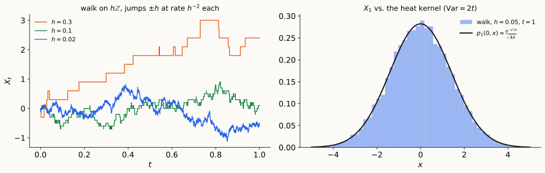
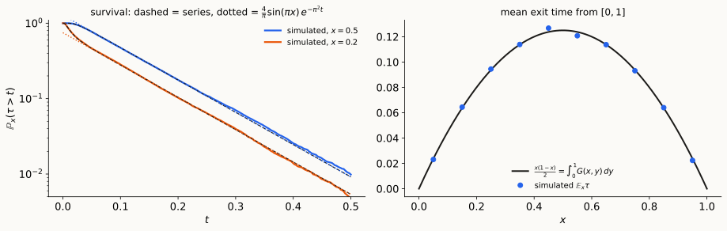

## Where we are

- **Lecture 2:** graph matrices are differential operators. Walks act on **functions** ($Pf$) and on **measures** ($\mu^\top P$); generator $P-I$, semigroup $H_t=e^{-tL_{rw}}$, Dirichlet form $\mathcal E$.
- **Lecture 14:** the continuum limits of path graphs are **Sturm–Liouville operators**: unbounded, with boundary conditions, and a compact Green's function.
- **Today:** the **processes** behind those operators. Every object from the graph lectures has a continuum counterpart, and most proofs carry over line by line. What is new: domains, boundaries, and non-compactness.

::: {.idea}
**Normalization for Lectures 15–17:** the generator of Brownian motion is $\Delta$ (not $\frac12\Delta$), i.e. $dX_t=\sqrt2\,dW_t$. This matches the Ornstein–Uhlenbeck operator and the Gaussian LSI of Lecture 13.
:::

::: notes
~2 min. Probabilists usually write ½Δ with dX = dW; analysts write Δ. With Δ the Dirichlet form is ∫|∇f|², with no ½, and the Gaussian LSI reads Ent(f²) ≤ 2 E|∇f|² as in Lecture 13.
:::

## Plan

- **§1 From random walks to Brownian motion.** Scaling limit, the heat semigroup, the generator, Itô and Dynkin.
- **§2 Markov semigroups.** Two actions again; diffusion generators; stationarity and reversibility; carré du champ and Dirichlet forms; domains.
- **§3 Boundaries, killing, spectra.** Reflection and killing; exit times and the Green's function; Feynman–Kac; compact vs. non-compact.
- **§4 Graphs on samples converge to Laplacians** (one slide).

::: notes
~1 min. Timing: §1 ~16 min, §2 ~20 min, §3 ~20 min, §4 ~5 min, closing ~6 min.
:::

# §1 · From random walks to Brownian motion {background-color="#1c1b19"}

## The scaling limit

Continuous-time walk on $h\mathbb Z$: jump $\pm h$, each at rate $h^{-2}$. Its generator is the **path graph** with weights $h^{-2}$:
$$\mathcal A_hf(x)=\frac{f(x+h)-2f(x)+f(x-h)}{h^2}\ \longrightarrow\ f''(x).$$

{.nostretch fig-align="center" width="100%" fig-alt="Left: three step-function paths, coarse for h = 0.3 and nearly continuous for h = 0.02. Right: a histogram of the walk at time 1 matching a Gaussian of variance 2."}

- $X_t$ is a sum of $\approx2t/h^2$ steps of size $\pm h$: **mean $0$, variance $2t$**. By the CLT, $X_t\to N(0,2t)$, and increments over disjoint intervals are independent.

::: notes
~4 min. Sample variance of X₁ in the simulation: 2.004. Donsker's invariance principle upgrades this to convergence of whole paths (in law, in the Skorokhod or uniform topology). The time scaling t ↦ t/h² is diffusive, as in Lecture 3: the walk needs ~1/h² steps to move distance 1.
:::

## Brownian motion and the heat semigroup

::: {.defn}
**Brownian motion** (generator $\Delta$) on $\mathbb R^d$: $X_t=x+\sqrt2\,W_t$, where $W$ has continuous paths, $W_0=0$, and independent increments $W_t-W_s\sim N(0,(t-s)I)$.
:::

**Semigroup and heat kernel:**
$$P_tf(x)=\mathbb E_x\,f(X_t)=\int p_t(x,y)f(y)\,dy,\qquad p_t(x,y)=\frac{e^{-|x-y|^2/4t}}{(4\pi t)^{d/2}} .$$

- **Markov property $\Rightarrow$ semigroup:** $P_{t+s}=P_tP_s$, i.e. Chapman–Kolmogorov $\ p_{t+s}(x,z)=\int p_t(x,y)p_s(y,z)\,dy$.
- **Generator:** $\ \mathcal Af=\lim_{t\to0}\frac{P_tf-f}t=\Delta f$ (Taylor-expand $f$ under the Gaussian), so $P_t=e^{t\Delta}$ and $u=P_tf$ solves the **heat equation** $\partial_tu=\Delta u$.
- **Graph analogue:** $H_t=e^{-tL_{rw}}=e^{t(P-I)}$, $\ H_t(x,y)$ the heat kernel of Lecture 2.

::: notes
~4 min. Generator computation: P_t f(x) = E f(x + √(2t) Z) = f(x) + √(2t) E[∇f·Z] + t E[Zᵀ∇²f Z] + o(t) = f(x) + t Δf(x) + o(t), since E Z = 0 and E ZZᵀ = I. Chapman–Kolmogorov for Gaussians: variances add, 2t + 2s.
:::

## Itô's formula and Dynkin's formula

For $dX_t=\sqrt2\,dW_t$ and smooth $f$ (**Itô's formula**: the $(dW)^2=dt$ term survives):
$$df(X_t)=\sqrt2\,\nabla f(X_t)\cdot dW_t+\Delta f(X_t)\,dt .$$

- **Martingale:** $\ M_t^f=f(X_t)-f(X_0)-\int_0^t\Delta f(X_s)\,ds\ $ has mean zero: the generator is the **drift of $f(X_t)$**.
- **Dynkin's formula:** for a stopping time $\tau$ with $\mathbb E_x\tau<\infty$,
$$\mathbb E_xf(X_\tau)=f(x)+\mathbb E_x\int_0^\tau\Delta f(X_s)\,ds .$$
- **Graph analogue:** $f(X_t)-\int_0^t(P-I)f(X_s)\,ds$ is a martingale for the continuous-time walk; this gave the hitting-time equations $Lh=d-\mathrm{vol}\,\mathbf 1_t$ in Lecture 9.

::: notes
~4 min. Heuristic for Itô: Taylor to second order, df = ∇f·dX + ½ dXᵀ∇²f dX, and dX dXᵀ = 2 dW dWᵀ = 2I dt. Dynkin is optional stopping for the martingale M^f; we use it in §3 for exit times. Everything here is stated without proof (Øksendal, Le Gall).
:::

# §2 · Markov semigroups {background-color="#1c1b19"}

## Two actions, again

As on graphs (Lecture 2, §2): the process acts on **functions** and on **measures**.

| | functions (observables) | measures (distributions) |
|:--|:--|:--|
| evolution | $u_t=P_tf$, $\ \partial_tu=\mathcal Au$ (**backward**) | $\mu_t=\mu P_t$, $\ \partial_t\rho=\mathcal A^*\rho$ (**forward**) |
| graph | $H_tf$ | $\mu^\top H_t$ |
| meaning | $\mathbb E_x f(X_t)$ | law of $X_t$ |

- **Duality:** $\ \int f\,d\mu_t=\int P_tf\,d\mu$.
- **Densities relative to $\pi$:** if $\mu_t=h_t\,\pi$ and $\pi$ is stationary, then $\partial_th_t=\mathcal A^\dagger h_t$, the adjoint in $L^2(\pi)$. For **reversible** processes $\mathcal A^\dagger=\mathcal A$: densities evolve like functions (Lecture 2, §2.4).
- The forward equation for a diffusion is the **Fokker–Planck equation** (Lecture 16).

::: notes
~3 min. For Brownian motion, A* = Δ again (Lebesgue measure is invariant), so both equations are the heat equation. With drift, A* f = −div(b f) + Δf ≠ A f: Lecture 16.
:::

## Diffusion generators

For the SDE $\ dX_t=b(X_t)\,dt+\sigma(X_t)\,dW_t$, Itô's formula gives the generator
$$\mathcal Af=b\cdot\nabla f+\tfrac12\operatorname{tr}\big(\sigma\sigma^\top\nabla^2f\big).$$

- **Drift** $b$: first-order term (transport). **Diffusion matrix** $a=\sigma\sigma^\top$: second-order term.
- With $\sigma=\sqrt2\,I$: $\ \mathcal Af=\Delta f+b\cdot\nabla f$.
- **Graph analogue:** $\mathcal A=P-I$, i.e. $\mathcal Af(x)=\sum_yP(x,y)\big(f(y)-f(x)\big)$: the average change of $f$ over one jump.
- **Local vs. non-local:** diffusion generators are **differential operators** (paths are continuous); graph generators average over neighbours (paths jump). Both are **Markov generators**: $\mathcal A1=0$ and the **maximum principle** ($f$ maximal at $x$ $\Rightarrow$ $\mathcal Af(x)\le0$).

::: notes
~3 min. Maximum principle: at a maximum, ∇f = 0 and ∇²f ⪯ 0, so tr(a ∇²f) ≤ 0; on a graph, every term f(y) − f(x) ≤ 0. It is what makes P_t positivity-preserving (P_t f ≥ 0 if f ≥ 0) and a contraction in sup norm.
:::

## Stationarity and reversibility

- **Stationary** $\pi$: $\ \int\mathcal Af\,d\pi=0$ for all $f$ (equivalently $\mathcal A^*\pi=0$).
- **Reversible** $\pi$: $\ \int g\,\mathcal Af\,d\pi=\int f\,\mathcal Ag\,d\pi$, i.e. $\mathcal A$ is **self-adjoint in $L^2(\pi)$**. Graph: $\Pi P=P^\top\Pi$.

::: {.thm}
**Example.** Let $\pi\propto e^{-U}$ and $\mathcal A=\Delta+b\cdot\nabla$. Integration by parts gives $\ \int g\,\Delta f\,e^{-U}=-\int\nabla g\cdot\nabla f\,e^{-U}+\int g\,\nabla U\cdot\nabla f\,e^{-U}$, so
$$\mathcal A\ \text{is reversible for}\ \pi\iff b=-\nabla U:\qquad dX_t=-\nabla U(X_t)\,dt+\sqrt2\,dW_t .$$
:::

- This is **Langevin dynamics**, the continuum Metropolis chain for sampling from $e^{-U}$ (Lecture 16). $U=\frac{|x|^2}2$ gives Ornstein–Uhlenbeck, $\mathcal Af=\Delta f-x\cdot\nabla f$.

::: notes
~4 min. With b = −∇U the symmetric form is ∫g 𝒜f dπ = −∫∇g·∇f dπ, manifestly symmetric. Conversely, symmetry for all f, g forces (b + ∇U)·∇f to integrate to zero against every g, so b = −∇U. Non-reversible drifts with the same π exist (b = −∇U + c with div(c e^{−U}) = 0); they can mix faster, a theme for Lecture 16.
:::

## The carré du champ and the Dirichlet form

::: {.defn}
$\Gamma(f,g)=\frac12\big(\mathcal A(fg)-f\,\mathcal Ag-g\,\mathcal Af\big),\qquad\mathcal E(f,g)=\int\Gamma(f,g)\,d\pi=-\int f\,\mathcal Ag\,d\pi\ $ (reversible, stationary $\pi$).
:::

| | $\Gamma(f)$ | $\mathcal E(f,f)$ |
|:--|:--|:--|
| graph, $\mathcal A=P-I$ | $\frac12\sum_yP(x,y)\big(f(y)-f(x)\big)^2$ | $\frac12\sum_{x,y}\pi_xP(x,y)(f_x-f_y)^2$ (Lecture 4) |
| diffusion, $\mathcal A=\Delta-\nabla U\cdot\nabla$ | $|\nabla f|^2$ | $\int|\nabla f|^2\,d\pi$ |

- **Same functional inequalities:** Poincaré $\lambda\operatorname{Var}_\pi f\le\mathcal E(f,f)$, LSI, MLSI, and the same proofs of $\chi^2$ and entropy decay (Lectures 3–4, 13).
- **Diffusion property (chain rule):** $\ \Gamma(\varphi(f),g)=\varphi'(f)\,\Gamma(f,g)$. This is why $\mathcal E(h,\log h)=4\,\mathcal E(\sqrt h,\sqrt h)$ and $\rho_0=4\alpha$ for diffusions (Lecture 13). On graphs it fails: only inequalities survive.
- **Next:** iterate once more, $\Gamma_2(f)=\frac12\big(\mathcal A\Gamma(f)-2\Gamma(f,\mathcal Af)\big)$: **Bakry–Émery** (Lecture 17).

::: notes
~5 min. Computing Γ for Δ: Δ(fg) = fΔg + gΔf + 2∇f·∇g, so Γ = ∇f·∇g; the drift term is a derivation (b·∇(fg) = f b·∇g + g b·∇f) and drops out. Graph: (P − I)(f²) − 2f(P − I)f = Σ_y P(x,y)(f(y) − f(x))². The diffusion property is the Leibniz rule; jumps break it because (f(y) − f(x))² is not quadratic in an infinitesimal.
:::

## Domains: the semigroup is the bounded object

- $\Delta$ is **unbounded**; it is defined on a **domain**, and the domain encodes the boundary behaviour (LA Review II §8, Lecture 14). $P_t$ is a **contraction** for every $t$.
- **Hille–Yosida** (stated): a closed, densely defined $\mathcal A$ generates a strongly continuous contraction semigroup iff every $\lambda>0$ is in its resolvent set and $\|(\lambda-\mathcal A)^{-1}\|\le\frac1\lambda$.
- **Self-adjoint case:** $-\mathcal A\succeq0$ self-adjoint in $L^2(\pi)$ $\Rightarrow$ $P_t=e^{t\mathcal A}$ by the spectral theorem. Equivalently, start from a **closed quadratic form** $\mathcal E$ (a Dirichlet form) and build the operator from it (Friedrichs, Fukushima).
- **Practical rule:** state and prove things for $P_t$, resolvents $(\lambda-\mathcal A)^{-1}$, or $\mathcal E$; differentiate only on a core of nice functions.

::: notes
~3 min. Keep this light. The quadratic-form route is the natural one for this course: everything we did with graphs (Poincaré, LSI, comparison) is phrased in terms of 𝓔, and Fukushima's theory says a closed Markovian form on L²(π) corresponds to a symmetric Markov process. Markovian: 𝓔(φ(f)) ≤ 𝓔(f) for normal contractions φ (e.g. truncation), the continuum version of "the graph energy decreases under truncation".
:::

# §3 · Boundaries, killing, spectra {background-color="#1c1b19"}

## Reflection and killing

Brownian motion on $[0,1]$ (generator $\frac{d^2}{dx^2}$) needs a rule at the boundary:

| process | boundary condition | graph (Lecture 14) | spectrum on $[0,1]$ |
|:--|:--|:--|:--|
| **reflected** at $0,1$ | Neumann $u'(0)=u'(1)=0$ | the path, no boundary term | $(\pi j)^2$, $j\ge0$ |
| **killed** at $0,1$ | Dirichlet $u(0)=u(1)=0$ | grounded endpoints | $(\pi j)^2$, $j\ge1$ |

- **Reflected:** a probability-preserving process with stationary law uniform on $[0,1]$, gap $\pi^2$, $\ \chi^2(\mu_t\Vert\pi)\le e^{-2\pi^2t}\chi^2(\mu_0\Vert\pi)$.
- **Killed:** a **sub-Markov** process; mass is lost at the boundary. $P_t1(x)=\mathbb P_x(\tau>t)$, with $\tau$ the exit time.
- **Survival:** expand $1=\sum_{k\ \rm odd}\frac4{k\pi}\sin(k\pi x)$ in the Dirichlet eigenbasis:
$$\mathbb P_x(\tau>t)=\sum_{k\ \rm odd}\frac4{k\pi}\,\sin(k\pi x)\,e^{-(k\pi)^2t}\ \approx\ \frac4\pi\sin(\pi x)\,e^{-\pi^2t}.$$

::: notes
~4 min. The survival function solves the heat equation with Dirichlet conditions and initial value 1. The bottom Dirichlet eigenvalue π² is the exponential rate at which a confined particle escapes; the bottom eigenfunction sin πx, normalized to a probability density, is the quasi-stationary distribution: the law of X_t conditioned on survival converges to it (Yaglom limit). Graph: the grounded Laplacian of Lecture 11.
:::

## Exit times and the Green's function

**Dynkin** with $\mathcal A=\frac{d^2}{dx^2}$: if $u''=-f$, $u(0)=u(1)=0$, then $\ u(x)=\mathbb E_x\int_0^\tau f(X_s)\,ds$. By Lecture 14,
$$\mathbb E_x\int_0^\tau f(X_s)\,ds=\int_0^1G(x,y)f(y)\,dy,\qquad G(x,y)=\min(x,y)-xy .$$

- **$G(x,\cdot)$ is the expected occupation density** of the killed process started at $x$. With $f=1$: $\ \mathbb E_x\tau=\int G(x,y)\,dy=\frac{x(1-x)}2$.

{.nostretch fig-align="center" width="100%" fig-alt="Left: log-scale survival curves; the simulated curves lie on the dashed series and approach straight dotted lines of slope minus pi squared. Right: simulated mean exit times on the parabola x(1-x)/2."}

- **Graph analogue:** hitting times solve $Lh=\dots$ and $L^+$ gives effective resistances and commute times (Lecture 9). Here $G$ plays the role of the inverse of the **grounded** Laplacian (the Neumann Green's function is the analogue of $L^+$), and $G(x,x)$ is the resistance from $x$ to the grounded ends.

::: notes
~5 min. Numbers from scripts/make_figures.py: P(τ > 0.2) from x = 0.5 is 0.177 simulated vs 0.177 from the series; mean exit times match x(1 − x)/2 to within a few percent (lattice walk with h = 0.01, each step of time h²/2 so the variance per unit time is 2). Proof of the occupation formula: apply Dynkin to u = ∫G(·,y) f(y) dy, which satisfies u'' = −f and vanishes at the exit points, so E_x u(X_τ) = 0 = u(x) − E_x∫_0^τ f(X_s) ds.
:::

## Killing at a rate: Feynman–Kac

Let the particle die at rate $q(x)\ge0$ while diffusing. The surviving expectation
$$u(t,x)=\mathbb E_x\Big[e^{-\int_0^tq(X_s)\,ds}\,f(X_t)\Big]\qquad\text{solves}\qquad\partial_tu=\Delta u-q\,u,\ \ u(0,\cdot)=f .$$

- The generator of the killed process is $\Delta-q$: the Sturm–Liouville **potential $q$ is a killing rate**. Dirichlet boundary conditions are the limit $q=\infty$ outside the domain.
- **Graph analogue:** edges to ground with weights $q_i$ (Lecture 11). Grounding = killing.
- The bottom of the spectrum of $-\Delta+q$ is the **exponential decay rate of survival**; when it is an isolated eigenvalue (bounded domain, or $q\to\infty$ at infinity), $\ \mathbb P_x(\text{alive at }t)\approx c\,\varphi_1(x)\,e^{-\lambda_1t}$.

::: notes
~4 min. Proof sketch: the product e^{−∫q} f(X_t) is a martingale correction; apply Itô to e^{−∫_0^s q} u(t − s, X_s). Quantum mechanics reads this backwards: e^{−tH} for the Schrödinger operator H = −Δ + q is a killed Brownian motion (imaginary time). For the penalized heat kernels of Lecture 11, the walk was killed at heavy vertices at the rate set by the penalty.
:::

## Spectra: compact vs. non-compact

**Compact** (interval with reflection, circle, torus, compact manifold): $(\lambda-\mathcal A)^{-1}$ is compact, so
$$p_t(x,y)=\sum_k e^{-\lambda_kt}\varphi_k(x)\varphi_k(y),\qquad 0=\lambda_1<\lambda_2\le\dots\to\infty,$$
and every theorem of Lectures 3–4 holds: $\chi^2$ decays at rate $2\lambda_2$, mixing time $\approx\frac1{\lambda_2}\log\frac1\varepsilon$ from smooth starts.

. . .

**$\mathbb R^d$:** Lebesgue measure is invariant but **infinite**; there is no stationary probability.

- Spectrum of $-\Delta$ on $L^2(\mathbb R^d)$: $[0,\infty)$, **continuous**, no eigenfunctions in $L^2$ (plane waves $e^{i\xi\cdot x}$ are not normalizable), **no gap**.
- The heat kernel decays only polynomially: $\ \sup_yp_t(x,y)=(4\pi t)^{-d/2}$. The particle spreads, it never mixes.

::: {.idea}
To get a stationary probability and a gap on $\mathbb R^d$, add a **confining drift**: $dX=-\nabla U\,dt+\sqrt2\,dW$. Next lecture: Ornstein–Uhlenbeck ($\lambda=1$, Hermite eigenfunctions) and Langevin dynamics.
:::

::: notes
~4 min. Point mass starts: on a compact manifold the heat kernel is smooth for every t > 0, so after any positive time the density is bounded and the χ² burn-in is finite, unlike δ_x on a graph with π_min tiny. On ℝ^d: Fourier transform diagonalizes −Δ as multiplication by |ξ|², the multiplication-operator form of the spectral theorem (LA Review II §7.4).
:::

# §4 · Graphs on samples converge to Laplacians {background-color="#1c1b19"}

## Random walks on sampled points

Sample $x_1,\dots,x_n$ from a density $\rho$ on $\mathbb R^d$ (or a manifold), and build a kernel graph $w_{ij}=k\big(\frac{|x_i-x_j|^2}{\varepsilon^2}\big)$.

- **Pointwise limit** (Belkin–Niyogi; Coifman–Lafon; Hein–Audibert–von Luxburg): as $n\to\infty$, $\varepsilon\to0$, the generators $P-I$, rescaled by $\varepsilon^{-2}$, converge to **weighted Laplacians**. With the $\alpha$-normalization $w_{ij}\leftarrow w_{ij}/(d_i d_j)^\alpha$ of Coifman–Lafon:
$$\frac{c}{\varepsilon^2}(P-I)f\ \longrightarrow\ \Delta f+2(1-\alpha)\,\nabla\log\rho\cdot\nabla f .$$
- $\alpha=0$ (plain random walk): Langevin generator for the density $\rho^2$. $\ \alpha=\frac12$: Langevin for $\rho$ ($U=-\log\rho$). $\ \alpha=1$: the **Laplace–Beltrami** operator, independent of the sampling density.
- **Spectral** convergence (eigenvalues and eigenvectors) needs more care and rates: Lecture 18 (Laplacian eigenmaps, diffusion maps).

::: notes
~5 min. State, don't prove. c depends on the kernel's second moment. On a manifold, ∇ and Δ are the Riemannian ones. The α = 1 normalization removes the density, which is the point of diffusion maps: recover the geometry, not the sampling. Lecture 18 picks this up.
:::

## The dictionary

| graph (Lectures 2–13) | continuum (today) |
|:--|:--|
| continuous-time walk, generator $P-I$ | diffusion, generator $\Delta+b\cdot\nabla$ |
| heat kernel $H_t=e^{t(P-I)}$ | $P_t=e^{t\mathcal A}$, kernel $p_t(x,y)$ |
| $\mu^\top H_t$ vs. $H_tf$ | Fokker–Planck vs. backward equation |
| reversibility $\Pi P=P^\top\Pi$ | $\mathcal A$ self-adjoint in $L^2(\pi)$; gradient drift $b=-\nabla U$ |
| $\Gamma(f)=\frac12\sum_yP(x,y)(f_y-f_x)^2$ | $\Gamma(f)=|\nabla f|^2$ (chain rule holds) |
| Dirichlet form, Poincaré, LSI | same, $\mathcal E=\int|\nabla f|^2d\pi$ |
| Neumann built in; grounding | reflection; killing (Dirichlet, or rate $q$) |
| hitting times, $L^+$, $R_{\rm eff}$ | exit times, occupation density $G$ |
| finite irreducible chain: always a gap | compact: discrete spectrum; $\mathbb R^d$: no gap without confinement |

## Takeaways

1. Brownian motion is the **scaling limit of random walks**; with generator $\Delta$ ($dX=\sqrt2\,dW$), its semigroup $e^{t\Delta}$ is the Gaussian heat kernel.
2. The generator is the **drift of $f(X_t)$** (Itô, Dynkin). Diffusion generators are $b\cdot\nabla+\frac12\operatorname{tr}(a\nabla^2)$; reversibility for $e^{-U}$ forces $b=-\nabla U$: **Langevin**.
3. The **carré du champ** $\Gamma(f)=|\nabla f|^2$ and the Dirichlet form $\int\Gamma\,d\pi$ carry all the functional inequalities over from graphs; the **chain rule** is what is special about diffusions.
4. **Boundaries are part of the operator:** reflection $=$ Neumann, killing $=$ Dirichlet or a potential $q$ (Feynman–Kac). The Green's function is the **occupation density**.
5. On $\mathbb R^d$ there is **no gap** without a confining drift: next, Langevin and Ornstein–Uhlenbeck.

## Discussion questions

1. Compute $\Gamma$ for $\mathcal Af=\frac12\operatorname{tr}(a\nabla^2f)+b\cdot\nabla f$ with a general diffusion matrix $a$. When is $\mathcal E$ a weighted $\int\nabla f^\top a\,\nabla f$?
2. For Brownian motion on the circle $\mathbb R/\mathbb Z$ (length $1$), compute $\chi^2(\delta_xP_t\Vert\pi)$. How does the mixing time compare with the cycle $C_n$ of Lecture 3 after rescaling?
3. Use Dynkin to compute $\mathbb P_x(X_\tau=1)$ for Brownian motion killed at $0$ and $1$. What is the graph analogue (Lecture 9)?
4. The bottom Dirichlet eigenvalue of $[0,L]^d$ is $d\pi^2/L^2$. What does that say about how long Brownian motion stays in a box, as a function of dimension?
5. Why does the chain rule $\Gamma(\varphi(f),g)=\varphi'(f)\Gamma(f,g)$ fail on graphs? What is the best inequality that survives?

## References

- B. Øksendal. *Stochastic Differential Equations*, 6th ed. Springer, 2003 (Chs. 7–8: generators, Dynkin, Feynman–Kac).
- J.-F. Le Gall. *Brownian Motion, Martingales, and Stochastic Calculus.* Springer, 2016.
- D. Bakry, I. Gentil, M. Ledoux. *Analysis and Geometry of Markov Diffusion Operators.* Springer, 2014 (Chs. 1–3: semigroups, Γ, Dirichlet forms).
- G. A. Pavliotis. *Stochastic Processes and Applications.* Springer, 2014 (Chs. 2–4; also for Lecture 16).
- M. Fukushima, Y. Oshima, M. Takeda. *Dirichlet Forms and Symmetric Markov Processes*, 2nd ed. De Gruyter, 2011.
- R. R. Coifman, S. Lafon. Diffusion maps. *Appl. Comput. Harmon. Anal.* 2006. · M. Belkin, P. Niyogi. Towards a theoretical foundation for Laplacian-based manifold methods. *J. Comput. Syst. Sci.* 2008. · M. Hein, J.-Y. Audibert, U. von Luxburg. From graphs to manifolds: weak and strong pointwise consistency of graph Laplacians. *COLT* 2005.

Reading: Lecture 2 notes §2; Bakry–Gentil–Ledoux Ch. 1; Pavliotis Chs. 2–3.

# Appendix: definitions for the board {background-color="#1c1b19"}

## Definitions {.smaller}

| Object | Definition |
|:--|:--|
| Brownian motion (generator $\Delta$) | $X_t=x+\sqrt2W_t$; $\ p_t(x,y)=(4\pi t)^{-d/2}e^{-|x-y|^2/4t}$ |
| semigroup, generator | $P_tf(x)=\mathbb E_xf(X_t)$; $\ \mathcal Af=\lim_{t\to0}(P_tf-f)/t$; $\ \partial_tP_tf=\mathcal AP_tf$ |
| Itô, Dynkin | $df(X)=\sqrt2\nabla f\cdot dW+\Delta f\,dt$; $\ \mathbb E_xf(X_\tau)=f(x)+\mathbb E_x\int_0^\tau\mathcal Af(X_s)ds$ |
| diffusion generator | $dX=b\,dt+\sigma dW$: $\ \mathcal Af=b\cdot\nabla f+\frac12\operatorname{tr}(\sigma\sigma^\top\nabla^2f)$ |
| stationary, reversible | $\int\mathcal Af\,d\pi=0$; $\ \mathcal A$ self-adjoint in $L^2(\pi)$; $\pi\propto e^{-U}$: $b=-\nabla U$ |
| carré du champ | $\Gamma(f,g)=\frac12(\mathcal A(fg)-f\mathcal Ag-g\mathcal Af)$; $\ \mathcal E=\int\Gamma\,d\pi$ |
| killing | reflected $\leftrightarrow$ Neumann; killed $\leftrightarrow$ Dirichlet; rate $q$: generator $\Delta-q$ (Feynman–Kac) |
| exit time, occupation | $\mathbb E_x\int_0^\tau f(X_s)ds=\int G(x,y)f(y)dy$; $\ [0,1]$: $\mathbb E_x\tau=\frac{x(1-x)}2$ |
| sampled graphs | $\frac c{\varepsilon^2}(P-I)\to\Delta+2(1-\alpha)\nabla\log\rho\cdot\nabla$ |
